[← 返回Git 与 GitLab 版本控制目录]({{ '/subjects/Git-GitLab/' | relative_url }})



# 08 Git 安装

优先使用操作系统包管理器安装 Git，便于获得安全更新；仅在明确需要特定版本时再考虑额外软件源或源码编译。以下终端记录对应旧版系统，版本号只作历史示例。

### Linux 安装 Git

根据 [Git 官方 Linux 安装说明](https://git-scm.com/download/linux)选择对应系统的包管理器。下方 Ubuntu 与 Rocky 的版本号是当时软件源的结果，不应据此判断当前机器会安装到相同版本。

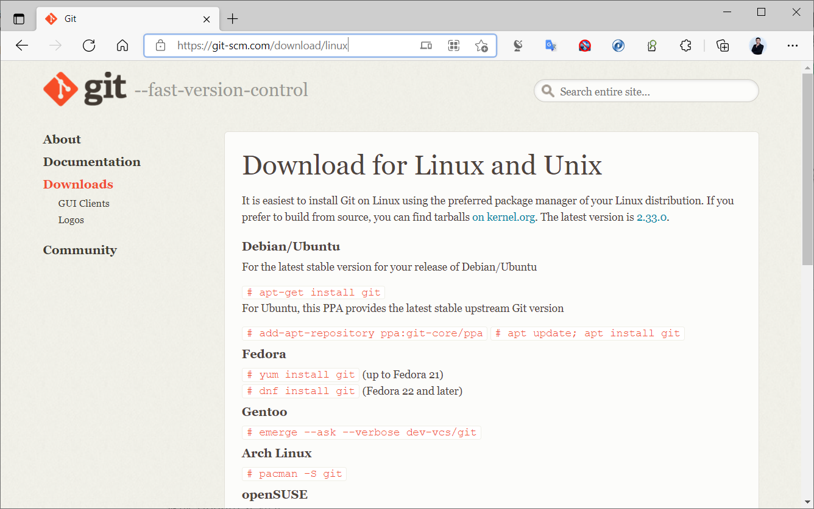

### 使用系统软件包

Ubuntu 和 RHEL 类发行版通常可直接安装 Git；先核对当前系统版本与软件源，再更新索引并安装。

以下是 Ubuntu 24.04 的历史终端输出：

```bash
[root@ubuntu2404 ~]#apt update && apt -y install git
[root@ubuntu2404 ~]#git version
git version 2.43.0
```

```bash
[root@ubuntu2204 ~]#apt update && apt -y install git
[root@ubuntu2204 ~]#git version
git version 2.34.1
[root@ubuntu2004 ~]#apt update && apt -y install git
[root@ubuntu2004 ~]#git version
git version 2.25.1
[root@ubuntu1804 ~]#apt update;apt -y install git
[root@ubuntu1804 ~]#git version
git version 2.17.1
```

范例：旧版 Ubuntu 从第三方 PPA 获取较新 Git。PPA 不等于官方仓库，使用前应确认系统版本仍受支持及软件源可信性。

```bash
[root@ubuntu1804 ~]#apt list  git
Listing... Done
git/bionic-security,bionic-updates 1:2.17.1-1ubuntu0.9 amd64 [upgradable from:
1:2.17.1-1ubuntu0.7]
[root@ubuntu1804 ~]#add-apt-repository ppa:git-core/ppa
[root@ubuntu1804 ~]#apt update
[root@ubuntu1804 ~]#apt list git
Listing... Done
git/bionic 1:2.33.0-0ppa1~ubuntu18.04.1 amd64 [upgradable from: 1:2.17.1-
1ubuntu0.7]
N: There are 3 additional versions. Please use the '-a' switch to see them.
[root@ubuntu1804 ~]#apt -y install  git
[root@ubuntu1804 ~]#git version
git version 2.33.0
```

Rocky Linux 的包管理方式类似，具体版本以系统仓库为准：

```bash
[root@rocky8 ~]#yum -y install git
[root@rocky8 ~]#git version
git version 2.27.0
```

### 源码安装

只有确实需要包管理器尚未提供的版本或编译选项时，才参考 [Git 源码安装说明](https://git-scm.com/book/en/v2/Getting-Started-Installing-Git)。源码安装会增加更新与卸载成本。

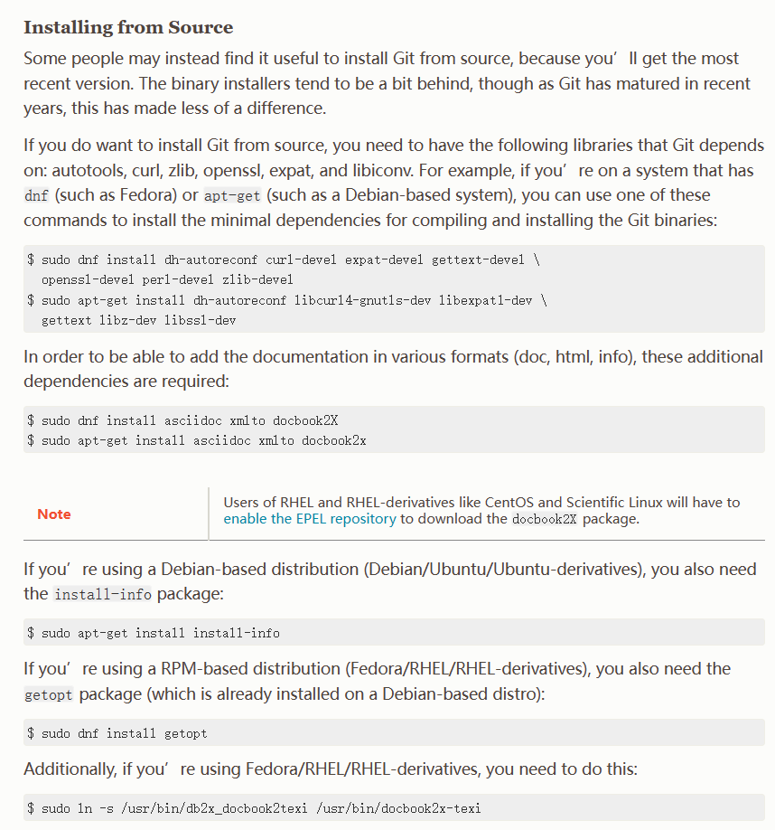

源码应从 [Git 发布页](https://github.com/git/git/releases) 或 [kernel.org](https://www.kernel.org/pub/software/scm/git/) 获取，并核对版本与完整性。

下面两段是旧版 Ubuntu、Rocky 的历史编译记录，只说明依赖安装、构建前缀和 PATH 的关系；其中的镜像仓库、固定 tarball 版本和系统名称都不适合直接复制到新环境。

```bash
[root@ubuntu2204 ~]#apt update && apt -y install gcc make dh-autoreconf libcurl4-gnutls-dev libexpat1-dev
[root@ubuntu2204 ~]#git clone https://gitee.com/lbtooth/git.git
[root@ubuntu2204 ~]#cd git
[root@ubuntu2204 git]#make -j "$(nproc)" prefix=/apps/git all
[root@ubuntu2204 git]#make prefix=/apps/git install
[root@ubuntu2204 git]#echo 'PATH=/apps/git/bin/:$PATH' > /etc/profile.d/git.sh
[root@ubuntu2204 git]#. /etc/profile.d/git.sh
[root@ubuntu2204 ~]#git version
git version 2.39.1.388.g2fc9e9ca3c
```

范例: Rocky 8 编译安装git

```bash
[root@rocky8 ~]#yum -y install gcc make openssl-devel curl-devel expat-devel
[root@rocky8 ~]#wget -P /usr/local/src https://mirrors.edge.kernel.org/pub/software/scm/git/git-2.33.0.tar.gz
[root@rocky8 ~]#cd /usr/local/src
[root@rocky8 src]#tar xf git-2.33.0.tar.gz
[root@rocky8 git-2.33.0]#cd git-2.33.0/
[root@rocky8 git-2.33.0]#cat INSTALL
[root@rocky8 git-2.33.0]#make -j "$(nproc)" prefix=/apps/git all
[root@rocky8 git-2.33.0]#make prefix=/apps/git install
[root@rocky8 git-2.33.0]#echo 'export PATH=/apps/git/bin:$PATH' > /etc/profile.d/git.sh
[root@rocky8 git-2.33.0]#. /etc/profile.d/git.sh
[root@rocky8 git-2.33.0]#git version
git version 2.33.0
```

### Windows 安装 Git

从 [Git for Windows 官方页面](https://git-scm.com/download/win)下载安装包。安装选项应结合团队的默认编辑器、行尾规则和凭据方式选择；不确定时先保留推荐设置，安装后在 PowerShell 或 Git Bash 中执行 `git --version` 验证。

以下截图来自旧版安装向导。第一组展示下载和初始选项；它们只作界面识别，当前版本的选项名称可能不同。


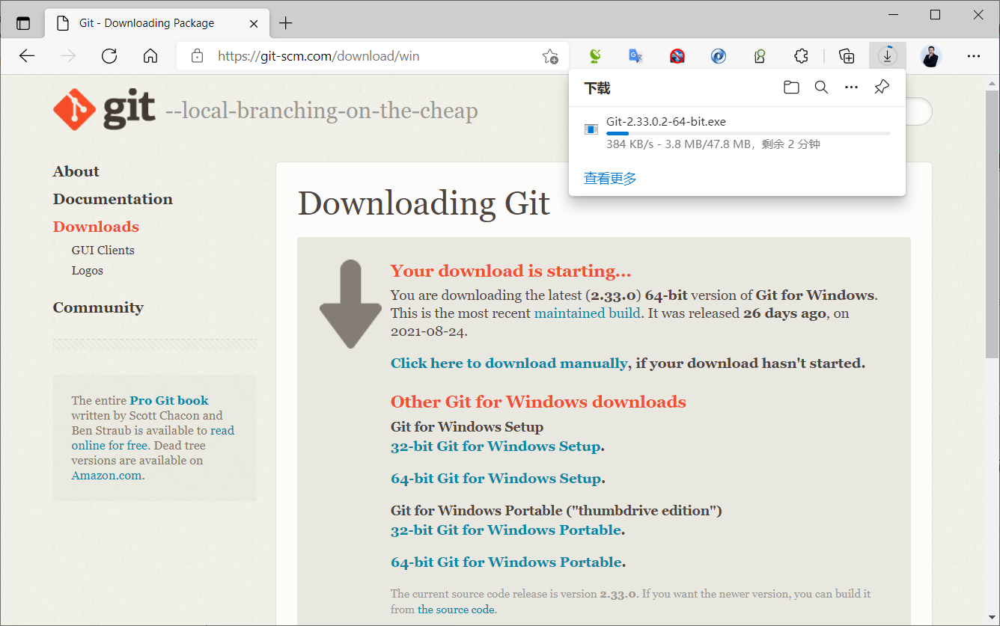

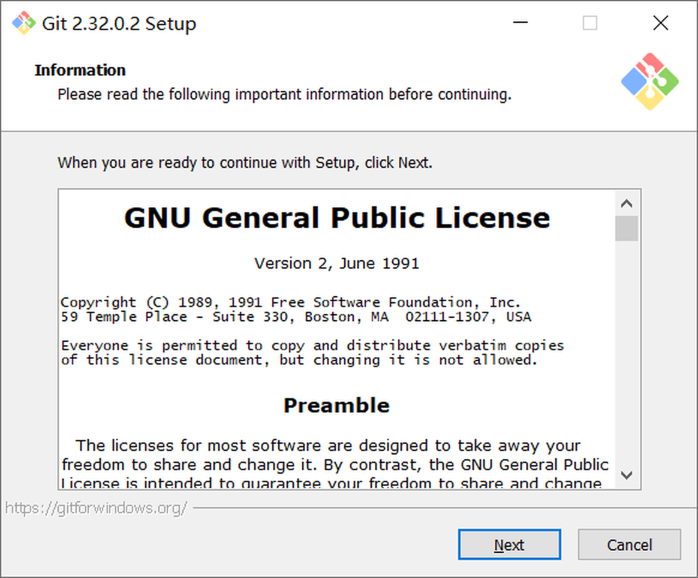

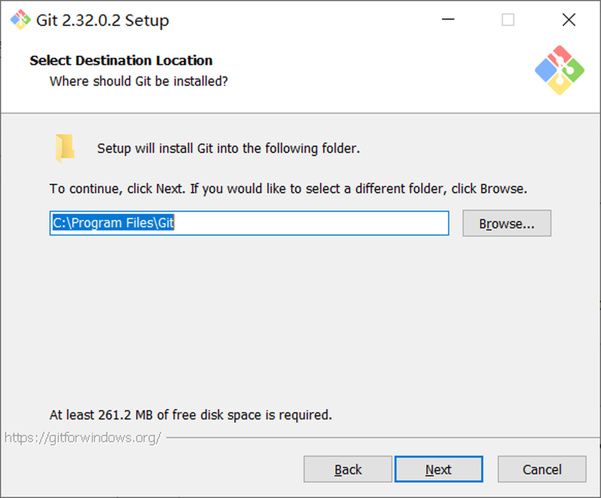

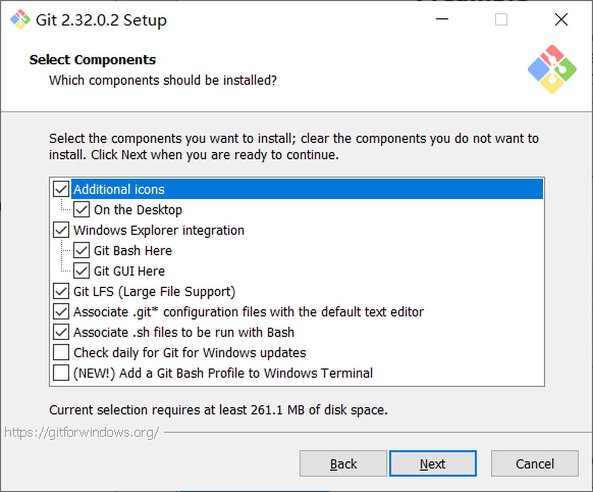


中间几页涉及默认编辑器、PATH 和行尾转换。尤其行尾设置会影响跨 Windows/Linux 协作，应先遵循项目已有的 `.gitattributes` 约定，而不是按旧截图机械点击。

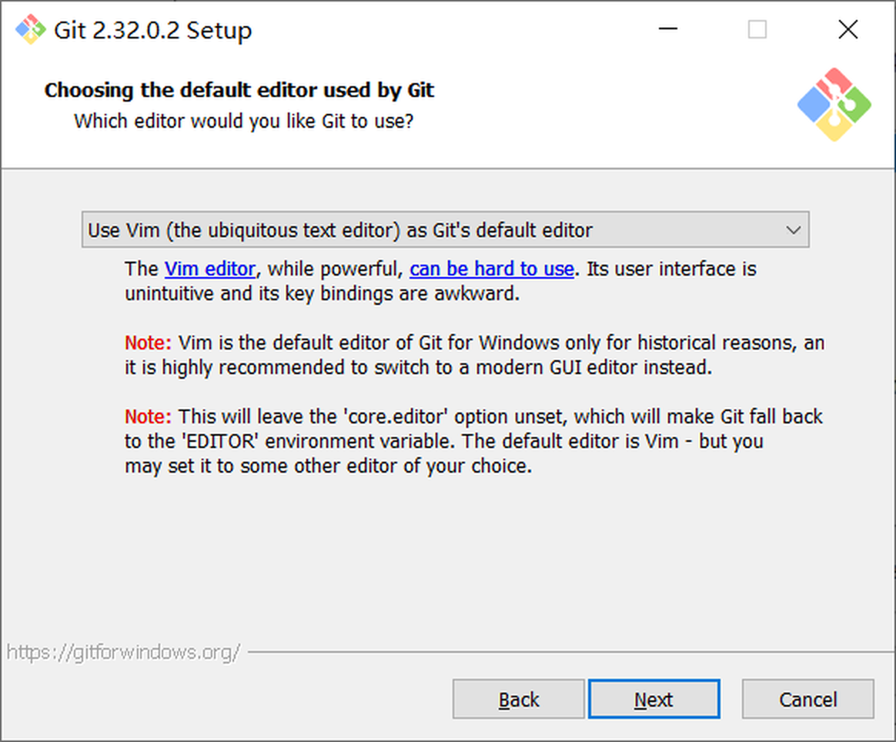

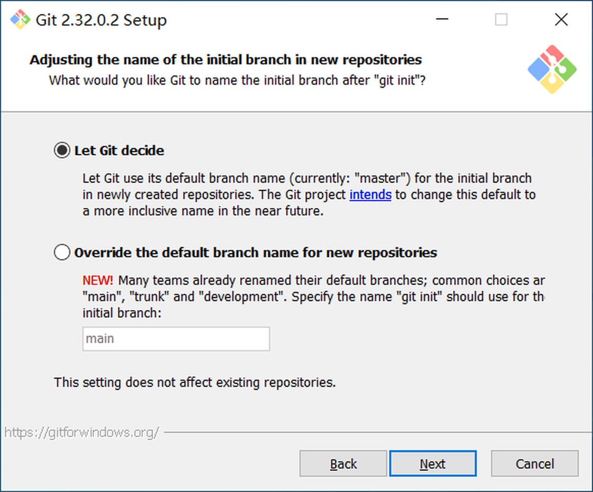

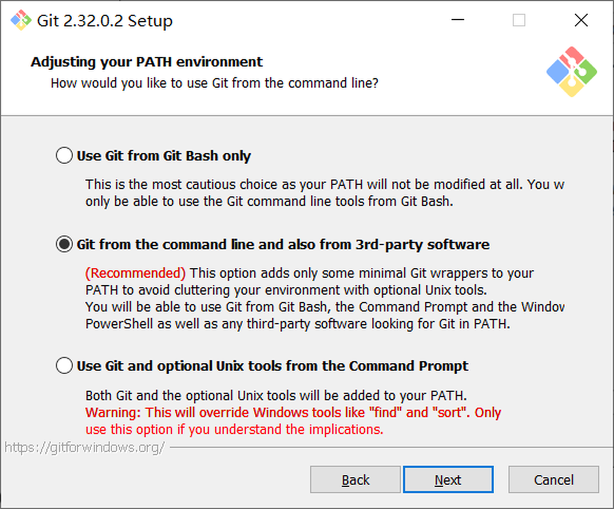

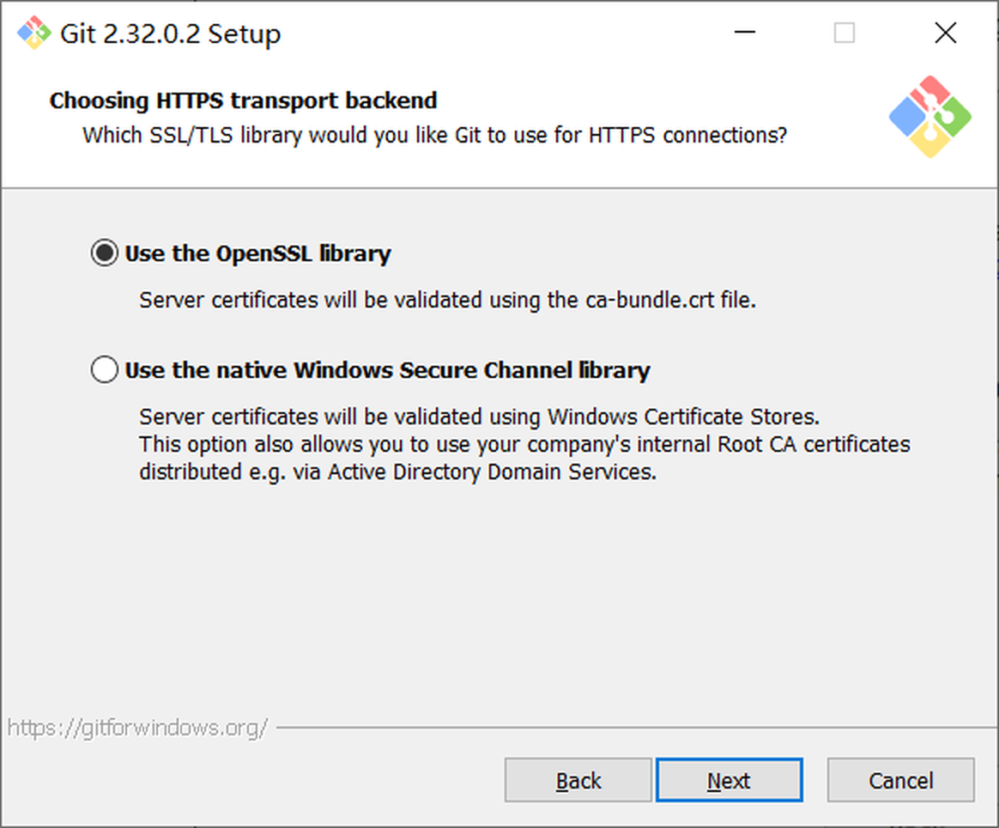

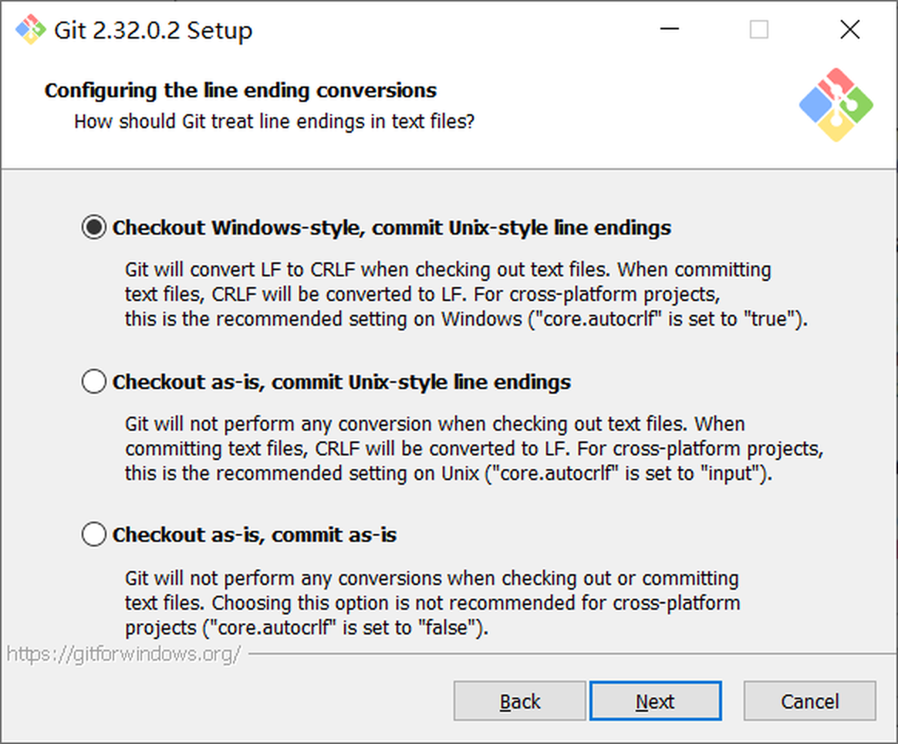

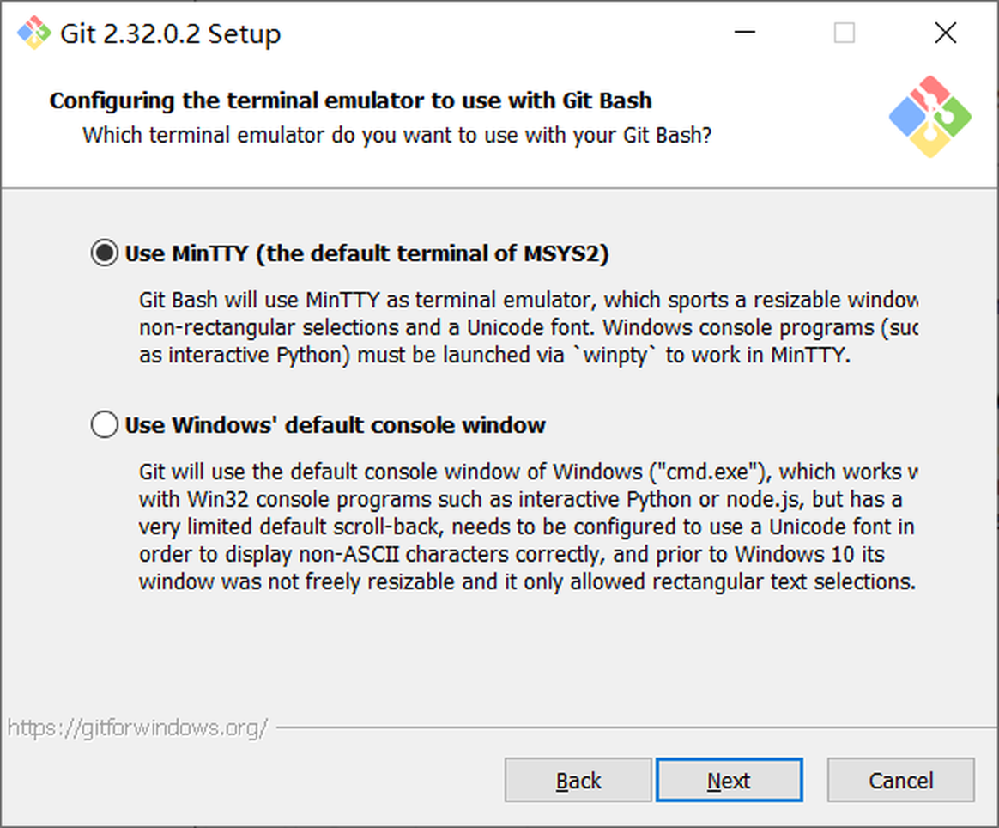

后续截图涉及终端、SSH 与凭据管理。HTTPS 凭据管理器与 SSH 密钥是两种认证路径；安装阶段不需要把访问令牌填进界面或仓库配置。

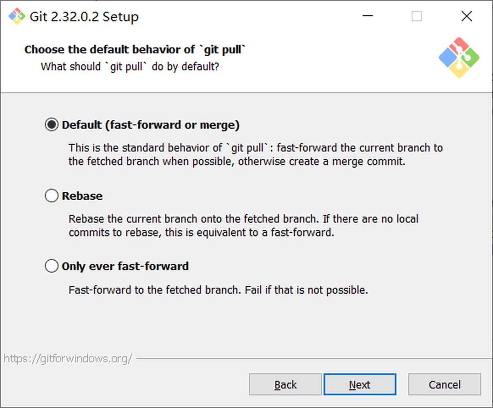


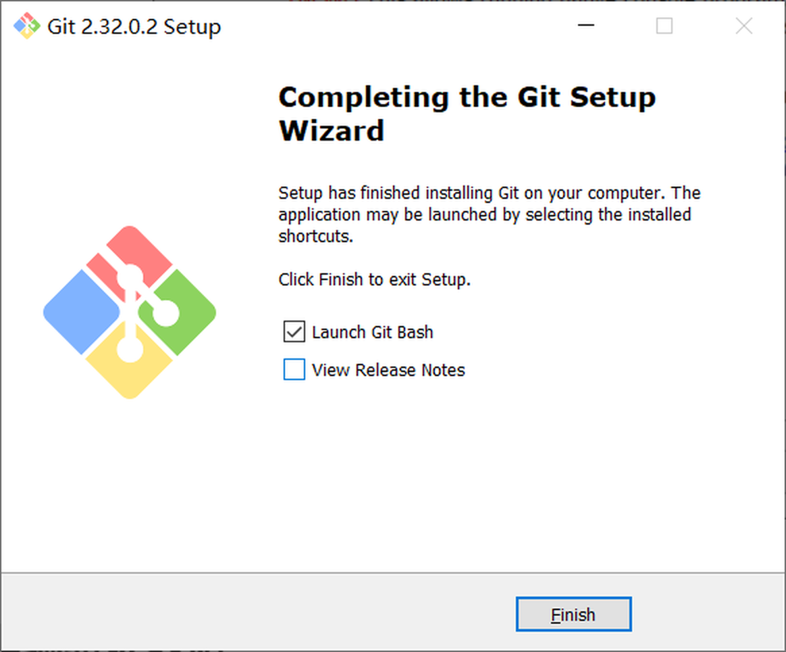


首次提交前配置提交身份：`git config --global user.name "你的姓名"` 和 `git config --global user.email "you@example.com"`。这用于标识提交作者，不等于远程平台的登录凭据。Windows 上若使用凭据管理器保存了 HTTPS 凭据，凭据失效后再更新；SSH 访问则使用密钥，与该 HTTPS 凭据流程不同。

### macOS 安装 Git

参照 [Git 官方 macOS 安装说明](https://git-scm.com/download/mac)选择 Xcode Command Line Tools 或包管理器。安装后同样先执行 `git --version`，再配置提交身份。



<nav class="article-end" aria-label="章节导航">
  <a href="{{ '/subjects/Git-GitLab/07-git-concepts-and-principles.html' | relative_url }}">← 上一篇：Git 相关概念和原理</a>
  <a href="{{ '/subjects/Git-GitLab/' | relative_url }}">返回 Git 与 GitLab 版本控制目录</a>
  <a href="{{ '/subjects/Git-GitLab/09-git-command-syntax.html' | relative_url }}">下一篇：Git 常用语法 →</a>
</nav>
