[← 返回Git 与 GitLab 版本控制目录]({{ '/subjects/Git-GitLab/' | relative_url }})



# 08 Git 安装
### 2.2 Git 安装

### Linux 安装 git

<https://git-scm.com/download/linux>

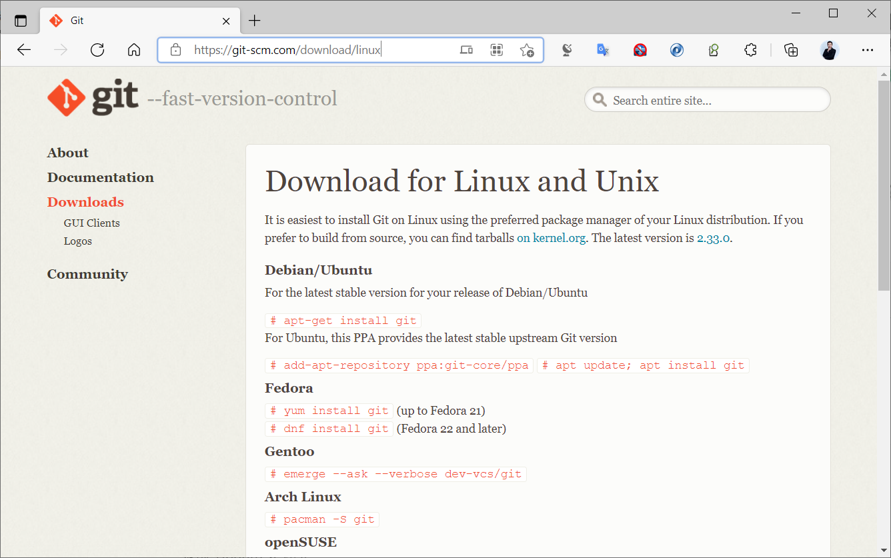

### 二进制包安装

CentOS和Ubuntu 系统源都带有git版本,可以直接安装

范例: Ubuntu 使系统内置仓库安装 git

```bash
[root@ubuntu2404 ~]#apt update && apt -y install git
[root@ubuntu2404 ~]#git version
git version 2.43.0
```

```bash
[root@ubuntu2204 ~]#apt update && apt -y install git
[root@ubuntu2204 ~]#git version
git version 2.34.1
[root@ubuntu2004 ~]#apt update && apt -y install git
[root@ubuntu2004 ~]#git version
git version 2.25.1
[root@ubuntu1804 ~]#apt update;apt -y install git
[root@ubuntu1804 ~]#git version
git version 2.17.1
```

范例: Ubuntu 安装最新版

```bash
[root@ubuntu1804 ~]#apt list  git
Listing... Done
git/bionic-security,bionic-updates 1:2.17.1-1ubuntu0.9 amd64 [upgradable from:
1:2.17.1-1ubuntu0.7]
[root@ubuntu1804 ~]#add-apt-repository ppa:git-core/ppa
[root@ubuntu1804 ~]#apt update
[root@ubuntu1804 ~]#apt list git
Listing... Done
git/bionic 1:2.33.0-0ppa1~ubuntu18.04.1 amd64 [upgradable from: 1:2.17.1-
1ubuntu0.7]
N: There are 3 additional versions. Please use the '-a' switch to see them.
[root@ubuntu1804 ~]#apt -y install  git
[root@ubuntu1804 ~]#git version
git version 2.33.0
```

范例: Rocky安装git

```bash
[root@rocky8 ~]#yum -y install git
[root@rocky8 ~]#git version
git version 2.27.0
```

### 源码安装

安装文档

<https://git-scm.com/book/en/v2/Getting-Started-Installing-Git>

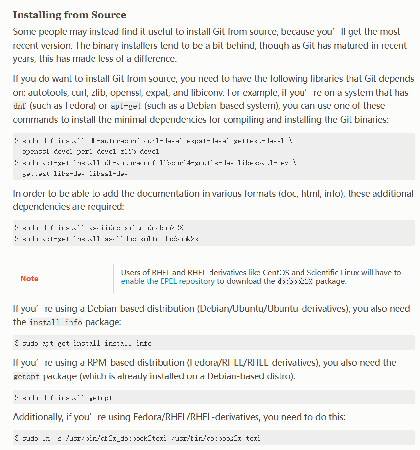

源码下载

<https://www.kernel.org/pub/software/scm/git>

<https://github.com/git/git/releases>

范例：Ubuntu 编译安装 git

```bash
[root@ubuntu2204 ~]#apt update && apt -y install gcc make dh-autoreconf
libcurl4-gnutls-dev libexpat1-dev
[root@ubuntu2204 ~]#git clone https://gitee.com/lbtooth/git.git
[root@ubuntu2204 ~]#cd git
[root@ubuntu2204 git]#make -j `grep -c processor /proc/cpuinfo` prefix=/apps
[root@ubuntu2204 git]#make prefix=/apps/git install
[root@ubuntu2204 git]#echo 'PATH=/apps/git/bin/:$PATH' > /etc/profile.d/git.sh
[root@ubuntu2204 git]#. /etc/profile.d/git.sh
[root@ubuntu2204 ~]#git version
git version 2.39.1.388.g2fc9e9ca3c
```

范例: Rocky 8 编译安装git

```bash
[root@rocky8 ~]#yum -y install gcc make  openssl-devel curl-devel expat-devel
[root@rocky8 ~]#wget -P /usr/local/src
https://github.com/git/git/archive/refs/tags/v2.33.0.tar.gz
[root@rocky8 ~]#wget -P /usr/local/src
https://mirrors.edge.kernel.org/pub/software/scm/git/git-2.33.0.tar.gz
[root@rocky8 ~]#cd /usr/local/src
[root@rocky8 src]#tar xf v2.33.0.tar.gz
[root@rocky8 git-2.33.0]#cd git-2.33.0/
#如果用旧版git,可以执行下面操作
[root@rocky8 ~]#git clone https://gitee.com/lbtooth/git.git
[root@rocky8 ~]#cd git/
[root@rocky8 git-2.33.0]#cat INSTALL
[root@rocky8 git-2.33.0]#make -j `grep -c processor /proc/cpuinfo`
prefix=/apps/git all
[root@rocky8 git-2.33.0]#make prefix=/apps/git install
[root@rocky8 git-2.33.0]#echo 'PATH=/apps/git/bin/:$PATH' >
/etc/profile.d/git.sh
[root@rocky8 git-2.33.0]#. /etc/profile.d/git.sh
[root@rocky8 git-2.33.0]#git version
git version 2.33.0
```

### Windows 安装 git

<https://git-scm.com/downloads>


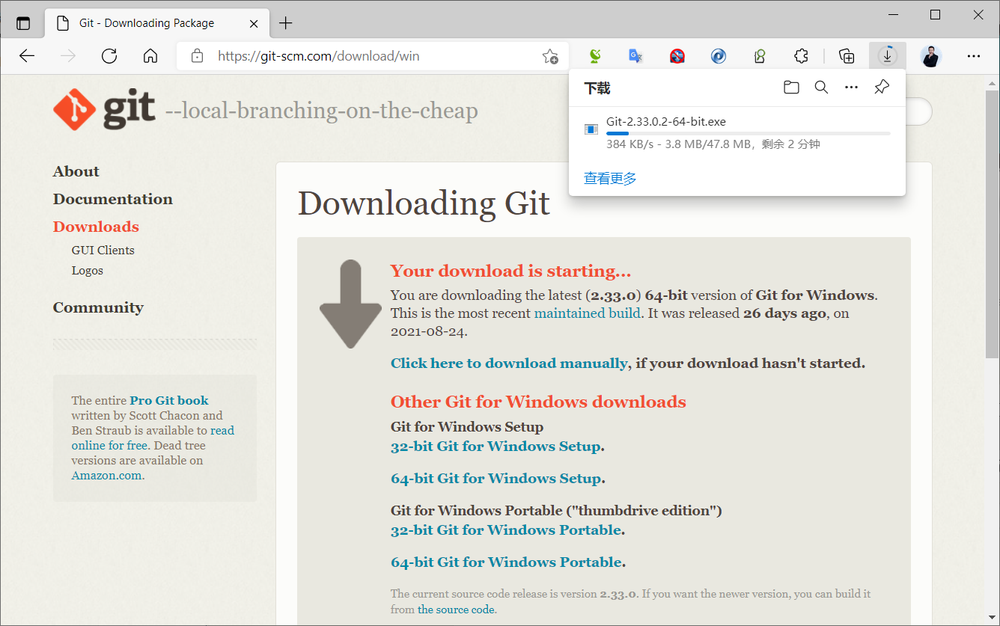


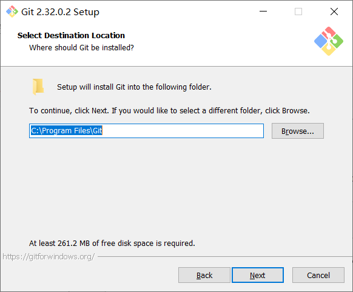

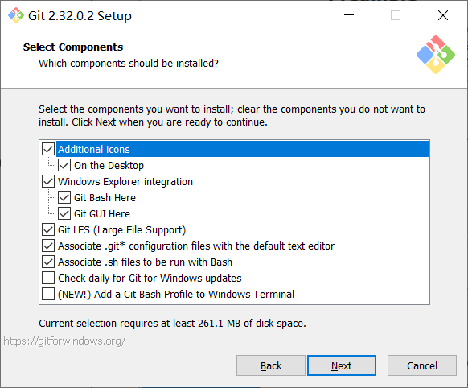


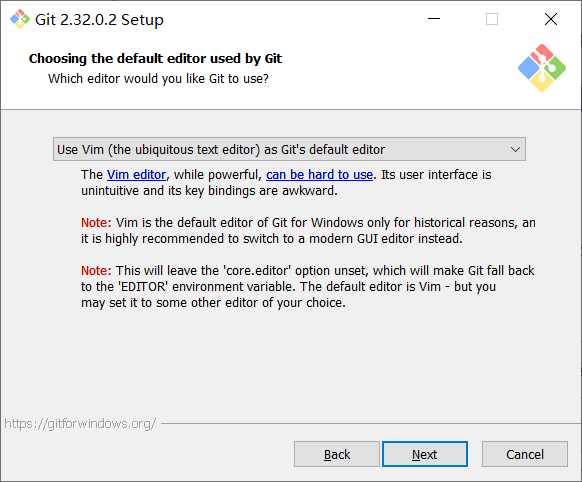

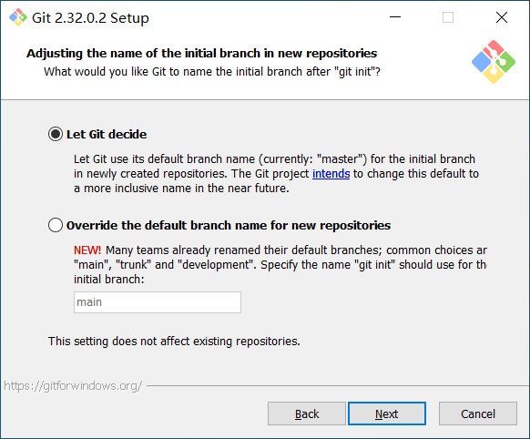

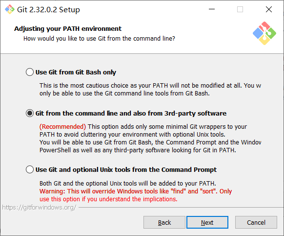

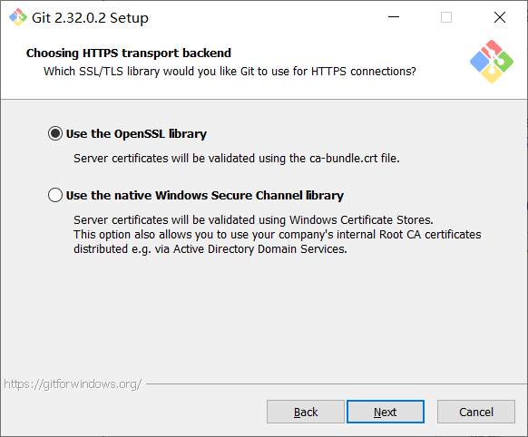


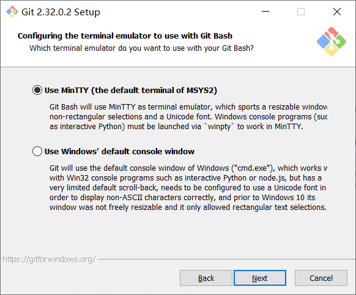

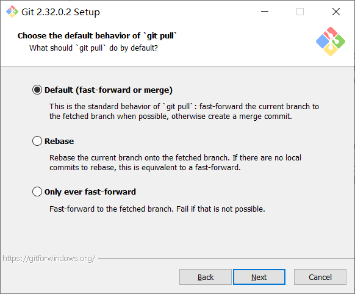


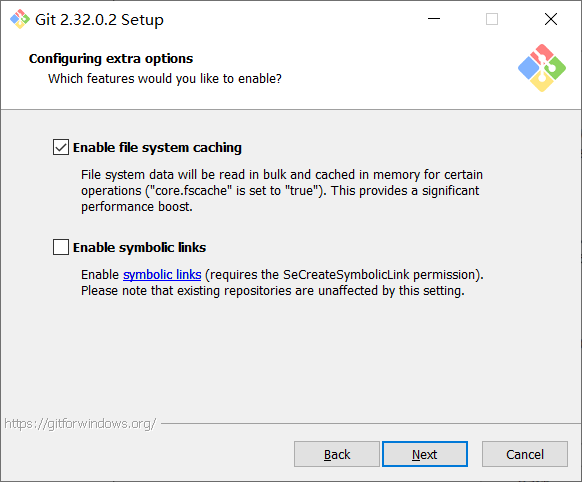

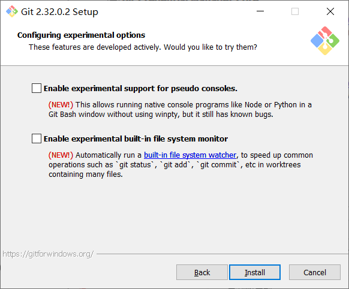

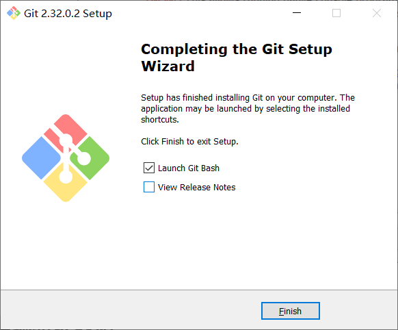

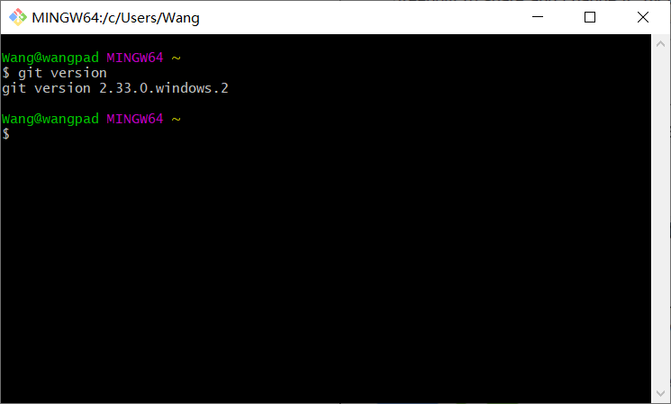

注意:

Windows 版本的 git 在提交前,必须配置邮箱和用户名

git  clone 时提交的用户密码信息会记录在凭据管理器中Windows凭据的普通凭据中,即修改密码后,需要删除凭据中密码

### Mac 安装 git

<https://git-scm.com/download/mac>



<nav class="article-end" aria-label="章节导航">
  <a href="{{ '/subjects/Git-GitLab/07-git-concepts-and-principles.html' | relative_url }}">← Previous: Git Concepts and Principles</a>
  <a href="{{ '/subjects/Git-GitLab/' | relative_url }}">Back to Git and GitLab Version Control Index</a>
  <a href="{{ '/subjects/Git-GitLab/09-git-command-syntax.html' | relative_url }}">Next: Git Command Syntax →</a>
</nav>
