[← 返回Git 与 GitLab 版本控制目录]({{ '/subjects/Git-GitLab/' | relative_url }})



# 09 Git 常用语法

Git 命令应按“检查状态 → 选择变更 → 提交 → 同步”的工作流学习。下面的命令行是可复制的示例，尖括号中的值需要替换；终端输出与操作命令分开展示，避免把提示符和历史输出误当命令执行。更多选项可查阅 [Git 命令文档](https://git-scm.com/docs) 与 [《Pro Git》中文版](https://git-scm.com/book/zh/v2)。

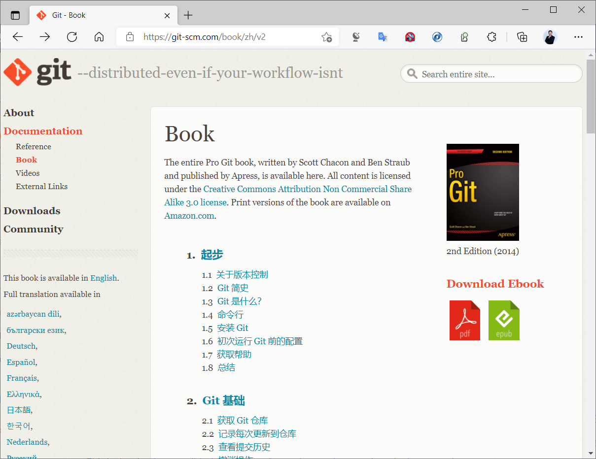

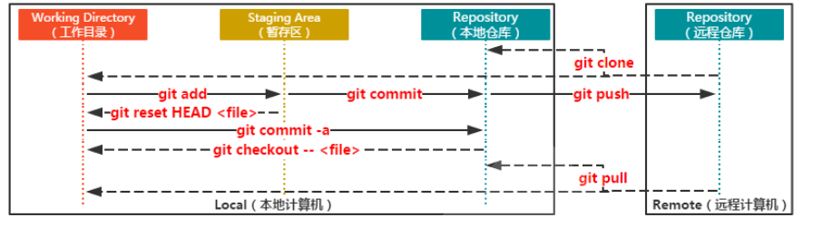

### 建立仓库和提交第一个版本

以下以空目录为例。`user.name` 和 `user.email` 是提交作者信息，不是远端平台的登录凭据；若不想影响其他仓库，可去掉 `--global`，只给当前仓库配置。

```bash
mkdir demo && cd demo
git init -b main
git config user.name "你的姓名"
git config user.email "you@example.com"
printf 'hello\n' > README.md
git status
git add README.md
git diff --staged
git commit -m "添加项目说明"
git log --oneline --graph
```

`git status` 区分未跟踪、未暂存和已暂存文件。`git diff` 查看尚未暂存的差异，`git diff --staged` 检查即将进入下一次提交的内容。`git commit -am` 只自动暂存已跟踪文件的修改与删除，不包括新文件。

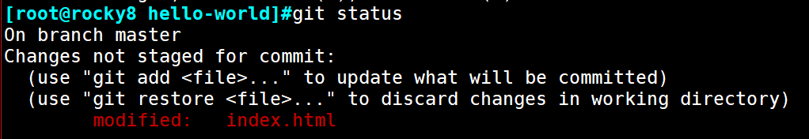

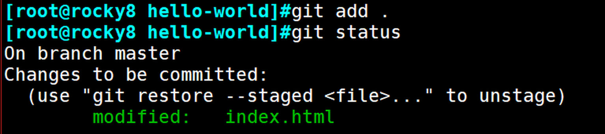

### 查看历史和内部对象

日常追踪可用 `git log --oneline --graph --all`；需要作者与日期时，再选择输出格式：

```bash
git log --graph --pretty=format:'%h %ad %an %s' --date=short
git show HEAD
git ls-files -s
```

上例中 `%h` 是缩短的提交 ID，`%ad` 是作者日期，`%an` 是作者姓名，`%s` 是提交标题。`git ls-files -s` 可看到索引中文件的对象 ID；要查看其类型与内容，可分别执行 `git cat-file -t <对象 ID>`、`git cat-file -p <对象 ID>`。这些命令帮助理解 Git 内部结构，日常提交并不必手动操作 `.git/objects` 文件。

### 忽略不应提交的文件

`.gitignore` 只影响尚未跟踪的匹配文件。项目通常忽略构建产物、编辑器临时文件和本地缓存，但应保留运行所需的配置模板与文档图片。以下只是一份示例，应依据实际项目调整：

```gitignore
/build/
/target/
.idea/
*.swp
*.log
```

将 `.gitignore` 提交到仓库，团队才能共享规则。若文件已被跟踪，添加忽略规则不会使其从历史消失；`git rm --cached <文件>` 仅从索引停止跟踪，工作区文件仍保留。密钥一旦提交，还需撤销或轮换，不能仅靠忽略规则补救。

### 撤销暂存与恢复工作区

```bash
git restore --staged README.md  # 从下一次提交中移除，但保留工作区修改
git restore README.md           # 丢弃已跟踪文件的未暂存修改
git rm README.md                # 删除工作区文件，并暂存删除
git rm --cached README.md       # 停止跟踪，保留工作区文件
```

四行是不同情境的选择，不是需要连续执行的脚本。恢复前先看 `git status` 与差异；`git restore README.md` 会丢弃未暂存的内容。如果删除发生在工作区而暂存区还有文件快照，`git restore <文件>` 可把暂存版本恢复到工作区。

### 理解 reset 与 revert

`git reset` 用于移动当前分支引用，并按模式决定是否同步索引与工作区。它适合调整尚未共享的本地历史；对已推送且他人可能基于其工作的分支，通常应使用 `git revert` 新增抵消提交。

| 命令 | 分支引用 | 暂存区 | 工作区 | 常见用途 |
| --- | --- | --- | --- | --- |
| `git reset --soft HEAD~1` | 回到前一提交 | 保留 | 保留 | 重做最近一次提交说明或内容 |
| `git reset --mixed HEAD~1` | 回到前一提交 | 重置 | 保留 | 将最近一次提交重新拆分暂存；`--mixed` 为默认模式 |
| `git reset --hard HEAD~1` | 回到前一提交 | 重置 | 重置 | 明确放弃未提交修改与本地提交前，确认可恢复路径 |

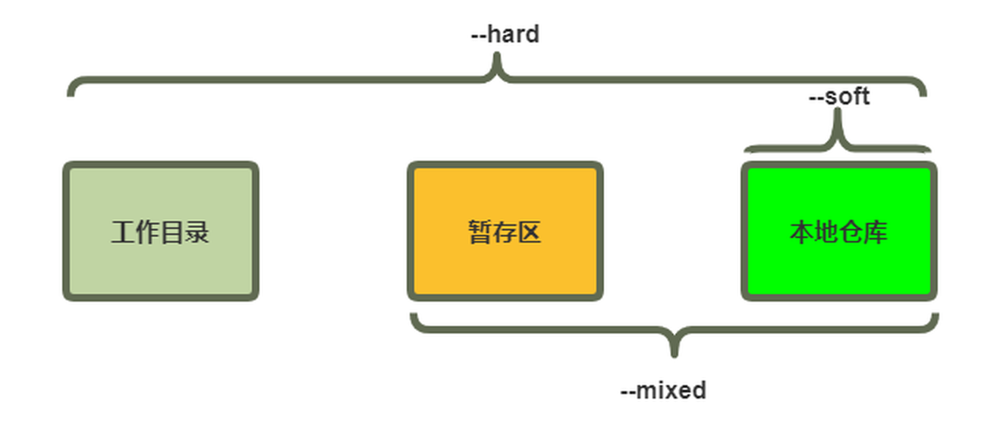

下列原课程图分别展示操作前、`--soft`、`--mixed` 和 `--hard` 的结果。阅读时重点比较分支引用、暂存区与工作区，不要把图中的历史提交 ID 当成自己仓库可用的 ID。

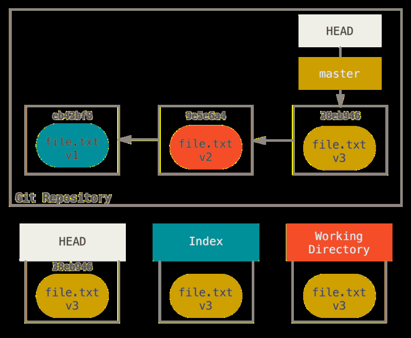

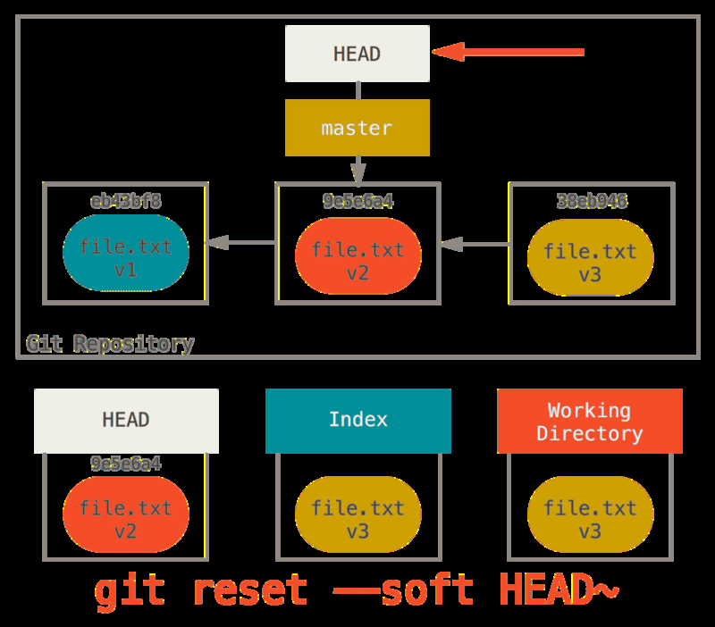

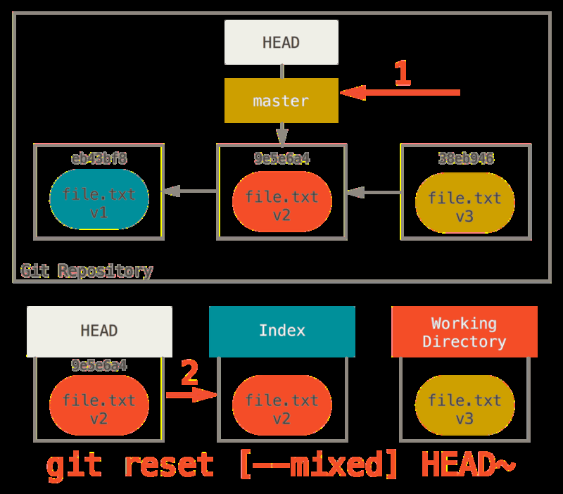

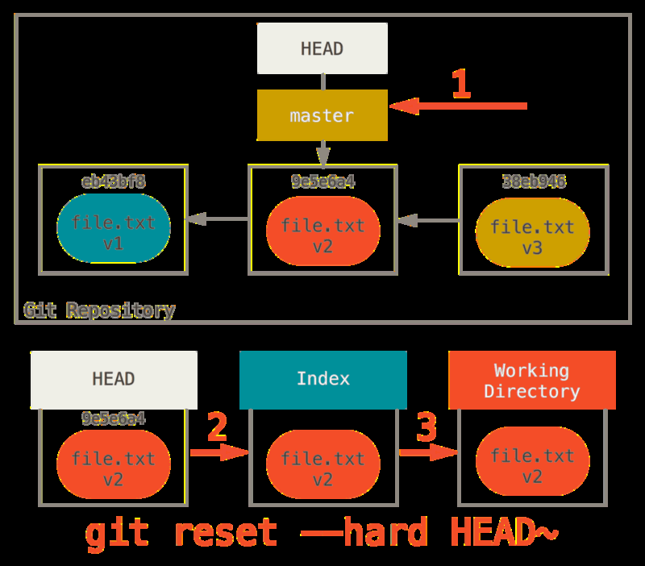

`reset` 不会立刻删除原提交对象，但可能让提交从分支历史中消失。误操作后可先查 `git reflog` 找到旧引用，再决定如何恢复；尚未提交的工作区内容不一定能从 reflog 找回。`--hard` 会覆盖未提交修改，务必先备份或提交有价值内容。

```bash
git status
git log --oneline -5
git reflog -5
```

`git revert <提交 ID>` 对指定提交的改动创建一个新的抵消提交，并保留原历史。它不是“跳回某个版本”：若之后还有其他提交，它们不会自动消失；若改动相互依赖，撤销也可能冲突，需要逐项核验。合并提交还需明确主线父提交，不能照搬普通提交的用法。

```bash
git revert HEAD          # 撤销最近一次提交，打开编辑器填写新提交说明
git revert --no-edit HEAD # 使用默认说明
git push origin main     # 确认撤销结果后再同步共享分支
```

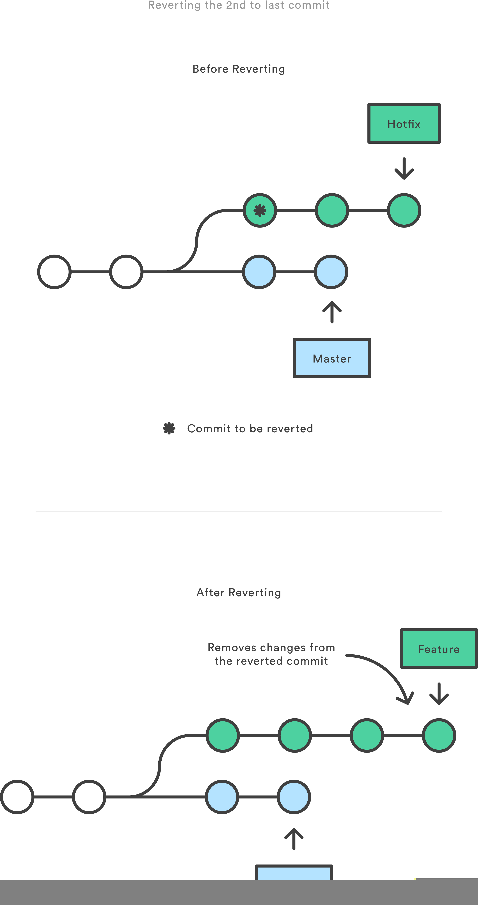


### 创建分支、合并与处理冲突

先提交当前工作，再创建功能分支；下面的两组操作应按实际工作顺序执行，而非与上面的撤销示例连在一起。

```bash
git switch main
git switch -c feature/example
printf 'new feature\n' > feature.txt
git add feature.txt
git commit -m "添加示例功能"
git switch main
git merge feature/example
git branch -d feature/example
```

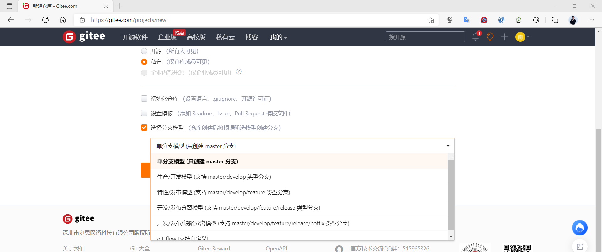

如果两边修改同一位置，`git merge` 可能停在冲突状态。此时用 `git status` 查看文件，编辑冲突标记，保留正确的最终内容，运行测试，再 `git add <文件>` 和 `git commit` 完成合并；放弃这次合并可使用 `git merge --abort`。冲突标记和历史终端输出仅供阅读，不应作为 Shell 命令粘贴。

重命名当前分支可用 `git branch -m <新名称>`。若该分支已推送，重命名还涉及新远端分支的推送、旧远端分支的清理和团队通知，不是只在本地改名即可。

### 标签与旧版本

```bash
git tag -a v1.0.0 -m "首个正式版本"
git show v1.0.0
git push origin v1.0.0
git switch -c maintenance/v1 v1.0.0
```

标签用于定位某个提交；最后一行从标签创建维护分支，避免长期在分离 HEAD 状态下开发。若只想临时查看旧版本，可用 `git show <标签>:<文件>`，无需执行 `git reset --hard <标签>` 改写当前分支。

### 连接远程仓库

在托管平台建立空仓库后，用平台给出的地址替换占位符。若远端已经初始化了 README 或其他提交，应先克隆远端或按团队策略整合历史，而不是盲目推送。

```bash
git remote add origin <远端仓库 URL>
git remote -v
git push -u origin main
git fetch origin
git pull --ff-only origin main
```


`origin` 是远程名称，`main` 是示例分支名，实际值以当前仓库为准。另一个工作目录应通过 `git clone <远端仓库 URL>` 获取项目。HTTPS 认证通常使用平台要求的访问令牌或凭据管理器，SSH 则使用公私钥；不要把令牌写进命令行 URL 或仓库文件。

远程访问失败时，先用 `git remote -v` 核对地址，再检查 DNS、网络连通性和权限。若组织网络必须经代理，使用管理员提供的地址，并在不再需要时撤销设置：

```bash
git config --global http.proxy http://<代理主机>:<端口>
git config --global --get http.proxy
git config --global --unset http.proxy
```

第三方镜像或下载中转站可能不同步，并改变信任边界。私有仓库与安装包优先使用受信任地址，并核验来源。



<nav class="article-end" aria-label="章节导航">
  <a href="{{ '/subjects/Git-GitLab/08-installing-git.html' | relative_url }}">← 上一篇：Git 安装</a>
  <a href="{{ '/subjects/Git-GitLab/' | relative_url }}">返回 Git 与 GitLab 版本控制目录</a>
  <a href="{{ '/subjects/Git-GitLab/10-public-cloud-repositories.html' | relative_url }}">下一篇：公有云仓库 →</a>
</nav>
