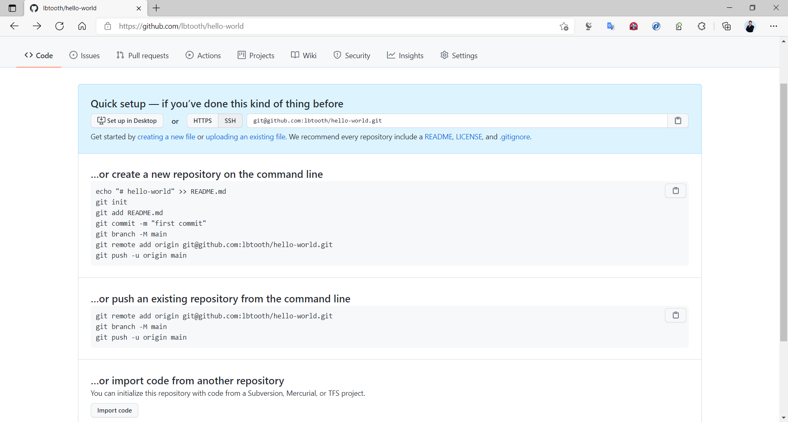
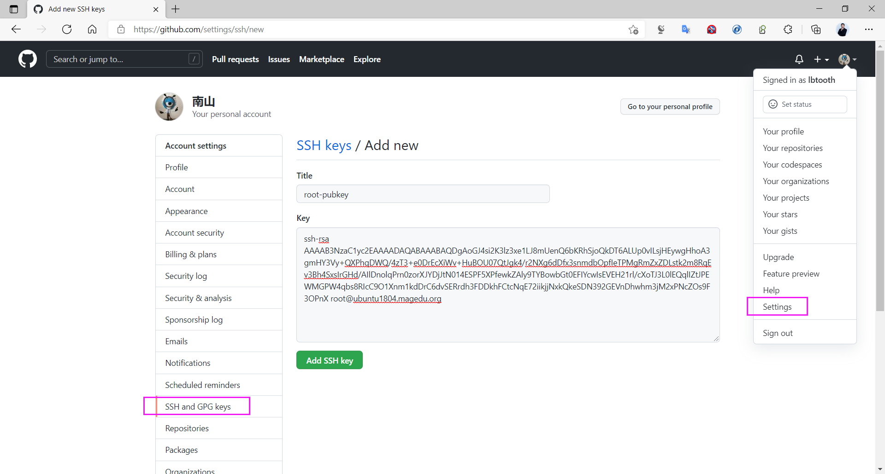
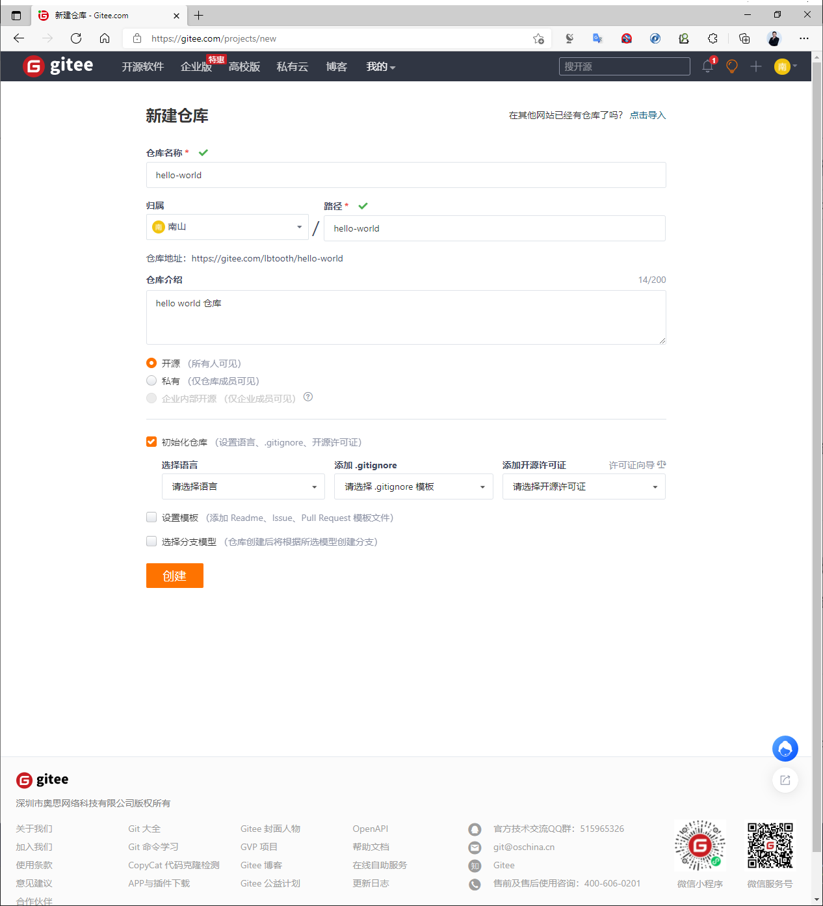
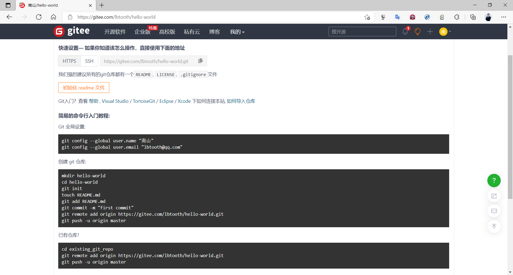

[← 返回Git 与 GitLab 版本控制目录]({{ '/subjects/Git-GitLab/' | relative_url }})



# 10 公有云仓库

本地 Git 仓库可以关联远程仓库以共享提交、开展代码审查并协作开发。远程托管还能保存一份异地副本，但仍需独立备份策略，不能把“已经推送”直接等同于“已经备份”。

“公有云托管”和“仓库是否公开”是两个维度：GitHub、Gitee 等云服务也能托管私有仓库；GitLab 既可自建，也有云端服务。选择时应看访问控制、合规要求、可用性和备份策略。

### 使用 GitHub

平台地址：[GitHub](https://github.com/)。

范例：在平台创建空仓库后，将本地 Git 仓库关联到远程。下方旧终端记录中的仓库地址、主机指纹和 `master` 分支都是历史示例，不应复制为当前值；实际操作先从平台取得仓库地址，并用 `git branch --show-current` 确认分支名。



```bash
[root@gitlab testproject]#git remote add origin git@github.com:lbtooth/hello-world.git
[root@gitlab testproject]#git remote
origin
[root@gitlab testproject]#git remote  -v
origin  git@github.com:lbtooth/hello-world.git (fetch)
origin  git@github.com:lbtooth/hello-world.git (push)
[root@gitlab testproject]#git push -u origin master
The authenticity of host 'github.com (52.74.223.119)' can't be established.
RSA key fingerprint is SHA256:nThbg6kXUpJWGl7E1IGOCspRomTxdCARLviKw6E5SY8.
Are you sure you want to continue connecting (yes/no)? yes
Warning: Permanently added 'github.com,52.74.223.119' (RSA) to the list of known
hosts.
git@github.com: Permission denied (publickey).
fatal: Could not read from remote repository.
Please make sure you have the correct access rights
and the repository exists.
[root@gitlab testproject]#ssh-keygen -t ed25519 -C "you@example.com"
[root@gitlab testproject]#cat ~/.ssh/id_ed25519.pub
ssh-ed25519 AAAA... you@example.com
```



上例首次推送因没有配置可用 SSH 公钥而失败。先通过平台官方渠道核对远程主机指纹，再把生成的**公钥**添加到个人账号；私钥始终留在本机。完成后用实际分支名重新推送，下方输出才代表该次推送成功。

```bash
[root@gitlab testproject]#git push -u origin master
Counting objects: 11, done.
Delta compression using up to 2 threads.
Compressing objects: 100% (5/5), done.
Writing objects: 100% (11/11), 825 bytes | 825.00 KiB/s, done.
Total 11 (delta 0), reused 0 (delta 0)
To github.com:lbtooth/hello-world.git
* [new branch]      master -> master
Branch 'master' set up to track remote branch 'master' from 'origin'.
```

### 使用 Gitee

Gitee 同样提供远程 Git 仓库。创建项目、设置可见性与关联远端的思路与上面一致，具体认证方式与套餐限制以平台当前说明为准。







<nav class="article-end" aria-label="章节导航">
  <a href="{{ '/subjects/Git-GitLab/09-git-command-syntax.html' | relative_url }}">← 上一篇：Git 常用语法</a>
  <a href="{{ '/subjects/Git-GitLab/' | relative_url }}">返回 Git 与 GitLab 版本控制目录</a>
  <a href="{{ '/subjects/Git-GitLab/11-case-study-a-metaverse-startup.html' | relative_url }}">下一篇：综合案例：从个人开发到团队协作 →</a>
</nav>
