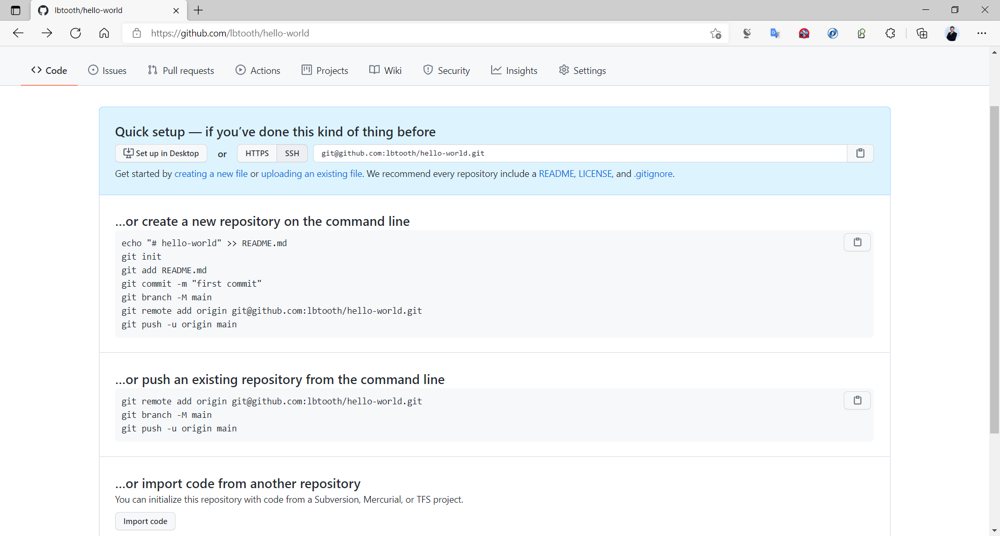
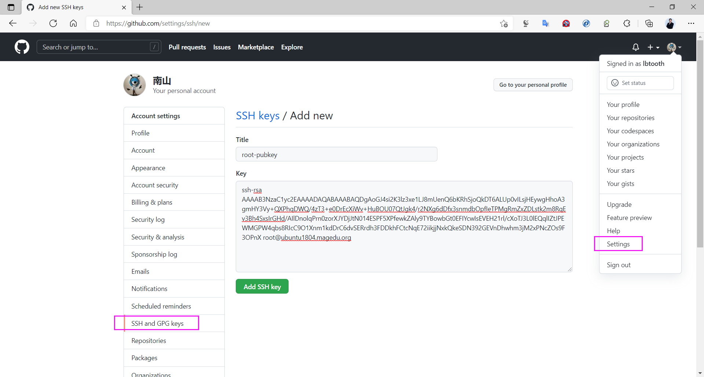
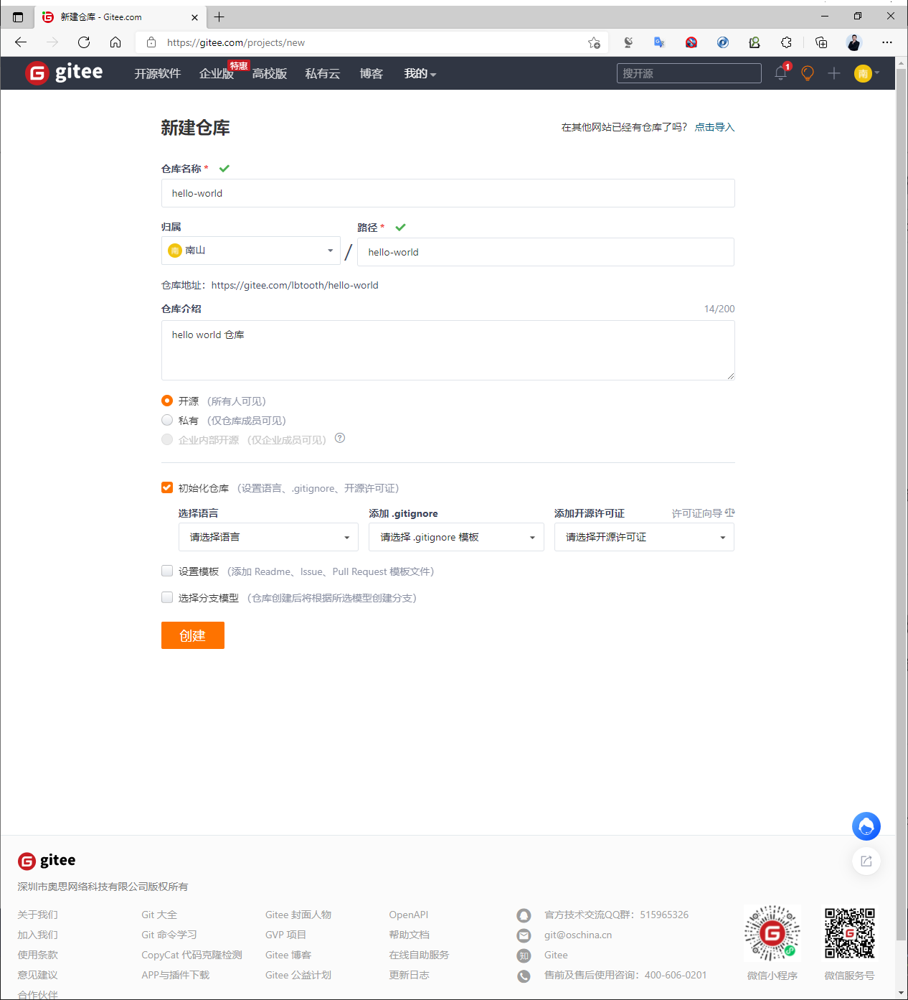
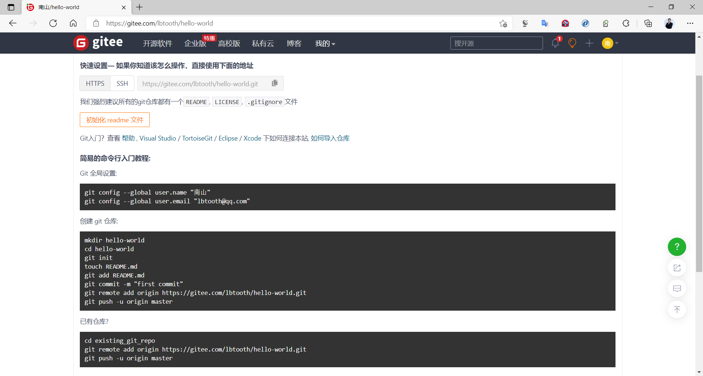

[← 返回Git 与 GitLab 版本控制目录]({{ '/subjects/Git-GitLab/' | relative_url }})



# 10 公有云仓库
### 2.4 公有云仓库

git 创建本地仓库后,可以将本地仓库和远程仓库进行同步.实现网络共享和备份

远程仓库可以分为公有云仓库和私有仓库

公有云仓库: 如github,gitee等,免费给个人或公司用使用,依赖互联网私有仓库: 如gitlab,适合于公司等组织内部网络使用

### 使用 github

<https://github.com/>

范例: 使用 github 创建仓库并将本地仓库上传至远程



```bash
[root@gitlab testproject]#git remote add origin git@github.com:lbtooth/hello-
world.git
[root@gitlab testproject]#git remote
origin
[root@gitlab testproject]#git remote  -v
origin  git@github.com:lbtooth/hello-world.git (fetch)
origin  git@github.com:lbtooth/hello-world.git (push)
[root@gitlab testproject]#git push -u origin master
The authenticity of host 'github.com (52.74.223.119)' can't be established.
RSA key fingerprint is SHA256:nThbg6kXUpJWGl7E1IGOCspRomTxdCARLviKw6E5SY8.
Are you sure you want to continue connecting (yes/no)? yes
Warning: Permanently added 'github.com,52.74.223.119' (RSA) to the list of known
hosts.
git@github.com: Permission denied (publickey).
fatal: Could not read from remote repository.
Please make sure you have the correct access rights
and the repository exists.
[root@gitlab testproject]#git-keygen
[root@gitlab testproject]#cat ~/.ssh/id_rsa.pub
ssh-rsa
AAAAB3NzaC1yc2EAAAADAQABAAABAQDgAoGJ4si2K3lz3xe1LJ8mUenQ6bKRhSjoQkDT6ALUp0vILsjH
EywgHhoA3gmHY3Vy+QXPhqDWQ/4zT3+e0DrEcXiWv+HuBOU07QtJgk4/r2NXg6dDfx3snmdbOpfIeTPM
gRmZxZDLstk2m8RqEv3Bh4SxsIrGHd/AIlDnolqPrn0zorXJYDjJtN014ESPF5XPfewkZAly9TYBowbG
t0EFIYcwIsEVEH21rl/cXoTJ3L0lEQqlIZtJPEWMGPW4qbs8RIcC9O1Xnm1kdDrC6dvSERrdh3FDDkhF
CtcNqE72iikjjNxkQkeSDN392GEVnDhwhm3jM2xPNcZOs9F3OPnX root@ubuntu1804.bowen.org
```



```bash
[root@gitlab testproject]#git push -u origin master
Counting objects: 11, done.
Delta compression using up to 2 threads.
Compressing objects: 100% (5/5), done.
Writing objects: 100% (11/11), 825 bytes | 825.00 KiB/s, done.
Total 11 (delta 0), reused 0 (delta 0)
To github.com:lbtooth/hello-world.git
* [new branch]      master -> master
Branch 'master' set up to track remote branch 'master' from 'origin'.
```

### 使用 gitee

范例: 国内码云创建仓库







<nav class="article-end" aria-label="章节导航">
  <a href="{{ '/subjects/Git-GitLab/09-git-command-syntax.html' | relative_url }}">← Previous: Git Command Syntax</a>
  <a href="{{ '/subjects/Git-GitLab/' | relative_url }}">Back to Git and GitLab Version Control Index</a>
  <a href="{{ '/subjects/Git-GitLab/11-case-study-a-metaverse-startup.html' | relative_url }}">Next: Case Study: A Metaverse Startup →</a>
</nav>
