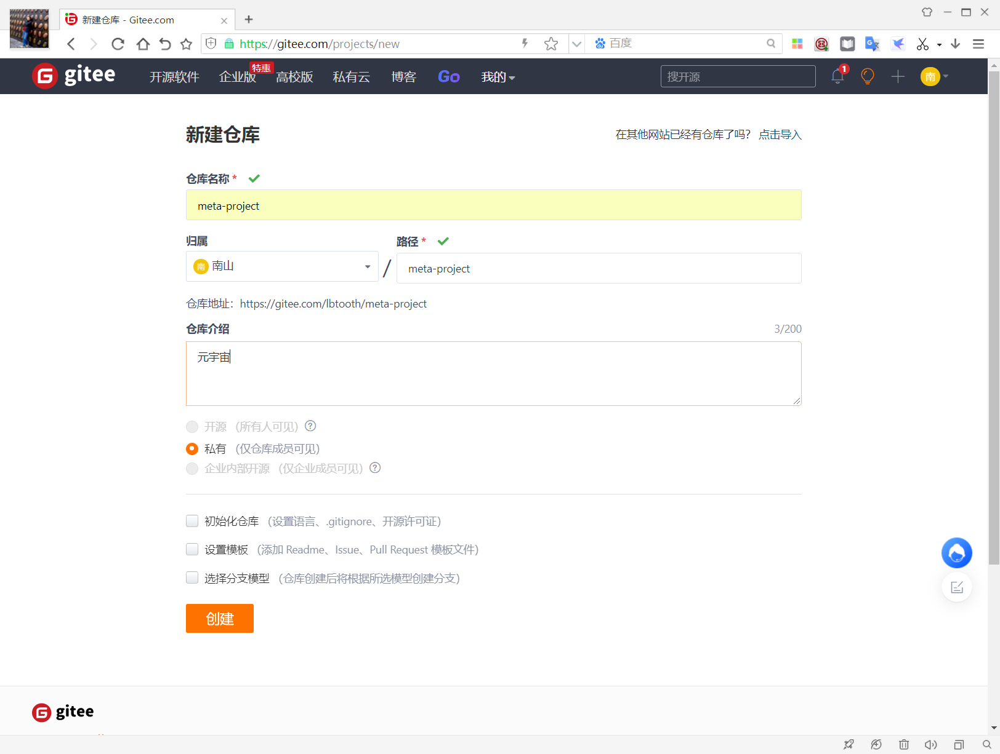
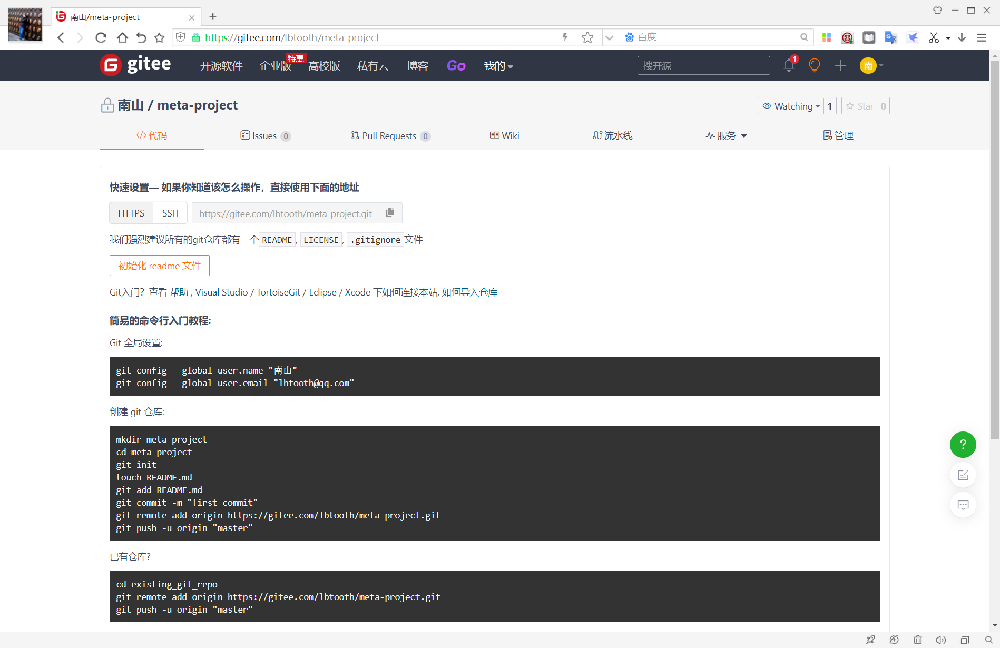
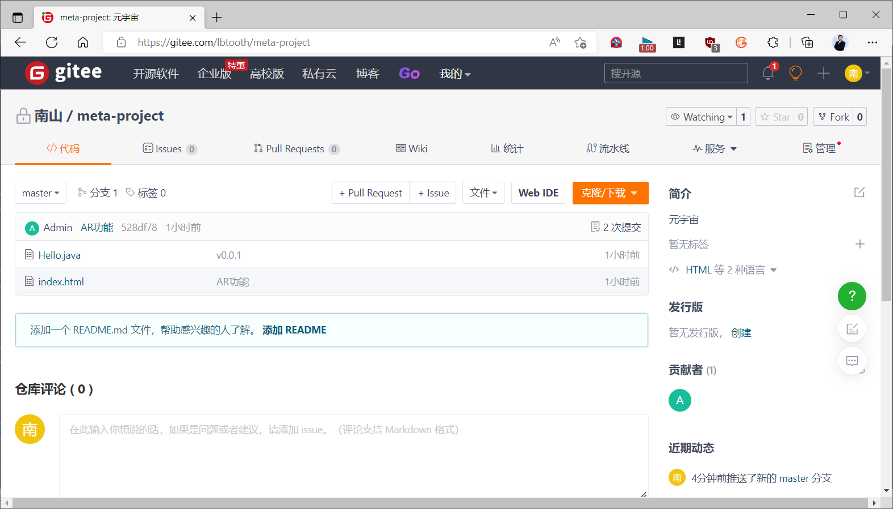

[← 返回Git 与 GitLab 版本控制目录]({{ '/subjects/Git-GitLab/' | relative_url }})



# 11 综合案例：从个人开发到团队协作

本案例沿着“个人提交 → 功能分支 → 远程协作 → 版本发布”展开。命令中的仓库地址、分支名和提交 ID 都是示例；执行前应以当前仓库的 `git status`、`git branch -a` 和 `git remote -v` 为准。

### 起步: 个人小型项目

### 初始化项目

想要让 git 对一个目录进行版本控制需要以下步骤：

```text
#进入要管理的文件夹
cd  /meta-project
#执行初始化命令
git init
#管理目录下的文件状态
vim index.html
git status
#管理指定文件
git add <文件名>
git add .
#个人信息配置：用户名和邮箱,只需配置一次即可
git config --global user.name "bowenxiaochun"
git config --global user.email "bowen@qq.com"
git config --global color.ui true
#提交
git commit -m "项目开发基本功能v0.0.1"
#查看版本记录
git log
git log --oneline
```

```text
#记录图形展示
git log --pretty=oneline --graph --all
git log --graph --pretty=format:"%h %s"
git log --graph --pretty=format:'%h -%d %s (%an, %cd)'
```

### 开发新功能

```text
git add .
git commit -m '添加AR功能'
```

### 版本回退

若新功能尚未推送，可以在实验仓库用 `git reset` 理解分支引用的变化；若已经推送并由团队共享，通常用 `git revert` 新建抵消提交。下面的 `--hard` 会丢弃未提交修改，先确认工作区干净并记录目标提交 ID。

```text
git log                       #查看所有的提交记录
git reflog                    #查看所有的历史提交记录
git reset --hard  <commitID>  #回退到指定的commitID
```

新功能过审后,再回滚至之后版本,即上面'添加AR功能'的版本

```text
git reflog                   #查看所有的历史提交记录
git reset --hard <commitID>  #回退到指定的commitID
```

### 业务增长: 发布特定版本和紧急修复 bug

有一些特定的"轻奢"用户需要特殊的新特性,但对当前版本不希望改变

创建新分支可以给使用者提供多个不同的分支版本，意味着可以把当前工作从主线版本分离开来，以免影响主线版本的开发。

```text
#查看分支和当前分支
git branch
#创建分支
git branch dev
#切换分支
git checkout dev
vim index.html
git add .
git commit -m '添加新特性'
#删除分支
git switch <主分支>  # 先离开要删除的分支
git branch -d dev  # 仅在已合并且不再需要时删除
#将指定分支合并至当前分支,可能产生冲突
git merge <要合并的分支>
git merge dev  #将dev的最新代码合并到当前分支
```

### 加班: 实现多台主机的远程协作开发

项目很成功,赚得了第一桶金,购置了新的公办场地,招聘了多个员工协同开发工作

原有电脑的配置已显不足,为支持更大项目的需要,配置了新电脑,继续开发

同时时间紧张,回家也需要加班开发

### 注册和创建的远程软件仓库

首先，需要注册github或gitee等仓库账号，并创建远程仓库，然后再执行如下命令，将代码上传到仓库

注意: 新建仓库时,选择不初始化仓库





### 将本地仓库同步至远程仓库

```bash
#给远程仓库起别名
git remote add origin <远程仓库地址>
#将当前分支的代码推送至远程
git push -u origin 分支
#推送当前已有项目到gitee仓库
git remote add origin https://gitee.com/lbtooth/meta-project.git
git push -u origin "master"
# 已添加 origin 时不要重复执行 remote add；如需修改地址，用 remote set-url。
[root@ubuntu2004 meta-project]#git remote set-url origin https://gitee.com/lbtooth/meta-project.git
#查看关联
[root@ubuntu2004 meta-project]#git remote
origin
[root@ubuntu2004 meta-project]#git remote -v
origin  https://gitee.com/lbtooth/meta-project.git (fetch)
origin  https://gitee.com/lbtooth/meta-project.git (push)
#推送所有分支到远程仓库
[root@ubuntu2004 meta-project]#git push -u origin --all
Username for 'https://gitee.com': lbtooth
Password for 'https://lbtooth@gitee.com':
Total 0 (delta 0), reused 0 (delta 0)
remote: Powered by GITEE.COM [GNK-6.3]
remote: Create a pull request for 'debug' on Gitee by visiting:
remote:     https://gitee.com/lbtooth/meta-
project/pull/new/lbtooth:debug...lbtooth:master
To https://gitee.com/lbtooth/meta-project.git
* [new branch]      debug -> debug
Branch 'dev' set up to track remote branch 'dev' from 'origin'.
Branch 'master' set up to track remote branch 'master' from 'origin'.
#或者只推送dev分支
[root@ubuntu2004 meta-project]#git checkout dev
[root@ubuntu2004 meta-project]#git push origin dev
```

查看gitee网站可以看到仓库有文件上传成功



### 在新电脑初次使用下载远程仓库的代码并继续开发

```text
#克隆远程仓库代码,自动实现实现git remote add origin 远程仓库地址
git clone <远程仓库地址>
#切换分支
git checkout 分支
#在公司下载完代码后，继续开发,切换到dev分支进行开发
git checkout dev
#把master分支合并到dev
git merge master
#修改代码
git add .
#提交代码
git commit -m '继续开发新功能'
git push origin dev
```

示例: 新电脑同步远程仓库到本地

```bash
#公有仓库直接下载即可
[root@ubuntu2004 ~]#git clone https://gitee.com/lbtooth/meta-project.git
# 私有仓库通过凭据管理器、交互式令牌或 SSH 密钥认证；不要把密码写进 URL。
#确认分支
[root@ubuntu2004 meta-project]#git branch
* master
[root@ubuntu2004 meta-project]#git switch --track origin/dev
# 已有本地 dev 后再拉取后续更新
[root@ubuntu2004 meta-project]#git pull --ff-only origin dev
#确认新代码已经同步到本机
[root@ubuntu2004 meta-project]#cat index.html
#个人信息配置：用户名和邮箱,只需配置一次即可
[root@ubuntu2004 meta-project]#git config --global user.email "bowen@qq.com"
[root@ubuntu2004 meta-project]#git config --global user.name "bowen"
[root@ubuntu2004 meta-project]#git config --global color.ui true
#继续提交
[root@ubuntu2004 meta-project]#vim index.html
[root@ubuntu2004 meta-project]#git add .
[root@ubuntu2004 meta-project]#git commit -m '继续开发新功能'
#同步到远程仓库
[root@ubuntu2004 meta-project]#git push origin dev
Username for 'https://gitee.com': lbtooth
Password for 'https://lbtooth@gitee.com':
Enumerating objects: 5, done.
Counting objects: 100% (5/5), done.
Delta compression using up to 2 threads
Compressing objects: 100% (3/3), done.
Writing objects: 100% (3/3), 361 bytes | 361.00 KiB/s, done.
Total 3 (delta 0), reused 0 (delta 0)
remote: Powered by GITEE.COM [GNK-6.3]
To https://gitee.com/lbtooth/meta-project.git
6be3e4d..43b9a43  dev -> dev
```

### 下班回到家继续加班

```text
#切换到dev分支进行开发
git checkout dev
#拉取最新代码
git pull origin dev
#等价于
git fetch origin dev
git merge origin/dev
#继续开发
git add .
#提交代码
git commit -m '在家加班'
#推送至远程
git push origin dev
```

### 到公司继续开发

```text
#切换到dev分支进行开发
git checkout dev
#拉最新代码,不必再clone，只需要通过pull获取最新代码即可
git pull origin dev
#继续开发.提交代码
git add .
git commit -m '上班工作'
#推送代码到仓库
git push origin dev
```

### 开发完毕，要上线

```text
#将dev分支合并到master，进行上线
git checkout master
git merge dev
git push origin master
#把dev分支也推送到远程
git checkout dev
git merge master
git push origin dev
```

### 免密码登录

通过 HTTPS 可使用平台支持的凭据管理器保存访问令牌；不要把用户名、密码或令牌嵌入远程 URL，因为它们可能进入 `.git/config`、终端历史和日志。远程 URL 保持普通仓库地址即可。

SSH 实现

```text
#生成公钥和私钥(默认放在 ~/.ssh目录下，id_rsa.pub公钥、id_rsa私钥）
ssh-keygen -t ed25519 -C "you@example.com"
#拷贝公钥的内容，并设置到gitee或github中
cat ~/.ssh/id_ed25519.pub
#在git本地中配置ssh地址
git remote set-url origin git@gitee.com:lbtooth/meta-project.git
#以后使用以下即可
git push origin master
```

### 多版本管理：标签管理

虽然每次commit,都会生成一个commit id,但此方式无疑是不方便标记和记忆的

git标签就是对指定的commit的一次快照，相当于给commit ID起了一个容易记忆的名称,可以做为进度的里程碑的标记

git tag 便于后续将特定时期的代码快速取出。

在代码发布时可以使用标签发布。

```text
#对当前最新提交的代码创建标签，-a标签名称，-m标签描述
git tag -a "v2.0" -m "新版本2.0"
#创建标签，指定commit ID
git log #查看Commit ID
git tag -a "v1.0" <Commit ID> -m "正式版本1.0"
#查看标签详情
git tag
git tag -l
#同步所有标签到远程仓库
git push origin --tags
```

范例:

```bash
#当前状态创建tag
[root@ubuntu2004 meta-project]#git tag -a "v1.0" -m "正式版本1.0"
#查看tag信息
[root@ubuntu2004 meta-project]#git show v1.0
tag v1.0
Tagger: bowen <bowen@qq.com>
Date:   Tue Jul 19 10:01:29 2022 +0000
正式版本1.0
commit 61a19a66264171fb73600166384ea828e00a5818 (HEAD -> master, tag: v1.0,
origin/master)
Author: bowen <bowen@qq.com>
Date:   Tue Jul 19 09:18:38 2022 +0000
删除Hello.java
diff --git a/Hello.java b/Hello.java
deleted file mode 100644
index 110b1e6..0000000
--- a/Hello.java
+++ /dev/null
@@ -1 +0,0 @@
-Hello v1.0
```

```bash
#查看commit ID
[root@ubuntu2004 meta-project]#git log
[root@ubuntu2004 meta-project]#git reflog
#为指定commit id创建tag
[root@ubuntu2004 meta-project]#git tag -a 'v0.0.1' d9c6b575702441fd -m '初始发布'
#同步所有tag到远程仓库
[root@ubuntu2004 meta-project]#git push origin --tags
#拉取所有远程仓库的tag
[root@ubuntu2004 meta-project]#git fetch origin --tags
```



<nav class="article-end" aria-label="章节导航">
  <a href="{{ '/subjects/Git-GitLab/10-public-cloud-repositories.html' | relative_url }}">← 上一篇：公有云仓库</a>
  <a href="{{ '/subjects/Git-GitLab/' | relative_url }}">返回 Git 与 GitLab 版本控制目录</a>
  <a href="{{ '/subjects/Git-GitLab/12-introduction-to-gitlab.html' | relative_url }}">下一篇：GitLab 介绍 →</a>
</nav>
