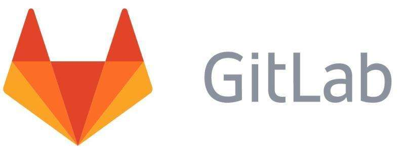
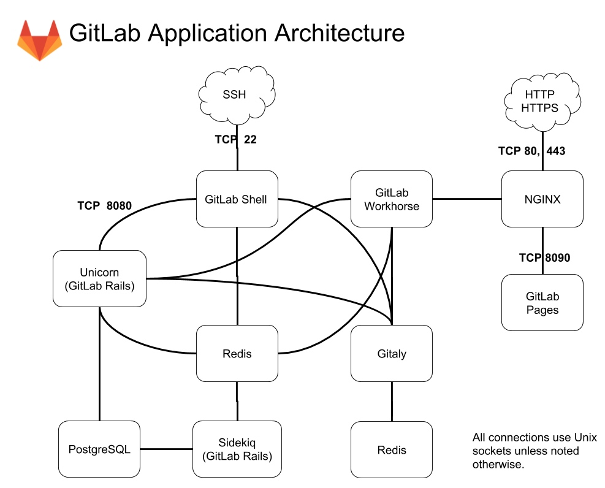

[← Back to Git and GitLab Version Control Index]({{ '/subjects/Git-GitLab/' | relative_url }})



# 12 Introduction to GitLab
## 3 私有软件仓库 GitLab

### 3.1 GitLab 介绍

### Gitlab 介绍

GitLab 是一个基于Ruby on Rails构建用于仓库管理系统的开源项目，使用Git作为代码管理工具，提供了Web界面进行访问公开的或者私有的项目

GitLab 特性

开源免费可以作为 Git 代码仓库提供了方便易用的 Web 管理界面支持多租户功能丰富支持离线提交安全性高, 可以对不同的用户设置不同的权限,并且支持不同用户只能访问特定的代码,实现代码部分可见

### GitLab 架构

Gitlab 是一个由很多应用组成复杂的系统

<https://panlw.github.io/15365441001781.html>

Gitlab的服务构成

Nginx：静态web服务器 GitLab shell：用于处理基于ssh会话的Git命令和修改authorized keys列表 gitlab-workhorse：轻量级的反向代理服务器,它旨在充当智能反向代理，以帮助整个 GitLab 加速 unicorn：An HTTP server for Rack applications, GitLab Rails应用是托管在这个服务器上面的 Gitaly：Git RPC service for handing all Git calls made by GitLab Puma (GitLab Rails)：处理发往Web接口和API的请求 postgresql：数据库 redis：缓存数据库 sidekiq：用于在后台执行队列任务（异步执行) GitLab Exporter：GitLab指标暴露器 Node Exporter：节点指标暴露器 GitLab self-monitoring的多个组件：Prometheus、Alertmanager、Grafana、Sentry和Jaeger Inbound emails（SMPT）：接收用于更新issue的邮件 Outbound email (SMTP)：向用户发送邮件通知 LDAP Authentication：LDAP认证集成 MinIO：对象存储服务 Registry：容器注册表，支持Image的push和pull操作 Runner：执行GitLab的CI/CD作业

Omnibus GitLab

由于Gitlab 组件众多,各个组件的分别管理配置过于复杂,所以官方提供了 Omnibus GitLab 项目实现方便的管理

Omnibus GitLab是基于Chef的应用编排工具，它基于Chef的cookbooks和recipes等组件自动化编排 GitLab的各组件，避免了用户复杂的配置过程

相关项目 https://gitlab.com/gitlab-org/omnibus-gitlab Omnibus GitLab architecture and components: https://docs.gitlab.com/omnibus/architecture/

管理各组件使用统一命令为gitlab-ctl，例如gitlab-ctl reconfigure或gitlab-ctl restart等能统—执行各组件的重新配置及重启操作

此外还有一些各组件专用的命令，如:gitlab-backup,gitlab-pgsql,gitlab-rails和gitlab-rake等

提供统一配置模板文件, 用于为GitLab中的每个组件提供配置信息

在配置模板文件中对于每个组件配置参数格式为: ['']=



<nav class="article-end" aria-label="章节导航">
  <a href="{{ '/subjects/Git-GitLab/11-case-study-a-metaverse-startup.html' | relative_url }}">← Previous: Case Study: A Metaverse Startup</a>
  <a href="{{ '/subjects/Git-GitLab/' | relative_url }}">Back to Git and GitLab Version Control Index</a>
  <a href="{{ '/subjects/Git-GitLab/13-installing-gitlab.html' | relative_url }}">Next: Installing GitLab →</a>
</nav>
