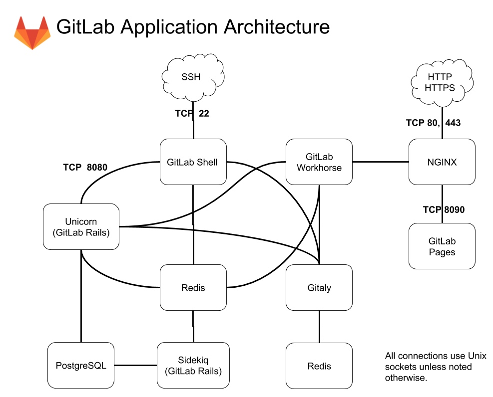

[← 返回Git 与 GitLab 版本控制目录]({{ '/subjects/Git-GitLab/' | relative_url }})



# 12 GitLab 介绍

Git 是分布式版本控制工具；GitLab 是围绕 Git 仓库提供协作、权限管理与 CI/CD 等能力的平台。它可以自建，也可以使用托管服务，不能把两者混为一谈。

### GitLab 能提供什么

GitLab 提供仓库托管、合并请求、问题跟踪、权限控制和流水线等功能。可用能力取决于部署方式与许可证。离线提交是 Git 本身的能力，不是 GitLab 赋予的；权限通常按实例、组和项目配置，不能保证用户“只看到仓库中的部分代码”。

### GitLab 架构

GitLab 自建部署包含 Web/API、Git 数据访问、数据库、后台任务和可选的监控、邮件、容器镜像仓库等组件。理解它们的职责有助于排查服务故障，不必把每个组件都视为必装。

下图是组件关系示意，不代表每个版本都默认启用全部服务。

| 组件 | 主要职责 |
| --- | --- |
| NGINX / Workhorse | 接收 HTTP 请求并将其分发给应用服务，处理部分大文件传输。 |
| Rails / Puma | 处理 Web 界面和 API；旧资料中的 Unicorn 不代表当前版本默认架构。 |
| Gitaly / GitLab Shell | 分别提供 Git 仓库访问服务和 SSH 访问入口。 |
| PostgreSQL / Redis / Sidekiq | 保存持久化数据、提供缓存与队列支持、执行后台任务。 |
| Registry / Runner | 可选的容器镜像仓库，以及执行 CI/CD 作业的独立 Runner。 |
| 邮件、LDAP、监控组件 | 按需求配置的通知、身份认证和可观测能力。 |

### Linux 软件包如何组织组件

Linux 软件包（旧称 Omnibus）把多项服务及其管理入口集成在一个安装方案中，降低单机自建部署的初始配置成本，但仍需规划容量、备份和升级。具体组件以安装版本的 [官方架构文档](https://docs.gitlab.com/administration/architecture/) 为准。

`gitlab-ctl reconfigure` 应用配置，`gitlab-ctl status` 查看服务；`gitlab-backup` 和 `gitlab-rake` 等工具承担专门任务。它们的可用参数与服务组合随版本变化，执行前应核对当前实例文档。

自建 Omnibus 安装通常通过 `/etc/gitlab/gitlab.rb` 设置参数，例如 `external_url 'https://gitlab.example.com'`；修改后运行 `gitlab-ctl reconfigure` 使配置生效。具体参数名称应以安装版本的官方文档为准。



<nav class="article-end" aria-label="章节导航">
  <a href="{{ '/subjects/Git-GitLab/11-case-study-a-metaverse-startup.html' | relative_url }}">← 上一篇：综合案例：从个人开发到团队协作</a>
  <a href="{{ '/subjects/Git-GitLab/' | relative_url }}">返回 Git 与 GitLab 版本控制目录</a>
  <a href="{{ '/subjects/Git-GitLab/13-installing-gitlab.html' | relative_url }}">下一篇：GitLab 安装 →</a>
</nav>
