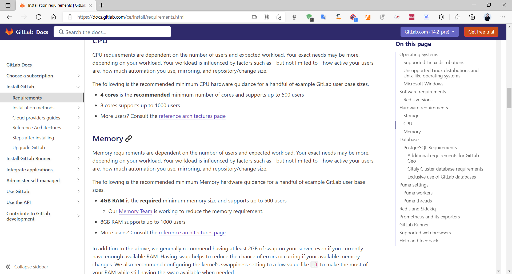
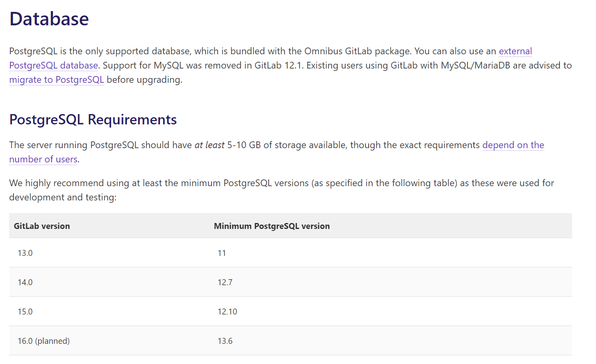
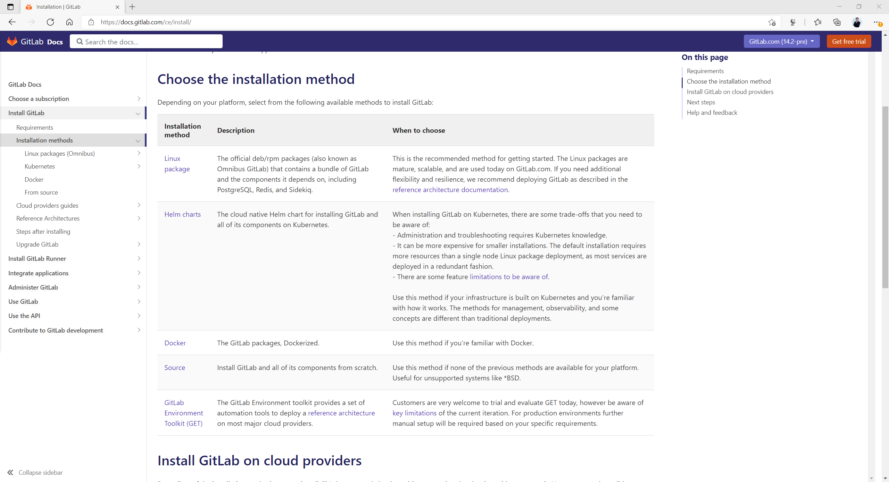
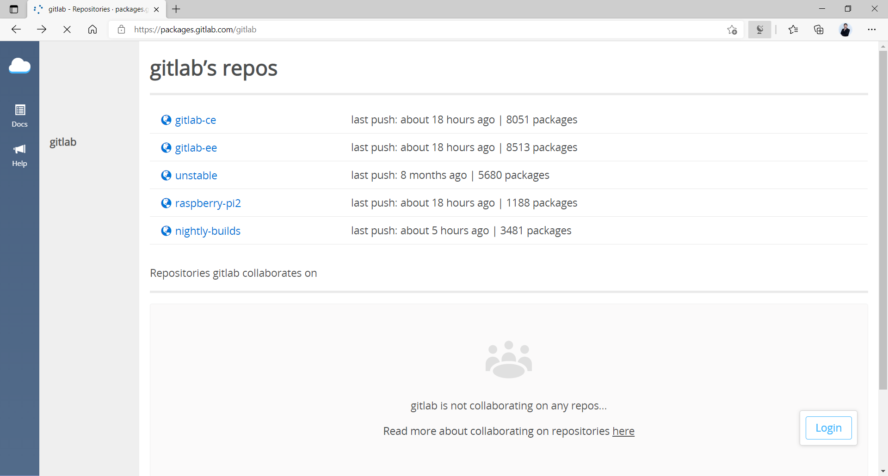
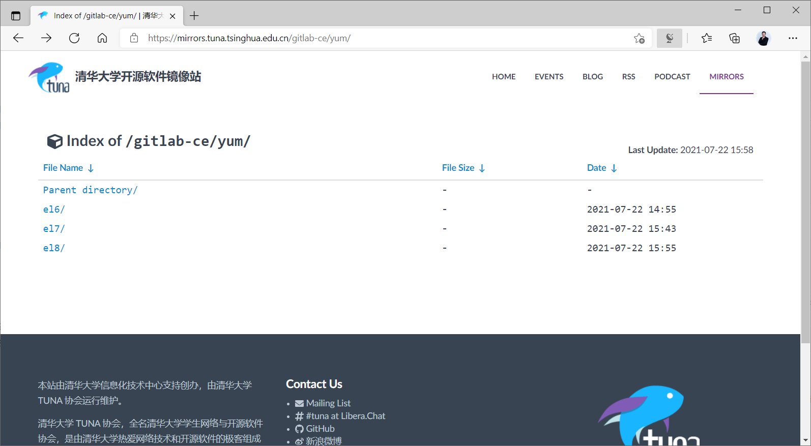
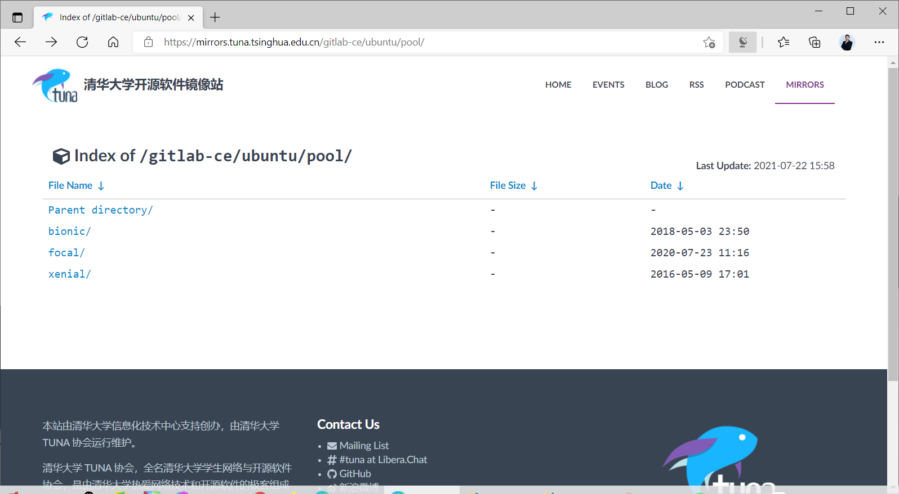
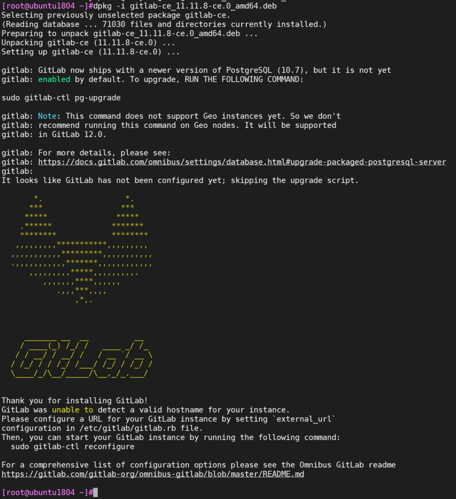
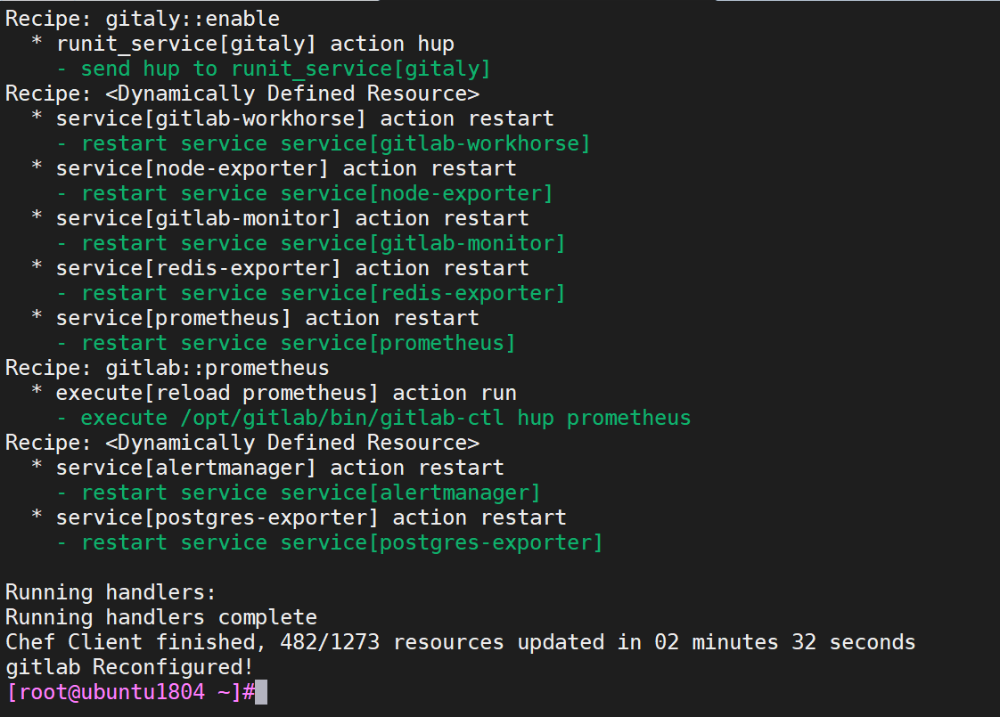
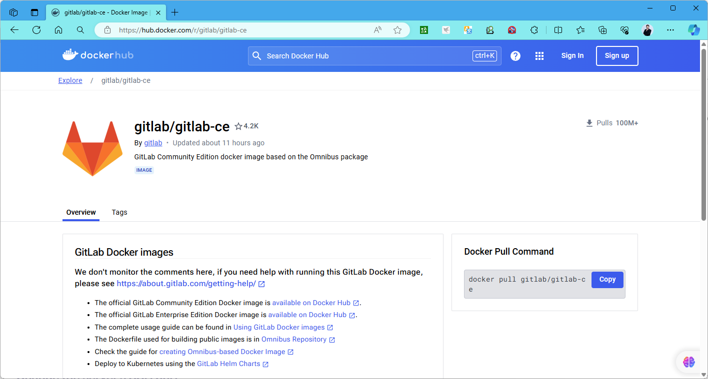

[← 返回Git 与 GitLab 版本控制目录]({{ '/subjects/Git-GitLab/' | relative_url }})



# 13 GitLab 安装
### 3.2 GitLab 安装

GitLab 有两个版本：EE商业版和CE社区版，以下使用CE版

### 安装方法

Gitlab 服务的安装文档：

<https://docs.gitlab.com/install/>

安装方法说明

<https://docs.gitlab.com/ee/install/install_methods.html>

Linux 安装包：官方的 deb/rpm 安装包（也被称作 Omnibus GitLab）包含极狐GitLab 和依赖的组件，包括PostgreSQL、Redis 和 Sidekiq Source：源码安装，在GitLab没有提供适用的安装包的平台上（例如各类BSD系统）只能采用这种安装方式 Docker：Docker 容器化的极狐GitLab 软件包 GitLab Operator：Kubernetes Operator风格的部署模式 Helm Chart：用于在 Kubernetes 上安装极狐GitLab 及其所有组件的云原生 Helm chart GitLab Environment Toolkit（GET）：自动化工具集，用于在主流的公有云（Azure、GCP和 AWS）上部署GitLab

### 安装 GitLab 要求

Gitlab硬件和软件的环境要求：

<https://docs.gitlab.com/ce/install/requirements.html>

硬件配置要求较高：

测试环境：内存4G以上，新版gitlab-ce_17.3.1建议8G以上生产环境：建议CPU2C以上，内存8G以上，磁盘10G以上配置，和用户数有关

注意:如果内存较低,可以会导致Gitlab有些服务无法启动,建议4G以上内存



数据库要求:

从GitLab 12.1 开始Linux包安装不再支持MySQL,只支持PostgreSQL



### 安装前准备

### Ubuntu 系统环境安装前准备

配置ubuntu 仓库

配置阿里云或清华大学等国内镜像仓库实现加速

```bash
[root@ubuntu1804 ~]#vim /etc/apt/sources.list
deb https://mirrors.tuna.tsinghua.edu.cn/ubuntu/ bionic main restricted universe
multiverse
deb-src https://mirrors.tuna.tsinghua.edu.cn/ubuntu/ bionic main restricted
universe multiverse
deb https://mirrors.tuna.tsinghua.edu.cn/ubuntu/ bionic-security main restricted
universe multiverse
deb-src https://mirrors.tuna.tsinghua.edu.cn/ubuntu/ bionic-security main
restricted universe multiverse
deb https://mirrors.tuna.tsinghua.edu.cn/ubuntu/ bionic-updates main restricted
universe multiverse
deb-src https://mirrors.tuna.tsinghua.edu.cn/ubuntu/ bionic-updates main
restricted universe multiverse
deb https://mirrors.tuna.tsinghua.edu.cn/ubuntu/ bionic-proposed main restricted
universe multiverse
deb-src https://mirrors.tuna.tsinghua.edu.cn/ubuntu/ bionic-proposed main
restricted universe multiverse
debhttps://mirrors.tuna.tsinghua.edu.cn/ubuntu/ bionic-backports main restricted
universe multiverse
deb-src https://mirrors.tuna.tsinghua.edu.cn/ubuntu/ bionic-backports main
restricted universe multiverse
```

### RHEL 系统环境安装前准备

基于最小化服务器安装，建议修改配置如下：

```bash
[root@centos ~]# wget -O /etc/yum.repos.d/epel.repo
http://mirrors.aliyun.com/repo/epel-7.repo
[root@centos ~]# systemctl disable firewalld
[root@centos ~]# sed -i '/SELINUX/s/enforcing/disabled/' /etc/sysconfig/selinux
[root@centos ~]# hostnamectl set-hostname gitlab.example.com
[root@centos ~]# reboot
```

### GitLab 安装

gitlab 安装有多种方式,下面选择包安装方式

<https://docs.gitlab.com/ce/install/>



### 安装 GitLab

官方gitlab 包下载链接

<https://packages.gitlab.com/gitlab>



GitLab-CE 安装包官方下载地址：

<https://packages.gitlab.com/gitlab/gitlab-ce>

yum源清华大学下载地址：

<https://mirrors.tuna.tsinghua.edu.cn/gitlab-ce/>

CentOS 的yum源



Ubuntu 的deb源

<https://mirrors.tuna.tsinghua.edu.cn/gitlab-ce/ubuntu/pool/>



范例：Ubuntu 国内镜像下载并安装 GitLab

```bash
#新版下载和安装
[root@ubuntu2204 ~]#wget https://mirrors.tuna.tsinghua.edu.cn/gitlab-
ce/ubuntu/pool/jammy/main/g/gitlab-ce/gitlab-ce_17.3.1-ce.0_amd64.deb
#旧版
[root@ubuntu2004 ~]#wget https://mirrors.tuna.tsinghua.edu.cn/gitlab-
ce/ubuntu/pool/bionic/main/g/gitlab-ce/gitlab-ce_14.1.0-ce.0_amd64.deb
#方法1
[root@ubuntu1804 ~]#dpkg -i gitlab-ce_14.1.0-ce.0_amd64.deb
#方法2
[root@ubuntu2204 ~]#apt install ./gitlab-ce_17.1.0-ce.0_amd64.deb
#旧版下载和安装
[root@ubuntu1804 ~]#wget https://mirrors.tuna.tsinghua.edu.cn/gitlab-
ce/ubuntu/pool/bionic/main/g/gitlab-ce/gitlab-ce_11.11.8-ce.0_amd64.deb
[root@ubuntu1804 ~]#dpkg -i gitlab-ce_11.11.8-ce.0_amd64.deb
```



### 修改 GitLab 配置

gitlab相关的目录：

```text
/etc/gitlab #配置文件目录，重要
/var/opt/gitlab #数据目录,源代码就存放在此目录,重要
/var/log/gitlab #日志目录
/run/gitlab #运行目录,存放很多的数据库文件
/opt/gitlab #安装目录
```

范例： gitlab 初始化配置

```bash
[root@ubuntu1804 ~]#vim /etc/gitlab/gitlab.rb
[root@ubuntu1804 ~]#grep "^[a-Z]" /etc/gitlab/gitlab.rb
external_url 'http://gitlab.bowen.org'   #修改此行
#可选,实现邮件通知设置,增加下面行(可以和上面行写在一起)
gitlab_rails['smtp_enable'] = true
gitlab_rails['smtp_address'] = "smtp.qq.com"
gitlab_rails['smtp_port'] = 465
gitlab_rails['smtp_user_name'] = "29308620@qq.com"
gitlab_rails['smtp_password'] = "授权码"
gitlab_rails['smtp_domain'] = "qq.com"
gitlab_rails['smtp_authentication'] = "login"
gitlab_rails['smtp_enable_starttls_auto'] = true
gitlab_rails['smtp_tls'] = true
gitlab_rails['gitlab_email_from'] = "29308620@qq.com"
#可选
nginx['listen_port']=8080  #修改nginx代理监听的端口
gitlab_sshd['enable']=true  #是否启用sshd服务
gitlab_sshd['listen_address']='0.0.0.0:2222'#ssh协议端口,地址
ssh://git@gitlab.bowen.org:2222/example/app.git
#新版中增加下面行,给root用户指定初始密码才能登录，或者设置环境变量GITLAB_ROOT_PASSWORD实现初
始密码
#注意:密码至少8位并且复杂度要求才是有效密码
gitlab_rails['initial_root_password'] = "bowen@123456"
#名称解析
[root@ubuntu1804 ~]#vim /etc/hosts
10.0.0.100 gitlab.bowen.org
```

由于 Gitlab 主机功能是代码托管，默认有些额外的组件比较消耗资源，如果暂时不使用可以考虑关闭

范例:  将不需要使用的组件都设定为false

```text
vim /etc/gitlab/gitlab.rb
prometheus['enable'] = false
prometheus['monitor_kubernetes'] =false
alertmanager['enable'] = false
node_exporter['enable'] = false
redis_exporter['enable'] = false
postgres_exporter['enable'] = false
gitlab_exporter['enable'] = false
prometheus_monitoring['enable'] =false
grafana['enable'] = false
```

### 初始化和启动服务

执行配置reconfigure并启动服务：

```bash
#每次修改完配置文件都需要执行此操作
[root@ubuntu1804 ~]#gitlab-ctl reconfigure
```



### 验证 GitLab 启动完成

```bash
#新版服务
[root@ubuntu1804 ~]#gitlab-ctl status
run: alertmanager: (pid 12495) 73s; run: log: (pid 12138) 144s
run: gitaly: (pid 12374) 76s; run: log: (pid 11439) 257s
run: gitlab-exporter: (pid 12388) 76s; run: log: (pid 11915) 163s
run: gitlab-workhorse: (pid 12349) 77s; run: log: (pid 11840) 181s
run: grafana: (pid 12514) 73s; run: log: (pid 12286) 96s
run: logrotate: (pid 11357) 270s; run: log: (pid 11365) 269s
run: nginx: (pid 11846) 177s; run: log: (pid 11860) 176s
run: node-exporter: (pid 12363) 76s; run: log: (pid 11898) 170s
run: postgres-exporter: (pid 12507) 73s; run: log: (pid 12164) 140s
run: postgresql: (pid 11570) 252s; run: log: (pid 11585) 249s
run: prometheus: (pid 12397) 75s; run: log: (pid 11960) 152s
run: puma: (pid 11754) 196s; run: log: (pid 11762) 193s
run: redis: (pid 11387) 264s; run: log: (pid 11395) 263s
run: redis-exporter: (pid 12390) 75s; run: log: (pid 11936) 157s
run: sidekiq: (pid 11772) 190s; run: log: (pid 11786) 187s
```

```bash
#旧版服务
[root@ubuntu1804 ~]#gitlab-ctl status
run: alertmanager: (pid 29801) 117s; run: log: (pid 29411) 135s
run: gitaly: (pid 29575) 120s; run: log: (pid 28084) 222s
run: gitlab-monitor: (pid 29659) 119s; run: log: (pid 29196) 151s
run: gitlab-workhorse: (pid 29616) 120s; run: log: (pid 28848) 173s
run: logrotate: (pid 28923) 166s; run: log: (pid 29008) 163s
run: nginx: (pid 28851) 172s; run: log: (pid 28902) 169s
run: node-exporter: (pid 29638) 119s; run: log: (pid 29107) 157s
run: postgres-exporter: (pid 29817) 116s; run: log: (pid 29479) 131s
run: postgresql: (pid 28231) 217s; run: log: (pid 28266) 214s
run: prometheus: (pid 29767) 118s; run: log: (pid 29335) 139s
run: redis: (pid 27937) 229s; run: log: (pid 27974) 227s
run: redis-exporter: (pid 29668) 118s; run: log: (pid 29258) 145s
run: sidekiq: (pid 28742) 180s; run: log: (pid 28797) 177s
run: unicorn: (pid 28653) 186s; run: log: (pid 28698) 183s
```

### 验证端口及状态

80端口是在初始化gitlib的时候启动的，因此如果之前有程序占用了相关端口,就会导致初始化失败或无法访问

```bash
[root@ubuntu1804 ~]#lsof -i :80
COMMAND   PID       USER   FD   TYPE DEVICE SIZE/OFF NODE NAME
nginx   28851       root    7u  IPv4  88801      0t0  TCP *:http (LISTEN)
nginx   28852 gitlab-www    7u  IPv4  88801      0t0  TCP *:http (LISTEN)
nginx   28853 gitlab-www    7u  IPv4  88801      0t0  TCP *:http (LISTEN)
```

### Gitlab的常用命令

GitLab除了使用Web界面进行管理，还提供了各组件的统一命令为gitlab-ctl，此外还有一些各组件专用的命令，如gitlab-pgsql、 gitlab-rails和gitlab-rake等

```text
#客户端命令行操作行
gitlab-ctl
gitlab-ctl check-config #检查配置
gitlab-ctl show-config  #查看配置
gitlab-ctl reconfigure  #修改过配置后需要执行重新配置
gitlab-ctl stop         #停止gitlab
gitlab-ctl start        #启动gitlab
gitlab-ctl restart      #重启gitlab
gitlab-ctl status       #查看组件运行状态
gitlab-ctl tail         #查看所有日志
gitlab-ctl tail nginx   #查看某个组件的日志
gitlab-ctl service-list #列出服务
#其它命令
gitlab-rails #用于启动控制台进行特殊操作，如修改管理员密码、打开数据库控制台( gitlab-rails
dbconsole)等
gitlab-psql #数据库命令行
gitlab-rake #数据备份恢复等数据操作
```

范例：

```bash
[root@ubuntu1804 ~]#gitlab-psql
psql (9.6.11)
Type "help" for help.
gitlabhq_production=# help
You are using psql, the command-line interface to PostgreSQL.
Type:  \copyright for distribution terms
\h for help with SQL commands
\? for help with psql commands
\g or terminate with semicolon to execute query
\q to quit
gitlabhq_production=# \db
List of tablespaces
Name    |    Owner    | Location
------------+-------------+----------
pg_default | gitlab-psql |
pg_global  | gitlab-psql |
(2 rows)
```

```bash
gitlabhq_production-# \q
[root@ubuntu1804 ~]#
```

范例: 查看服务列表

```bash
[root@gitlab ~]#gitlab-ctl service-list
alertmanager*
gitaly*
gitlab-exporter*
gitlab-workhorse*
grafana*
logrotate*
nginx*
node-exporter*
postgres-exporter*
postgresql*
prometheus*
puma*
redis*
redis-exporter*
sidekiq*
```

### 一键安装 GitLab 脚本

```bash
#!/bin/bash
#
#FileName:          install_gitlab.sh
#Description:       The test script
#说明:安装GitLab 服务器内存建议至少4G,root密码至少8位
GITLAB_VERSION=14.1.0
URL="https://mirrors.tuna.tsinghua.edu.cn/gitlab-
ce/ubuntu/pool/bionic/main/g/gitlab-ce/gitlab-ce_${GITLAB_VERSION}-
ce.0_amd64.deb"
#URL="https://mirrors.tuna.tsinghua.edu.cn/gitlab-
ce/ubuntu/pool/bionic/main/g/gitlab-ce/gitlab-ce_12.3.5-ce.0_amd64.deb"
#URL="https://mirrors.tuna.tsinghua.edu.cn/gitlab-ce/yum/el8/gitlab-ce-14.1.5-
ce.0.el8.x86_64.rpm"
#URL="https://mirrors.tuna.tsinghua.edu.cn/gitlab-ce/yum/el7/gitlab-ce-14.1.5-
ce.0.el7.x86_64.rpm"
#新版密码必须符合复杂性要求且至少8位
GITLAB_ROOT_PASSWORD=bowen@123456
SMTP_PASSWORD=xxxxxxxxxxxxxx
HOST=gitlab.bowen.org
#HOST=`hostname -I|awk '{print $1}'`
. /etc/os-release
color () {
RES_COL=60
MOVE_TO_COL="echo -en \\033[${RES_COL}G"
SETCOLOR_SUCCESS="echo -en \\033[1;32m"
SETCOLOR_FAILURE="echo -en \\033[1;31m"
SETCOLOR_WARNING="echo -en \\033[1;33m"
SETCOLOR_NORMAL="echo -en \E[0m"
echo -n "$1" && $MOVE_TO_COL
echo -n "["
if [ $2 = "success" -o $2 = "0" ] ;then
${SETCOLOR_SUCCESS}
echo -n $"  OK  "
elif [ $2 = "failure" -o $2 = "1"  ] ;then
${SETCOLOR_FAILURE}
echo -n $"FAILED"
else
${SETCOLOR_WARNING}
echo -n $"WARNING"
fi
${SETCOLOR_NORMAL}
echo -n "]"
echo
}
install_gitlab() {
wget -P /usr/local/src/ $URL || { color  "下载失败!" 1 ;exit ; }
PACK="/usr/local/src/${URL##*/}"
if [ $ID = "centos" -o $ID = "rocky" ];then
yum -y install $PACK
else
dpkg -i  $PACK
fi
if [ $? -eq 0 ];then
color "安装gitlab完成!" 0
else
color "安装gitlab失败!" 1
exit
fi
}
config_gitlab() {
sed -i.bak  "/^external_url.*/c external_url \'http://$HOST\'"
/etc/gitlab/gitlab.rb
cat  >> /etc/gitlab/gitlab.rb <<EOF
gitlab_rails['smtp_enable'] = true
gitlab_rails['smtp_address'] = "smtp.qq.com"
gitlab_rails['smtp_port'] = 465
gitlab_rails['smtp_user_name'] = "29308620@qq.com"
gitlab_rails['smtp_password'] = "$SMTP_PASSWORD"
gitlab_rails['smtp_domain'] = "qq.com"
gitlab_rails['smtp_authentication'] = "login"
gitlab_rails['smtp_enable_starttls_auto'] = true
gitlab_rails['smtp_tls'] = true
gitlab_rails['gitlab_email_from'] = "29308620@qq.com"
gitlab_rails['initial_root_password'] = "$GITLAB_ROOT_PASSWORD"
EOF
gitlab-ctl reconfigure
gitlab-ctl status
if [ $?  -eq 0 ];then
echo
color "Gitlab安装完成!" 0
echo "------------------------------------------------------------------
-"
echo -e "请访问链接: \E[32;1mhttp://$HOST/\E[0m"
echo -e "用户和密码: \E[32;1mroot/${GITLAB_ROOT_PASSWORD}\E[0m"
else
color "Gitlab安装失败!" 1
exit
fi
}
install_gitlab
config_gitlab
```

### 基于 Docker 安装 GitLab

<https://docs.gitlab.com/ee/install/docker.html>

<https://hub.docker.com/r/gitlab/gitlab-ce>



```text
https://docs.gitlab.com/ee/install/docker/configuration.html#pre-configure-
docker-container
sudo docker run --detach \
--hostname gitlab.example.com \
--env GITLAB_OMNIBUS_CONFIG="external_url 'http://gitlab.example.com';
gitlab_rails['lfs_enabled'] = true;" \
--publish 443:443 --publish 80:80 --publish 22:22 \
--name gitlab \
--restart always \
--volume $GITLAB_HOME/config:/etc/gitlab \
--volume $GITLAB_HOME/logs:/var/log/gitlab \
--volume $GITLAB_HOME/data:/var/opt/gitlab \
--shm-size 256m \
gitlab/gitlab-ce:<version>-ce.0
```

范例:基于Docker 部署

```bash
docker pull gitlab/gitlab-ce:17.0.1-ce.0
export GITLAB_HOME=/srv/gitlab
sudo docker run --detach \
--hostname gitlab.example.com \
--publish 443:443 --publish 80:80 --publish 22:22 \
--name gitlab \
--restart always \
--volume $GITLAB_HOME/config:/etc/gitlab \
--volume $GITLAB_HOME/logs:/var/log/gitlab \
--volume $GITLAB_HOME/data:/var/opt/gitlab \
--shm-size 256m \
gitlab/gitlab-ce:17.0.1-ce.0
#gitlab/gitlab-ce:latest
```

### 基于 Kubernetes 安装 GitLab

<https://docs.gitlab.com/operator/installation.html>

范例：注意相关镜像可能需要科学上网

```text
#1)Deploy the GitLab Operator
GL_OPERATOR_VERSION=0.8.1 # https://gitlab.com/gitlab-org/cloud-native/gitlab-
operator/-/releases
PLATFORM=kubernetes # or "openshift"
kubectl create namespace gitlab-system
kubectl apply -f
https://gitlab.com/api/v4/projects/18899486/packages/generic/gitlab-
operator/${GL_OPERATOR_VERSION}/gitlab-
operator-${PLATFORM}-${GL_OPERATOR_VERSION}.yaml
#或者
helm repo add gitlab-operator
https://gitlab.com/api/v4/projects/18899486/packages/helm/stable
helm repo update
#需要提前安装cert-manager证书管理组件
kubectl apply -f https://github.com/cert-manager/cert-
manager/releases/download/v1.6.3/cert-manager.yaml
helm install gitlab-operator gitlab-operator/gitlab-operator --create-namespace
--namespace gitlab-system
#2)Create a GitLab custom resource (CR).
cat mygitlab.yaml
apiVersion: apps.gitlab.com/v1beta1
kind: GitLab
metadata:
name: gitlab
spec:
chart:
version: "X.Y.Z" # https://gitlab.com/gitlab-org/cloud-native/gitlab-
operator/-/blob/0.8.1/CHART_VERSIONS
values:
global:
hosts:
domain: example.com # use a real domain here
ingress:
configureCertmanager: true
certmanager-issuer:
email: youremail@example.com # use your real email address here
kubectl -n gitlab-system apply -f mygitlab.yaml
#3)观察结果
kubectl -n gitlab-system logs deployment/gitlab-controller-manager -c manager -f
$ kubectl -n gitlab-system get gitlab
NAME     STATUS   VERSION
gitlab   Ready    5.2.4
```

```text
#4）访问
https://gitlab.example.com.
```



<nav class="article-end" aria-label="章节导航">
  <a href="{{ '/subjects/Git-GitLab/12-introduction-to-gitlab.html' | relative_url }}">← Previous: Introduction to GitLab</a>
  <a href="{{ '/subjects/Git-GitLab/' | relative_url }}">Back to Git and GitLab Version Control Index</a>
  <a href="{{ '/subjects/Git-GitLab/14-basic-gitlab-configuration.html' | relative_url }}">Next: Basic GitLab Configuration →</a>
</nav>
