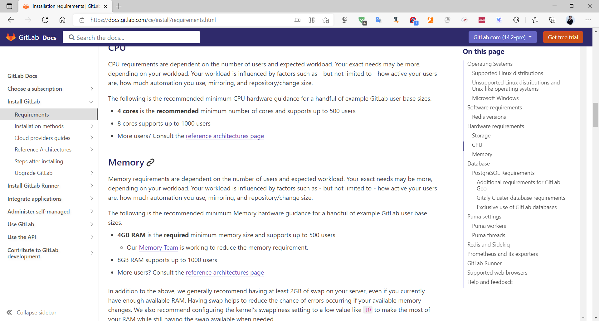
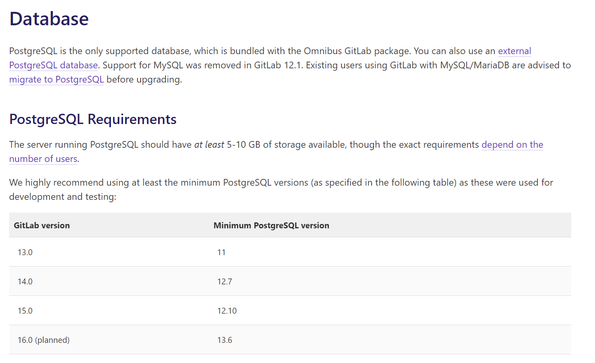
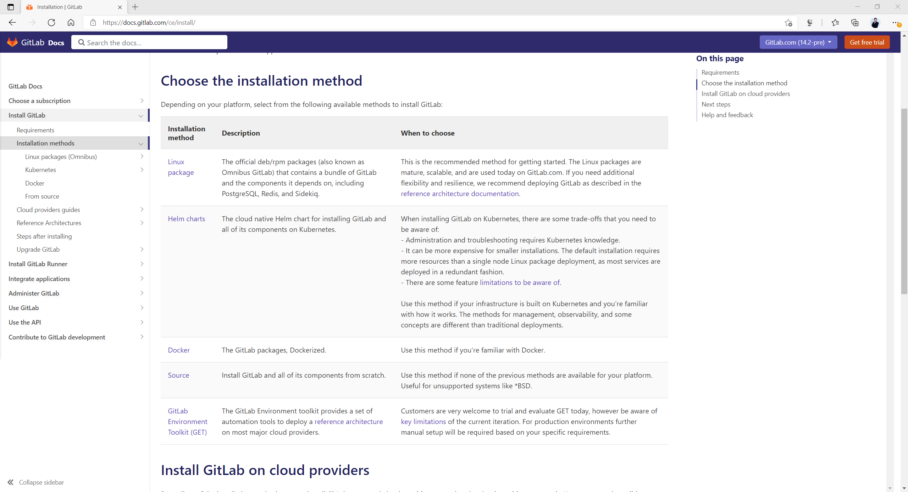
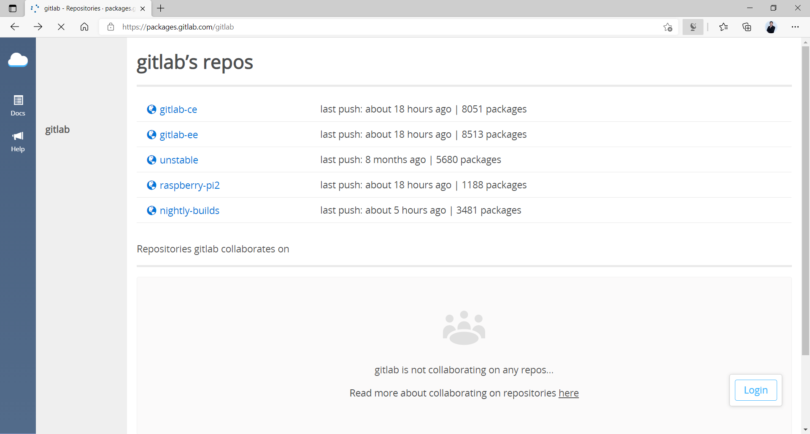
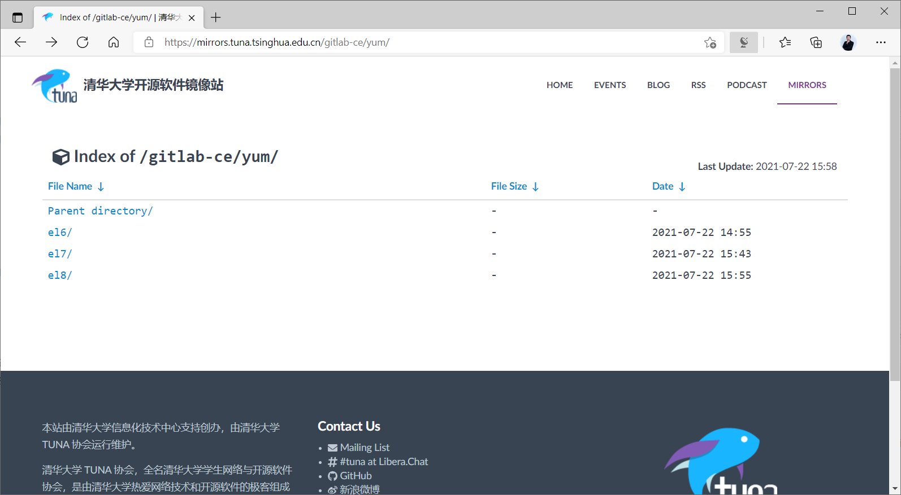
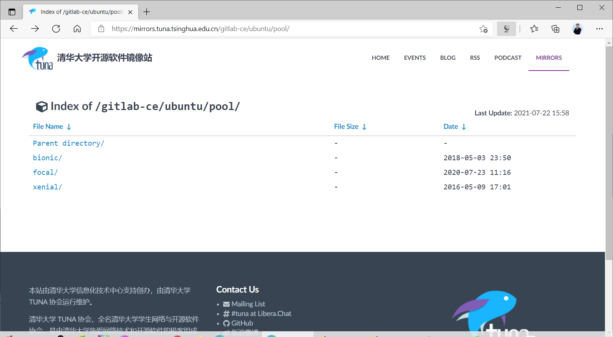
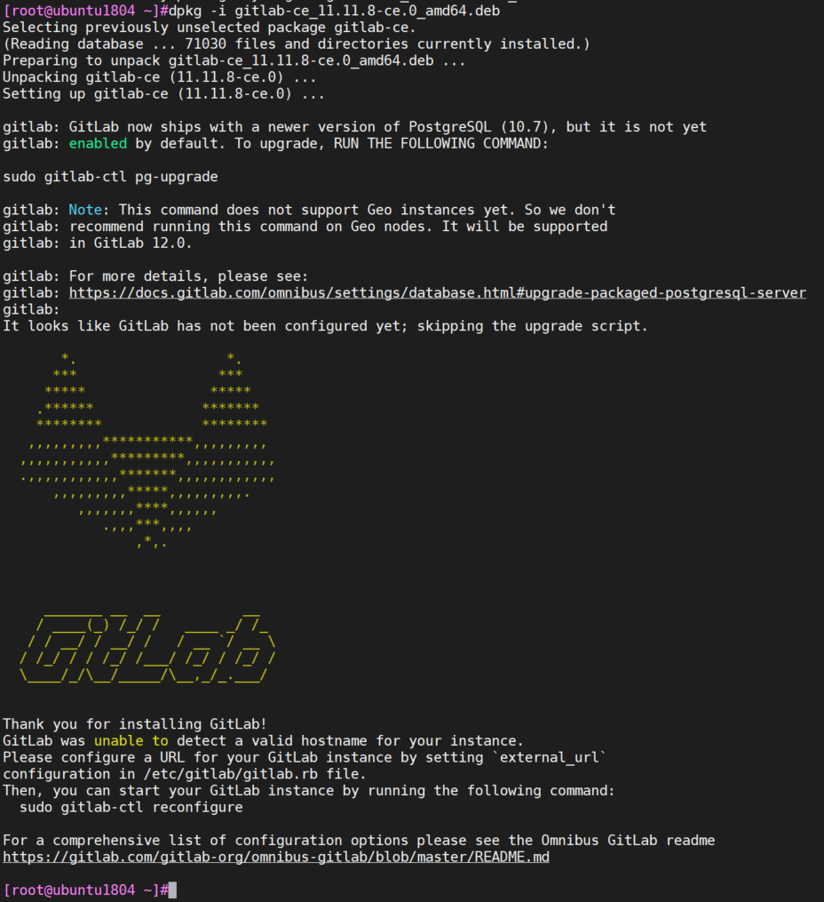
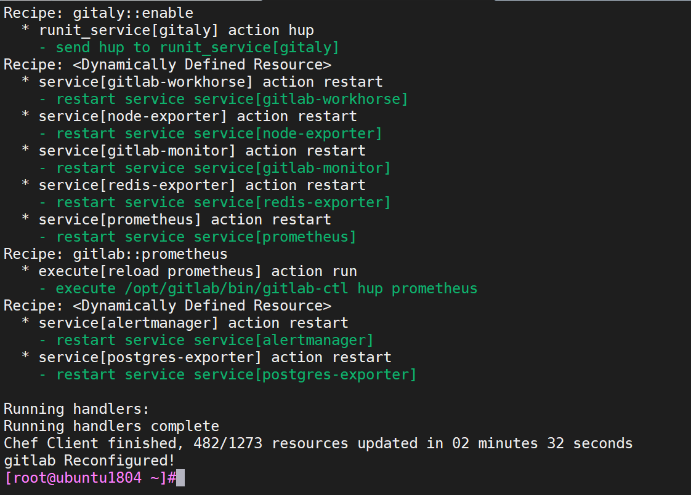
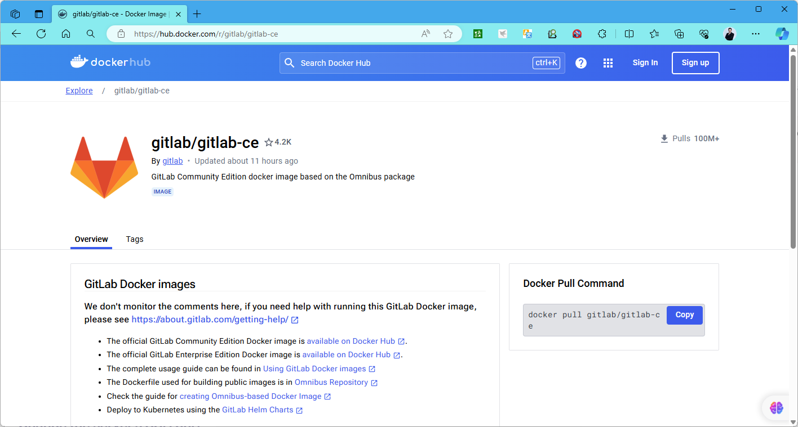

[← 返回Git 与 GitLab 版本控制目录]({{ '/subjects/Git-GitLab/' | relative_url }})



# 13 GitLab 安装

GitLab 安装方式、系统支持和资源要求会随版本变化。本章以**单机 Linux 软件包**为主线，说明安装前的决策、配置和验证；文末对容器与 Kubernetes 部署指出不同的运维边界。原课程截图来自旧版 CE 实验，界面和包名只用于辨认历史步骤，不应直接当成当前版本指令。

### 选安装方式和容量

先阅读 [GitLab 官方安装文档](https://docs.gitlab.com/install/) 和目标版本的[安装要求](https://docs.gitlab.com/install/requirements/)，确认操作系统、CPU/内存、数据库、磁盘和升级路径。

| 方式 | 适用场景 | 需要额外负责的事项 |
| --- | --- | --- |
| Linux 软件包 | 自管理单机或少量实例 | 系统更新、证书、备份、升级和监控 |
| Docker 容器 | 已有容器运维能力 | 持久卷、端口映射、镜像版本与容器备份 |
| Kubernetes Helm Chart | 已有集群和存储能力 | Ingress、TLS、持久化、数据库依赖和 Chart 升级 |
| 源码安装 | 开发或特殊平台 | 完整的依赖和组件维护 |

生产容量应根据用户数、仓库增长、CI 负载、附件和备份保留量测算，不宜把某张旧图中的“最低内存”或磁盘数值当成通用规格。资源不足时可能出现后台作业堆积或服务反复重启。



软件包安装集成 PostgreSQL；若使用外部数据库，应确认目标版本要求的 PostgreSQL 版本、连接与备份方式，而不是照搬早期 MySQL 教程。



### 安装前检查

1. 选择受支持的系统版本，记录 `cat /etc/os-release` 与架构；Ubuntu、RHEL 类系统的软件源不能互换。
2. 为 GitLab 设置可解析的域名，并决定 `external_url`、TLS 证书、HTTPS 和 SSH 端口。
3. 确认时间同步、磁盘空间和防火墙规则；不需要为了安装 GitLab 关闭防火墙或 SELinux。
4. 预先规划备份位置、管理员初始凭据交付方式和后续升级窗口。

### 安装 Linux 软件包

原课程先展示安装渠道和包页面，下图中的发行代号、版本号和镜像地址均属于历史环境。新部署优先按官方说明配置与本机系统匹配的软件源，并核对包的来源与版本；第三方镜像可能滞后。









软件源配置完成后，以 Ubuntu 为例安装当前选定的 `gitlab-ce` 包。RHEL 类系统使用对应包管理器和软件源；如需固定版本，应先在官方支持矩阵确认该版本可用于目标系统。

```bash
cat /etc/os-release
sudo apt update
apt-cache policy gitlab-ce
sudo apt install gitlab-ce
```

下图是旧实验的安装完成页面。安装成功只是开始，仍须配置域名、验证服务和建立备份。



### 配置域名与可选组件

软件包的主要配置文件是 `/etc/gitlab/gitlab.rb`；数据通常在 `/var/opt/gitlab`，日志在 `/var/log/gitlab`。修改 `external_url` 时，要让 DNS、证书和反向代理配置与之对应。下列 Ruby 配置仅说明字段形式，域名和证书路径应换成实例实际值：

```ruby
external_url 'https://gitlab.example.com'
```

如果需要 SMTP 通知或修改 SSH 端口，先阅读当前版本的配置项与邮件服务要求，再把凭据交给受控的密钥管理方式；不要在教程或共享仓库中写明文授权码。小规格实验环境可评估停用不使用的监控组件，但不能盲目复制旧版一整组开关：配置项可能已更名，停用监控也会失去故障信号。

```bash
sudo gitlab-ctl reconfigure
sudo gitlab-ctl status
sudo gitlab-ctl tail
```

`reconfigure` 将配置转为运行服务设置；若失败，应先看失败组件日志，而非反复执行安装命令。原课程图示展示配置与服务状态，旧版 Unicorn、Grafana 等组件列表不能用于判断当前版本是否完整。





### 安装后验证

`gitlab-ctl status` 只能说明进程状态。还应使用与 `external_url` 一致的地址完成 Web 登录，创建测试项目，并验证 HTTPS/SSH 克隆、提交与推送。若端口冲突，用 `ss -ltnp` 核对实际监听端口；HTTPS 实例通常关注 443，不能只检查 80。

首次管理员密码按目标版本文档获取或在安装时安全设定，登录后立即改为独立强密码，并检查注册策略。接着安排配置与数据的双重备份，下一章和第 17 章分别介绍初始设置与备份恢复。

### 容器与 Kubernetes 的差异

Docker 方式应参考[官方容器安装文档](https://docs.gitlab.com/install/docker/)。镜像标签需固定到受支持版本，持久化 `/etc/gitlab`、`/var/log/gitlab` 和 `/var/opt/gitlab`，并使 `external_url` 与端口映射一致。下面仅示意持久化目录结构；证书和网络配置未完成前，不应直接作为生产部署清单。

```text
宿主机 /srv/gitlab/config  → 容器 /etc/gitlab
宿主机 /srv/gitlab/logs    → 容器 /var/log/gitlab
宿主机 /srv/gitlab/data    → 容器 /var/opt/gitlab
```

Kubernetes 方式按 [GitLab Helm Chart 文档](https://docs.gitlab.com/charts/) 选择与集群兼容的 Chart，并规划持久卷、Ingress、TLS、域名、数据库和对象存储。Pod 显示 `Ready` 只是组件检查，仍须验证用户登录、仓库读写和恢复演练。



<nav class="article-end" aria-label="章节导航">
  <a href="{{ '/subjects/Git-GitLab/12-introduction-to-gitlab.html' | relative_url }}">← 上一篇：GitLab 介绍</a>
  <a href="{{ '/subjects/Git-GitLab/' | relative_url }}">返回 Git 与 GitLab 版本控制目录</a>
  <a href="{{ '/subjects/Git-GitLab/14-basic-gitlab-configuration.html' | relative_url }}">下一篇：GitLab 基本配置 →</a>
</nav>
