[← 返回Git 与 GitLab 版本控制目录]({{ '/subjects/Git-GitLab/' | relative_url }})



# 14 GitLab 基本配置
### 3.3 GitLab 基本配置

### 首次登录 GitLab Web 界面修改密码

新版gitlab密码初始化官方帮助链接

<https://docs.gitlab.com/omnibus/installation/index.html>

浏览器访问http://gitlab服务器IP/

在新版gitlab中第一次登录的界面发生变化,取消重设密码界面,需要直接输入用户和密码才能登录

默认用户为root，其密码是随机生成

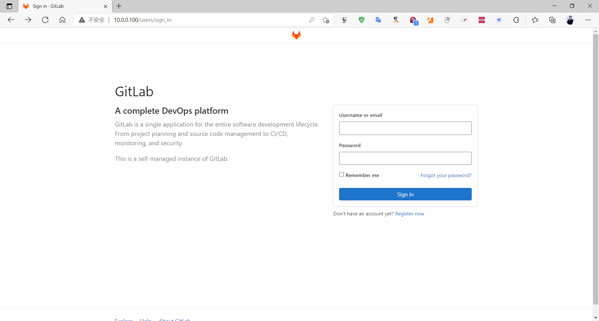

```bash
#如果没有在配置文件中对密码做初始化设置,可以从以下文件找到初始密码
[root@ubuntu1804 ~]#cat /etc/gitlab/initial_root_password
# WARNING: This value is valid only in the following conditions
#          1. If provided manually (either via `GITLAB_ROOT_PASSWORD` environment
variable or via `gitlab_rails['initial_root_password']` setting in `gitlab.rb`,
it was provided before database was seeded for the first time (usually, the first
reconfigure run).
#          2. Password hasn't been changed manually, either via UI or via command
line.
#
#          If the password shown here doesn't work, you must reset the admin
password following
https://docs.gitlab.com/ee/security/reset_user_password.html#reset-your-root-
password.
Password: t2c31Eqz4035tmrbAJFl/itm8aSkEHu87xGzluzsj/w=
# NOTE: This file will be automatically deleted in the first reconfigure run
after 24 hours.
```

新版登录界面,用root用户和配置文件中指定的密码或以上文件中的初始密码登录

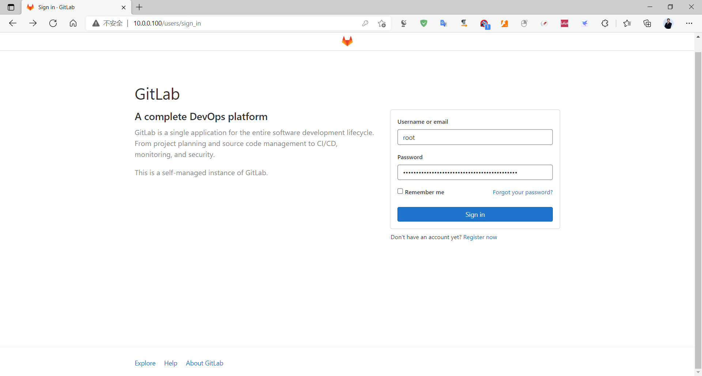

新版登录后,也可以再次修改密码,注意:密码至少8位

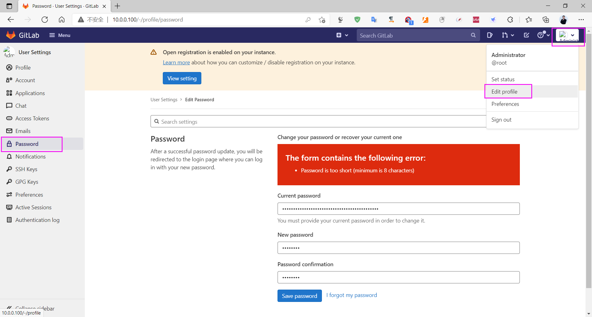

使用用户 root 和上面设置的密码登录

新版界面

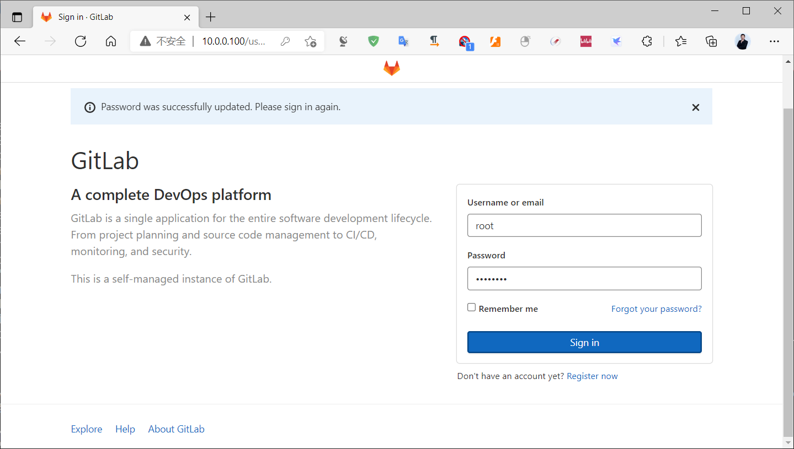

新版登录首页

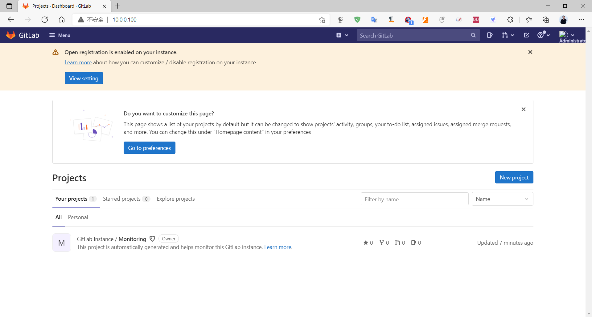

以下是旧版的首次登录web页面，必须先设置密码，密码要求最少8位

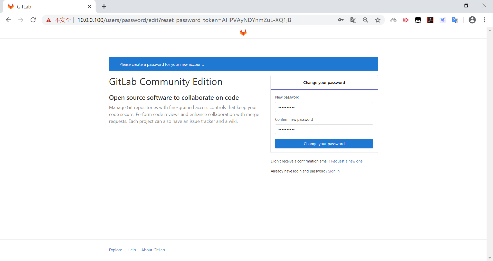

旧版界面

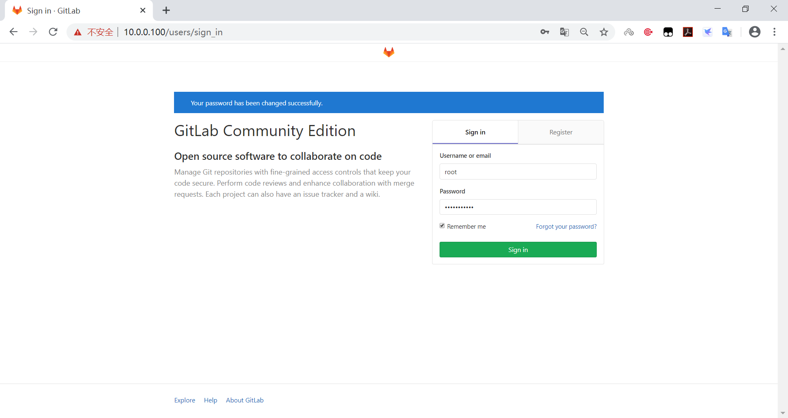

旧版登录首页

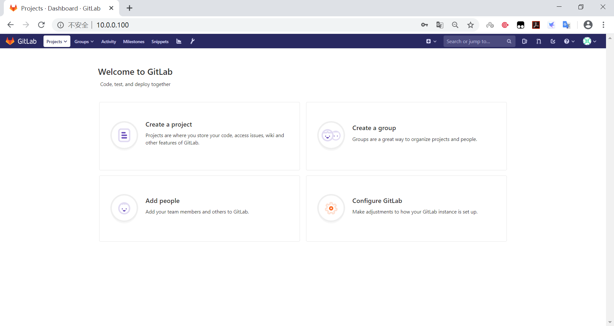

### 修改头像

登录gitlab后可能看到用户的头像不能正常显示,可以修改为自定义的头像

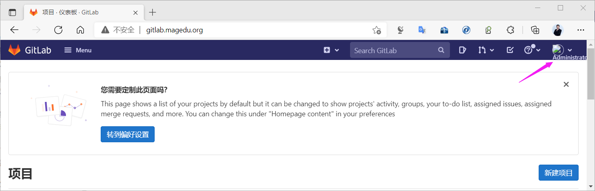

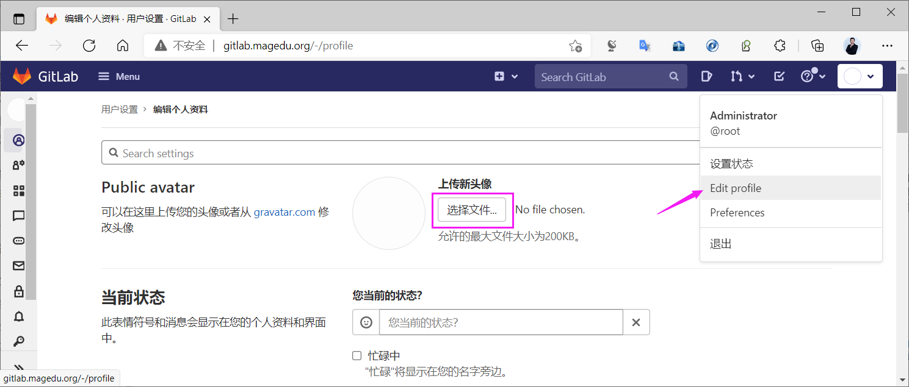

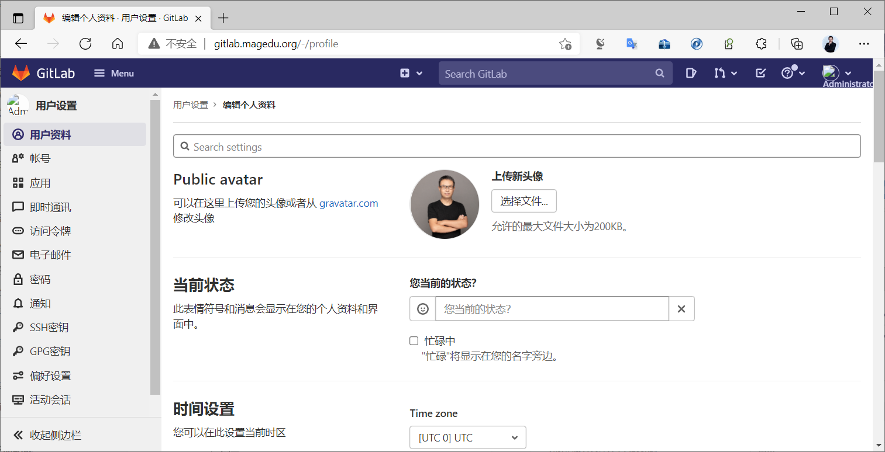

### 关闭账号注册功能

新版用户注册界面

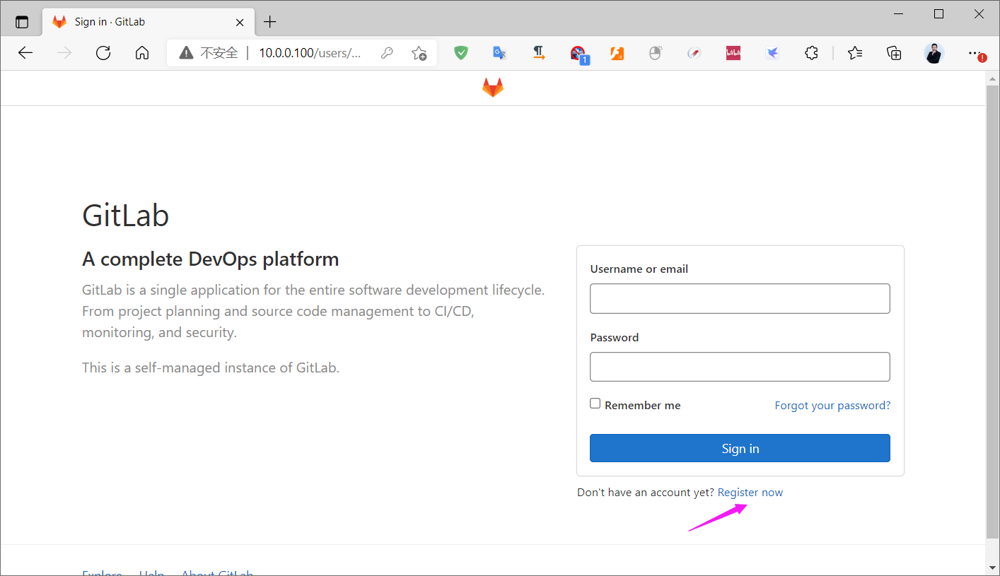

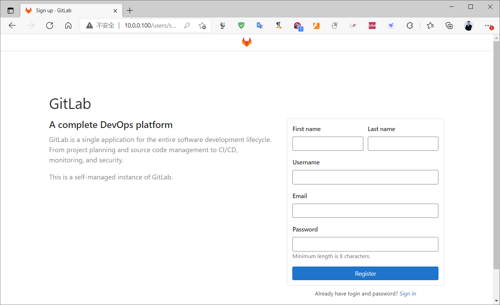

关闭注册功能,先用root用户登录

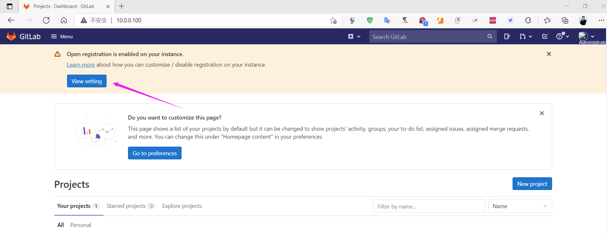

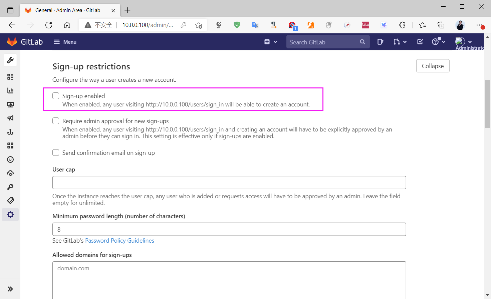

Save Changes 后,再重新登录观察到注册界面不再显示

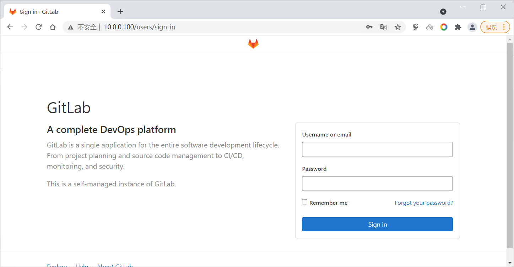

旧版中默认情况下也可以直接注册账号，基于安全目的，一般都会关闭此功能

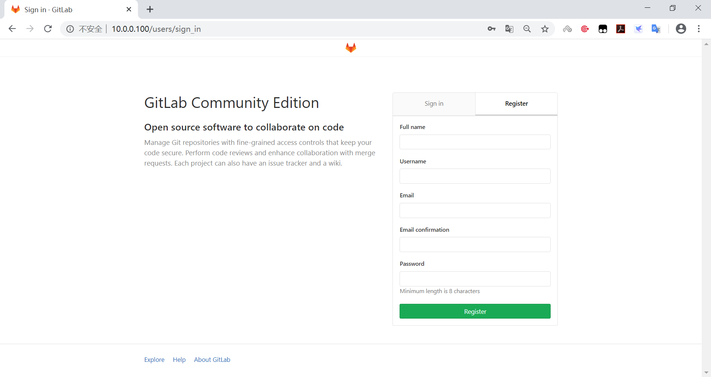

取消账户注册功能之后点save changes

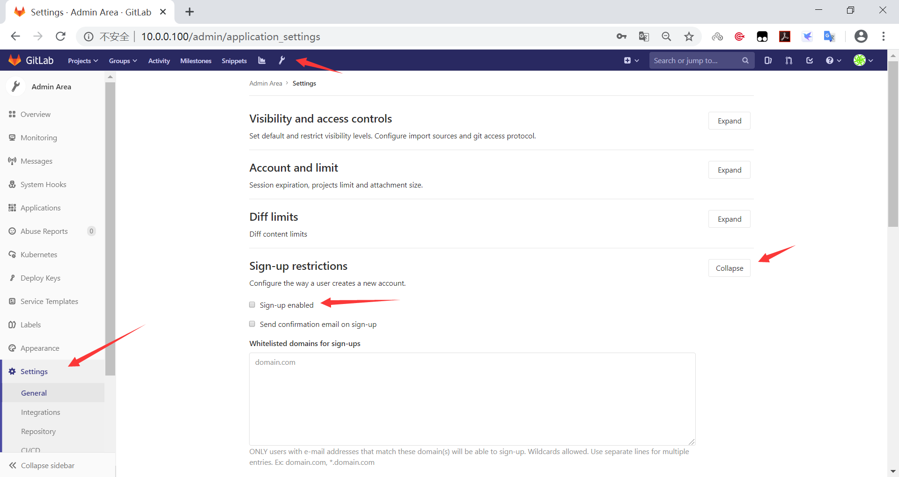

重新登录，验证是否还有注册选项

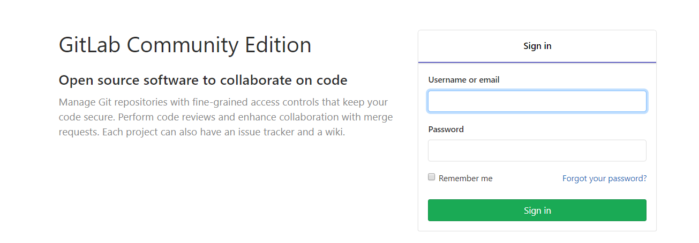



<nav class="article-end" aria-label="章节导航">
  <a href="{{ '/subjects/Git-GitLab/13-installing-gitlab.html' | relative_url }}">← Previous: Installing GitLab</a>
  <a href="{{ '/subjects/Git-GitLab/' | relative_url }}">Back to Git and GitLab Version Control Index</a>
  <a href="{{ '/subjects/Git-GitLab/15-gitlab-user-and-group-management.html' | relative_url }}">Next: GitLab User and Group Management →</a>
</nav>
