[← 返回Git 与 GitLab 版本控制目录]({{ '/subjects/Git-GitLab/' | relative_url }})



# 14 GitLab 基本配置

安装完成后，应依次完成首次登录、管理员密码更新与账号注册策略检查。界面位置会随版本变化，以下截图主要帮助识别操作目标，而非保证按钮名称始终相同。

### 首次登录 GitLab Web 界面修改密码

安装及初始密码的版本说明可参考 [GitLab Linux package 安装文档](https://docs.gitlab.com/install/package/)；下面以软件包安装的 Omnibus 实例为例。

浏览器访问 `external_url` 对应的地址，优先使用配置正确证书的 HTTPS 域名。若页面无法打开，先核对 DNS、端口与 `gitlab-ctl status`，不要随意改用 IP 绕过域名配置。

首次登录使用管理员账号 `root`。若安装时未显式设置初始密码，GitLab 可能把生成的密码临时写入 `/etc/gitlab/initial_root_password`；该文件会在后续重配置中被移除，且密码修改后其中的值不再有效。不要把文件内容保存到课程笔记或工单。

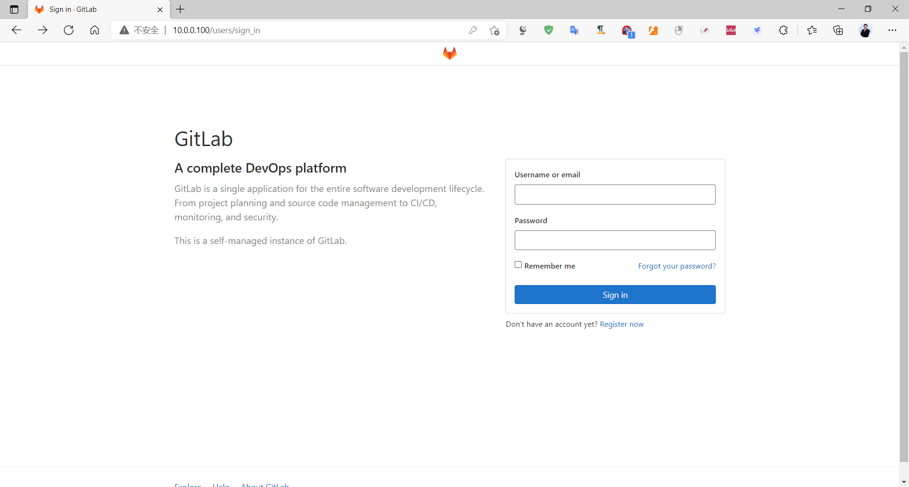

```bash
sudo cat /etc/gitlab/initial_root_password
```

下图是较新版本的登录界面。输入安装时设定的管理员密码，或上述文件中的临时初始密码；若密码已过期或无法登录，按管理员密码重置流程处理。

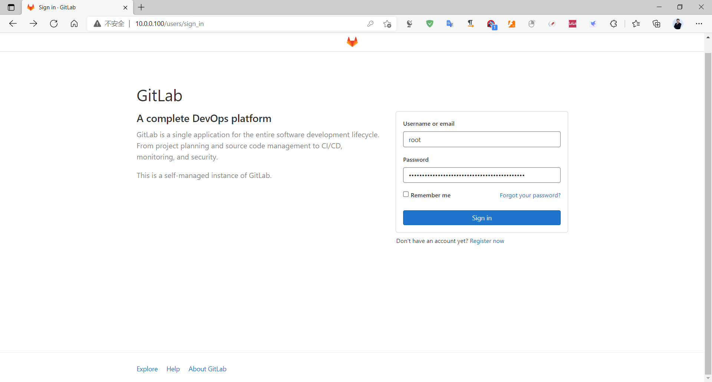

首次登录后及时设置独立强密码，按实例策略配置双因素认证，并确认管理员邮箱可接收通知。密码策略随版本和实例配置变化，不应只以“至少 8 位”为唯一标准。

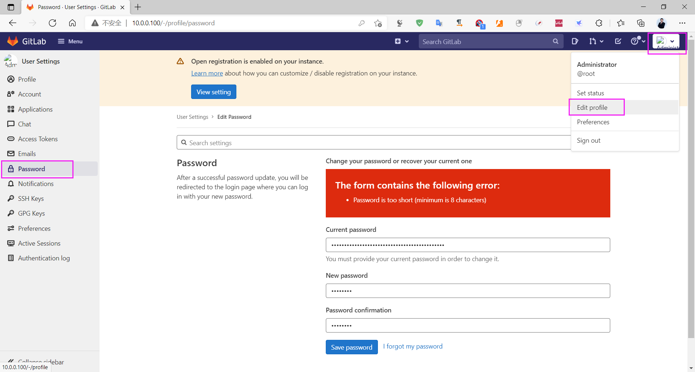

完成密码更新后重新登录，确认管理员首页正常打开。

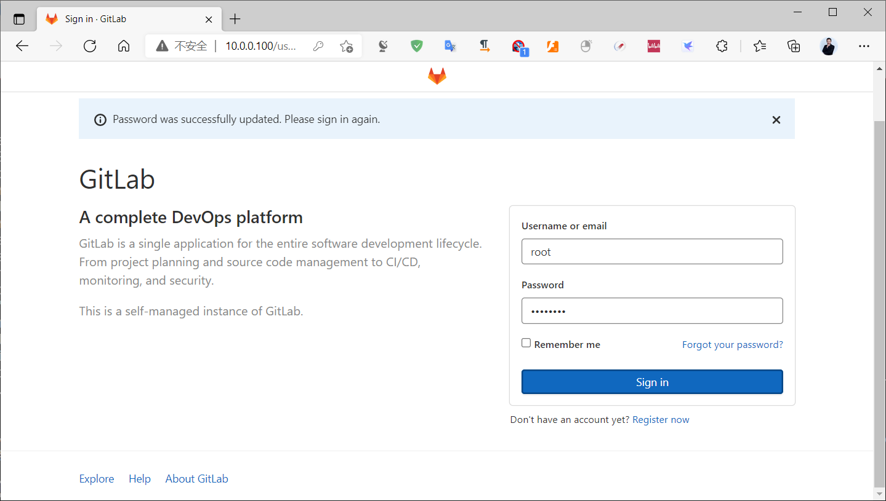

下图继续展示当时版本的首页布局；具体菜单位置可能随版本调整。

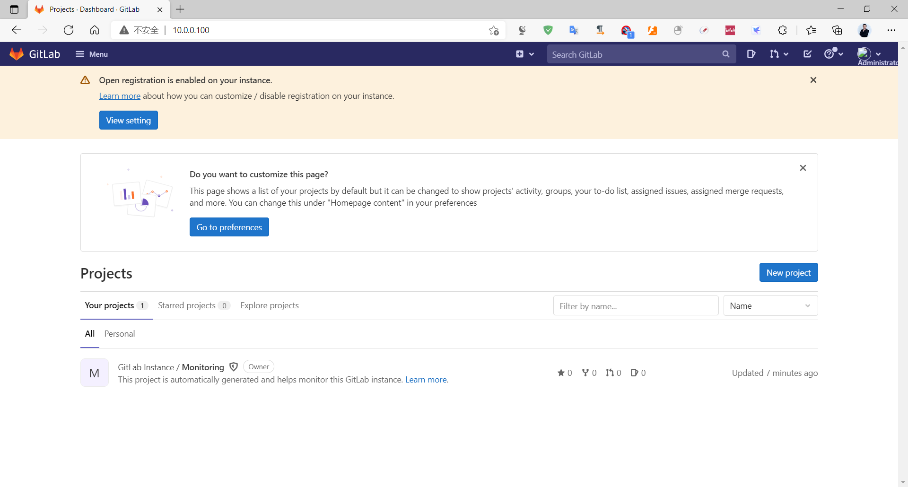

旧版安装可能在首次访问时直接显示设置密码页面。它与上面的临时密码文件流程是不同版本的界面，不需要依次执行。

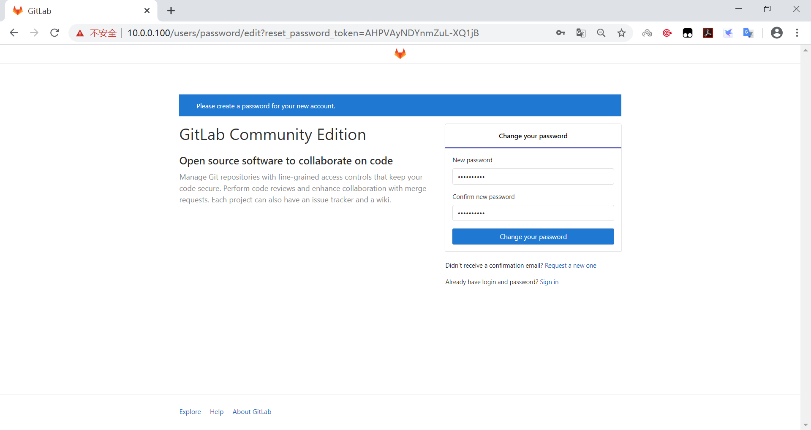

旧版登录页示例如下。

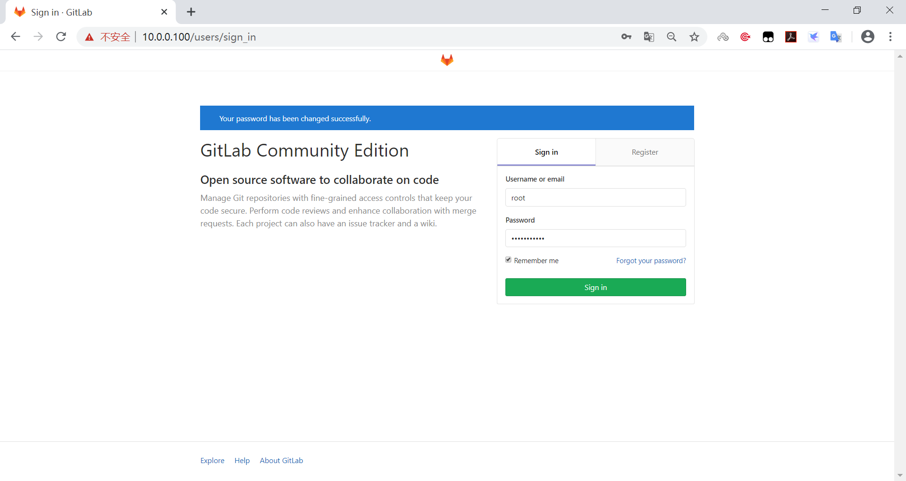

旧版首页示例如下。

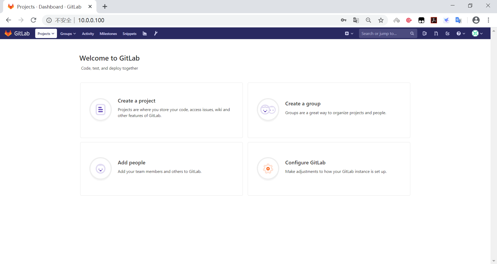

### 修改头像

头像无法显示通常只影响界面，不代表仓库服务故障。进入个人资料设置上传受支持的图片即可；若所有用户头像都异常，再检查外部头像服务、代理与网络策略。

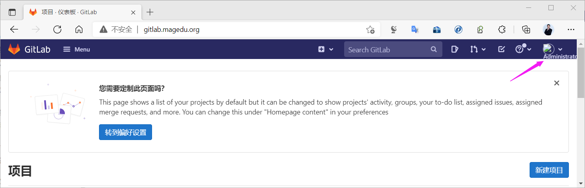

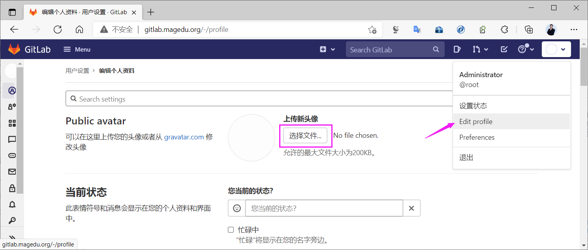

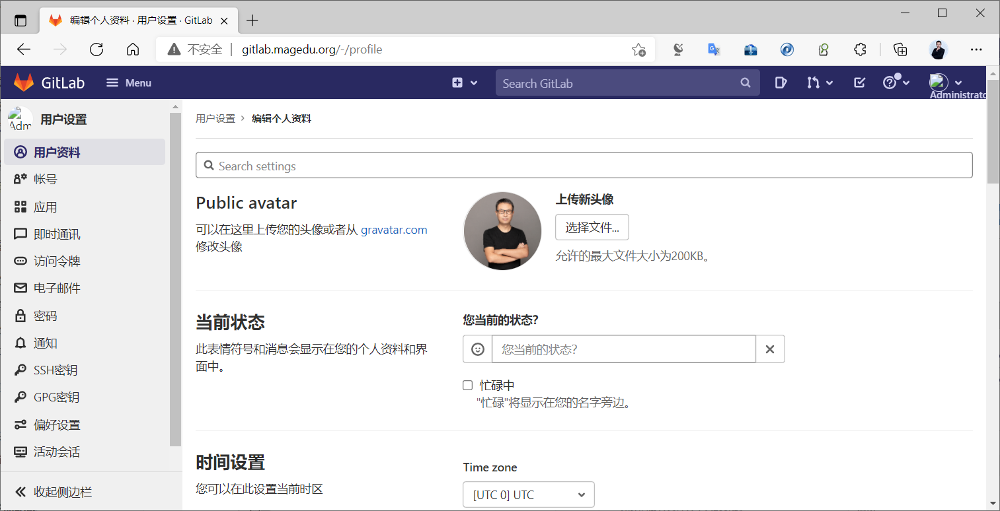

### 关闭账号注册功能

先查看登录页是否有注册入口，再到管理中心核对当前注册策略。

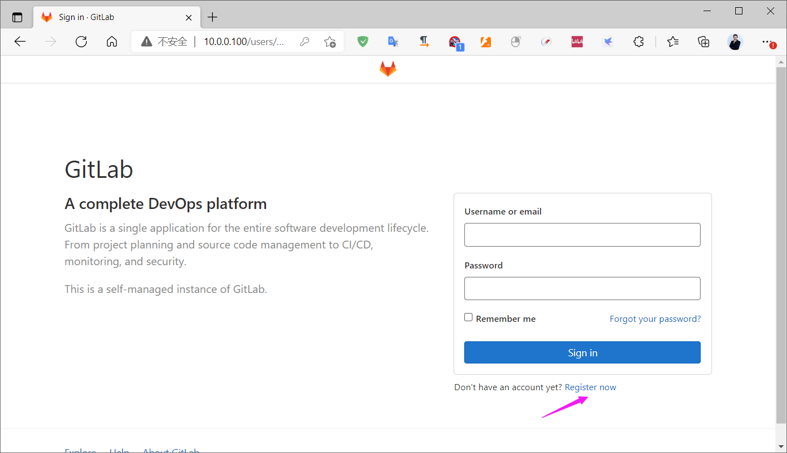

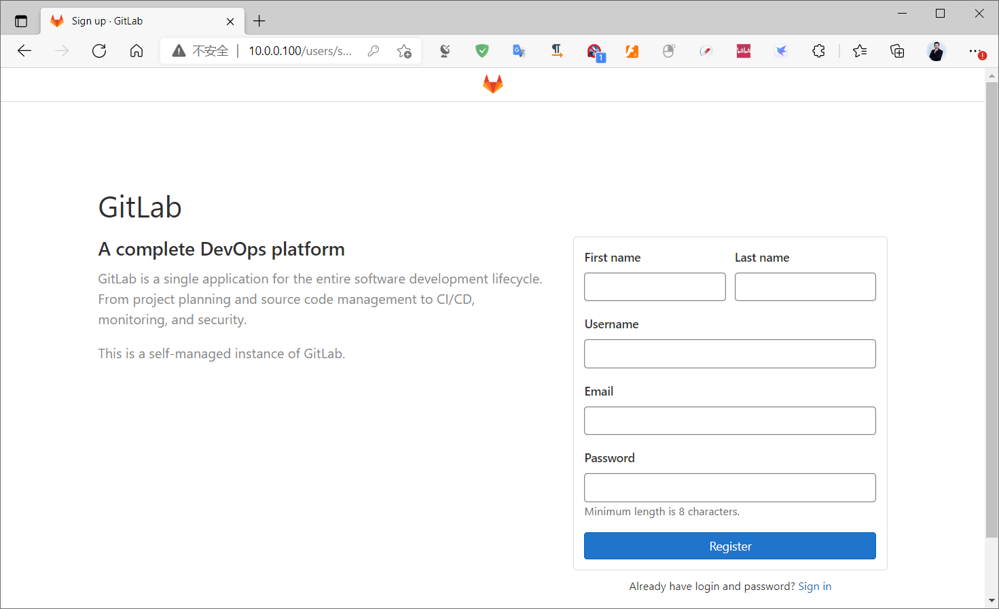

若实例只面向组织内部成员，可由管理员在**管理中心 → 设置 → 通用 → 注册限制**关闭公开注册。确需对外开放注册时，应保留审批、验证和滥用防护措施，而不是机械关闭。

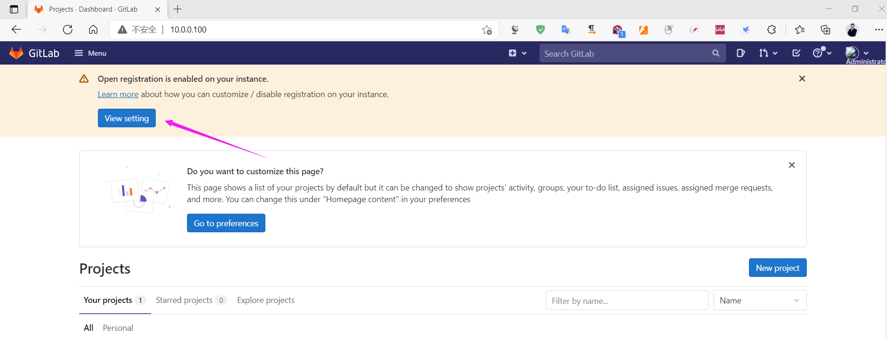

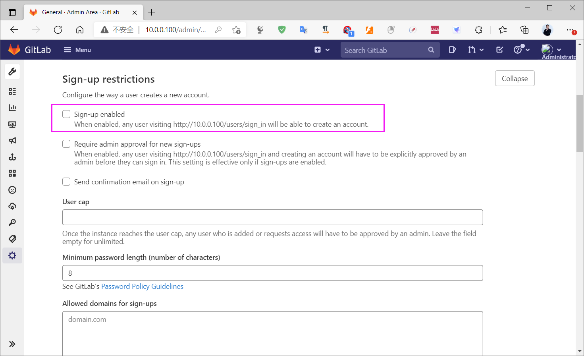

保存后退出登录并检查注册入口是否消失；再用普通账户验证已有用户仍可正常登录。关闭注册只阻止自助创建新用户，不会删除现有账号。

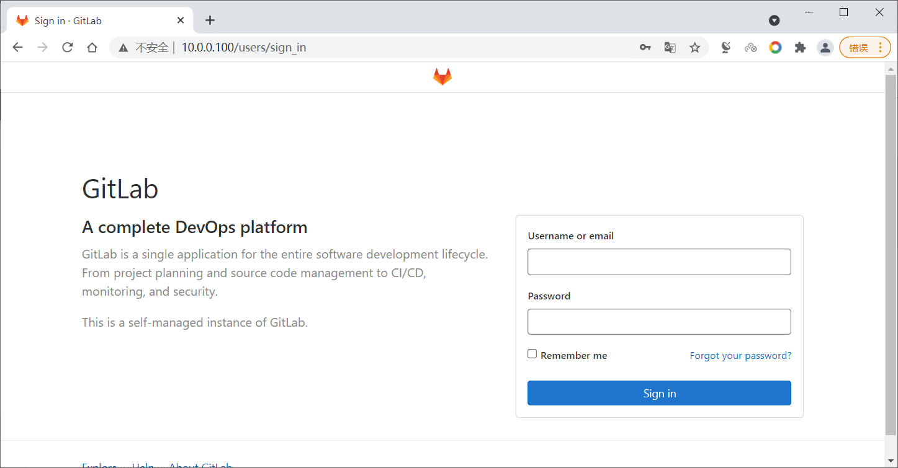

旧版界面中的对应选项位置如下；是否关闭注册应由实例面向的人群和账号审批流程决定。

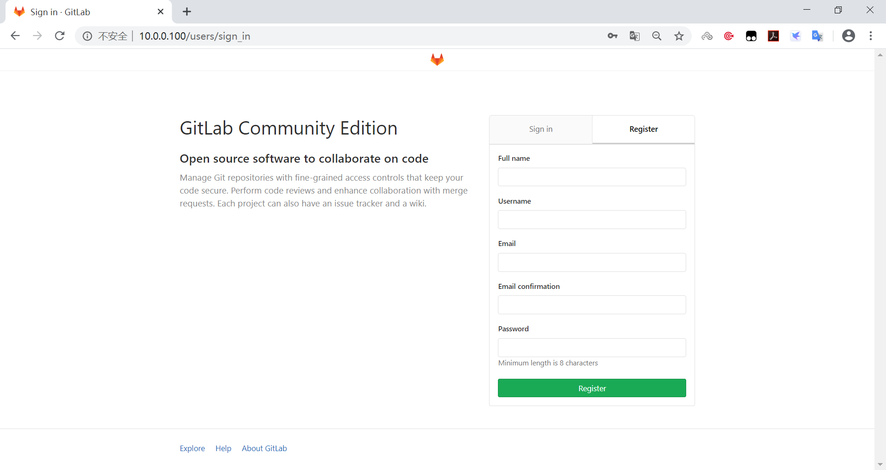

更改设置后保存，并确认提示生效。

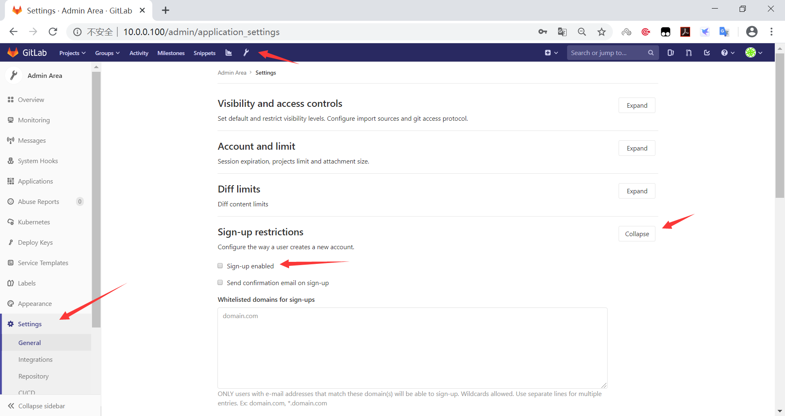

最后用未登录窗口验证注册入口，同时检查现有用户登录。

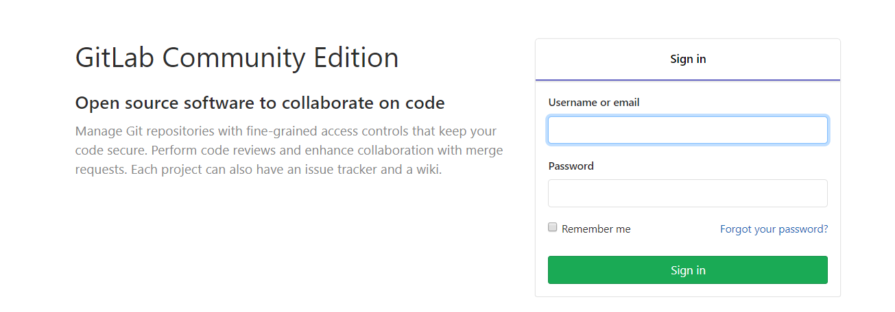



<nav class="article-end" aria-label="章节导航">
  <a href="{{ '/subjects/Git-GitLab/13-installing-gitlab.html' | relative_url }}">← 上一篇：GitLab 安装</a>
  <a href="{{ '/subjects/Git-GitLab/' | relative_url }}">返回 Git 与 GitLab 版本控制目录</a>
  <a href="{{ '/subjects/Git-GitLab/15-gitlab-user-and-group-management.html' | relative_url }}">下一篇：GitLab 用户和组管理 →</a>
</nav>
