[← Back to Git and GitLab Version Control Index]({{ '/subjects/Git-GitLab/' | relative_url }})



# 15 GitLab User and Group Management
### 3.4 GitLab 用户和组管理

### 用户管理

### 创建用户

创建gitlab用户账户并登录

新版界面

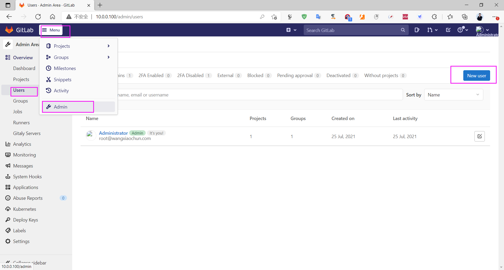

输入新的用户信息

image-20210725194100283

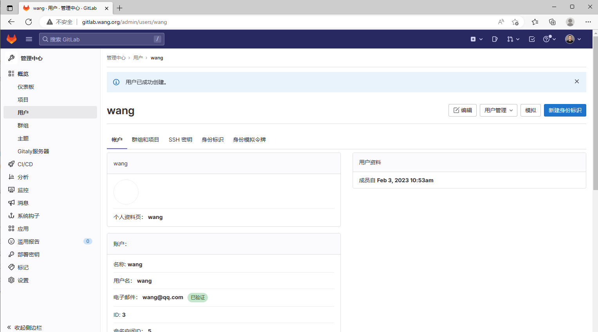

### 修改密码

创建用户完成后,再编辑用户信息，才能修改密码

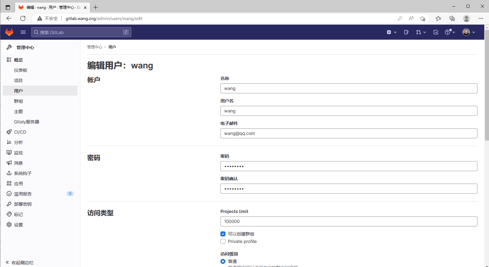

用户首次登录会提示修改密码

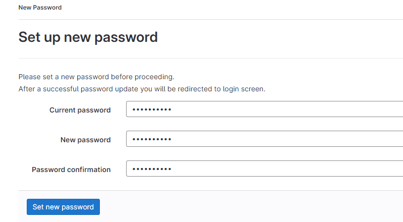

创建用户成功后,用户邮箱会收到下面邮件

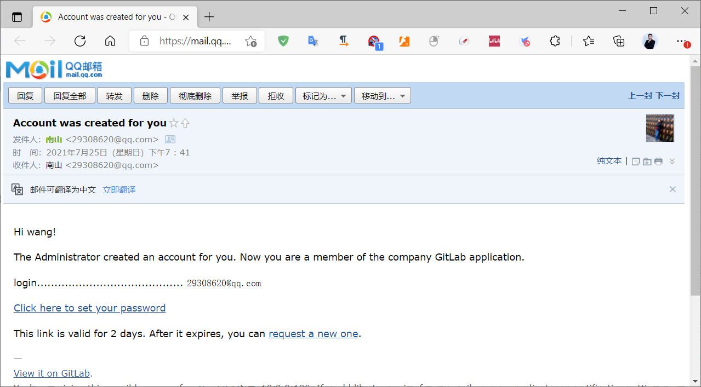

点上面的链接重设密码

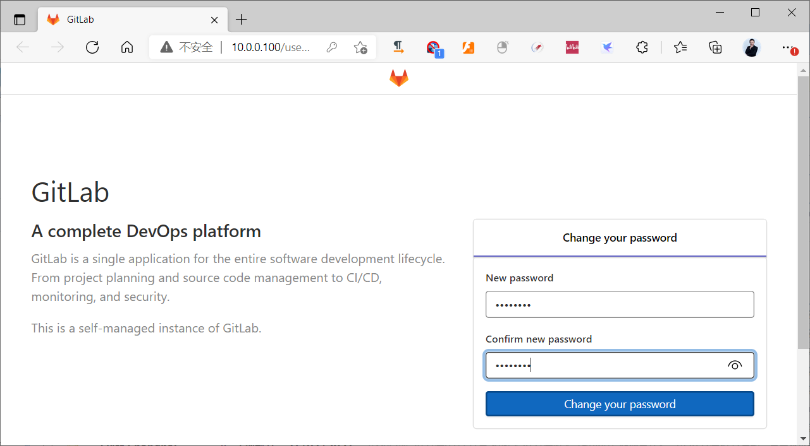

登录成功,并且收到邮件

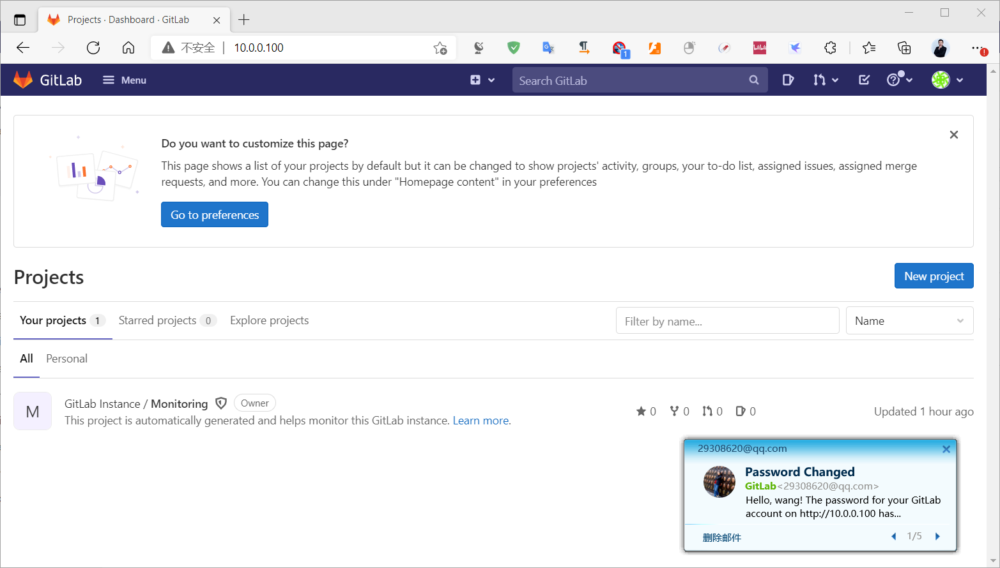

同样的方式再创建其他用户

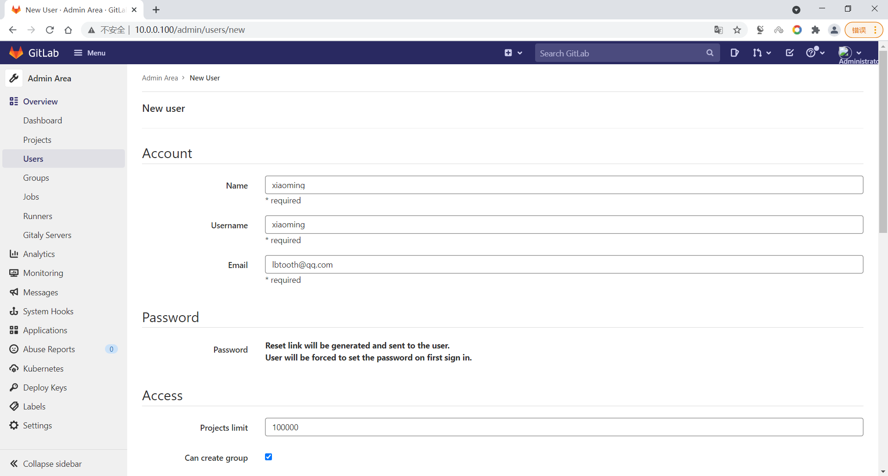

旧版界面

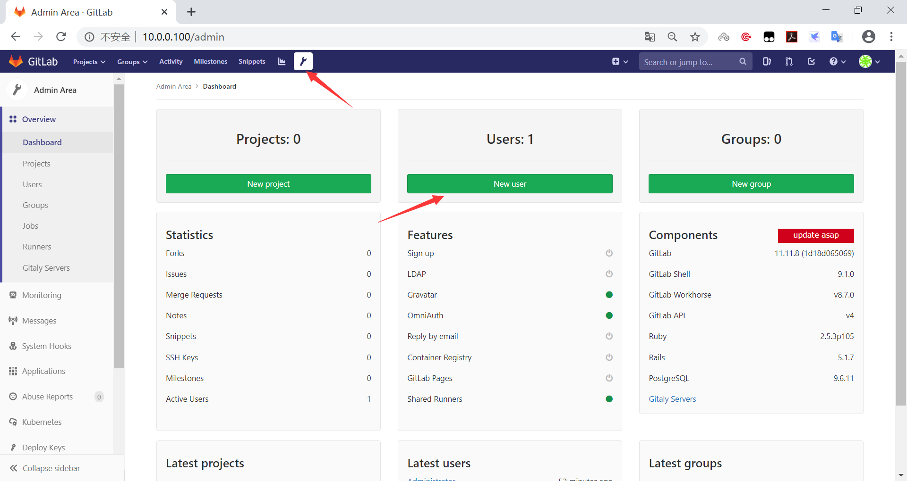

如下图，填写用户信息

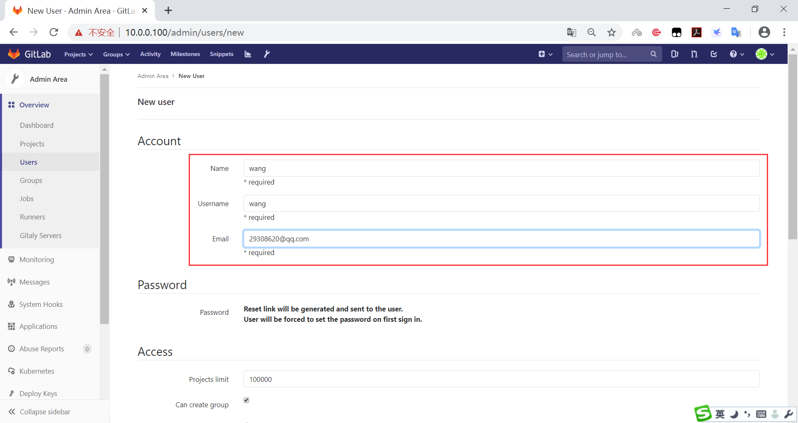

登录邮箱，可以看到注册邮件

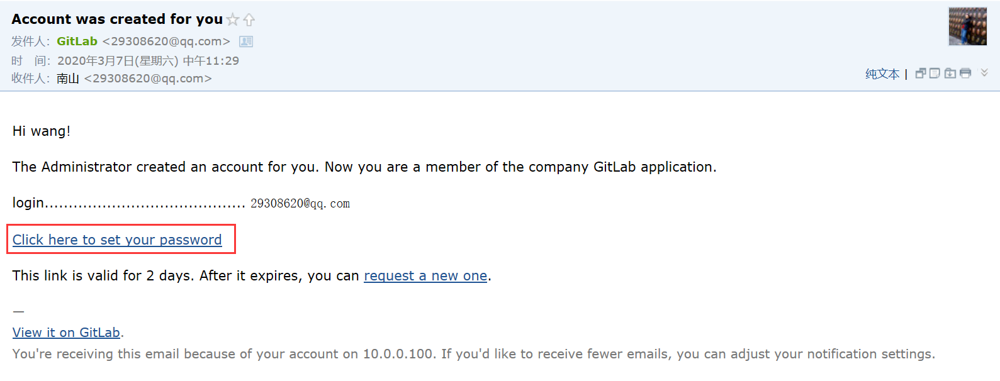

使用第一次使用新账号登录要设置密码：

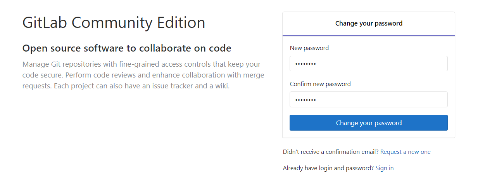

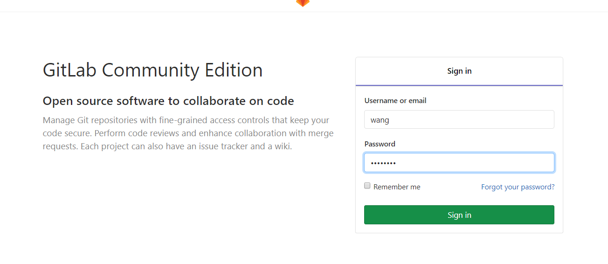

修改密码后，会收到修改密码的邮件

### 创建组群

使用管理员root 或用户都可以创建group组

一个group组里面可以拥有多个project项目分支，可以将开发的用户添加到组里，再进行设置权限

如果gitlab使用者的组织规模较大,每一个group组可以分别对应一个组织,如:某个分公司或部门

如果gitlab使用者的组织规模较小, 每一个group组也可以对应一个项目或业务,即每一个不同的group组对应同一个组织内部的不同的项目

不同的组中添加不同的开发人员帐号，即可实现对开发者实现权限的管理。 新版界面

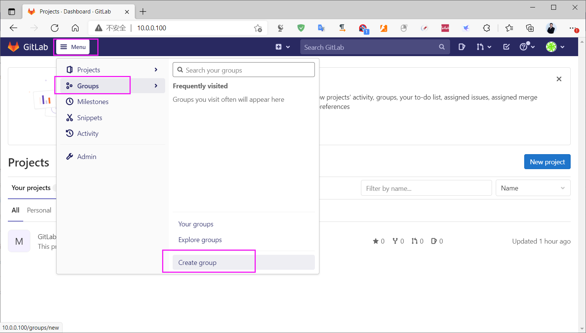

基于安全，选择private

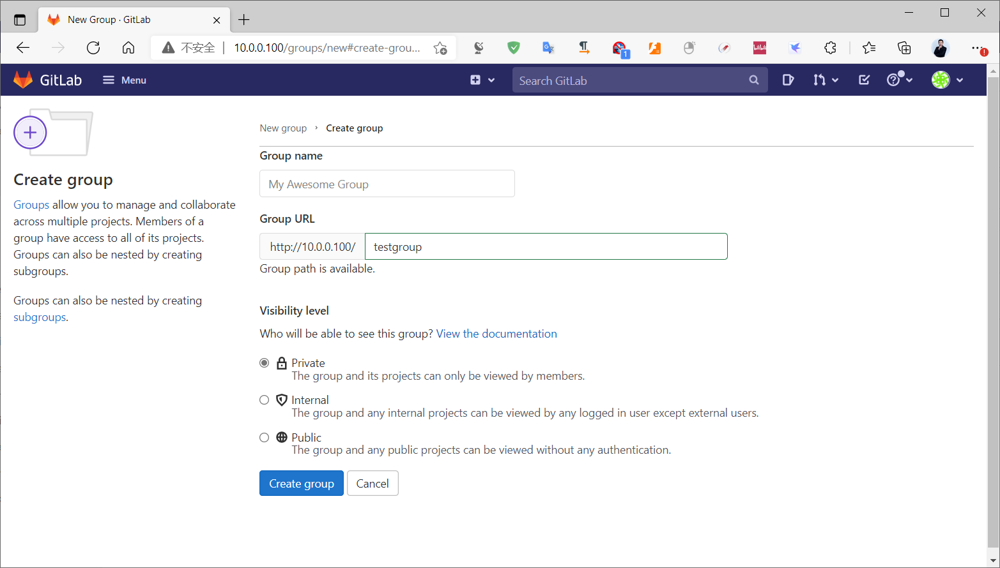



<nav class="article-end" aria-label="章节导航">
  <a href="{{ '/subjects/Git-GitLab/14-basic-gitlab-configuration.html' | relative_url }}">← Previous: Basic GitLab Configuration</a>
  <a href="{{ '/subjects/Git-GitLab/' | relative_url }}">Back to Git and GitLab Version Control Index</a>
  <a href="{{ '/subjects/Git-GitLab/16-gitlab-project-management.html' | relative_url }}">Next: GitLab Project Management →</a>
</nav>
