[← 返回Git 与 GitLab 版本控制目录]({{ '/subjects/Git-GitLab/' | relative_url }})



# 15 GitLab 用户和组管理

先建立用户身份，再用组组织项目和分配权限。这样人员变动时可以调整组成员，而不必逐个项目修改授权。下方截图来自不同版本的 GitLab，菜单位置和按钮名称可能不同，操作时以当前实例界面为准。

### 创建用户与首次登录

管理员在用户管理页面新建账号，填写姓名、用户名和可接收邮件的地址。创建前应确认该邮箱是否属于本人，以及实例是否允许自主注册；不要直接给新用户管理员权限。下面两张图展示较新版本的用户入口和信息表单。

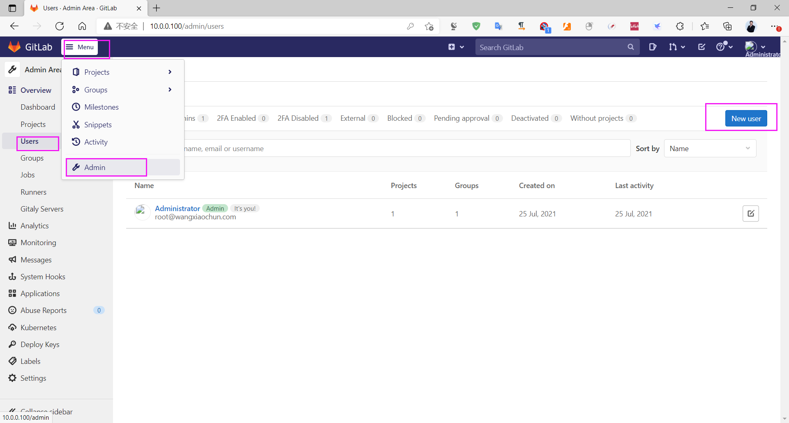

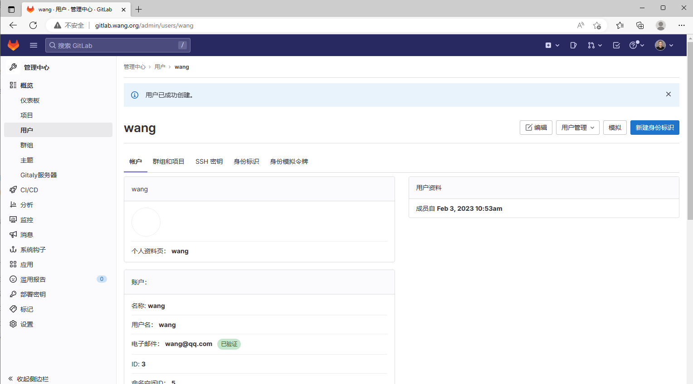

### 设置或重置密码

管理员可在用户详情中发起密码重置；若邮件服务已配置，也可让用户使用收到的重置链接自行设置密码。具体是否要求首次登录修改密码，取决于账号创建方式和 GitLab 版本。不要通过聊天或文档传递明文密码。

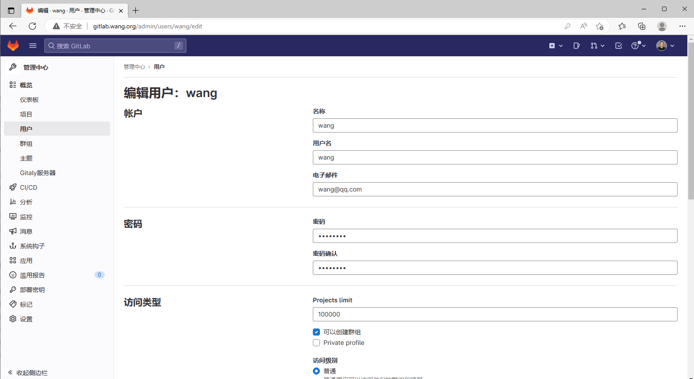

首次登录时，按页面提示完成密码设置或修改：

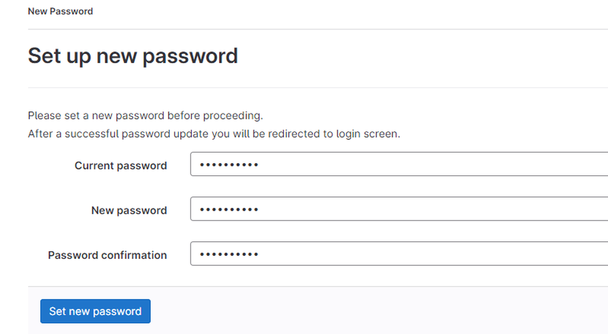

以下截图依次展示邀请／重置邮件、打开链接后的设置页面，以及登录后的确认页面：

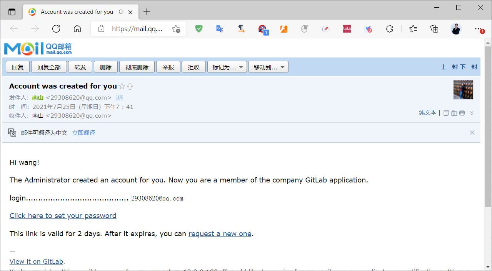

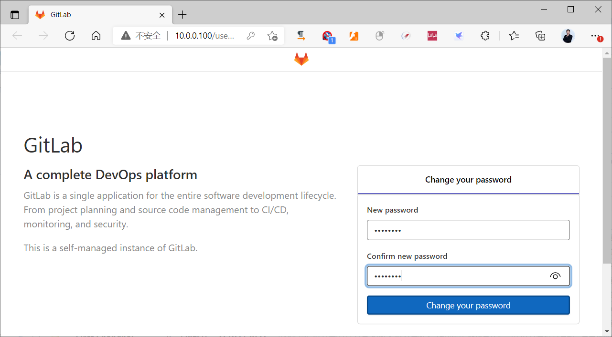

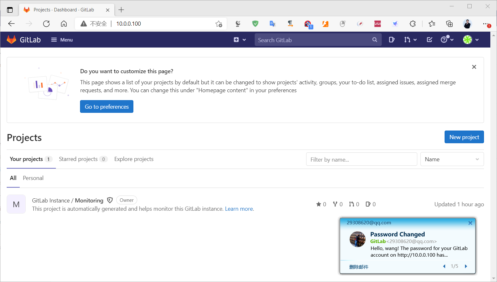

确认账号可以登录后，再按相同步骤创建其他用户，或按组织的身份管理流程批量接入。不要仅以“邮件已发送”判断账号已可用；还应检查邮件投递、链接有效期和账号状态。

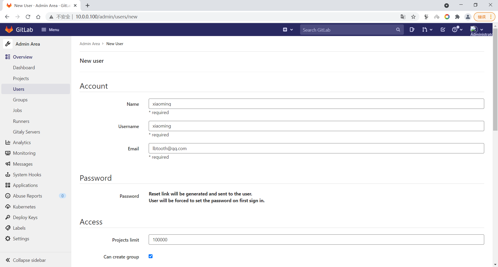

旧版 GitLab 的页面布局不同，但“创建账号—设置密码—首次登录”的流程相同。以下四张历史截图供识别界面，不必在当前版本中逐项寻找完全一致的按钮。

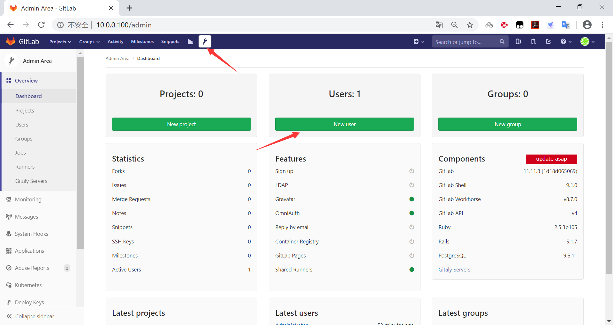

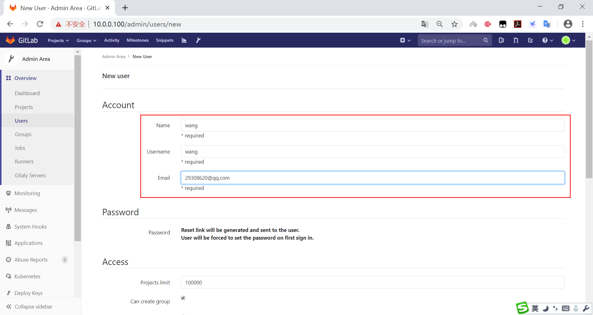

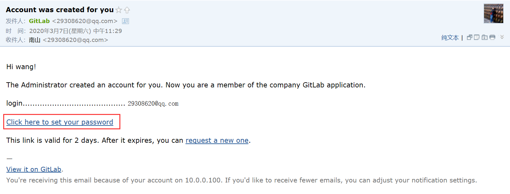

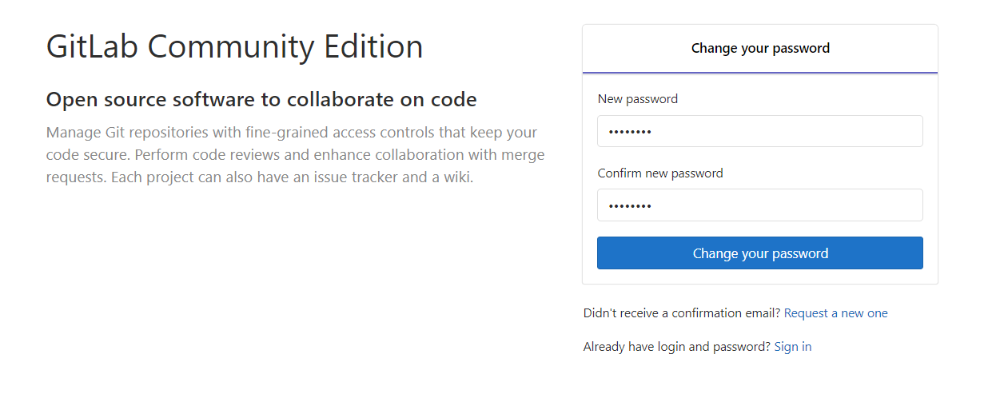

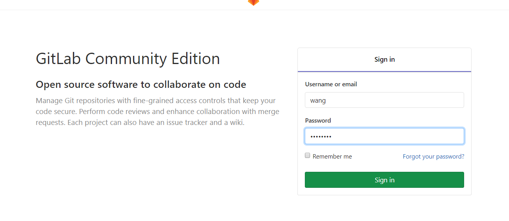

密码变更后，用户还可能收到安全通知邮件；若本人没有发起变更，应立即检查账号活动。

### 创建组并授权

拥有相应权限的用户可以创建组。一个组可包含多个项目和子组；**分支属于项目，不属于组**。大型组织可按部门建立组，小型团队也可按业务或产品划分。将成员加入组并授予适当角色后，组内项目可继承相关访问权限，因此授权前要确认组的层级和现有项目范围。

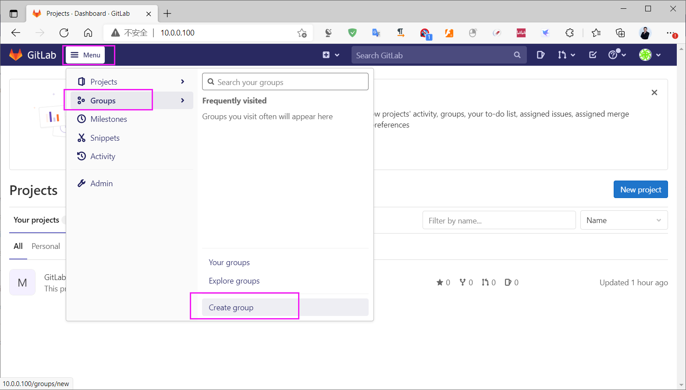

创建组时选择可见性。若项目只供组织内部使用，通常先选 **Private（私有）**，再按需邀请成员；是否使用 Internal 或 Public，应结合代码与资料的公开范围决定。创建后检查成员角色和项目继承权限，而不只检查可见性设置。

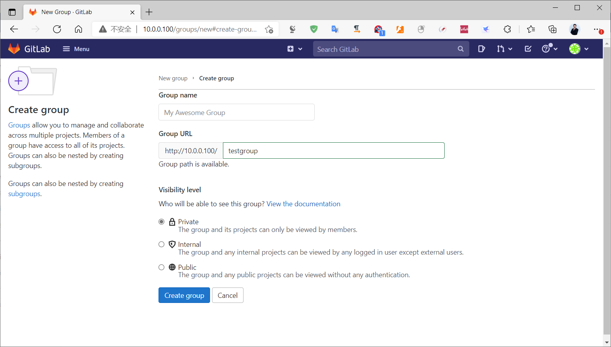



<nav class="article-end" aria-label="章节导航">
  <a href="{{ '/subjects/Git-GitLab/14-basic-gitlab-configuration.html' | relative_url }}">← 上一篇：GitLab 基础配置</a>
  <a href="{{ '/subjects/Git-GitLab/' | relative_url }}">返回 Git 与 GitLab 专题目录</a>
  <a href="{{ '/subjects/Git-GitLab/16-gitlab-project-management.html' | relative_url }}">下一篇：GitLab 项目管理 →</a>
</nav>
