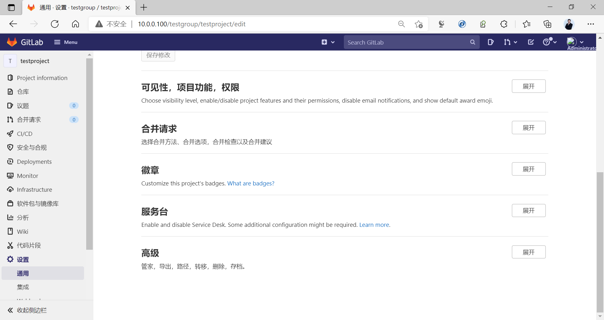
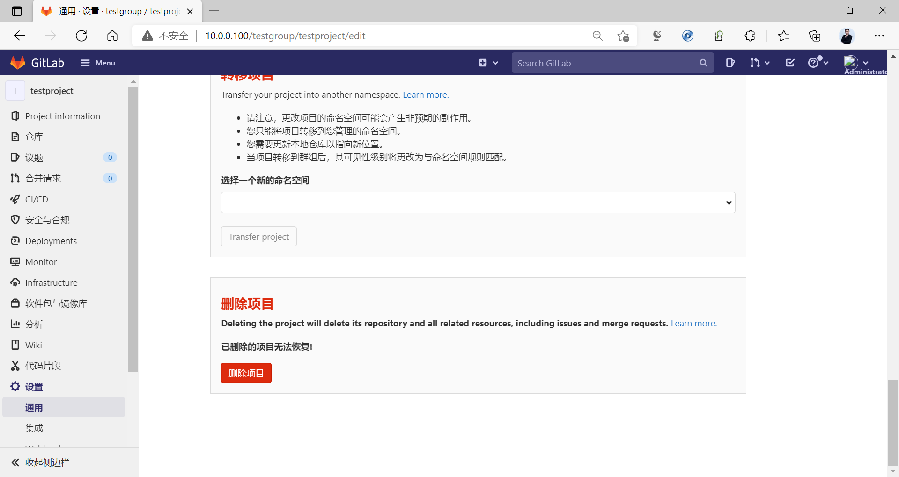
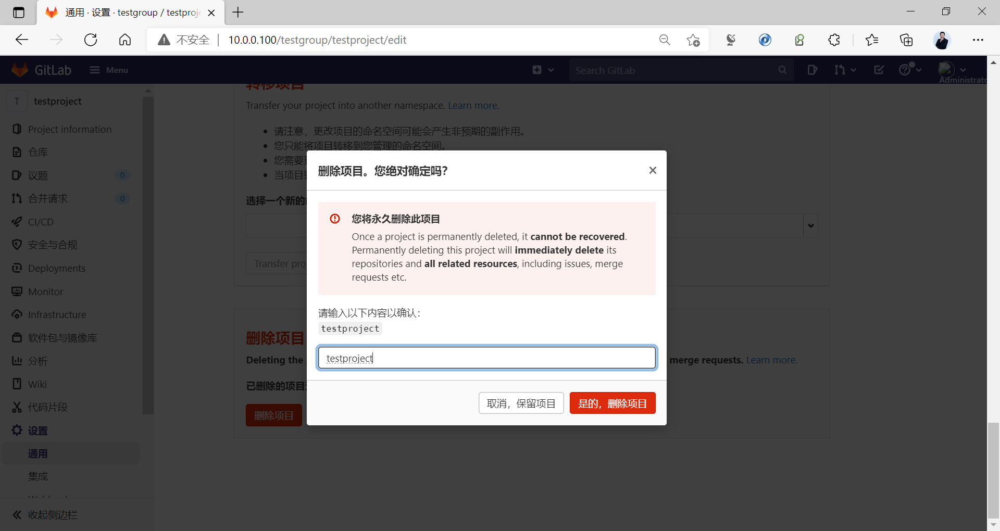
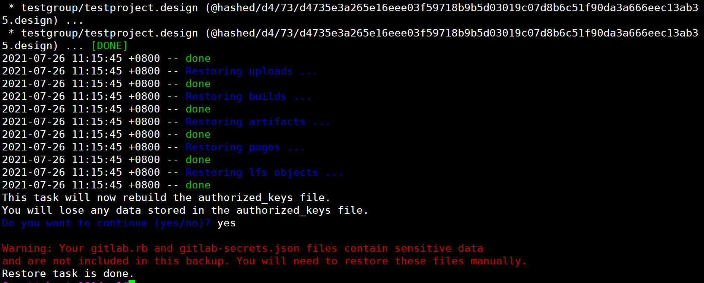
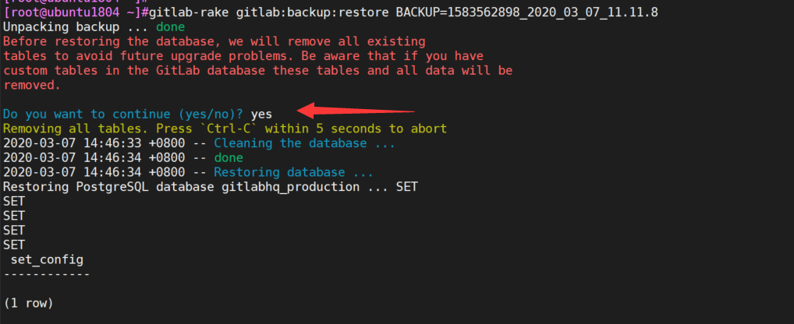
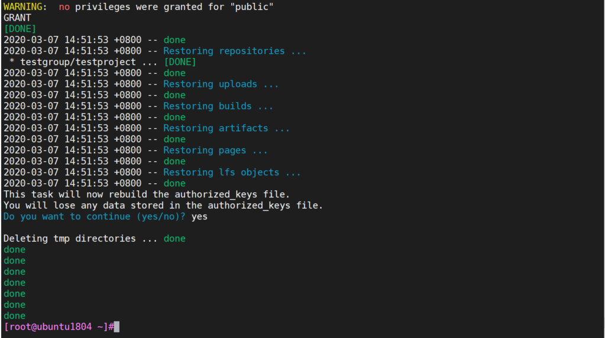
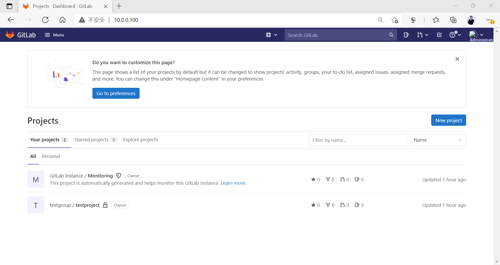

[← 返回Git 与 GitLab 版本控制目录]({{ '/subjects/Git-GitLab/' | relative_url }})



# 17 GitLab 数据备份与恢复

先区分“备份是否成功生成”和“是否能够恢复”：前者只检查输出与文件，后者还需要匹配版本、配置密钥、外部依赖与实际项目读写验证。下列旧版本终端记录用于理解步骤，恢复命令会覆盖目标实例数据，不能直接对仍在服务的生产实例试验。

数据备份和恢复官方帮助：

<https://docs.gitlab.com/ee/raketasks/backup_restore.html>

### 备份相关配置文件

```text
/etc/gitlab/gitlab.rb
/etc/gitlab/gitlab-secrets.json #双因子验证等使用此文件
```

备份配置文件命令

```text
gitlab-ctl backup-etc --backup-path <DIRECTORY>
#如果不指定--backup-path <DIRECTORY>，则默认备份至/etc/gitlab/config_backup/
```

范例：备份配置文件命令

```bash
[root@ubuntu1804 ~]#gitlab-ctl backup-etc
Could not find '/etc/gitlab/config_backup' directory. Creating.
Running configuration backup
Creating configuration backup archive: gitlab_config_1627267534_2021_07_26.tar
/etc/gitlab/
/etc/gitlab/gitlab.rb
/etc/gitlab/gitlab-secrets.json
/etc/gitlab/trusted-certs/
Configuration backup archive complete:
/etc/gitlab/config_backup/gitlab_config_1627267534_2021_07_26.tar
Keeping all older configuration backups
[root@ubuntu1804 ~]#ls /etc/gitlab/config_backup/
gitlab_config_1627267534_2021_07_26.tar
[root@ubuntu1804 ~]#tar tvf
/etc/gitlab/config_backup/gitlab_config_1627267534_2021_07_26.tar
tar: Removing leading `/' from member names
drwxrwxr-x root/root         0 2021-07-26 10:45 /etc/gitlab/
-rw------- root/root    121857 2021-07-26 09:36 /etc/gitlab/gitlab.rb
-rw------- root/root     19021 2021-07-26 09:40 /etc/gitlab/gitlab-secrets.json
drwxr-xr-x root/root         0 2021-07-26 09:37 /etc/gitlab/trusted-certs/
```

### 手动备份数据

不同版本的备份数据命令

```text
#GitLab 12.2之后版本
gitlab-backup create
#GitLab 12.1之前旧的版本
gitlab-rake gitlab:backup:create
```

备份相关配置

```bash
#默认在/etc/gitlab/gitlab.rb文件中指定备份路径，如果目录空间不足，可以修改新的目录
#注意：修改完配置需要执行gitlab-ctl reconfigure
# gitlab_rails['backup_path'] = "/var/opt/gitlab/backups"
#备份文件含仓库和用户数据，应限制访问；不要示范设为对所有用户可读的 0644。
#备份保留时长应按业务 RPO/RTO 和存储容量确定，不应假定默认为 7 天。
# gitlab_rails['backup_keep_time'] = 604800
```

### 执行备份并核对结果

软件包安装的 GitLab 可使用 `gitlab-backup create` 创建应用数据备份；较旧版本曾使用 `gitlab-rake gitlab:backup:create`。命令输出中的数据库、仓库、上传文件、CI 制品等项目应分别显示完成或明确说明跳过原因。

```bash
gitlab-backup create
ls -lh /var/opt/gitlab/backups/
gitlab-ctl backup-etc
ls -lh /etc/gitlab/config_backup/
```

**应用备份与配置备份必须同时保存。** 应用备份通常不包含 `/etc/gitlab/gitlab.rb` 和 `/etc/gitlab/gitlab-secrets.json`；后者丢失可能使加密数据不可解密。备份文件应复制到受控的独立存储，限制访问，并定期在隔离环境做恢复演练。容器、对象存储和外部数据库部署的备份范围应按实际架构另行核对。

### 恢复演练场景

截图中的“删除项目”仅用于隔离实验实例验证恢复能力。恢复前要记录目标实例当前数据，并确认备份包含目标项目；真实业务环境应使用独立恢复实例，避免为了测试而删除项目。







### 执行恢复

恢复的前提条件

```text
核对源与目标 GitLab 版本、类型及依赖是否满足目标版本的恢复要求；通常要求相同版本。
备份 gitlab.rb 与 gitlab-secrets.json，核对存储权限和外部对象存储范围。
先在隔离实例演练，确认备份文件可读、空间充足且恢复会覆盖的目标数据已另行保存。
```

新版恢复方法

```bash
#恢复前先停止两个服务
[root@ubuntu1804 ~]#gitlab-ctl stop puma
[root@ubuntu1804 ~]#gitlab-ctl stop sidekiq
#恢复时指定备份文件的时间部分，不需要指定文件的全名
[root@ubuntu1804 ~]#gitlab-backup restore BACKUP=<去掉 _gitlab_backup.tar 后缀的备份 ID>
#示例
[root@ubuntu1804 ~]#gitlab-backup restore BACKUP=1627268555_2021_07_26_14.1.0
#Next, restore /etc/gitlab/gitlab-secrets.json if necessary, as previously
mentioned.Reconfigure, restart and check GitLab:
[root@ubuntu1804 ~]#gitlab-ctl reconfigure
[root@ubuntu1804 ~]#gitlab-ctl restart
# 后续检查不能只看页面是否打开；至少运行内置检查并验证用户、仓库读写和关键附件。
[root@ubuntu1804 ~]#gitlab-rake gitlab:check SANITIZE=true
#In GitLab 13.1 and later, check database values can be decrypted especially if
/etc/gitlab/gitlab-secrets.json was restored, or if a different server is the
target for the restore.
[root@ubuntu1804 ~]#gitlab-rake gitlab:doctor:secrets
```

旧版恢复方法

```bash
#恢复前先停止两个服务
[root@ubuntu1804 ~]#gitlab-ctl stop unicorn
[root@ubuntu1804 ~]#gitlab-ctl stop sidekiq
#恢复时指定备份文件的时间部分，不需要指定文件的全名
[root@ubuntu1804 ~]# gitlab-rake gitlab:backup:restore BACKUP=备份文件名的时间部分
```

范例：新版恢复过程

```bash
[root@ubuntu1804 ~]#gitlab-ctl stop puma
[root@ubuntu1804 ~]#gitlab-ctl stop sidekiq
[root@ubuntu1804 ~]#gitlab-ctl status
run: alertmanager: (pid 886) 486s; run: log: (pid 863) 486s
run: gitaly: (pid 916) 485s; run: log: (pid 872) 486s
run: gitlab-exporter: (pid 888) 486s; run: log: (pid 857) 486s
run: gitlab-workhorse: (pid 909) 485s; run: log: (pid 865) 486s
run: grafana: (pid 908) 485s; run: log: (pid 871) 486s
run: logrotate: (pid 910) 485s; run: log: (pid 864) 486s
run: nginx: (pid 905) 485s; run: log: (pid 884) 486s
run: node-exporter: (pid 885) 486s; run: log: (pid 882) 486s
run: postgres-exporter: (pid 906) 485s; run: log: (pid 880) 486s
run: postgresql: (pid 917) 485s; run: log: (pid 878) 486s
run: prometheus: (pid 887) 486s; run: log: (pid 858) 486s
down: puma: 386s, normally up; run: log: (pid 879) 486s
run: redis: (pid 915) 485s; run: log: (pid 883) 486s
run: redis-exporter: (pid 907) 485s; run: log: (pid 870) 486s
down: sidekiq: 379s, normally up; run: log: (pid 881) 486s
#确保备份的版本名称
[root@ubuntu1804 ~]#ll
/var/opt/gitlab/backups/1627268555_2021_07_26_14.1.0_gitlab_backup.tar
-rw------- 1 git git 307200 Jul 26 11:02
/var/opt/gitlab/backups/1627268555_2021_07_26_14.1.0_gitlab_backup.tar
#注意：备份文件所有目录及权限属性，无需指定完整文件名
[root@ubuntu1804 ~]#gitlab-backup restore BACKUP=1627268555_2021_07_26_14.1.0
[root@ubuntu1804 ~]#gitlab-ctl reconfigure
[root@ubuntu1804 ~]#gitlab-ctl restart
ok: run: alertmanager: (pid 1853) 1s
ok: run: gitaly: (pid 1861) 1s
ok: run: gitlab-exporter: (pid 1883) 0s
ok: run: gitlab-workhorse: (pid 1885) 0s
ok: run: grafana: (pid 1893) 1s
ok: run: logrotate: (pid 1903) 0s
ok: run: nginx: (pid 1909) 1s
ok: run: node-exporter: (pid 1991) 0s
ok: run: postgres-exporter: (pid 1997) 0s
ok: run: postgresql: (pid 2006) 0s
ok: run: prometheus: (pid 2015) 1s
ok: run: puma: (pid 2023) 0s
ok: run: redis: (pid 2029) 1s
ok: run: redis-exporter: (pid 2035) 0s
ok: run: sidekiq: (pid 2041) 0s
#观察日志，等待恢复完成，需要再等一会儿再验证是否恢复
[root@ubuntu1804 ~]#gitlab-ctl  tail
```



范例：旧版恢复过程



确认恢复数据：



恢复后再将之前停止的两个服务启动

```bash
[root@ubuntu1804 ~]# gitlab-ctl start sidekiq
ok: run: sidekiq: (pid 16859) 0s
[root@ubuntu1804 ~]# gitlab-ctl start unicorn
ok: run: unicorn: (pid 16882) 1s
#或者执行下面也可以
[root@ubuntu1804 ~]# gitlab-ctl restart
```

### 确保还原完成

恢复后检查项目与用户信息，并实际克隆测试仓库、核对附件或 CI 制品；再确认后台作业和邮件、SSO 等外部集成正常。只有页面可访问并不能证明恢复完整。

注意：可能需要等一段时间才能打开浏览器进行访问





<nav class="article-end" aria-label="章节导航">
  <a href="{{ '/subjects/Git-GitLab/16-gitlab-project-management.html' | relative_url }}">← 上一篇：GitLab 项目管理</a>
  <a href="{{ '/subjects/Git-GitLab/' | relative_url }}">返回 Git 与 GitLab 版本控制目录</a>
  <a href="{{ '/subjects/Git-GitLab/18-gitlab-localization.html' | relative_url }}">下一篇：GitLab 汉化 →</a>
</nav>
