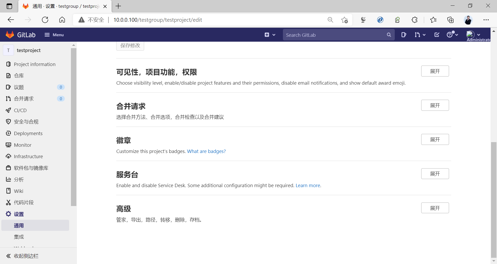
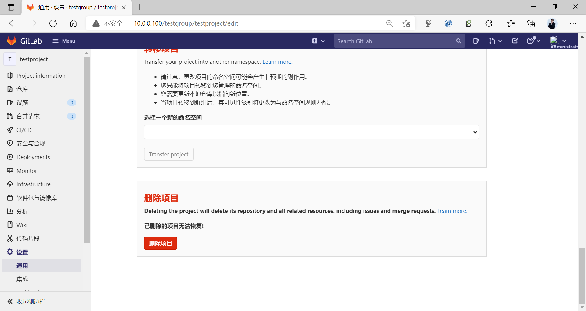
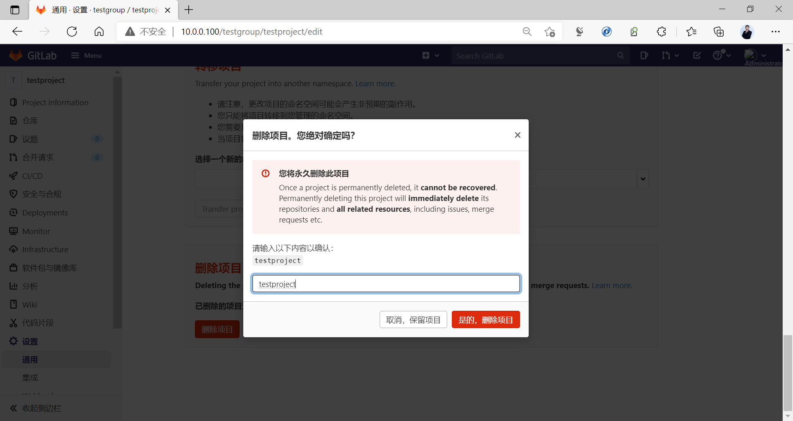
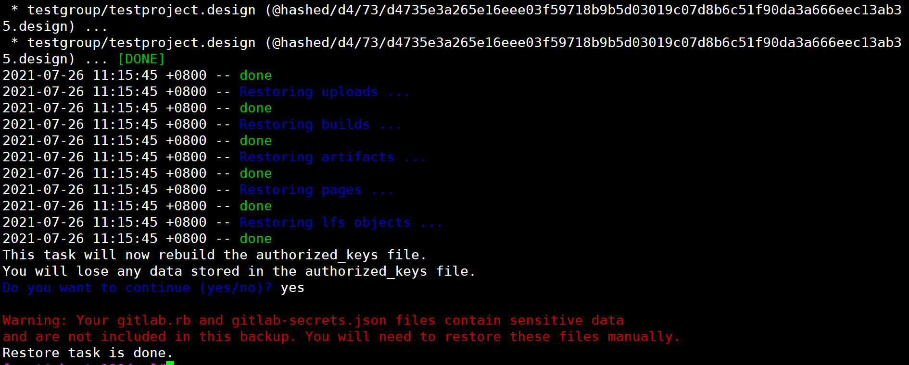
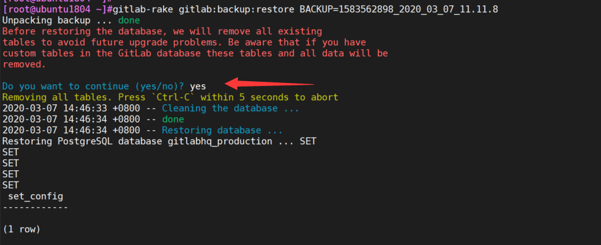
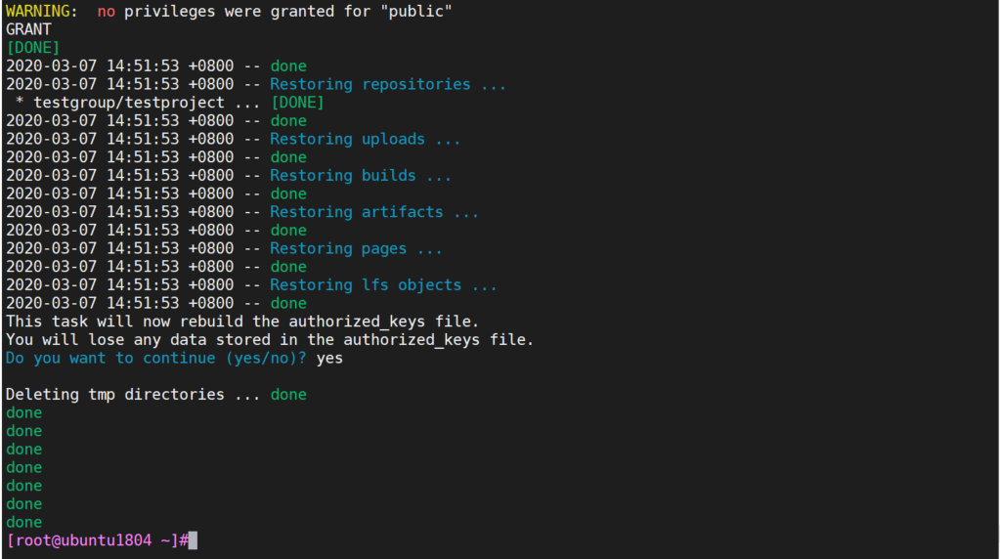
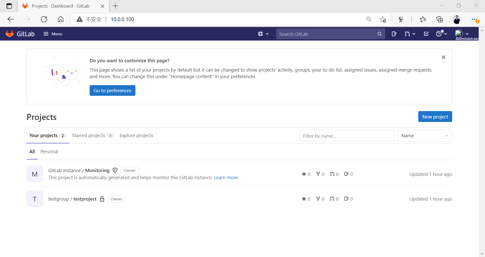

[← Back to Git and GitLab Version Control Index]({{ '/subjects/Git-GitLab/' | relative_url }})



# 17 GitLab Data Backup and Recovery
### 3.6 GitLab 的数据备份和恢复

数据备份和恢复官方帮助：

<https://docs.gitlab.com/ee/raketasks/backup_restore.html>

### 备份相关配置文件

```text
/etc/gitlab/gitlab.rb
/etc/gitlab/gitlab-secrets.json #双因子验证等使用此文件
```

备份配置文件命令

```text
gitlab-ctl backup-etc --backup-path <DIRECTORY>
#如果不指定--backup-path <DIRECTORY>，则默认备份至/etc/gitlab/config_backup/
```

范例：备份配置文件命令

```bash
[root@ubuntu1804 ~]#gitlab-ctl backup-etc
Could not find '/etc/gitlab/config_backup' directory. Creating.
Running configuration backup
Creating configuration backup archive: gitlab_config_1627267534_2021_07_26.tar
/etc/gitlab/
/etc/gitlab/gitlab.rb
/etc/gitlab/gitlab-secrets.json
/etc/gitlab/trusted-certs/
Configuration backup archive complete:
/etc/gitlab/config_backup/gitlab_config_1627267534_2021_07_26.tar
Keeping all older configuration backups
[root@ubuntu1804 ~]#ls /etc/gitlab/config_backup/
gitlab_config_1627267534_2021_07_26.tar
[root@ubuntu1804 ~]#tar tvf
/etc/gitlab/config_backup/gitlab_config_1627267534_2021_07_26.tar
tar: Removing leading `/' from member names
drwxrwxr-x root/root         0 2021-07-26 10:45 /etc/gitlab/
-rw------- root/root    121857 2021-07-26 09:36 /etc/gitlab/gitlab.rb
-rw------- root/root     19021 2021-07-26 09:40 /etc/gitlab/gitlab-secrets.json
drwxr-xr-x root/root         0 2021-07-26 09:37 /etc/gitlab/trusted-certs/
```

### 手动备份数据

不同版本的备份数据命令

```text
#GitLab 12.2之后版本
gitlab-backup create
#GitLab 12.1之前旧的版本
gitlab-rake gitlab:backup:create
```

备份相关配置

```bash
#默认在/etc/gitlab/gitlab.rb文件中指定备份路径，如果目录空间不足，可以修改新的目录
#注意：修改完配置需要执行gitlab-ctl reconfigure
# gitlab_rails['backup_path'] = "/var/opt/gitlab/backups"
#备份的文件权限，所有者和所属组为git
# gitlab_rails['backup_archive_permissions'] = 0644
#默认备份过期时长为7天，单位为s, 之后会被自动删除
# gitlab_rails['backup_keep_time'] = 604800
```

范例：新版备份

```bash
[root@ubuntu1804 ~]#gitlab-backup create
2021-07-26 11:02:32 +0800 -- Dumping database ...
Dumping PostgreSQL database gitlabhq_production ... [DONE]
2021-07-26 11:02:35 +0800 -- done
2021-07-26 11:02:35 +0800 -- Dumping repositories ...
* gitlab-instance-d0dfe28d/Monitoring
(@hashed/6b/86/6b86b273ff34fce19d6b804eff5a3f5747ada4eaa22f1d49c01e52ddb7875b4b)
...
* gitlab-instance-d0dfe28d/Monitoring
(@hashed/6b/86/6b86b273ff34fce19d6b804eff5a3f5747ada4eaa22f1d49c01e52ddb7875b4b)
... [EMPTY] [SKIPPED]
* gitlab-instance-d0dfe28d/Monitoring.wiki
(@hashed/6b/86/6b86b273ff34fce19d6b804eff5a3f5747ada4eaa22f1d49c01e52ddb7875b4b.
wiki) ...
* gitlab-instance-d0dfe28d/Monitoring.wiki
(@hashed/6b/86/6b86b273ff34fce19d6b804eff5a3f5747ada4eaa22f1d49c01e52ddb7875b4b.
wiki) ... [EMPTY] [SKIPPED]
* gitlab-instance-d0dfe28d/Monitoring.design
(@hashed/6b/86/6b86b273ff34fce19d6b804eff5a3f5747ada4eaa22f1d49c01e52ddb7875b4b.
design) ...
* gitlab-instance-d0dfe28d/Monitoring.design
(@hashed/6b/86/6b86b273ff34fce19d6b804eff5a3f5747ada4eaa22f1d49c01e52ddb7875b4b.
design) ... [EMPTY] [SKIPPED]
* testgroup/testproject
(@hashed/d4/73/d4735e3a265e16eee03f59718b9b5d03019c07d8b6c51f90da3a666eec13ab35)
...
* testgroup/testproject
(@hashed/d4/73/d4735e3a265e16eee03f59718b9b5d03019c07d8b6c51f90da3a666eec13ab35)
... [DONE]
* testgroup/testproject.wiki
(@hashed/d4/73/d4735e3a265e16eee03f59718b9b5d03019c07d8b6c51f90da3a666eec13ab35.
wiki) ...
* testgroup/testproject.wiki
(@hashed/d4/73/d4735e3a265e16eee03f59718b9b5d03019c07d8b6c51f90da3a666eec13ab35.
wiki) ... [EMPTY] [SKIPPED]
* testgroup/testproject.design
(@hashed/d4/73/d4735e3a265e16eee03f59718b9b5d03019c07d8b6c51f90da3a666eec13ab35.
design) ...
* testgroup/testproject.design
(@hashed/d4/73/d4735e3a265e16eee03f59718b9b5d03019c07d8b6c51f90da3a666eec13ab35.
design) ... [EMPTY] [SKIPPED]
2021-07-26 11:02:35 +0800 -- done
2021-07-26 11:02:35 +0800 -- Dumping uploads ...
2021-07-26 11:02:35 +0800 -- done
2021-07-26 11:02:35 +0800 -- Dumping builds ...
2021-07-26 11:02:35 +0800 -- done
2021-07-26 11:02:35 +0800 -- Dumping artifacts ...
2021-07-26 11:02:35 +0800 -- done
2021-07-26 11:02:35 +0800 -- Dumping pages ...
2021-07-26 11:02:35 +0800 -- done
2021-07-26 11:02:35 +0800 -- Dumping lfs objects ...
2021-07-26 11:02:35 +0800 -- done
2021-07-26 11:02:35 +0800 -- Dumping container registry images ...
2021-07-26 11:02:35 +0800 -- [DISABLED]
Creating backup archive: 1627268555_2021_07_26_14.1.0_gitlab_backup.tar ... done
Uploading backup archive to remote storage  ... skipped
Deleting tmp directories ... done
done
done
done
done
done
done
done
Deleting old backups ... skipping
Warning: Your gitlab.rb and gitlab-secrets.json files contain sensitive data
and are not included in this backup. You will need these files to restore a
backup.
Please back them up manually.
Backup task is done.
#默认备份保存在下面目录
[root@ubuntu1804 ~]#ll /var/opt/gitlab/backups/
-rw-------  1 git  git  307200 Jul 26 11:02
1627268555_2021_07_26_14.1.0_gitlab_backup.tar
```

范例： 旧版备份数据

```bash
#在任意目录即可备份当前gitlab数据
[root@ubuntu1804 ~]#gitlab-rake gitlab:backup:create
2020-03-07 14:34:56 +0800 -- Dumping database ...
Dumping PostgreSQL database gitlabhq_production ... [DONE]
2020-03-07 14:34:57 +0800 -- done
2020-03-07 14:34:57 +0800 -- Dumping repositories ...
* testgroup/testproject ... [DONE]
[SKIPPED] Wiki
2020-03-07 14:34:58 +0800 -- done
2020-03-07 14:34:58 +0800 -- Dumping uploads ...
2020-03-07 14:34:58 +0800 -- done
2020-03-07 14:34:58 +0800 -- Dumping builds ...
2020-03-07 14:34:58 +0800 -- done
2020-03-07 14:34:58 +0800 -- Dumping artifacts ...
2020-03-07 14:34:58 +0800 -- done
2020-03-07 14:34:58 +0800 -- Dumping pages ...
2020-03-07 14:34:58 +0800 -- done
2020-03-07 14:34:58 +0800 -- Dumping lfs objects ...
2020-03-07 14:34:58 +0800 -- done
2020-03-07 14:34:58 +0800 -- Dumping container registry images ...
2020-03-07 14:34:58 +0800 -- [DISABLED]
Creating backup archive: 1583562898_2020_03_07_11.11.8_gitlab_backup.tar ...
done
Uploading backup archive to remote storage  ... skipped
Deleting tmp directories ... done
done
done
done
done
done
done
done
Deleting old backups ... skipping
[root@ubuntu1804 ~]#ll /var/opt/gitlab/backups/
-rw-------  1 git git 102400 Mar  7 14:34
1583562898_2020_03_07_11.11.8_gitlab_backup.tar
```

### 模拟删除项目







### 执行恢复

恢复的前提条件

```text
备份和恢复使用的版本要一致
还原相关配置文件后，执行gitlab-ctl reconfigure
确保gitlab正在运行状态
```

新版恢复方法

```bash
#恢复前先停止两个服务
[root@ubuntu1804 ~]#gitlab-ctl stop puma
[root@ubuntu1804 ~]#gitlab-ctl stop sidekiq
#恢复时指定备份文件的时间部分，不需要指定文件的全名
[root@ubuntu1804 ~]#gitlab-backup restore BACKUP=备份文件名的时间部分_Gitlab版本
#示例
[root@ubuntu1804 ~]#gitlab-backup restore BACKUP=1583562898_2020_03_07_11.11.8
#Next, restore /etc/gitlab/gitlab-secrets.json if necessary, as previously
mentioned.Reconfigure, restart and check GitLab:
[root@ubuntu1804 ~]#gitlab-ctl reconfigure
[root@ubuntu1804 ~]#gitlab-ctl restart
#后续检查可选做
[root@ubuntu1804 ~]#gitlab-rake gitlab:check SANITIZE=true
#In GitLab 13.1 and later, check database values can be decrypted especially if
/etc/gitlab/gitlab-secrets.json was restored, or if a different server is the
target for the restore.
[root@ubuntu1804 ~]#gitlab-rake gitlab:doctor:secrets
```

旧版恢复方法

```bash
#恢复前先停止两个服务
[root@ubuntu1804 ~]#gitlab-ctl stop unicorn
[root@ubuntu1804 ~]#gitlab-ctl stop sidekiq
#恢复时指定备份文件的时间部分，不需要指定文件的全名
[root@ubuntu1804 ~]# gitlab-rake gitlab:backup:restore BACKUP=备份文件名的时间部分
```

范例：新版恢复过程

```bash
[root@ubuntu1804 ~]#gitlab-ctl stop puma
[root@ubuntu1804 ~]#gitlab-ctl stop sidekiq
[root@ubuntu1804 ~]#gitlab-ctl status
run: alertmanager: (pid 886) 486s; run: log: (pid 863) 486s
run: gitaly: (pid 916) 485s; run: log: (pid 872) 486s
run: gitlab-exporter: (pid 888) 486s; run: log: (pid 857) 486s
run: gitlab-workhorse: (pid 909) 485s; run: log: (pid 865) 486s
run: grafana: (pid 908) 485s; run: log: (pid 871) 486s
run: logrotate: (pid 910) 485s; run: log: (pid 864) 486s
run: nginx: (pid 905) 485s; run: log: (pid 884) 486s
run: node-exporter: (pid 885) 486s; run: log: (pid 882) 486s
run: postgres-exporter: (pid 906) 485s; run: log: (pid 880) 486s
run: postgresql: (pid 917) 485s; run: log: (pid 878) 486s
run: prometheus: (pid 887) 486s; run: log: (pid 858) 486s
down: puma: 386s, normally up; run: log: (pid 879) 486s
run: redis: (pid 915) 485s; run: log: (pid 883) 486s
run: redis-exporter: (pid 907) 485s; run: log: (pid 870) 486s
down: sidekiq: 379s, normally up; run: log: (pid 881) 486s
#确保备份的版本名称
[root@ubuntu1804 ~]#ll
/var/opt/gitlab/backups/1627268555_2021_07_26_14.1.0_gitlab_backup.tar
-rw------- 1 git git 307200 Jul 26 11:02
/var/opt/gitlab/backups/1627268555_2021_07_26_14.1.0_gitlab_backup.tar
#注意：备份文件所有目录及权限属性，无需指定完整文件名
[root@ubuntu1804 ~]#gitlab-backup restore BACKUP=1627268555_2021_07_26_14.1.0
[root@ubuntu1804 ~]#gitlab-ctl reconfigure
[root@ubuntu1804 ~]#gitlab-ctl restart
ok: run: alertmanager: (pid 1853) 1s
ok: run: gitaly: (pid 1861) 1s
ok: run: gitlab-exporter: (pid 1883) 0s
ok: run: gitlab-workhorse: (pid 1885) 0s
ok: run: grafana: (pid 1893) 1s
ok: run: logrotate: (pid 1903) 0s
ok: run: nginx: (pid 1909) 1s
ok: run: node-exporter: (pid 1991) 0s
ok: run: postgres-exporter: (pid 1997) 0s
ok: run: postgresql: (pid 2006) 0s
ok: run: prometheus: (pid 2015) 1s
ok: run: puma: (pid 2023) 0s
ok: run: redis: (pid 2029) 1s
ok: run: redis-exporter: (pid 2035) 0s
ok: run: sidekiq: (pid 2041) 0s
#观察日志，等待恢复完成，需要再等一会儿再验证是否恢复
[root@ubuntu1804 ~]#gitlab-ctl  tail
```



范例：旧版恢复过程



确认恢复数据：



恢复后再将之前停止的两个服务启动

```bash
[root@ubuntu1804 ~]# gitlab-ctl start sidekiq
ok: run: sidekiq: (pid 16859) 0s
[root@ubuntu1804 ~]# gitlab-ctl start unicorn
ok: run: unicorn: (pid 16882) 1s
#或者执行下面也可以
[root@ubuntu1804 ~]# gitlab-ctl restart
```

### 确保还原完成

恢复后，项目及用户信息都已还原

注意：可能需要等一段时间才能打开浏览器进行访问





<nav class="article-end" aria-label="章节导航">
  <a href="{{ '/subjects/Git-GitLab/16-gitlab-project-management.html' | relative_url }}">← Previous: GitLab Project Management</a>
  <a href="{{ '/subjects/Git-GitLab/' | relative_url }}">Back to Git and GitLab Version Control Index</a>
  <a href="{{ '/subjects/Git-GitLab/18-gitlab-localization.html' | relative_url }}">Next: GitLab Localization →</a>
</nav>
