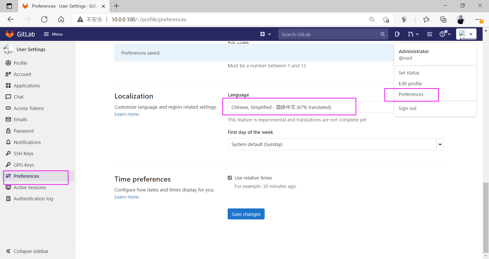
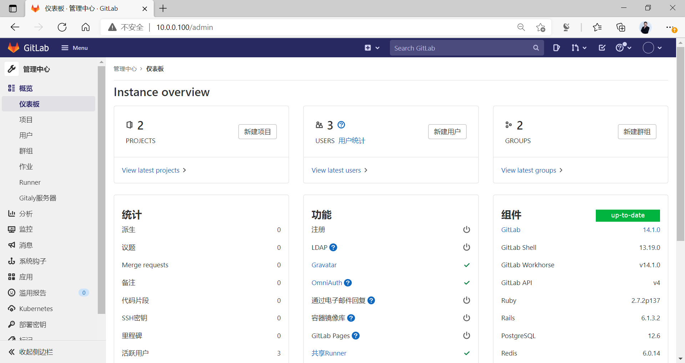
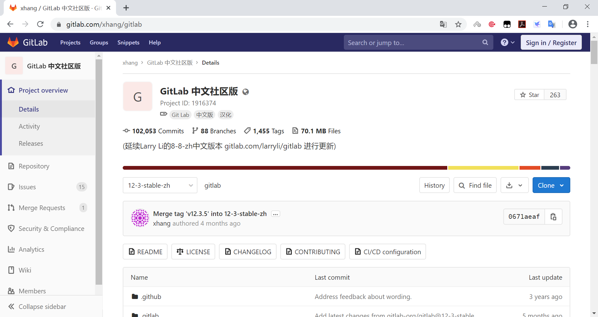
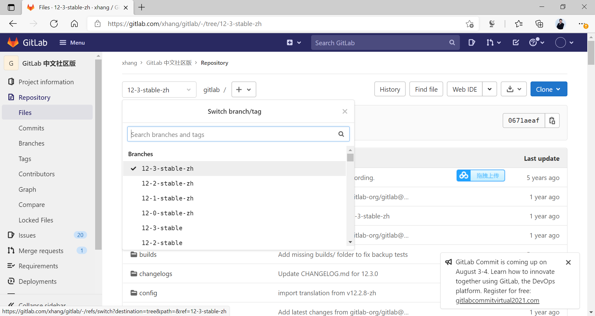
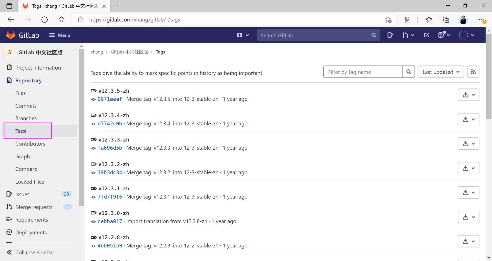
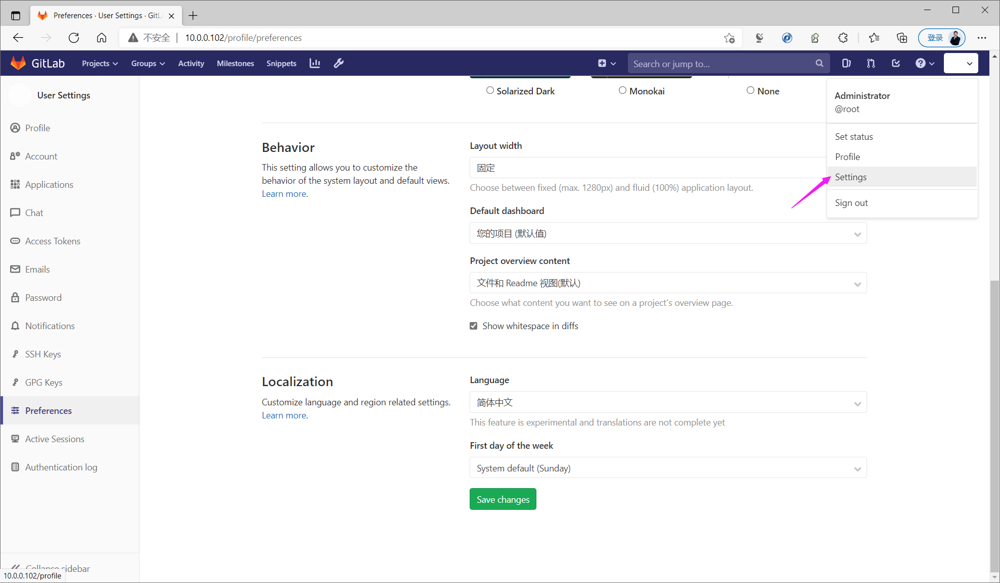
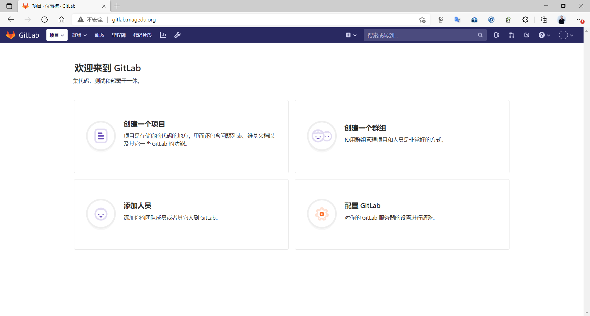
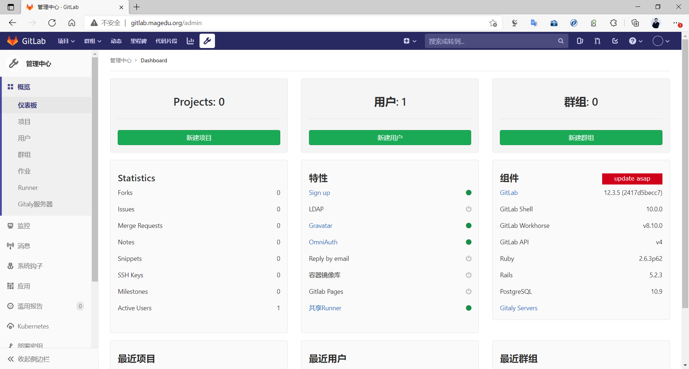

[← Back to Git and GitLab Version Control Index]({{ '/subjects/Git-GitLab/' | relative_url }})



# 18 GitLab Localization
### 3.7 GitLab 汉化

gitlab 默认是英文界面，可以汉化为中文界面，有三种汉化方式

### 官方内置的配置实现汉化

GitLab 自带中文语言支持，但汉化的不彻底，可以通过下面配置修改语言显示



查看效果



### 第三方汉化包(可选)

当前的最新版官方汉化已经非常接近100%，所以无需再使用第三方汉化方式

基于第三方开发爱好者实现,通过GitLab 中文社区版进行汉化，此项目更新较慢,只支持特定的较老版本

当前只支持12.2版本

注意： 选择相同的版本才能汉化

汉化包地址：

<https://gitlab.com/xhang/gitlab>







下载对应版本的语言包替换

<https://gitlab.com/xhang/gitlab/-/archive/v12.3.5-zh/gitlab-v12.3.5-zh.tar>

<https://gitlab.com/xhang/gitlab/-/archive/v11.11.5-zh/gitlab-v11.11.5-zh.tar>

<https://gitlab.com/xhang/gitlab/-/archive/v11.9.8-zh/gitlab-v11.9.8-zh.tar>

### 通过第三方汉化包直接替换实现

```bash
# gitlab-ctl stop
# wget https://gitlab.com/xhang/gitlab/-/archive/v12.3.5-zh/gitlab-v12.3.5-
zh.tar
# tar xvf gitlab-vX.Y.Z-zh.tar
# cp -rp /opt/gitlab/embedded/service/gitlab-rails /opt/gitlab-rails.bak #备份源文
件
# cp -rf gitlab-vX.Y.Z-zh/* /opt/gitlab/embedded/service/gitlab-rails/ #替换文件
# gitlab-ctl reconfigure
# gitlab-ctl start
```

Web 界面更改语言：

右上角的账户下拉框选Settings然后左侧Preferences设置项，然后语言选择中文


保存后刷新界面


### 通过第三方汉化包对比进行汉化

本方式汉化效果比上面方式更好，推荐使用

```bash
# cd ~
# git clone https://gitlab.com/xhang/gitlab.git
# head -1 /opt/gitlab/version-manifest.txt #查看当前gitlab版本
# gitlab_version=$(cat /opt/gitlab/embedded/service/gitlab-rails/VERSION)
# cd gitlab
# git diff v${gitlab_version} v${gitlab_version}-zh > /root/${gitlab_version}-
zh.diff
# gitlab-ctl stop
# patch -f -d /opt/gitlab/embedded/service/gitlab-rails -p1 <
/root/${gitlab_version}-zh.diff
# gitlab-ctl reconfigure
# gitlab-ctl start
# gitlab-ctl status
```

Web 界面更改语言：

右上角的账户下拉框选Settings然后左侧Preferences设置项，然后语言选择中文









<nav class="article-end" aria-label="章节导航">
  <a href="{{ '/subjects/Git-GitLab/17-gitlab-data-backup-and-recovery.html' | relative_url }}">← Previous: GitLab Data Backup and Recovery</a>
  <a href="{{ '/subjects/Git-GitLab/' | relative_url }}">Back to Git and GitLab Version Control Index</a>
  <a href="{{ '/subjects/Git-GitLab/19-gitlab-migration-and-upgrades.html' | relative_url }}">Next: GitLab Migration and Upgrades →</a>
</nav>
