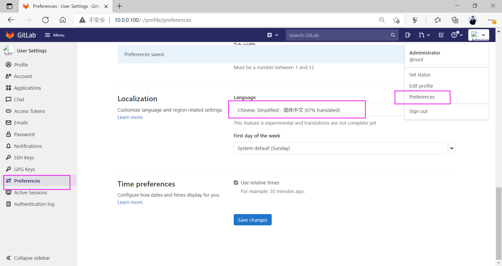
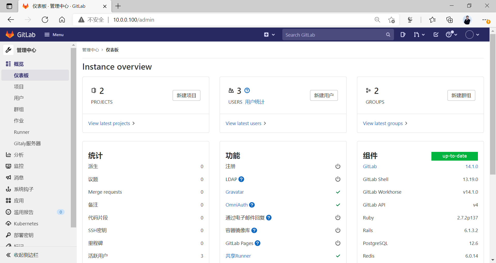
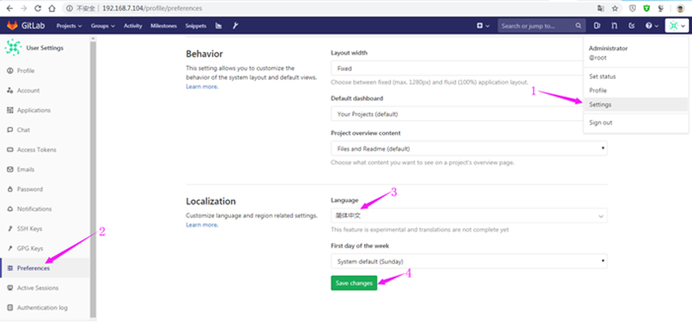

[← 返回 Git 与 GitLab 版本控制目录]({{ '/subjects/Git-GitLab/' | relative_url }})



# 18 GitLab 汉化

GitLab 已内置简体中文。对当前版本，先使用产品提供的语言设置；旧资料中的两种第三方汉化包方式只适用于特定历史版本，升级时还可能覆盖安装目录，不适合作为日常部署步骤。

## 设置中文界面

管理员可在管理区域检查实例的默认语言；这个设置影响新用户的初始体验，不会强行覆盖已有用户的个人偏好。不同版本的菜单位置可能变化，先在当前版本界面中查找语言或本地化设置。

设置后用新账户或无痕会话验证默认界面语言，同时检查邮件和项目页面是否符合预期；部分术语可能仍保留英文。

## 个人账户选择中文

登录后进入个人头像菜单中的 **Preferences / 偏好设置**，在语言选项中选择简体中文并保存，刷新页面核对菜单、项目页与设置页。个人偏好通常优先于实例默认语言；若切换后仍显示英文，先核对账户设置、浏览器缓存和当前 GitLab 版本，不要直接修改服务器代码。

原资料还展示了下载第三方汉化包、替换 `/opt/gitlab/embedded/service/gitlab-rails`，或用补丁直接改写安装目录。这些截图针对旧版本，和当前内置语言设置不是同一流程；补丁必须严格匹配版本，且升级后可能失效，所以不作为现行操作步骤。确需维护旧版实例时，应先确认该版本的官方语言支持与升级计划，再在测试环境验证，而非照搬旧截图修改生产文件。



<nav class="article-end" aria-label="章节导航">
  <a href="{{ '/subjects/Git-GitLab/17-gitlab-data-backup-and-recovery.html' | relative_url }}">← 上一篇：GitLab 数据备份与恢复</a>
  <a href="{{ '/subjects/Git-GitLab/' | relative_url }}">返回 Git 与 GitLab 版本控制目录</a>
  <a href="{{ '/subjects/Git-GitLab/19-gitlab-migration-and-upgrades.html' | relative_url }}">下一篇：GitLab 迁移与升级 →</a>
</nav>
