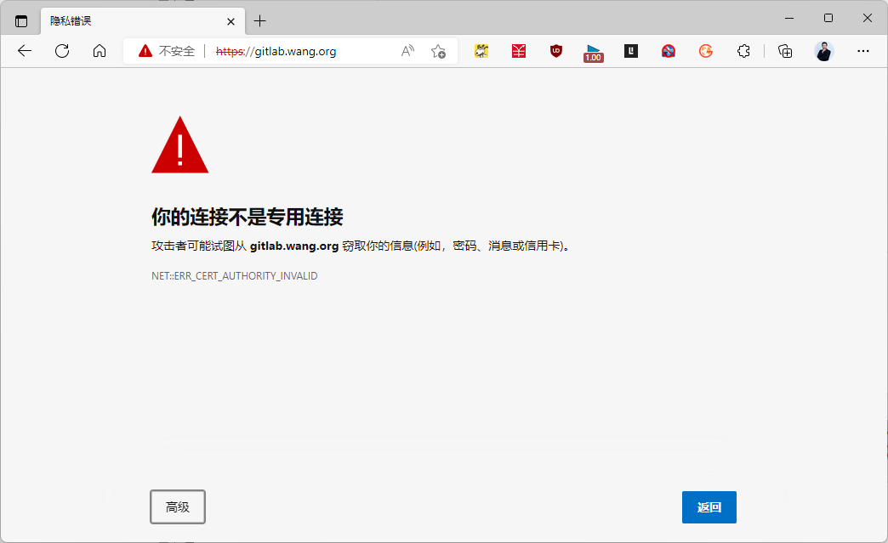

[← 返回 Git 与 GitLab 版本控制目录]({{ '/subjects/Git-GitLab/' | relative_url }})



# 20 为 GitLab 启用 HTTPS

HTTPS 可保护登录凭据与仓库传输；即使服务只在内部网络使用，也应按组织的证书管理要求配置。

以下以 Linux 包安装且使用内置 NGINX 的 GitLab 为例；若前面还有负载均衡器或反向代理，TLS 终止位置和 `external_url`、转发头需要一并设计。具体选项以[GitLab 官方 HTTPS 配置说明](https://docs.gitlab.com/omnibus/settings/nginx.html#enable-https)和当前安装版本为准。

### 配置步骤

先为 `gitlab.example.com` 准备与域名匹配的证书链和私钥，并确认 DNS 指向本实例。正式环境优先使用受信任 CA 签发的证书；内部环境可使用受管内部 CA，但客户端也必须信任该 CA。

```ruby
# /etc/gitlab/gitlab.rb
external_url 'https://gitlab.example.com'
nginx['ssl_certificate'] = '/etc/gitlab/ssl/gitlab.example.com.crt'
nginx['ssl_certificate_key'] = '/etc/gitlab/ssl/gitlab.example.com.key'
nginx['redirect_http_to_https'] = true
```

将证书链和私钥放在对应路径，限制私钥读取权限，再执行：

```bash
gitlab-ctl reconfigure
gitlab-ctl status
curl -I https://gitlab.example.com/users/sign_in
```

`curl` 验证后，还应从另一台客户端检查证书链、域名匹配、HTTP 到 HTTPS 跳转，并执行登录、`git clone` 与推送测试。不要通过关闭 Git 的证书校验掩盖证书名不匹配或缺少信任链的问题。



### 内部 CA 的客户端信任

如果证书由内部 CA 签发，将 **CA 证书**（不是私钥）加入各客户端的信任库。Ubuntu 示例：

```bash
sudo install -m 0644 org-root-ca.crt /usr/local/share/ca-certificates/org-root-ca.crt
sudo update-ca-certificates
```

RHEL/Rocky 系统可将 CA 证书放入 `/etc/pki/ca-trust/source/anchors/` 后运行 `update-ca-trust`。不要直接向系统生成的证书包文件追加内容；系统更新可能覆盖这种改动。



<nav class="article-end" aria-label="章节导航">
  <a href="{{ '/subjects/Git-GitLab/19-gitlab-migration-and-upgrades.html' | relative_url }}">← 上一篇：GitLab 迁移与升级</a>
  <a href="{{ '/subjects/Git-GitLab/' | relative_url }}">返回 Git 与 GitLab 版本控制目录</a>
  <a href="{{ '/subjects/Git-GitLab/21-resetting-a-forgotten-gitlab-password.html' | relative_url }}">下一篇：重置遗忘的 GitLab 管理员密码 →</a>
</nav>
