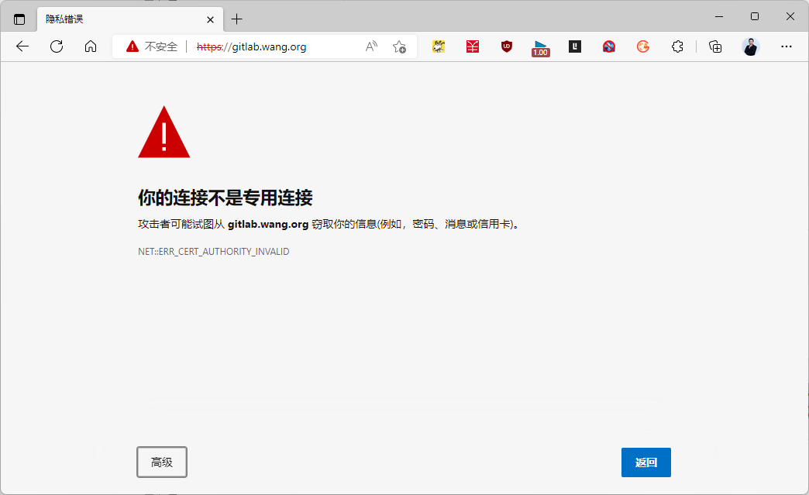
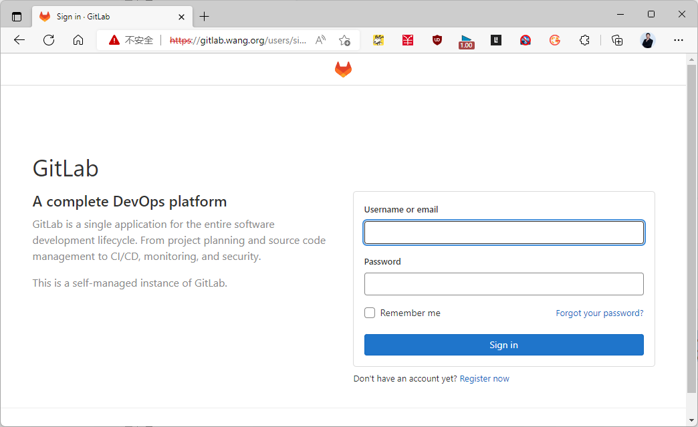
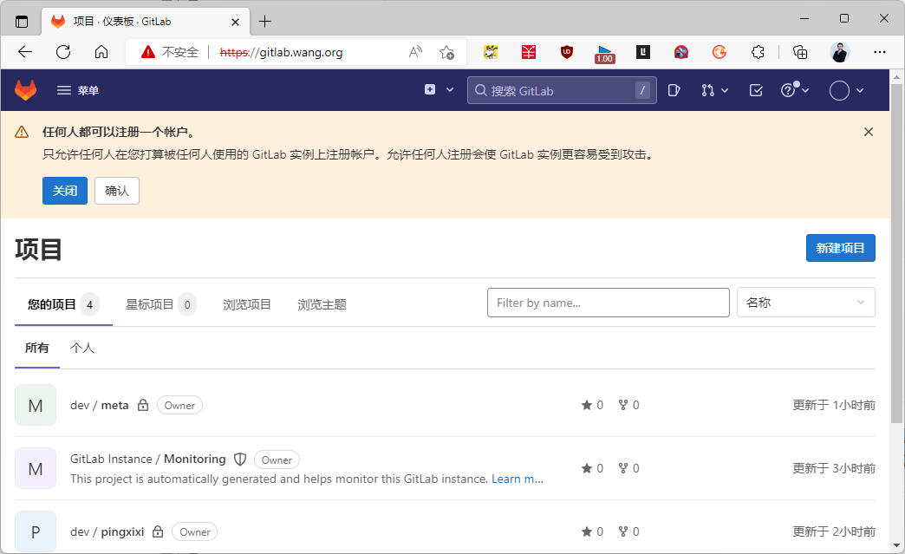

[← 返回Git 与 GitLab 版本控制目录]({{ '/subjects/Git-GitLab/' | relative_url }})



# 20 实现 Https
### 3.9 实现 Https

GitLab 如果用于不安全的网络，建议使用 https

注意：建议使用权威CA颁发的证书，自签名的证书需要加入信任,否则会导致后续git clone等操作失败

官方说明

<https://docs.gitlab.com/omnibus/settings/nginx.html#enable-https>

范例:

```bash
#创建证书
[root@gitlab ~]#mkdir -p /etc/gitlab/ssl &&  cd /etc/gitlab/ssl
[root@gitlab ssl]#openssl genrsa -out gitlab.bowen.org.key 2048
#注意：CN=gitlab.bowen.org 必须你的网站的域名
[root@gitlab ssl]#openssl req -days 3650 -x509 \
-sha256 -nodes -newkey rsa:2048 -subj
"/C=CN/ST=beijing/L=beijing/O=bowen/CN=gitlab.bowen.org" -keyout
gitlab.bowen.org.key -out gitlab.bowen.org.crt
#修改配置文件的如下内容,必选项共4项
[root@gitlab ~]# vim /etc/gitlab/gitlab.rb
external_url "https://gitlab.bowen.org" #此项必须修改为https，必选项，还原为http时，只修
改此行即可
nginx['enable'] = true  #可选
nginx['client_max_body_size'] = '1000m' #可选
nginx['redirect_http_to_https'] = true  #必选项，默认值为false，修改为true，实现http自
动301跳转至https，，还原为http时，无需修改此行
nginx['redirect_http_to_https_port'] = 80 #可选,所有请求80的都跳转到443，默认值，可不修
改，保持注释状态
nginx['ssl_certificate'] ="/etc/gitlab/ssl/gitlab.bowen.org.crt"   #必选项
nginx['ssl_certificate_key'] ="/etc/gitlab/ssl/gitlab.bowen.org.key"   #必选项
nginx['ssl_ciphers'] = "ECDHE-RSA-AES256-GCM-SHA384:ECDHE-RSA-AES128-GCM-SHA256"
#可选
nginx['ssl_prefer_server_ciphers'] = "on"  #可选
nginx['ssl_protocols'] = "TLSv1.2"    #可选
nginx['ssl_session_cache'] = "shared:SSL:10m"   #可选
nginx['ssl_session_timeout'] = "1440m"    #可选
#重新初始化
[root@gitlab ~]# gitlab-ctl reconfigure
#可选
[root@gitlab ~]# gitlab-ctl restart
[root@gitlab ~]# gitlab-ctl status
#还登录原来的URL,会自动跳转到 https
```







范例: 解决自签名证书的信任问题

```bash
#由于自签名证书不信息,访问出下面错误
[root@ubuntu2204 ~]#git clone http://gitlab.bowen.org/devops/myai.git
正克隆到'myai' ...
fatal:无法访问'http://gitlab.bowen.org/ devops/myai.git/ ': server certificate
verification failed.CAfile: none CRLfile: none
#在使用git客户端的主机上信任自签名证书
[root@ubuntu2204 ~]#scp gitlab-server:/etc/gitlab/ssl/gitlab.bowen.org.crt .
#UbuntuCA证书路径
[root@ubuntu2204 ~]#cat gitlab.bowen.org.crt >> /etc/ssl/certs/ca-
certificates.crt
#红帽系统证书路径
[root@rocky8 ~]#cat gitlab.bowen.org.crt  >> /etc/pki/tls/certs/ca-bundle.crt
```



<nav class="article-end" aria-label="章节导航">
  <a href="{{ '/subjects/Git-GitLab/19-gitlab-migration-and-upgrades.html' | relative_url }}">← Previous: GitLab Migration and Upgrades</a>
  <a href="{{ '/subjects/Git-GitLab/' | relative_url }}">Back to Git and GitLab Version Control Index</a>
  <a href="{{ '/subjects/Git-GitLab/21-resetting-a-forgotten-gitlab-password.html' | relative_url }}">Next: Resetting a Forgotten GitLab Password →</a>
</nav>
