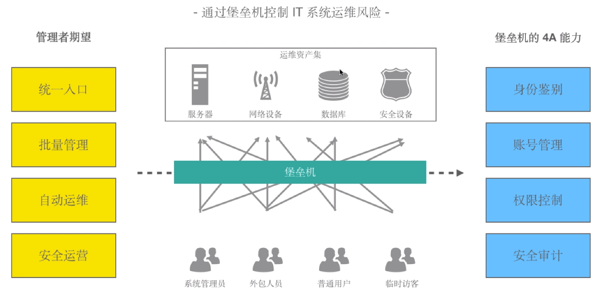

[← 返回JumpServer 堡垒机目录]({{ '/subjects/JumpServer/' | relative_url }})



# 01 跳板机和堡垒机
## 跳板机：统一进入内网的路径

跳板机是运维人员进入目标主机之前先登录的一台中间主机。它把原本分散的入口收敛到一处，便于限制哪些人可以接触管理网络；但**统一入口本身不等于完整审计**。若只把目标主机账号交给使用者，再让他们经跳板机登录，仍难以按资产和操作动作精细授权，也未必能回放会话。

SSH、RDP 等协议都可以通过合适的跳板方案转接，区别不在于协议“能不能用”，而在于接入方式、账号托管、授权粒度和记录能力。跳板机一旦故障或被入侵，还可能影响其可达的全部资产，因此也需要自身的加固、最小权限与高可用设计。

## 堡垒机：把访问控制和审计纳入入口

堡垒机在统一入口之上，进一步管理“谁能用哪个账号访问哪台资产、在什么时间访问、做了什么”。常见能力包括身份认证、资产和账号管理、审批、命令或文件操作控制，以及会话录像与审计检索。它能帮助落实运维管理制度，但不能代替目标系统自身的权限管理、补丁和日志保护。

下图展示从单一访问入口延伸到授权、运维连接和审计的关系。后续章节将以 JumpServer 为例说明这些能力如何组合。



<nav class="article-end" aria-label="章节导航">
  <a href="{{ '/subjects/JumpServer/' | relative_url }}">返回 JumpServer 专题目录</a>
  <a href="{{ '/subjects/JumpServer/02-introduction-to-jumpserver.html' | relative_url }}">下一篇：JumpServer 简介 →</a>
</nav>
