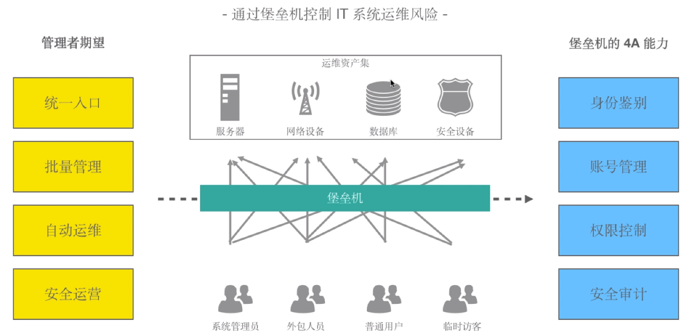

[← 返回JumpServer 堡垒机目录]({{ '/subjects/JumpServer/' | relative_url }})



# 01 跳板机和堡垒机
## 1 堡垒机和 JumpServer

### 1.1 跳板机和堡垒机

跳板机

跳板机是一种用于单点登陆的主机应用系统。跳板机通常是由一台服务器通过特定的软件实现

维护人员在维护过程中，首先要统一登录到这台服务器上，然后从这台服务器再登录到目标设备进行维护。

但跳板机没有实现对运维人员操作行为的控制和审计，此外，跳板机存在严重的安全风险，一旦跳板机系统被攻入，则将后端资源风险完全暴露无遗。

对于一些服务（如:telnet）可以通过跳板机来完成一定的控制访问，但是对于更多的服务（SSH、RDP 等）来讲，就显得力不从心了。

堡垒机

由于跳板机的不足，更多的组织需要更先进、更好的安全技术,来实现运维操作管理和安全。

堡垒机开始以独立的产品形态被广泛部署，有效降低了运维操作风险，使得运维操作管理变得更简单、 更安全。

堡垒机能满足角色管理与授权审批、信息资源访问控制、操作记录和审计、系统变更和维护控制要求， 并生成一些统计报表配合管理规范，从而不断提升IT内控的合规性。



<nav class="article-end" aria-label="章节导航">
  <a href="{{ '/subjects/JumpServer/' | relative_url }}">Back to JumpServer Bastion Host Index</a>
  <a href="{{ '/subjects/JumpServer/02-introduction-to-jumpserver.html' | relative_url }}">Next: Introduction to JumpServer →</a>
</nav>
