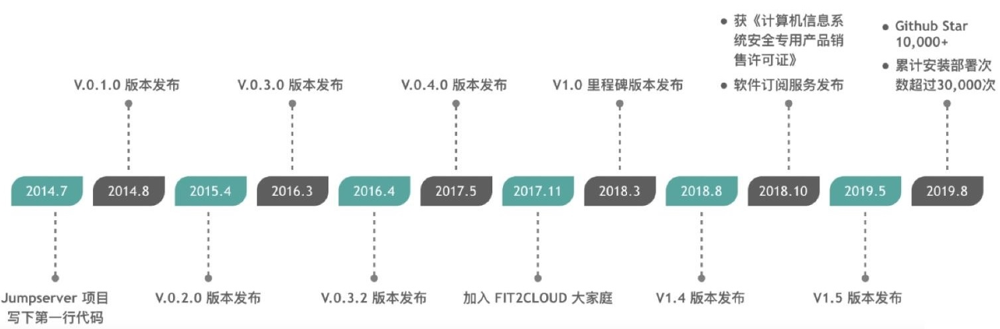

[← 返回JumpServer 堡垒机目录]({{ '/subjects/JumpServer/' | relative_url }})



# 02 JumpServer 简介
### 1.2 JumpServer 简介

JumpServer 是全球首款完全开源的堡垒机, 使用 GNU GPL v2.0 开源协议, 是符合 4A 的专业运维审计系统。为互联网企业提供了认证，授权，审计，自动化运维等功能。 JumpServer 使用 Python / Django 进行开发, 遵循 Web 2.0 规范, 配备了业界领先的 Web Terminal 解决方案, 交互界面美观、用户体验好。

JumpServer 采纳分布式架构, 支持多机房跨区域部署, 中心节点提供 API, 各机房部署登录节点, 可横向扩展、无并发访问限制。

JumpServer 现已支持管理 SSH、 Telnet、 RDP、 VNC 协议资产。

JumpServer 历史

官方地址： http://www.jumpserver.org/

github项目: https://github.com/jumpserver



<nav class="article-end" aria-label="章节导航">
  <a href="{{ '/subjects/JumpServer/01-jump-hosts-and-bastion-hosts.html' | relative_url }}">← Previous: Jump Hosts and Bastion Hosts</a>
  <a href="{{ '/subjects/JumpServer/' | relative_url }}">Back to JumpServer Bastion Host Index</a>
  <a href="{{ '/subjects/JumpServer/03-jumpserver-production-use-cases.html' | relative_url }}">Next: JumpServer Production Use Cases →</a>
</nav>
