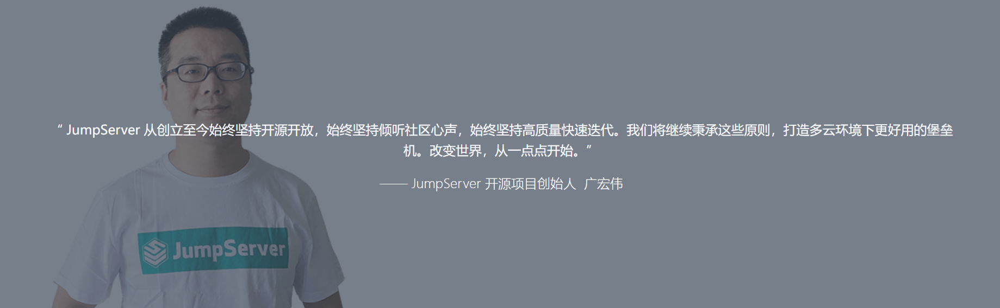
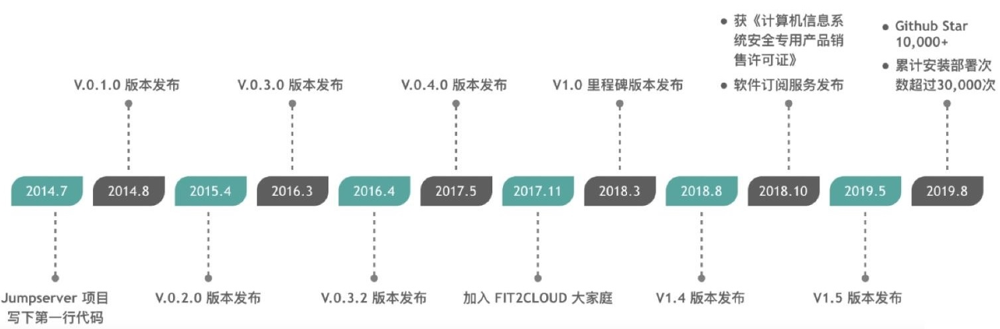

[← 返回JumpServer 堡垒机目录]({{ '/subjects/JumpServer/' | relative_url }})



# 02 JumpServer 简介

JumpServer 是面向运维访问的堡垒机平台。它把人员、资产和资产账号集中管理，让用户在授权范围内通过 Web 终端或受支持的客户端连接目标资产，并保留会话和操作审计。上一章提到的“4A”——认证、账号、授权、审计——分别对应平台的不同环节，不能只启用登录页面就认为审计已完整落地。

JumpServer 由管理后台、前端和多种协议连接组件组成，常见连接场景包括 SSH、RDP、VNC 与数据库访问。实际支持的协议、插件和许可证范围会随版本变化，应以所部署版本的官方文档核对。部署规模较大时可分离接入组件和核心服务，但并发能力仍受计算资源、数据库、Redis、网络与录像存储限制，不存在“无并发限制”的通用保证。

下图记录项目的历史版本，阅读时注意区分当时的架构与当前版本的组件名称。

项目文档：<https://docs.jumpserver.org/>

源代码入口：<https://github.com/jumpserver>



<nav class="article-end" aria-label="章节导航">
  <a href="{{ '/subjects/JumpServer/01-jump-hosts-and-bastion-hosts.html' | relative_url }}">← 上一篇：跳板机与堡垒机</a>
  <a href="{{ '/subjects/JumpServer/' | relative_url }}">返回 JumpServer 专题目录</a>
  <a href="{{ '/subjects/JumpServer/03-jumpserver-production-use-cases.html' | relative_url }}">下一篇：生产应用场景 →</a>
</nav>
