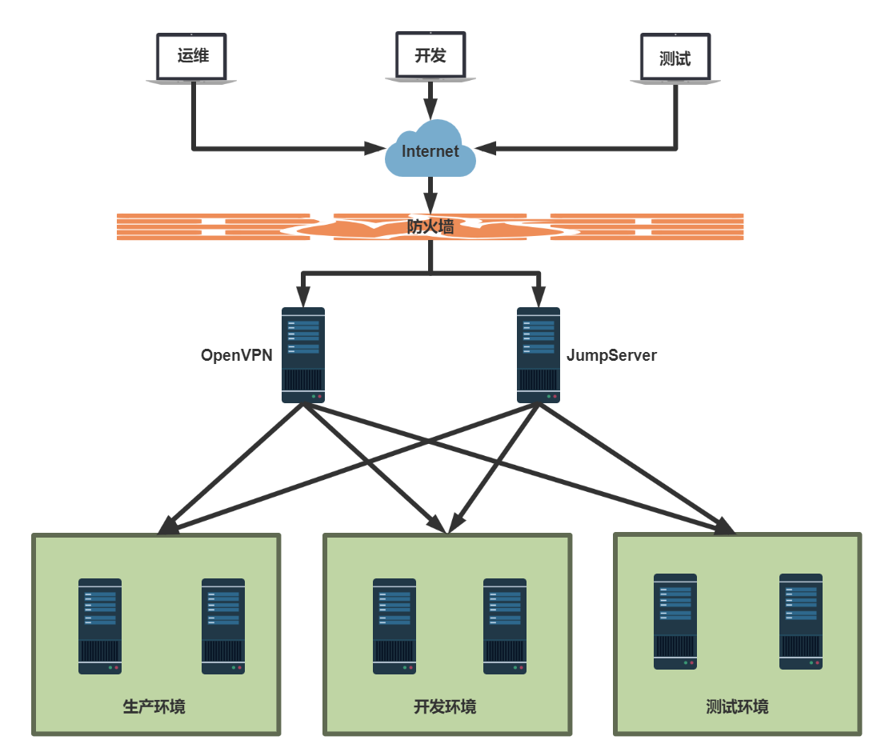

[← 返回JumpServer 堡垒机目录]({{ '/subjects/JumpServer/' | relative_url }})



# 03 JumpServer 生产应用场景
### 1.3 JumpServer 生产应用场景



<nav class="article-end" aria-label="章节导航">
  <a href="{{ '/subjects/JumpServer/02-introduction-to-jumpserver.html' | relative_url }}">← Previous: Introduction to JumpServer</a>
  <a href="{{ '/subjects/JumpServer/' | relative_url }}">Back to JumpServer Bastion Host Index</a>
  <a href="{{ '/subjects/JumpServer/04-jumpserver-features-and-benefits.html' | relative_url }}">Next: JumpServer Features and Benefits →</a>
</nav>
