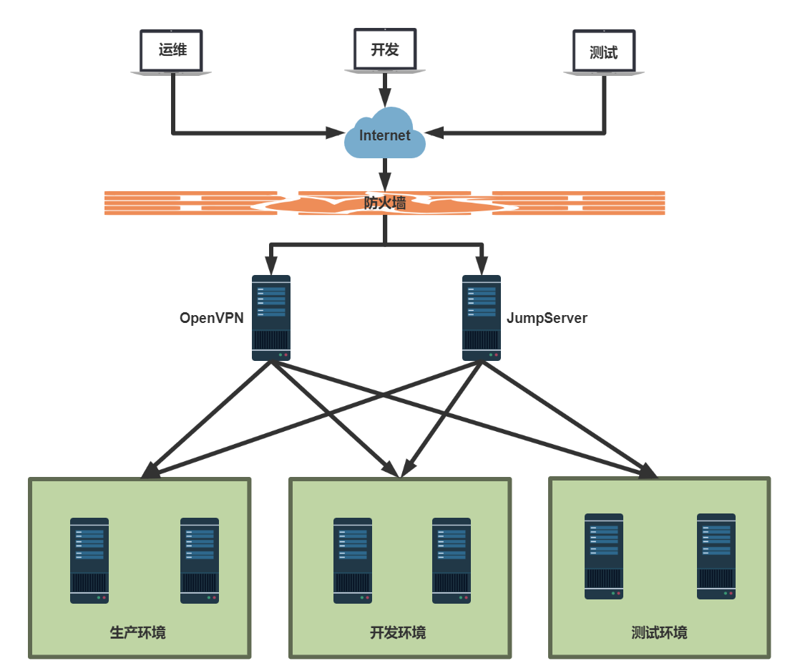

[← 返回JumpServer 堡垒机目录]({{ '/subjects/JumpServer/' | relative_url }})



# 03 JumpServer 生产应用场景

下图以生产、开发和测试三套环境为例：运维、开发、测试人员从外部网络进入后，分别通过 VPN 或 JumpServer 接触内网资产。两条路径解决的问题不同：VPN 提供网络连通性，JumpServer 进一步管理运维会话和资产授权；如果只经 VPN 直接登录主机，堡垒机就无法记录那段会话。

设计实际访问路径时，先列出人员角色和环境边界，再规定哪些资产必须经过 JumpServer，哪些操作需要审批或录像。生产环境的权限通常比测试环境更窄，临时授权应有到期时间。图中的箭头表示“可能的访问路径”，并不意味着所有人都应同时拥有到三套环境的通行权限。



<nav class="article-end" aria-label="章节导航">
  <a href="{{ '/subjects/JumpServer/02-introduction-to-jumpserver.html' | relative_url }}">← 上一篇：JumpServer 简介</a>
  <a href="{{ '/subjects/JumpServer/' | relative_url }}">返回 JumpServer 专题目录</a>
  <a href="{{ '/subjects/JumpServer/04-jumpserver-features-and-benefits.html' | relative_url }}">下一篇：优势与功能 →</a>
</nav>
