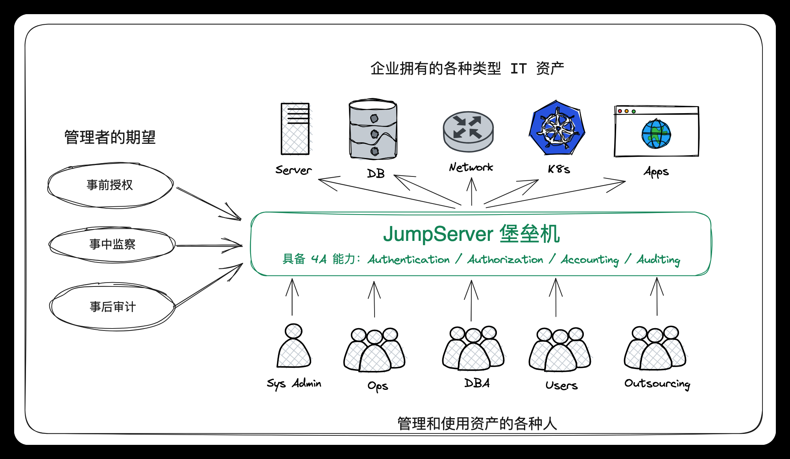
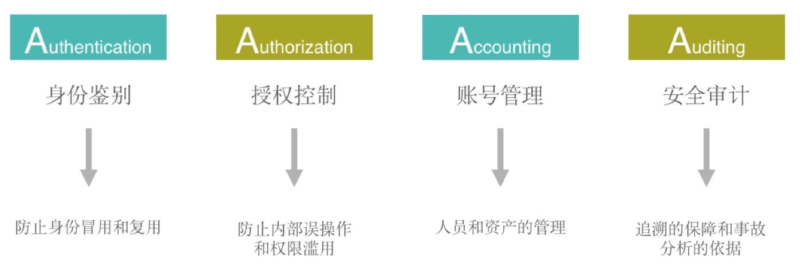

[← Back to JumpServer Bastion Host Index]({{ '/subjects/JumpServer/' | relative_url }})



# 04 JumpServer Features and Benefits
### 1.4 JumpServer的优势和功能

### 特色优势

开源: 零门槛，线上快速获取和安装分布式: 轻松支持大规模并发访问； 无插件: 仅需浏览器，极致的 Web Terminal 使用体验多云支持: 一套系统，同时管理不同云上面的资产云端存储: 审计录像云端存储，永不丢失多租户: 一套系统，多个子公司和部门同时使用

### 功能列表

堡垒机四个核心能力: 运维安全审计的4A规范

身份认证 Authentication 登录认证资源统一登录与认证

LDAP/AD 认证

RADIUS 认证

OpenID 认证（实现单点登录）

CAS 认证 （实现单点登录）

MFA认证 MFA 二次认证（Google

Authenticator）

RADIUS 二次认证

登录复核（X-PACK） 用户登录行为受管理员的

监管与控制

账号管理 Account 集中账号管理用户管理

系统用户管理

统一密码资产密码托管

自动生成密码

自动推送密码

密码过期设置

批量改密（X-PACK） 定期批量改密

多种密码策略

多云纳管（X-PACK） 对私有云、公有云资产自

动统一纳管

收集用户（X-PACK） 自定义任务定期收集主机

用户

统一对资产主机的用户密

密码匣子（X-PACK）

码进行查看、更新、测试操作

对用户、用户组、资产、资

授权控制 Authorization 多维授权

产节点、应用以及系统用户进行授权

资产授权资产以树状结构进行展示

资产和节点均可灵活授权

节点内资产自动继承授权

子节点自动继承父节点授权

应用授权实现更细粒度的应用级授

权

身份认证 Authentication 登录认证资源统一登录与认证

MySQL 数据库应用、RemoteApp 远程应用（X-PACK）

实现对授权资产的文件上

动作授权

传、下载以及连接动作的控制

时间授权实现对授权资源使用时间

段的限制

特权指令实现对特权指令的使用

（支持黑白名单）

命令过滤实现对授权系统用户所执

行的命令进行控制

文件传输 SFTP 文件上传/下载

文件管理实现 Web SFTP 文件管理

工单管理（X-PACK） 支持对用户登录请求行为

进行控制

组织管理（X-PACK） 实现多租户管理与权限隔

离

安全审计 Audit 操作审计用户操作行为审计

会话审计在线会话内容审计

历史会话内容审计

支持对 Linux、Windows

录像审计

等资产操作的录像进行回放审计

支持对 RemoteApp（XPACK）、MySQL 等应用操作的录像进行回放审计

指令审计支持对资产和应用等操作

的命令进行审计

文件传输可对文件的上传、下载记

录进行审计



<nav class="article-end" aria-label="章节导航">
  <a href="{{ '/subjects/JumpServer/03-jumpserver-production-use-cases.html' | relative_url }}">← Previous: JumpServer Production Use Cases</a>
  <a href="{{ '/subjects/JumpServer/' | relative_url }}">Back to JumpServer Bastion Host Index</a>
  <a href="{{ '/subjects/JumpServer/05-jumpserver-components.html' | relative_url }}">Next: JumpServer Components →</a>
</nav>
