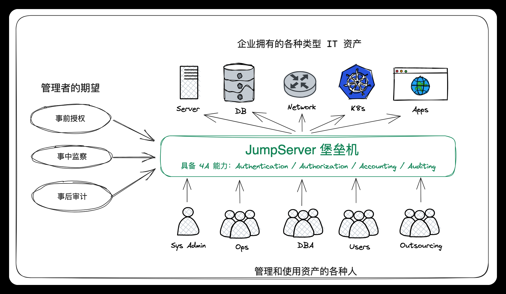
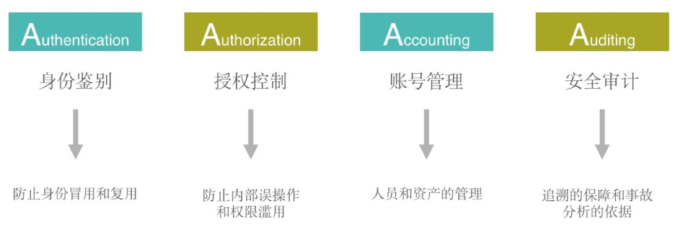

[← 返回JumpServer 堡垒机目录]({{ '/subjects/JumpServer/' | relative_url }})



# 04 JumpServer 的优势和功能

本篇从堡垒机的“4A”能力出发，说明 JumpServer 如何管理人员、资产、授权与审计。原资料中的功能清单混合了社区版和 X-PACK 功能；实际可用范围应以所部署版本及许可证为准。

### 特色优势

JumpServer 的核心价值是给运维访问提供统一入口：集中维护人员和资产信息，按规则控制谁能在什么时间访问哪些资产，并留下可追溯的操作记录。Web Terminal 可降低客户端安装负担；资产规模较大时，还需根据并发量规划组件、存储与高可用方案。

多云资产纳管、录像外部存储和组织隔离等能力与版本、配置相关。即使启用了云端存储，也仍需设置留存周期、访问权限和备份策略，不能把“已上传”视为“永不丢失”。

### 功能列表

堡垒机常用的“4A”框架包括身份认证（Authentication）、账号管理（Account）、授权控制（Authorization）和安全审计（Audit）。它们分别回答“是谁”“使用哪个账号”“允许做什么”以及“实际做了什么”。

#### 身份认证：确认访问者是谁

运维人员先登录统一入口，再访问获准使用的资产。原资料列举了 LDAP／AD、RADIUS、OpenID Connect、CAS 等身份源，以及基于验证器或 RADIUS 的多因素认证。接入时应核对当前版本支持的协议、回调配置及账号映射方式。登录复核属于资料标注的 X-PACK 能力，可让指定登录行为经过进一步审批。

#### 账号管理：管理以什么身份进入资产

平台可以集中管理用户、资产账号和密码策略，包括密码托管、生成、推送、过期设置等。资料还列出批量改密、多云资产纳管、主机账号收集和“密码匣子”等 X-PACK 功能。落地时要区分**平台登录账号**与**目标资产账号**：用户获得访问授权，并不意味着应直接看到目标资产的密码。

#### 授权控制：限定访问范围与动作

授权规则可围绕用户／用户组、资产／资产节点、账号、应用和时间段设置。资产树便于批量管理，但继承规则可能扩大权限范围；新增子节点或资产后，应复核是否意外继承了父节点的授权。

除连接权限外，还可按实际能力控制文件上传下载、SFTP 操作、特权命令和会话使用时间。MySQL 应用、RemoteApp、工单审批和多组织隔离等在原资料中带有 X-PACK 标记，应按当前部署版本核验。命令过滤只能覆盖被记录和识别的操作，不宜替代目标系统自身的最小权限配置。

#### 安全审计：回答操作实际发生了什么

审计内容包括在线和历史会话、命令记录、文件传输记录，以及对 Linux、Windows 或受支持应用的会话录像回放。录像与日志应关联操作者、目标资产和时间，便于事后检索。还需设置审计数据的保留期限、访问控制和备份，避免审计存储本身成为单点故障。



<nav class="article-end" aria-label="章节导航">
  <a href="{{ '/subjects/JumpServer/03-jumpserver-production-use-cases.html' | relative_url }}">← 上一篇：JumpServer 生产应用场景</a>
  <a href="{{ '/subjects/JumpServer/' | relative_url }}">返回 JumpServer 专题目录</a>
  <a href="{{ '/subjects/JumpServer/05-jumpserver-components.html' | relative_url }}">下一篇：JumpServer 组件 →</a>
</nav>
