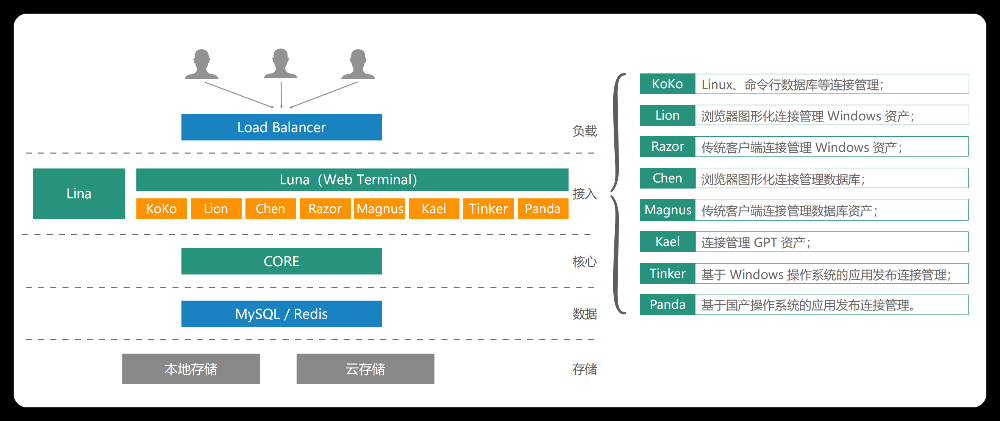
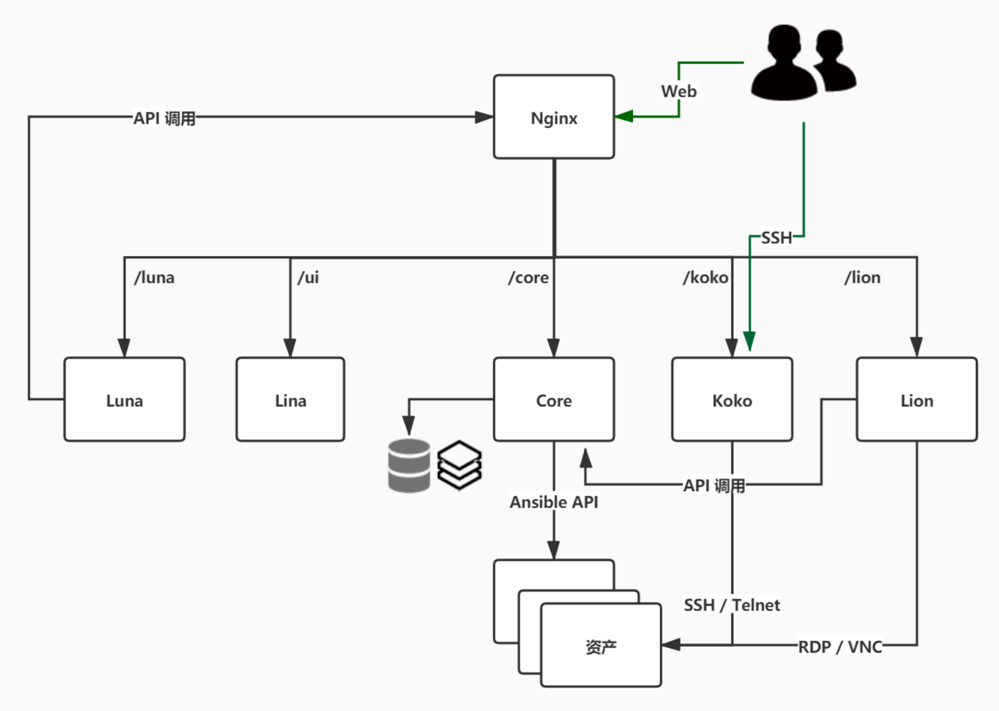
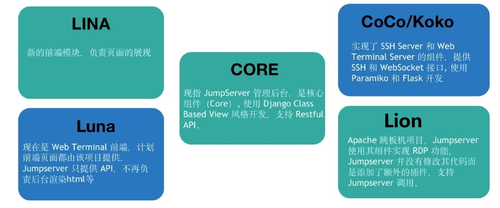

[← 返回JumpServer 堡垒机目录]({{ '/subjects/JumpServer/' | relative_url }})



# 05 JumpServer 组成

理解组件时，先看访问路径：用户在前端登录，经核心服务完成身份与授权检查，再由对应协议组件连接资产；数据库和缓存保存平台状态，录像则进入配置的存储。下图展示的是某一版本的组件布局，名称和拆分方式可能随版本变化。

| 层次 | 组件示例 | 在访问链路中的作用 |
| --- | --- | --- |
| 展示层 | Lina、Luna | 分别承担管理界面和 Web 终端等前端页面 |
| 核心层 | Core | 提供用户、资产、授权和会话等管理接口 |
| 连接层 | KoKo、Lion、Razor、Chen、Magnus 等 | 按 SSH、RDP 或数据库等协议代理与记录连接；具体可用组件取决于版本 |
| 后台处理 | Celery、Video 等 | 处理异步任务与部分会话录像转换工作 |
| 数据与存储 | MySQL、Redis、录像存储 | 保存平台数据、任务状态与审计内容，需分别设计备份与容量 |

图中还列有 Kael、Tinker、Panda 等连接组件，对应特定资产类型或应用发布场景。是否需要部署它们，应从实际资产类型出发，而不是照图把所有组件都装上。特别是图片里出现的旧系统名称只反映原资料年代，不代表建议继续使用已停止维护的系统。

另一张图包含较早期的 Coco/Koko、Luna、Lina 与 Lion 命名。Coco 到 KoKo 的演进说明连接组件可能随版本替换；升级或排障时，应先确认**当前部署实际运行了哪些服务**，再对照该版本的组件文档。若 Web 页面能打开但 SSH 连接失败，重点检查 KoKo 及其到目标资产的网络；若登录、资产列表均异常，则先检查 Core、数据库和缓存。这样的分层排查比记住每个组件采用什么编程语言更有用。



<nav class="article-end" aria-label="章节导航">
  <a href="{{ '/subjects/JumpServer/04-jumpserver-features-and-benefits.html' | relative_url }}">← 上一篇：优势与功能</a>
  <a href="{{ '/subjects/JumpServer/' | relative_url }}">返回 JumpServer 专题目录</a>
  <a href="{{ '/subjects/JumpServer/06-installation-requirements.html' | relative_url }}">下一篇：安装要求 →</a>
</nav>
