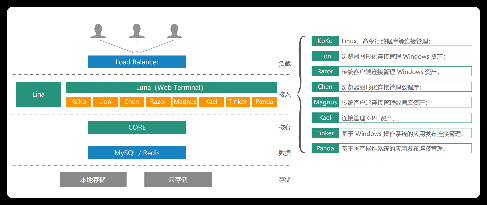
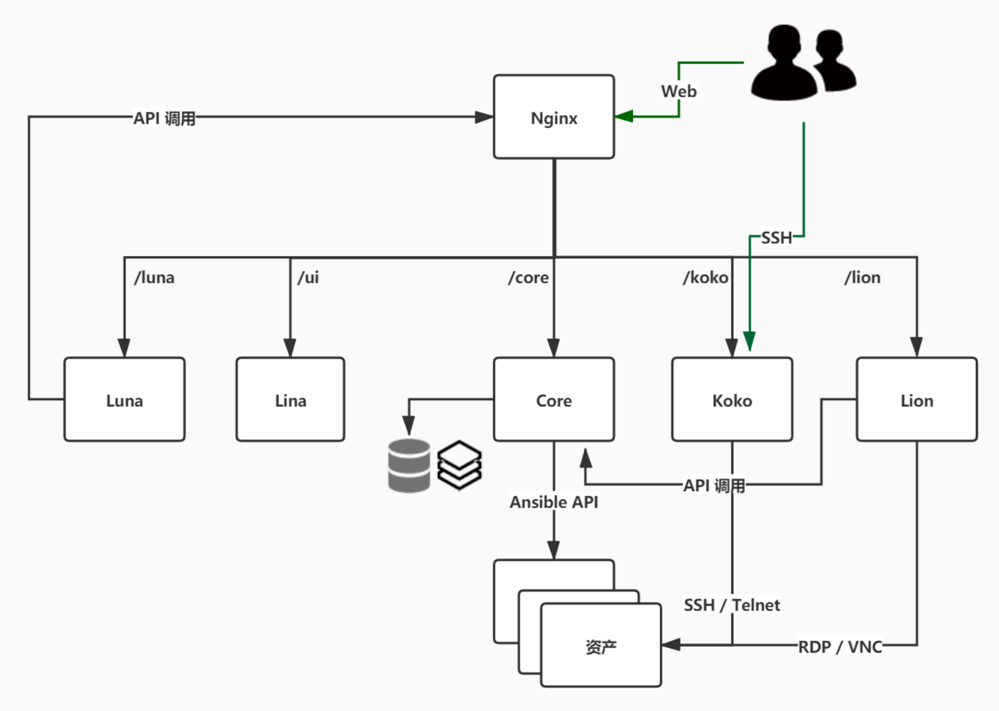
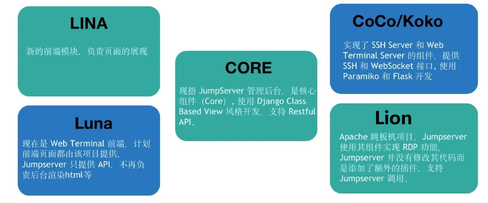

[← Back to JumpServer Bastion Host Index]({{ '/subjects/JumpServer/' | relative_url }})



# 05 JumpServer Components
### 1.5 JumpServer 组成

Core 组件是 JumpServer 的核心组件，其他组件依赖此组件启动。 Koko 是服务于类 Unix 资产平台的组件，通过 SSH、Telnet 协议提供字符型连接。 Lion 是服务于 Windows 资产平台的组件，用于 Web 端访问 Windows 资产。 XRDP 是服务于 RDP 协议组件，该组件主要功能是通过 JumpServer Client 方式访问 windows 2000、XP 等系统的资产。 Razor 是服务于 RDP 协议组件，JumpServer Client 默认使用 Razor 组件访问 Windows 资产。 Magnus 是服务于数据库的组件，用于通过客户端代理访问数据库资产。 Kael 是服务于 GPT 资产平台的组件，用于纳管 ChatGPT 资产。 Chen 是服务于数据库的组件，用于通过 Web GUI 方式访问数据库资产。 Celery 是处理异步任务的组件，用于执行 JumpServer 相关的自动化任务。 Video 是专门处理 Razor 组件和 Lion 组件产生录像的格式转换工作，将产生的会话录像转化为 MP4 格式。

Lina

前端 UI 项目，实现web页面展示，主要使用 Vue，Element UI 完成

Core 现指 Jumpserver 管理后台，是核心组件（Core）, 使用 Django Class Based View 风格开发，支持 Restful API。

Coco/Koko

实现了 SSH Server 和 Web Terminal Server 的组件，提供 SSH 和 WebSocket 接口, 使用 Paramiko 和 Flask 开发。

Koko 是 Go 版本的 coco，重构了 coco 的 SSH/SFTP 服务和 Web Terminal 服务。

Luna 现在是 Web Terminal 前端，计划前端页面都由该项目提供，Jumpserver 只提供 API，不再负责后台渲染html等。主要使用Angular CLI 完成

Lion

Lion 使用了 Apache 软件基金会的开源项目 Guacamole，JumpServer 使用 Golang 和 Vue 重构了 Guacamole 实现 RDP/VNC 协议跳板机功能。



<nav class="article-end" aria-label="章节导航">
  <a href="{{ '/subjects/JumpServer/04-jumpserver-features-and-benefits.html' | relative_url }}">← Previous: JumpServer Features and Benefits</a>
  <a href="{{ '/subjects/JumpServer/' | relative_url }}">Back to JumpServer Bastion Host Index</a>
  <a href="{{ '/subjects/JumpServer/06-installation-requirements.html' | relative_url }}">Next: Installation Requirements →</a>
</nav>
