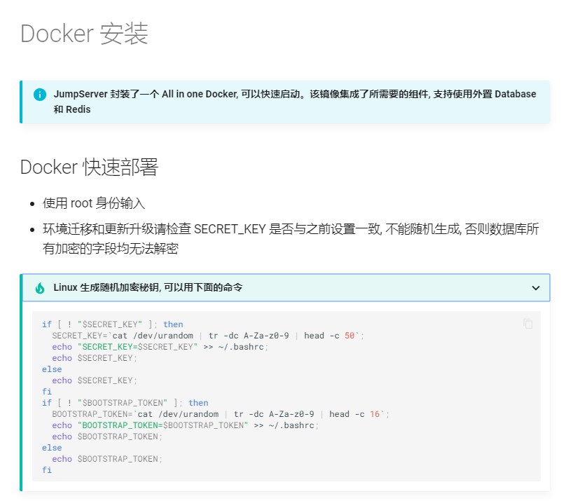
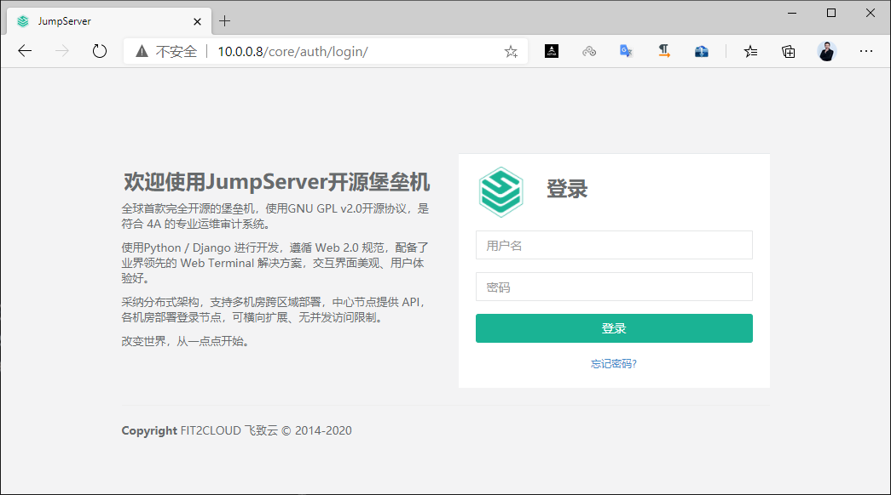
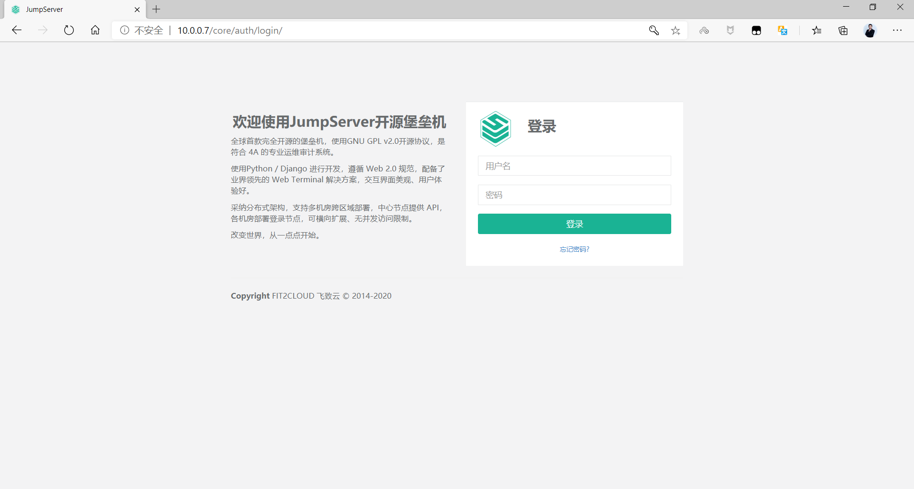

[← 返回JumpServer 堡垒机目录]({{ '/subjects/JumpServer/' | relative_url }})



# 08 基于 Docker 部署

原资料把 JumpServer v2、v3、v4 的命令和数百行日志混在一起，同一示例甚至出现不同版本的镜像与组件。部署时必须先固定**一个版本**，再按该版本的[官方容器安装文档](https://docs.jumpserver.org/)核对镜像、数据库、Redis、挂载目录和环境变量。下面解释部署关系和验收方法，不把旧日志当作当前版本的预期输出。

## 选定数据布局

一体化镜像 jms_all 可以把多个组件放在同一个容器里，但镜像不是备份：数据库、日志和录像仍须持久化。另一种布局让 MySQL、Redis 独立运行，JumpServer 容器通过 Docker 网络中的服务名连接它们，便于分别管理和备份。本篇按**外置 MySQL 与 Redis**说明，不要再叠加内置数据库的参数。MySQL 5.7、8.0 与 Redis 6、7 在原资料中分别对应不同历史版本，不能拼成一套通用兼容矩阵。

## 准备 Docker 网络与依赖

先安装 Docker，确认引擎工作正常，再创建自定义网络和数据卷：

~~~bash
docker version
docker info
docker network create jumpserver-net
docker volume create jsdata
~~~

MySQL 和 Redis 应按选定的 JumpServer 版本文档部署，加入 jumpserver-net，并分别配置持久化。JumpServer 可以通过 mysql、redis 两个容器名寻址；容器间通信不要求把数据库端口发布到公网。启动平台前，应验证数据库已创建、专用账号具有相应权限、字符集符合要求，且 Redis 已启用合适的认证。

原示例包含 123456、公开的管理员默认密码和 --privileged=true。这些是旧实验配置，不应直接复用。镜像加速地址和私有仓库也只适用于原环境。

## 生成密钥并填写连接配置

SECRET_KEY 用于平台加密相关功能，BOOTSTRAP_TOKEN 用于组件注册。应分别生成独立随机值，安全保存，并在恢复旧系统时沿用原值。不要把真实值写进仓库、Shell 历史或截图。

创建仅部署人员可读的 jumpserver.env。下列尖括号内容均为待填写的占位符；所需变量还应以选定版本文档为准：

~~~dotenv
SECRET_KEY=<独立生成的长随机值>
BOOTSTRAP_TOKEN=<另一独立随机值>
DB_ENGINE=mysql
DB_HOST=mysql
DB_PORT=3306
DB_NAME=jumpserver
DB_USER=jumpserver
DB_PASSWORD=<数据库账号密码>
REDIS_HOST=redis
REDIS_PORT=6379
REDIS_PASSWORD=<Redis 密码>
~~~

环境文件同样包含敏感配置，不要提交到 Git。若已有密钥管理服务，应优先使用部署平台支持的 Secret 注入方式。

## 启动容器

下例展示版本、网络、端口、环境文件和数据卷如何组合。VERSION 必须换成已经核对过的镜像标签；容器内的 /opt/data 是原一体化示例路径，其他版本可能不同：

~~~bash
VERSION="vX.Y.Z"  # 用已核对的实际镜像标签替换
docker run -d \
  --name jms_all \
  --restart unless-stopped \
  --network jumpserver-net \
  --env-file ./jumpserver.env \
  -p 8080:80 \
  -p 2222:2222 \
  -v jsdata:/opt/data \
  "jumpserver/jms_all:$VERSION"
~~~

这是结构示例，不保证覆盖所有历史镜像的参数。若对应版本要求额外卷或端口，须按该版本文档补齐。不要默认开启特权容器。测试环境使用宿主机 8080 端口；对外提供服务时还要规划 HTTPS、反向代理和访问控制。

## 验证与排障

按“依赖服务—容器—Web 入口—资产连接—审计录像”的顺序检查：

~~~bash
docker ps --filter name=jms_all
docker logs --tail 100 jms_all
docker network inspect jumpserver-net
curl -I http://127.0.0.1:8080/
~~~

网页能返回登录页或重定向，只说明入口可达；还要验证管理员初始化、资产授权、SSH 会话和录像回放。以下两张图是旧版登录界面，仅供辨识，不代表当前版本的页面或默认凭据。

| 现象 | 进一步检查 |
| --- | --- |
| 容器反复退出 | 镜像版本、必填变量、卷权限、MySQL 与 Redis 连接 |
| 启动初期出现 connection refused | 可能是 Core 尚未就绪；持续出现时检查 Core 和依赖 |
| KoKo 注册报“名称重复”并退出 | 注册并未成功，核对组件名、旧记录和版本 |
| Web 正常但资产连接失败 | 检查连接组件、授权与容器到资产的网络 |
| 登录正常但录像缺失 | 检查审计卷、权限、上传任务和保留策略 |

原资料把带有 ERROR 的 v2.1、v2.22、v2.28、v3.4 等日志标为“确认成功”，容易误导。单个组件进入 RUNNING 不等于整个平台可用，必须按上述链路验收。

## 自定义网络与恢复

自定义网络解决的是容器之间按服务名通信，不保存业务数据。MySQL 数据目录、JumpServer 审计文件以及 Redis 的持久化文件都应分别放入受管理的卷。重建或升级前先备份数据库和审计卷，核对目标镜像与现有数据格式的兼容性；不要只替换镜像标签就认定升级完成。下一篇会用 Compose 集中描述这些服务和依赖。



<nav class="article-end" aria-label="章节导航">
  <a href="{{ '/subjects/JumpServer/07-installation-methods.html' | relative_url }}">← 上一篇：安装方法</a>
  <a href="{{ '/subjects/JumpServer/' | relative_url }}">返回 JumpServer 专题目录</a>
  <a href="{{ '/subjects/JumpServer/09-docker-compose-deployment.html' | relative_url }}">下一篇：Docker Compose 部署 →</a>
</nav>
