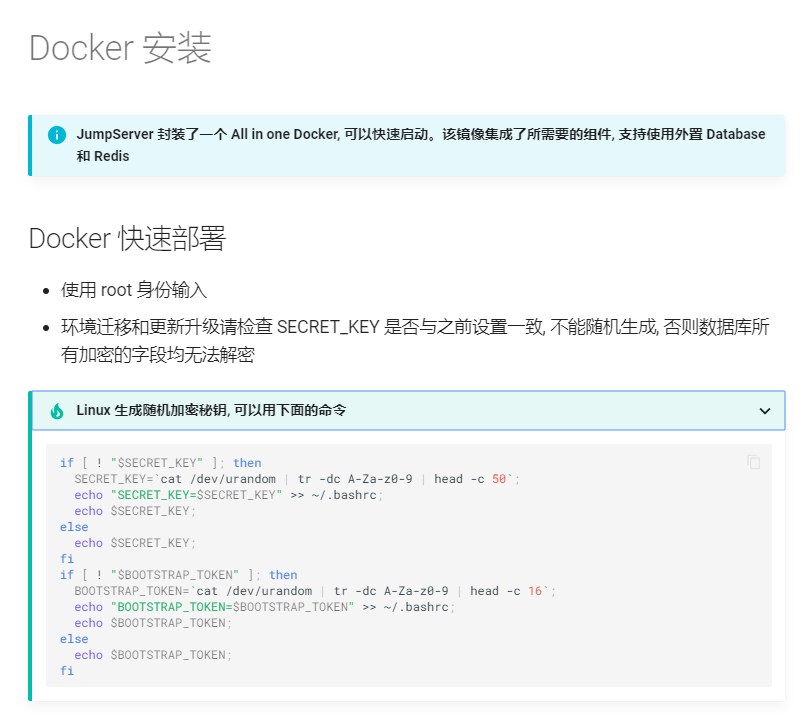
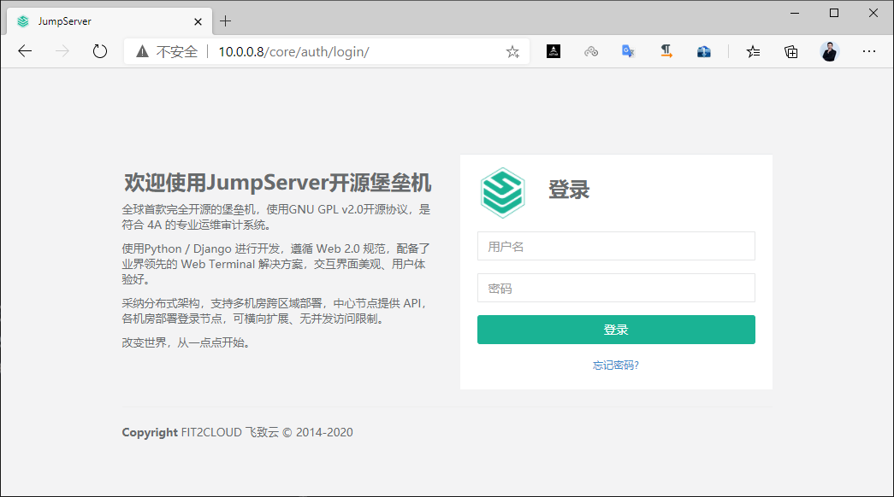
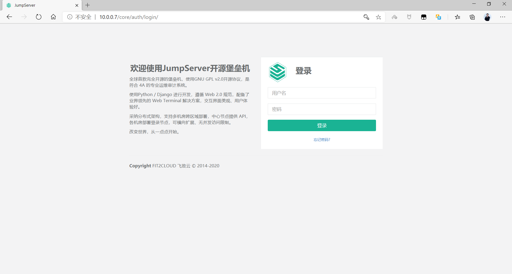

[← 返回JumpServer 堡垒机目录]({{ '/subjects/JumpServer/' | relative_url }})



# 08 基于 Docker 部署
### 2.3 基于 Docker 部署

官方文档:

<https://github.com/jumpserver/Dockerfile/tree/master/allinone>

<https://docs.jumpserver.org/zh/master/install/docker_install/>

```text
#https://github.com/jumpserver/Dockerfile
docker volume create jsdata &> /dev/null
docker volume create pgdata &> /dev/null
docker run --name jms_all \
-e SECRET_KEY=PleaseChangeMe \
-e BOOTSTRAP_TOKEN=PleaseChangeMe \
-v jsdata:/opt/data \
-v pgdata:/var/lib/postgresql \
-p 2222:2222 \
-p 80:80 jumpserver/jms_all
```

### 环境说明

<https://github.com/jumpserver/Dockerfile/tree/master/allinone>

使用外置 MySQL 数据库和 Redis:

```text
- 外置数据库要求 MySQL 版本大于等于 5.7
- 外置 Redis 要求 Redis 版本大于等于 6.0
# 自行部署 MySQL 可以参考
(https://docs.jumpserver.org/zh/master/install/setup_by_lb/#mysql)
# mysql 创建用户并赋予权限, 请自行替换 nu4x599Wq7u0Bn8EABh3J91G 为自己的密码
mysql -u root -p
create database jumpserver default charset 'utf8';
create user 'jumpserver'@'%' identified by 'nu4x599Wq7u0Bn8EABh3J91G';
grant all on jumpserver.* to 'jumpserver'@'%';
flush privileges;
# 自行部署 Redis 可以参考
(https://docs.jumpserver.org/zh/master/install/setup_by_lb/#redis)
```

基于容器,安装完毕后可以通过以下方式访问

浏览器访问: http://<容器所在服务器IP> 默认管理员账户 admin 密码 admin SSH 访问: ssh -p 2222 <容器所在服务器IP> XShell 等工具请添加 connection 连接, 默认 ssh 端口 2222

### 安装 Docker 环境

```bash
[root@ubuntu2404 ~]#apt update && apt -y  install docker.io
[root@ubuntu2204 ~]#apt update && apt -y  install docker.io
[root@ubuntu2004 ~]#apt update && apt -y  install docker.io
```

```bash
[root@ubuntu2004 ~]#docker version
Client:
Version:           20.10.12
API version:       1.41
Go version:        go1.16.2
Git commit:        20.10.12-0ubuntu2~20.04.1
Built:             Wed Apr  6 02:14:38 2022
OS/Arch:           linux/amd64
Context:           default
Experimental:      true
Server:
Engine:
Version:          20.10.12
API version:      1.41 (minimum version 1.12)
Go version:       go1.16.2
Git commit:       20.10.12-0ubuntu2~20.04.1
Built:            Thu Feb 10 15:03:35 2022
OS/Arch:          linux/amd64
Experimental:     false
containerd:
Version:          1.5.9-0ubuntu1~20.04.4
GitCommit:
runc:
Version:          1.1.0-0ubuntu1~20.04.1
GitCommit:
docker-init:
Version:          0.19.0
GitCommit:
#镜像加速(可选)
[root@ubuntu2004 ~]#echo '{"registry-mirrors":
["http://si7y70hh.mirror.aliyuncs.com"], "insecure-registries":
["harbor.bowen.org:80"]' > /etc/docker/daemon.json
[root@ubuntu2004 ~]#systemctl restart docker
```

### 安装 MySQL 服务

官方说明:

<https://docs.jumpserver.org/zh/master/install/prod/distributed_03/>

MySQL要求

```text
create database jumpserver default charset 'utf8';
create user 'jumpserver'@'%' identified by 'nu4x599Wq7u0Bn8EABh3J91G';
grant all on jumpserver.* to 'jumpserver'@'%';
flush privileges;
```

注意：

基于Jumpserver-v3.8.1 支持MySQL8.0 ,但默认MySQL8.0验证插件是caching_sha2_password，不符合要求，需要修改为mysql_native_password

JumpServer-v2.28.7之前版本默认不支持MySQL8.0，选择MySQL5.7

### 下载 MySQL 镜像查看默认配置(可选)

下载MySQL镜像并运行, 查看当前默认配置不符合JumpServer安装要求

```bash
#下载MySQL镜像并启动
[root@ubuntu2004 ~]#docker run  --rm --name mysql  -e MYSQL_ROOT_PASSWORD=123456
-e MYSQL_DATABASE=jumpserver -e MYSQL_USER=jumpserver -e MYSQL_PASSWORD=123456 -d
-p 3306:3306 registry.cn-beijing.aliyuncs.com/bowenxiaochun/mysql:5.7
#查看默认的MySQL容器配置不符合jumpserver要求
[root@ubuntu2004 ~]#docker exec -it mysql bash
root@f44e1c85f088:/# mysql -uroot -p123456
mysql: [Warning] Using a password on the command line interface can be insecure.
Welcome to the MySQL monitor.  Commands end with ; or \g.
Your MySQL connection id is 2
Server version: 5.7.30 MySQL Community Server (GPL)
Copyright (c) 2000, 2020, Oracle and/or its affiliates. All rights reserved.
Oracle is a registered trademark of Oracle Corporation and/or its
affiliates. Other names may be trademarks of their respective
owners.
Type 'help;' or '\h' for help. Type '\c' to clear the current input statement.
mysql> show create database jumpserver;
+------------+------------------------------------------------------------------
-----+
| Database   | Create Database
|
+------------+------------------------------------------------------------------
-----+
| jumpserver | CREATE DATABASE `jumpserver` /*!40100 DEFAULT CHARACTER SET
latin1 */ |
+------------+------------------------------------------------------------------
-----+
1 row in set (0.01 sec)
mysql> select user,host from  mysql.user;
+---------------+-----------+
| user          | host      |
+---------------+-----------+
| jumpserver    | %         |
| root          | %         |
| mysql.session | localhost |
| mysql.sys     | localhost |
| root          | localhost |
+---------------+-----------+
5 rows in set (0.00 sec)
mysql> exit
Bye
#查看配置文件路径
root@f44e1c85f088:/# cat /etc/mysql/mysql.cnf
......
!includedir /etc/mysql/conf.d/
!includedir /etc/mysql/mysql.conf.d/
#默认配置文件
root@f44e1c85f088:/# tree /etc/mysql/
/etc/mysql/
|-- conf.d
|   |-- docker.cnf
|   |-- mysql.cnf
|   `-- mysqldump.cnf
|-- my.cnf -> /etc/alternatives/my.cnf
|-- my.cnf.fallback
|-- mysql.cnf
`-- mysql.conf.d
`-- mysqld.cnf
2 directories, 7 files
root@f44e1c85f088:/#  ls -R /etc/mysql
/etc/mysql:
conf.d  my.cnf  my.cnf.fallback  mysql.cnf  mysql.conf.d
/etc/mysql/conf.d:
docker.cnf  mysql.cnf  mysqldump.cnf
/etc/mysql/mysql.conf.d:
mysqld.cnf
#默认配置文件
root@f44e1c85f088:/# grep '^[^#]' /etc/mysql/mysql.conf.d/mysqld.cnf
[mysqld]
pid-file    = /var/run/mysqld/mysqld.pid
socket      = /var/run/mysqld/mysqld.sock
datadir     = /var/lib/mysql
symbolic-links=0
#默认配置文件
root@f44e1c85f088:/# cat /etc/mysql/conf.d/mysql.cnf
[mysql]
```

```bash
root@f44e1c85f088:/# exit
exit
[root@centos8 ~]#docker stop mysql
```

### 在宿主机准备MySQL配置文件(可选)

```bash
#准备相关目录
[root@ubuntu2004 ~]#mkdir -p /etc/mysql/mysql.conf.d/
[root@ubuntu2004 ~]#mkdir -p /etc/mysql/conf.d/
#生成服务器配置文件,指定字符集
[root@ubuntu2004 ~]#tee /etc/mysql/mysql.conf.d/mysqld.cnf <<EOF
[mysqld]
pid-file= /var/run/mysqld/mysqld.pid
socket= /var/run/mysqld/mysqld.sock
datadir= /var/lib/mysql
symbolic-links=0
character-set-server=utf8   #添加此行,指定字符集
EOF
#生成客户端配置文件,指定字符集
[root@ubuntu2004 ~]#tee /etc/mysql/conf.d/mysql.cnf <<EOF
[mysql]
default-character-set=utf8  #添加此行,指定字符集
EOF
#查看配置文件列表
[root@ubuntu2004 ~]#tree /etc/mysql/
/etc/mysql/
├── conf.d
│   └── mysql.cnf
└── mysql.conf.d
└── mysqld.cnf
2 directories, 2 files
```

### 启动 MySQL 容器

将上面宿主机的设置好的配置文件挂载至MySQL容器

案例：基于Jumpserver-v4.6.0，使用MySQL8.0, 默认字符集utf8mb4就满足要求，无需再修改，但需要修改验证插件

```bash
#默认MySQL8.0的验证插件是caching_sha2_password，不符合要求，需要修改
mysql_native_password
[root@ubuntu2404 ~]#cat mysqld.cnf
[mysqld]
default_authentication_plugin=mysql_native_password
#启动MySQL容器
[root@ubuntu2404 ~]#docker run  --name mysql  -e MYSQL_ROOT_PASSWORD=123456 -e
MYSQL_DATABASE=jumpserver -e MYSQL_USER=jumpserver -e MYSQL_PASSWORD=123456 -d  -
p 3306:3306 -v ./mysqld.cnf:/etc/mysql/conf.d/mysqld.cnf --restart always
registry.cn-beijing.aliyuncs.com/bowenxiaochun/mysql:8.0.29-oracle
```

### 验证 MySQL

```bash
[root@ubuntu2004 ~]#docker exec -it mysql sh
# mysql -p123456 -e 'show variables like "character%"'
mysql: [Warning] Using a password on the command line interface can be insecure.
+--------------------------+----------------------------+
| Variable_name            | Value                      |
+--------------------------+----------------------------+
| character_set_client     | utf8                       |
| character_set_connection | utf8                       |
| character_set_database   | utf8                       |
| character_set_filesystem | binary                     |
| character_set_results    | utf8                       |
| character_set_server     | utf8                       |
| character_set_system     | utf8                       |
| character_sets_dir       | /usr/share/mysql/charsets/ |
+--------------------------+----------------------------+
# mysql -p123456 -e 'show variables like "collation%"'
mysql: [Warning] Using a password on the command line interface can be insecure.
+----------------------+-----------------+
| Variable_name        | Value           |
+----------------------+-----------------+
| collation_connection | utf8_general_ci |
| collation_database   | utf8_general_ci |
| collation_server     | utf8_general_ci |
+----------------------+-----------------+
# cat /var/lib/mysql/jumpserver/db.opt
default-character-set=utf8
default-collation=utf8_general_ci
# cat /etc/mysql/mysql.conf.d/mysqld.cnf
[mysqld]
pid-file= /var/run/mysqld/mysqld.pid
socket= /var/run/mysqld/mysqld.sock
datadir= /var/lib/mysql
symbolic-links=0
character-set-server=utf8
# cat /etc/mysql/conf.d/mysql.cnf
[mysql]
default-character-set=utf8
# mysql -p123456 -e 'select user,host from mysql.user'
mysql: [Warning] Using a password on the command line interface can be insecure.
+---------------+-----------+
| user          | host      |
+---------------+-----------+
| jumpserver    | %         |
| root          | %         |
| mysql.session | localhost |
| mysql.sys     | localhost |
| root          | localhost |
+---------------+-----------+
# mysql -p123456 -e 'select user,host from mysql.user'
mysql: [Warning] Using a password on the command line interface can be insecure.
+---------------+-----------+
| user          | host      |
+---------------+-----------+
| jumpserver    | %         |
| root          | %         |
| mysql.session | localhost |
| mysql.sys     | localhost |
| root          | localhost |
+---------------+-----------+
# ls /var/lib/mysql/ -l
total 188484
-rw-r----- 1 mysql mysql       56 Aug 16 08:43 auto.cnf
-rw------- 1 mysql mysql     1680 Aug 16 08:43 ca-key.pem
-rw-r--r-- 1 mysql mysql     1112 Aug 16 08:43 ca.pem
-rw-r--r-- 1 mysql mysql     1112 Aug 16 08:43 client-cert.pem
-rw------- 1 mysql mysql     1676 Aug 16 08:43 client-key.pem
-rw-r----- 1 mysql mysql     1346 Aug 16 08:43 ib_buffer_pool
-rw-r----- 1 mysql mysql 50331648 Aug 16 08:43 ib_logfile0
-rw-r----- 1 mysql mysql 50331648 Aug 16 08:43 ib_logfile1
-rw-r----- 1 mysql mysql 79691776 Aug 16 08:43 ibdata1
-rw-r----- 1 mysql mysql 12582912 Aug 16 08:43 ibtmp1
drwxr-x--- 2 mysql mysql       20 Aug 16 08:43 jumpserver
drwxr-x--- 2 mysql mysql     4096 Aug 16 08:43 mysql
drwxr-x--- 2 mysql mysql     8192 Aug 16 08:43 performance_schema
-rw------- 1 mysql mysql     1676 Aug 16 08:43 private_key.pem
-rw-r--r-- 1 mysql mysql      452 Aug 16 08:43 public_key.pem
-rw-r--r-- 1 mysql mysql     1112 Aug 16 08:43 server-cert.pem
-rw------- 1 mysql mysql     1676 Aug 16 08:43 server-key.pem
drwxr-x--- 2 mysql mysql     8192 Aug 16 08:43 sys
#或者执行下面
[root@ubuntu2004 ~]#docker exec mysql mysql -p123456 -e 'show variables like
"character%"'
[root@ubuntu2004 ~]#docker exec mysql mysql -p123456 -e 'show variables like
"collation%"'
[root@ubuntu2004 ~]#docker exec mysql cat /var/lib/mysql/jumpserver/db.opt
[root@ubuntu2004 ~]#docker exec mysql cat /etc/mysql/conf.d/mysql.cnf
[root@ubuntu2004 ~]#docker exec mysql mysql -p123456 -e 'select user,host from
mysql.user'
[root@ubuntu2004 ~]#docker exec mysql ls /var/lib/mysql/ -l
```

```bash
[root@ubuntu2004 ~]#ls /data/mysql/
auto.cnf    client-cert.pem  ibdata1      ibtmp1      performance_schema  server-
cert.pem
ca-key.pem  client-key.pem   ib_logfile0  jumpserver  private_key.pem     server-
key.pem
ca.pem      ib_buffer_pool   ib_logfile1  mysql       public_key.pem      sys
```

```bash
#测试连接MySQL
[root@ubuntu2004 ~]#yum -y install mysql
[root@ubuntu2004 ~]#mysql -ujumpserver -p123456 -h10.0.0.8
Welcome to the MariaDB monitor.  Commands end with ; or \g.
Your MySQL connection id is 8
Server version: 5.7.30 MySQL Community Server (GPL)
Copyright (c) 2000, 2018, Oracle, MariaDB Corporation Ab and others.
Type 'help;' or '\h' for help. Type '\c' to clear the current input statement.
MySQL [(none)]> show databases;
+--------------------+
| Database           |
+--------------------+
| information_schema |
| jumpserver         |
+--------------------+
2 rows in set (0.00 sec)
MySQL [(none)]> use jumpserver
Database changed
MySQL [jumpserver]> show tables;
Empty set (0.00 sec)
```

### 安装 Redis 服务

官方说明

<https://docs.jumpserver.org/zh/master/install/prod/distributed_04/>

新版要求:

```text
外置 Redis 要求 Redis 版本大于等于 6.0
注意:旧版JumpServer 不支持redis7.0，新版支持redis7.0
```

### 启动 Redis

范例：基于Jumpserver-v4.6.0

```bash
[root@ubuntu2404 ~]#docker run -d --name redis --restart always registry.cn-
beijing.aliyuncs.com/bowenxiaochun/redis:7.2.5 redis-server --requirepass 123456
```

范例：基于Jumpserver-v3.10.10

```bash
[root@ubuntu2204 ~]#docker run -d -p 6379:6379 --name redis --restart always
registry.cn-beijing.aliyuncs.com/bowenxiaochun/redis:7.2.5 redis-server --
requirepass 123456
```

范例：基于Jumpserver-v3.8.1

```bash
[root@ubuntu2204 ~]#docker run -d -p 6379:6379 --name redis --restart always
registry.cn-beijing.aliyuncs.com/bowenxiaochun/redis:6.2.5 redis-server --
requirepass 123456
```

范例:

```bash
[root@ubuntu2004 ~]#docker run -d -p 6379:6379 --name redis --restart always
registry.cn-beijing.aliyuncs.com/bowenxiaochun/redis:6.2.5 redis-server --
requirepass 123456
2b75e77aa35b79dcb0e4cffb41d124c10124cdfda959e3131f7927e8808f9417
```

### 验证 Redis连接

```bash
[root@ubuntu2004 ~]#yum  -y install redis
[root@ubuntu2004 ~]#redis-cli -h 10.0.0.8 -a 123456
10.0.0.8:6379> info
# Server
redis_version:5.0.9
redis_git_sha1:00000000
redis_git_dirty:0
```

### 部署 JumpServer

### 生成 key 和 token

参考官方说明:

<https://github.com/jumpserver/Dockerfile/tree/master/allinone>

<https://docs.jumpserver.org/zh/master/install/docker_install/>

需要先生成 key 和 token



范例：

```bash
#生成相关key
[root@ubuntu2204 ~]#cat /dev/urandom | tr -dc '[:alnum:]' | head -c50
HuMa1pnvbjrLeiBEJTUoQfBwPMrsZYlL6jpik46Hcib4PHMldx
[root@ubuntu2204 ~]#cat /dev/urandom | tr -dc '[:alnum:]' | head -c30
2wqN3fWeB4KaSLTMoyK5JgSylkS2z9
```

范例

```bash
[root@ubuntu2004 ~]#cat  key.sh
#!/bin/bash
if [ ! "$SECRET_KEY" ]; then
SECRET_KEY=`cat /dev/urandom | tr -dc A-Za-z0-9 | head -c 50`;
echo "SECRET_KEY=$SECRET_KEY" >> ~/.bashrc;
echo SECRET_KEY=$SECRET_KEY;
else
echo SECRET_KEY=$SECRET_KEY;
fi
if [ ! "$BOOTSTRAP_TOKEN" ]; then
BOOTSTRAP_TOKEN=`cat /dev/urandom | tr -dc A-Za-z0-9 | head -c 24`;
echo "BOOTSTRAP_TOKEN=$BOOTSTRAP_TOKEN" >> ~/.bashrc;
echo BOOTSTRAP_TOKEN=$BOOTSTRAP_TOKEN;
else
echo BOOTSTRAP_TOKEN=$BOOTSTRAP_TOKEN;
fi
[root@ubuntu2004 ~]#bash key.sh
[root@ubuntu2004 ~]#tail -n2 .bashrc
SECRET_KEY=9RTRBg3AjHjvUUNCUpHUH5LirSFazRozk1UyOQcoKkwMExeUEm
BOOTSTRAP_TOKEN=1OlaSdCoUpSQPjH6
```

### 运行容器

范例：JumpServer v4.10.2

```text
docker run --name jms_all -d \
-p 80:80 \
-p 2222:2222 \
-p 30000-30100:30000-30100 \
-e SECRET_KEY=6T5eFTGkNajOfMDecLkSJSLgEi5NeaRIL7z26j3VSX4jDHlPzZ \
-e BOOTSTRAP_TOKEN=O2GT7OYxmsU3h1G7oea53cWFrznagN \
-e LOG_LEVEL=ERROR \
-e DB_ENGINE=mysql \  #新版要求
-e DB_HOST=mysql \
-e DB_PORT=3306 \
-e DB_USER=jumpserver \
-e DB_PASSWORD=123456  \
-e DB_NAME=jumpserver \
-e REDIS_HOST=redis \
-e REDIS_PORT=6379 \
-e REDIS_PASSWORD='123456' \
--privileged=true \
-v /opt/jumpserver/core/data:/opt/jumpserver/data \
-v /opt/jumpserver/koko/data:/opt/koko/data \
-v /opt/jumpserver/lion/data:/opt/lion/data \
-v /opt/jumpserver/kael/data:/opt/kael/data \
-v /opt/jumpserver/chen/data:/opt/chen/data \
-v /opt/jumpserver/web/log:/var/log/nginx \
jumpserver/jms_all:v4.10.2
```

### 验证是否成功

2.3.5.3.1 查看日志

范例：查看jumpserver-v3.4.3日志确认成功

```bash
[root@ubuntu2204 ~]#docker logs -f jms_all
......
2023-09-01 11:04:32 main main.go [ERROR] POST
http://localhost:8080/api/v1/terminal/terminal-registrations/ failed, unmarshal
```

'{"name":["೦೦' response failed: json: cannot unmarshal array into Go struct

```text
field Terminal.name of type string
2023-09-01 11:04:33,577 INFO success: lion entered RUNNING state, process has
stayed up for > than 1 seconds (startsecs)
2023-09-01 11:04:33,577 INFO success: magnus entered RUNNING state, process has
stayed up for > than 1 seconds (startsecs)
2023-09-01 11:04:37 [ERRO] 注册终端失败退出
2023-09-01 11:04:37,565 INFO exited: koko (exit status 1; not expected)
2023-09-01 11:04:37 [ERRO] POST http://localhost:8080/api/v1/terminal/terminal-
registrations/ failed, unmarshal '{"name":["名称重复"]}' responsefailed: json:
cannot unmarshal array into Go struct field Terminal.name of type string
2023-09-01 11:04:37,594 INFO spawned: 'koko' with pid 1026
2023-09-01 11:04:37 main main.go [ERROR] POST
http://localhost:8080/api/v1/terminal/terminal-registrations/ failed, unmarshal
```

'{"name":["೦೦' response failed: json: cannot unmarshal array into Go struct

```text
field Terminal.name of type string
2023-09-01 11:04:37
KoKo Version unknown, more see https://www.jumpserver.org
Quit the server with CONTROL-C.
......
```

范例：查看jumpserver 2.28.7日志确认成功

```bash
[root@ubuntu2204 ~]#docker logs -f jms_all
.....
Applying users.0039_auto_20211229_1852...2023-03-10 16:00:14 [ERRO] Post
"http://127.0.0.1:8080/api/v1/terminal/terminal-registrations/": dial tcp
127.0.0.1:8080: connect: connection refused
2023-03-10 16:00:14 main main.go [ERROR] Post
"http://127.0.0.1:8080/api/v1/terminal/terminal-registrations/": dial tcp
127.0.0.1:8080: connect: connection refused
2023-03-10 16:00:14 [ERRO] Post "http://127.0.0.1:8080/api/v1/terminal/terminal-
registrations/": dial tcp 127.0.0.1:8080: connect: connection refused
OK
Applying users.0040_alter_user_source... OK
After migration, update builtin role permissions
2023-03-10 16:00:15 Fri Mar 10 16:00:15 2023
2023-03-10 16:00:15 JumpServer version v2.28.7, more see
https://www.jumpserver.org
Lion Version v2.28.7, more see https://www.jumpserver.org
2023-03-10 16:00:30
KoKo Version v2.28.7, more see https://www.jumpserver.org
Quit the server with CONTROL-C.
#以下错误提示不影响使用
```

范例: 查看jumpserver 2.22.1日志确认成功

```bash
[root@ubuntu2004 ~]#docker logs -f jms_all
Starting supervisor: supervisord.
Time: 2022-05-27 06:15:16
The Installation is Complete.
--------------------------------------------------
| Documentation:    https://docs.jumpserver.org/ |
| Official Website: https://www.jumpserver.org/  |
--------------------------------------------------
██╗██╗   ██╗███╗   ███╗██████╗ ███████╗███████╗██████╗ ██╗
██╗███████╗██████╗
██║██║   ██║████╗ ████║██╔══██╗██╔════╝██╔════╝██╔══██╗██║
██║██╔════╝██╔══██╗
██║██║   ██║██╔████╔██║██████╔╝███████╗█████╗  ██████╔╝██║   ██║█████╗
██████╔╝
██   ██║██║   ██║██║╚██╔╝██║██╔═══╝ ╚════██║██╔══╝  ██╔══██╗╚██╗ ██╔╝██╔══╝
██╔══██╗
╚█████╔╝╚██████╔╝██║ ╚═╝ ██║██║     ███████║███████╗██║  ██║ ╚████╔╝
███████╗██║  ██║
╚════╝  ╚═════╝ ╚═╝     ╚═╝╚═╝     ╚══════╝╚══════╝╚═╝  ╚═╝  ╚═══╝
╚══════╝╚═╝  ╚═╝
Version:
v2.22.1
Default Access:
username: admin  password: admin
LOG_LEVEL: ERROR
JumpServer Logs:
```

范例: 查看jumpserver 2.5.3日志确认成功

```bash
[root@centos8 ~]#docker logs -f jms_all
2020-12-08 15:35:31 Tue Dec  8 15:35:31 2020
2020-12-08 15:35:31 JumpServer version v2.5.3, more see
https://www.jumpserver.org
2020-12-08 15:35:31 Check database connection ...
users
[ ] 0001_initial
[ ] 0002_auto_20171225_1157_squashed_0019_auto_20190304_1459 (18 squashed
migrations)
[ ] 0020_auto_20190612_1825
[ ] 0021_auto_20190625_1104
[ ] 0022_auto_20190625_1105
[ ] 0023_auto_20190724_1525
[ ] 0024_auto_20191118_1612
[ ] 0025_auto_20200206_1216
[ ] 0026_auto_20200508_2105
[ ] 0027_auto_20200616_1503
[ ] 0028_auto_20200728_1805
[ ] 0029_auto_20200814_1650
[ ] 0030_auto_20200819_2041
2020-12-08 15:35:37 Database connect success
2020-12-08 15:35:37 Check database structure change ...
2020-12-08 15:35:37 Migrate model change to database ...
Operations to perform:
Apply all migrations: admin, applications, assets, audits, auth,
authentication, captcha, common, contenttypes, django_cas_ng, django_celery_beat,
jms_oidc_rp, ops, orgs, perms, sessions, settings, terminal, tickets, users
Running migrations:
Applying contenttypes.0001_initial... OK
Applying contenttypes.0002_remove_content_type_name... OK
Applying auth.0001_initial... OK
Applying auth.0002_alter_permission_name_max_length... OK
Applying auth.0003_alter_user_email_max_length... OK
Applying auth.0004_alter_user_username_opts... OK
Applying auth.0005_alter_user_last_login_null... OK
Applying auth.0006_require_contenttypes_0002... OK
Applying auth.0007_alter_validators_add_error_messages... OK
Applying auth.0008_alter_user_username_max_length... OK
Applying users.0001_initial... OK
Applying admin.0001_initial... OK
Applying admin.0002_logentry_remove_auto_add... OK
Applying admin.0003_logentry_add_action_flag_choices... OK
Applying assets.0001_initial... OK
Applying assets.0002_auto_20180105_1807_squashed_0009_auto_20180307_1212... OK
Applying assets.0010_auto_20180307_1749_squashed_0019_auto_20180816_1320... OK
Applying assets.0020_auto_20180816_1652... OK
Applying assets.0021_auto_20180903_1132... OK
Applying assets.0022_auto_20181012_1717... OK
Applying assets.0023_auto_20181016_1650... OK
Applying assets.0024_auto_20181219_1614... OK
Applying assets.0025_auto_20190221_1902... OK
Applying assets.0026_auto_20190325_2035... OK
Applying assets.0027_auto_20190521_1703... OK
Applying assets.0028_protocol... OK
Applying assets.0029_auto_20190522_1114... OK
Applying assets.0030_auto_20190619_1135... OK
Applying assets.0031_auto_20190621_1332... OK
Applying assets.0032_auto_20190624_2108... OK
Applying assets.0033_auto_20190624_2108... OK
Applying assets.0034_auto_20190705_1348... OK
Applying assets.0035_auto_20190711_2018... OK
Applying assets.0036_auto_20190716_1535... OK
Applying assets.0037_auto_20190724_2002... OK
Applying assets.0038_auto_20190911_1634... OK
Applying assets.0039_authbook_is_active... OK
Applying assets.0040_auto_20190917_2056... OK
Applying assets.0041_gathereduser... OK
Applying assets.0042_favoriteasset... OK
Applying assets.0043_auto_20191114_1111... OK
Applying assets.0044_platform... OK
Applying assets.0045_auto_20191206_1607... OK
Applying assets.0046_auto_20191218_1705... OK
Applying assets.0047_assetuser... OK
Applying assets.0048_auto_20191230_1512... OK
Applying assets.0049_systemuser_sftp_root... OK
Applying assets.0050_auto_20200711_1740... OK
Applying assets.0051_auto_20200713_1143... OK
Applying assets.0052_auto_20200715_1535... OK
Applying assets.0053_auto_20200723_1232... OK
Applying assets.0054_auto_20200807_1032... OK
Applying assets.0055_auto_20200811_1845... OK
Applying assets.0056_auto_20200904_1751... OK
Applying assets.0057_fill_node_value_assets_amount_and_parent_key...
................................................................. OK
Applying users.0002_auto_20171225_1157_squashed_0019_auto_20190304_1459... OK
Applying perms.0001_initial... OK
Applying perms.0002_auto_20171228_0025_squashed_0009_auto_20180903_1132... OK
Applying perms.0003_action... OK
Applying perms.0004_assetpermission_actions... OK
Applying applications.0001_initial... OK
Applying perms.0005_auto_20190521_1619... OK
Applying perms.0006_auto_20190628_1921... OK
Applying perms.0007_remove_assetpermission_actions... OK
Applying perms.0008_auto_20190911_1907... OK
Applying perms.0009_remoteapppermission_system_users... OK
Applying applications.0002_remove_remoteapp_system_user... OK
Applying applications.0003_auto_20191210_1659... OK
Applying applications.0004_auto_20191218_1705... OK
Applying applications.0005_k8sapp... OK
Applying applications.0006_application... OK
Applying assets.0058_auto_20201023_1115... OK
Applying assets.0059_auto_20201027_1905... OK
Applying assets.0060_node_full_value...
- Start migrate node value if has /
- Start migrate node full value
OK
Applying assets.0061_auto_20201116_1757... OK
Applying assets.0062_auto_20201117_1938... OK
Applying audits.0001_initial... OK
Applying audits.0002_ftplog_org_id... OK
Applying audits.0003_auto_20180816_1652... OK
Applying audits.0004_operatelog_passwordchangelog_userloginlog... OK
Applying audits.0005_auto_20190228_1715... OK
Applying audits.0006_auto_20190726_1753... OK
Applying audits.0007_auto_20191202_1010... OK
Applying audits.0008_auto_20200508_2105... OK
Applying audits.0009_auto_20200624_1654... OK
Applying audits.0010_auto_20200811_1122... OK
Applying auth.0009_alter_user_last_name_max_length... OK
Applying auth.0010_alter_group_name_max_length... OK
Applying auth.0011_update_proxy_permissions... OK
Applying authentication.0001_initial... OK
Applying authentication.0002_auto_20190729_1423... OK
Applying authentication.0003_loginconfirmsetting... OK
Applying authentication.0004_ssotoken... OK
Applying captcha.0001_initial... OK
Applying common.0001_initial... OK
Applying common.0002_auto_20180111_1407... OK
Applying common.0003_setting_category... OK
Applying common.0004_setting_encrypted... OK
Applying common.0005_auto_20190221_1902... OK
Applying common.0006_auto_20190304_1515... OK
Applying django_cas_ng.0001_initial... OK
Applying django_celery_beat.0001_initial... OK
Applying django_celery_beat.0002_auto_20161118_0346... OK
Applying django_celery_beat.0003_auto_20161209_0049... OK
Applying django_celery_beat.0004_auto_20170221_0000... OK
Applying django_celery_beat.0005_add_solarschedule_events_choices... OK
Applying django_celery_beat.0006_auto_20180322_0932... OK
Applying django_celery_beat.0007_auto_20180521_0826... OK
Applying django_celery_beat.0008_auto_20180914_1922... OK
Applying django_celery_beat.0006_auto_20180210_1226... OK
Applying django_celery_beat.0006_periodictask_priority... OK
Applying django_celery_beat.0009_periodictask_headers... OK
Applying django_celery_beat.0010_auto_20190429_0326... OK
Applying django_celery_beat.0011_auto_20190508_0153... OK
Applying django_celery_beat.0012_periodictask_expire_seconds... OK
Applying jms_oidc_rp.0001_initial... OK
Applying ops.0001_initial... OK
Applying ops.0002_celerytask... OK
Applying ops.0003_auto_20181207_1744... OK
Applying ops.0004_adhoc_run_as... OK
Applying ops.0005_auto_20181219_1807... OK
Applying ops.0006_auto_20190318_1023... OK
Applying ops.0007_auto_20190724_2002... OK
Applying ops.0008_auto_20190919_2100... OK
Applying ops.0009_auto_20191217_1713... OK
Applying ops.0010_auto_20191217_1758... OK
Applying ops.0011_auto_20200106_1534... OK
Applying ops.0012_auto_20200108_1659... OK
Applying ops.0013_auto_20200108_1706... OK
Applying ops.0014_auto_20200108_1749... OK
Applying ops.0015_auto_20200108_1809... OK
Applying ops.0016_commandexecution_org_id... OK
Applying ops.0017_auto_20200306_1747... OK
Applying ops.0018_auto_20200509_1434... OK
Applying orgs.0001_initial... OK
Applying orgs.0002_auto_20180903_1132... OK
Applying orgs.0003_auto_20190916_1057... OK
Applying orgs.0004_organizationmember... OK
Applying orgs.0005_auto_20200721_1937... OK
Applying orgs.0006_auto_20200721_1937... OK
Applying orgs.0007_auto_20200728_1805... OK
Applying orgs.0008_auto_20200819_2041... OK
Applying orgs.0009_auto_20201023_1628... OK
Applying users.0020_auto_20190612_1825... OK
Applying users.0021_auto_20190625_1104... OK
Applying users.0022_auto_20190625_1105... OK
Applying users.0023_auto_20190724_1525... OK
Applying users.0024_auto_20191118_1612... OK
Applying users.0025_auto_20200206_1216... OK
Applying users.0026_auto_20200508_2105... OK
Applying users.0027_auto_20200616_1503... OK
Applying users.0028_auto_20200728_1805... OK
Applying users.0029_auto_20200814_1650... OK
Applying users.0030_auto_20200819_2041... OK
Applying perms.0010_auto_20191218_1705... OK
Applying perms.0011_auto_20200721_1739... OK
Applying perms.0012_k8sapppermission... OK
2020-12-08 15:36:04 [node ERROR] Node parent node in mapper:  Default
Applying perms.0013_rebuildusertreetask_usergrantedmappingnode... OK
Applying perms.0014_build_users_perm_tree... OK
Applying perms.0015_auto_20200929_1728... OK
Applying perms.0016_applicationpermission... OK
Applying sessions.0001_initial... OK
Applying settings.0001_initial... OK
Applying terminal.0001_initial... OK
Applying terminal.0002_auto_20171228_0025_squashed_0009_auto_20180326_0957...
OK
Applying terminal.0010_auto_20180423_1140... OK
Applying terminal.0011_auto_20180807_1116... OK
Applying terminal.0012_auto_20180816_1652... OK
Applying terminal.0013_auto_20181123_1113... OK
Applying terminal.0014_auto_20181226_1441... OK
Applying terminal.0015_auto_20190923_1529... OK
Applying terminal.0016_commandstorage_replaystorage... OK
Applying terminal.0017_auto_20191125_0931... OK
Applying terminal.0018_auto_20191202_1010... OK
Applying terminal.0019_auto_20191206_1000... OK
Applying terminal.0020_auto_20191218_1721... OK
Applying terminal.0021_auto_20200213_1316... OK
Applying terminal.0022_session_is_success... OK
Applying terminal.0023_command_risk_level... OK
Applying terminal.0024_auto_20200715_1713... OK
Applying terminal.0025_auto_20200810_1735... OK
Applying terminal.0026_auto_20201027_1905... OK
Applying terminal.0027_auto_20201102_1651... OK
Applying terminal.0028_auto_20201110_1918... OK
Applying terminal.0029_auto_20201116_1757... OK
Applying tickets.0001_initial... OK
Applying tickets.0002_auto_20200728_1146... OK
Applying tickets.0003_auto_20200804_1551... OK
Applying tickets.0004_ticket_comment... OK
Applying tickets.0005_ticket_meta_confirmed_system_users... OK
Applying tickets.0006_auto_20201023_1628... OK
2020-12-08 15:36:06 Collect static files
2020-12-08 15:36:10 Collect static files done
Starting guacd: SUCCESS
guacd[89]: INFO:    Guacamole proxy daemon (guacd) version 1.2.0 started
Tomcat started.
Jumpserver ALL v2.5.3
官网 http://www.jumpserver.org
文档 http://docs.jumpserver.org
进入容器命令 docker exec -it jms_all /bin/bash
```

范例: 查看 jumpserver 2.1.2版日志

```bash
[root@centos7 ~]#docker logs -f jms_all
2020-08-16 17:40:00 Sun Aug 16 17:40:00 2020
2020-08-16 17:40:00 Jumpserver version v2.1.2, more see
https://www.jumpserver.org
2020-08-16 17:40:00 Check database connection ...
users
[ ] 0001_initial
[ ] 0002_auto_20171225_1157_squashed_0019_auto_20190304_1459 (18 squashed
migrations)
[ ] 0020_auto_20190612_1825
[ ] 0021_auto_20190625_1104
[ ] 0022_auto_20190625_1105
[ ] 0023_auto_20190724_1525
[ ] 0024_auto_20191118_1612
[ ] 0025_auto_20200206_1216
[ ] 0026_auto_20200508_2105
[ ] 0027_auto_20200616_1503
2020-08-16 17:40:06 Database connect success
2020-08-16 17:40:06 Check database structure change ...
2020-08-16 17:40:06 Migrate model change to database ...
Operations to perform:
Apply all migrations: admin, applications, assets, audits, auth,
authentication, captcha, common, contenttypes, django_cas_ng, django_celery_beat,
jms_oidc_rp, ops, orgs, perms, sessions, settings, terminal, tickets, users
Running migrations:
Applying contenttypes.0001_initial... OK
Applying contenttypes.0002_remove_content_type_name... OK
Applying auth.0001_initial... OK
Applying auth.0002_alter_permission_name_max_length... OK
Applying auth.0003_alter_user_email_max_length... OK
Applying auth.0004_alter_user_username_opts... OK
Applying auth.0005_alter_user_last_login_null... OK
Applying auth.0006_require_contenttypes_0002... OK
Applying auth.0007_alter_validators_add_error_messages... OK
Applying auth.0008_alter_user_username_max_length... OK
Applying users.0001_initial... OK
Applying admin.0001_initial... OK
Applying admin.0002_logentry_remove_auto_add... OK
Applying admin.0003_logentry_add_action_flag_choices... OK
Applying users.0002_auto_20171225_1157_squashed_0019_auto_20190304_1459... OK
Applying assets.0001_initial... OK
Applying perms.0001_initial... OK
Applying assets.0002_auto_20180105_1807_squashed_0009_auto_20180307_1212... OK
Applying assets.0010_auto_20180307_1749_squashed_0019_auto_20180816_1320... OK
Applying perms.0002_auto_20171228_0025_squashed_0009_auto_20180903_1132... OK
Applying perms.0003_action... OK
Applying perms.0004_assetpermission_actions... OK
Applying assets.0020_auto_20180816_1652... OK
Applying assets.0021_auto_20180903_1132... OK
Applying assets.0022_auto_20181012_1717... OK
Applying assets.0023_auto_20181016_1650... OK
Applying assets.0024_auto_20181219_1614... OK
Applying assets.0025_auto_20190221_1902... OK
Applying assets.0026_auto_20190325_2035... OK
Applying applications.0001_initial... OK
Applying perms.0005_auto_20190521_1619... OK
Applying perms.0006_auto_20190628_1921... OK
Applying perms.0007_remove_assetpermission_actions... OK
Applying perms.0008_auto_20190911_1907... OK
Applying assets.0027_auto_20190521_1703... OK
Applying assets.0028_protocol... OK
Applying assets.0029_auto_20190522_1114... OK
Applying assets.0030_auto_20190619_1135... OK
Applying assets.0031_auto_20190621_1332... OK
Applying assets.0032_auto_20190624_2108... OK
Applying assets.0033_auto_20190624_2108... OK
Applying assets.0034_auto_20190705_1348... OK
Applying assets.0035_auto_20190711_2018... OK
Applying assets.0036_auto_20190716_1535... OK
Applying assets.0037_auto_20190724_2002... OK
Applying assets.0038_auto_20190911_1634... OK
Applying perms.0009_remoteapppermission_system_users... OK
Applying applications.0002_remove_remoteapp_system_user... OK
Applying applications.0003_auto_20191210_1659... OK
Applying applications.0004_auto_20191218_1705... OK
Applying assets.0039_authbook_is_active... OK
Applying assets.0040_auto_20190917_2056... OK
Applying assets.0041_gathereduser... OK
Applying assets.0042_favoriteasset... OK
Applying assets.0043_auto_20191114_1111... OK
Applying assets.0044_platform... OK
Applying assets.0045_auto_20191206_1607... OK
Applying assets.0046_auto_20191218_1705... OK
Applying assets.0047_assetuser... OK
Applying assets.0048_auto_20191230_1512... OK
Applying assets.0049_systemuser_sftp_root... OK
Applying assets.0050_auto_20200711_1740... OK
Applying assets.0051_auto_20200713_1143... OK
Applying assets.0052_auto_20200715_1535... OK
Applying audits.0001_initial... OK
Applying audits.0002_ftplog_org_id... OK
Applying audits.0003_auto_20180816_1652... OK
Applying audits.0004_operatelog_passwordchangelog_userloginlog... OK
Applying audits.0005_auto_20190228_1715... OK
Applying audits.0006_auto_20190726_1753... OK
Applying audits.0007_auto_20191202_1010... OK
Applying audits.0008_auto_20200508_2105... OK
Applying audits.0009_auto_20200624_1654... OK
Applying auth.0009_alter_user_last_name_max_length... OK
Applying auth.0010_alter_group_name_max_length... OK
Applying auth.0011_update_proxy_permissions... OK
Applying authentication.0001_initial... OK
Applying authentication.0002_auto_20190729_1423... OK
Applying authentication.0003_loginconfirmsetting... OK
Applying captcha.0001_initial... OK
Applying common.0001_initial... OK
Applying common.0002_auto_20180111_1407... OK
Applying common.0003_setting_category... OK
Applying common.0004_setting_encrypted... OK
Applying common.0005_auto_20190221_1902... OK
Applying common.0006_auto_20190304_1515... OK
Applying django_cas_ng.0001_initial... OK
Applying django_celery_beat.0001_initial... OK
Applying django_celery_beat.0002_auto_20161118_0346... OK
Applying django_celery_beat.0003_auto_20161209_0049... OK
Applying django_celery_beat.0004_auto_20170221_0000... OK
Applying
django_celery_beat.0005_add_solarschedule_events_choices_squashed_0009_merge_201
81012_1416... OK
Applying django_celery_beat.0006_periodictask_priority... OK
Applying jms_oidc_rp.0001_initial... OK
Applying ops.0001_initial... OK
Applying ops.0002_celerytask... OK
Applying ops.0003_auto_20181207_1744... OK
Applying ops.0004_adhoc_run_as... OK
Applying ops.0005_auto_20181219_1807... OK
Applying ops.0006_auto_20190318_1023... OK
Applying ops.0007_auto_20190724_2002... OK
Applying ops.0008_auto_20190919_2100... OK
Applying ops.0009_auto_20191217_1713... OK
Applying ops.0010_auto_20191217_1758... OK
Applying ops.0011_auto_20200106_1534... OK
Applying ops.0012_auto_20200108_1659... OK
Applying ops.0013_auto_20200108_1706... OK
Applying ops.0014_auto_20200108_1749... OK
Applying ops.0015_auto_20200108_1809... OK
Applying ops.0016_commandexecution_org_id... OK
Applying ops.0017_auto_20200306_1747... OK
Applying ops.0018_auto_20200509_1434... OK
Applying orgs.0001_initial... OK
Applying orgs.0002_auto_20180903_1132... OK
Applying orgs.0003_auto_20190916_1057... OK
Applying users.0020_auto_20190612_1825... OK
Applying users.0021_auto_20190625_1104... OK
Applying users.0022_auto_20190625_1105... OK
Applying users.0023_auto_20190724_1525... OK
Applying users.0024_auto_20191118_1612... OK
Applying perms.0010_auto_20191218_1705... OK
Applying sessions.0001_initial... OK
Applying settings.0001_initial... OK
Applying terminal.0001_initial... OK
Applying terminal.0002_auto_20171228_0025_squashed_0009_auto_20180326_0957...
OK
Applying terminal.0010_auto_20180423_1140... OK
Applying terminal.0011_auto_20180807_1116... OK
Applying terminal.0012_auto_20180816_1652... OK
Applying terminal.0013_auto_20181123_1113... OK
Applying terminal.0014_auto_20181226_1441... OK
Applying terminal.0015_auto_20190923_1529... OK
Applying terminal.0016_commandstorage_replaystorage... OK
Applying terminal.0017_auto_20191125_0931... OK
Applying terminal.0018_auto_20191202_1010... OK
Applying terminal.0019_auto_20191206_1000... OK
Applying terminal.0020_auto_20191218_1721... OK
Applying terminal.0021_auto_20200213_1316... OK
Applying terminal.0022_session_is_success... OK
Applying terminal.0023_command_risk_level... OK
Applying terminal.0024_auto_20200715_1713... OK
Applying tickets.0001_initial... OK
Applying users.0025_auto_20200206_1216... OK
Applying users.0026_auto_20200508_2105... OK
Applying users.0027_auto_20200616_1503... OK
2020-08-16 17:40:30 Collect static files
2020-08-16 17:40:34 Collect static files done
guacd[81]: INFO:    Guacamole proxy daemon (guacd) version 1.2.0 started
Starting guacd: SUCCESS
Tomcat started.
Jumpserver ALL v2.1.2
官网 http://www.jumpserver.org
文档 http://docs.jumpserver.org
有问题请参考 http://docs.jumpserver.org/zh/docs/faq.html
进入容器命令 docker exec -it jms_all /bin/bash
[root@centos7 ~]#
```

2.3.5.3.2 查看 MySQL 中生成相关表

```bash
[root@centos8 ~]#docker exec -it mysql sh
# mysql -ujumpserver -p123456 jumperserver
mysql> show tables;
+----------------------------------------------+
| Tables_in_jumpserver                         |
+----------------------------------------------+
| applications_databaseapp                     |
| applications_remoteapp                       |
| assets_adminuser                             |
| assets_asset                                 |
| assets_asset_labels                          |
| assets_asset_nodes                           |
| assets_assetgroup                            |
| assets_authbook                              |
| assets_cluster                               |
| assets_commandfilter                         |
| assets_commandfilterrule                     |
| assets_domain                                |
| assets_favoriteasset                         |
| assets_gateway                               |
| assets_gathereduser                          |
| assets_label                                 |
| assets_node                                  |
| assets_platform                              |
| assets_systemuser                            |
| assets_systemuser_assets                     |
| assets_systemuser_cmd_filters                |
| assets_systemuser_groups                     |
| assets_systemuser_nodes                      |
| assets_systemuser_users                      |
| audits_ftplog                                |
| audits_operatelog                            |
| audits_passwordchangelog                     |
| audits_userloginlog                          |
| auth_group                                   |
| auth_group_permissions                       |
| auth_permission                              |
| authentication_accesskey                     |
| authentication_loginconfirmsetting           |
| authentication_loginconfirmsetting_reviewers |
| authentication_privatetoken                  |
| captcha_captchastore                         |
| django_admin_log                             |
| django_cas_ng_proxygrantingticket            |
| django_cas_ng_sessionticket                  |
| django_celery_beat_crontabschedule           |
| django_celery_beat_intervalschedule          |
| django_celery_beat_periodictask              |
| django_celery_beat_periodictasks             |
| django_celery_beat_solarschedule             |
| django_content_type                          |
| django_migrations                            |
| django_session                               |
| jms_oidc_rp_oidcuser                         |
| ops_adhoc                                    |
| ops_adhoc_execution                          |
| ops_adhoc_hosts                              |
| ops_celerytask                               |
| ops_commandexecution                         |
| ops_commandexecution_hosts                   |
| ops_task                                     |
| orgs_organization                            |
| orgs_organization_admins                     |
| orgs_organization_auditors                   |
| orgs_organization_users                      |
| perms_assetpermission                        |
| perms_assetpermission_assets                 |
| perms_assetpermission_nodes                  |
| perms_assetpermission_system_users           |
| perms_assetpermission_user_groups            |
| perms_assetpermission_users                  |
| perms_databaseapppermission                  |
| perms_databaseapppermission_database_apps    |
| perms_databaseapppermission_system_users     |
| perms_databaseapppermission_user_groups      |
| perms_databaseapppermission_users            |
| perms_remoteapppermission                    |
| perms_remoteapppermission_remote_apps        |
| perms_remoteapppermission_system_users       |
| perms_remoteapppermission_user_groups        |
| perms_remoteapppermission_users              |
| settings_setting                             |
| terminal                                     |
| terminal_command                             |
| terminal_commandstorage                      |
| terminal_replaystorage                       |
| terminal_session                             |
| terminal_status                              |
| terminal_task                                |
| tickets_comment                              |
| tickets_ticket                               |
| tickets_ticket_assignees                     |
| users_user                                   |
| users_user_groups                            |
| users_user_user_permissions                  |
| users_usergroup                              |
+----------------------------------------------+
90 rows in set (0.00 sec)
```

2.3.5.3.3 查看端口

```bash
[root@centos8 ~]#ss -ntl
State    Recv-Q Send-Q    Local Address:Port   Peer Address:Port
LISTEN   0      128             0.0.0.0:22          0.0.0.0:*
LISTEN   0      100           127.0.0.1:25          0.0.0.0:*
LISTEN   0      128                   *:2222              *:*
LISTEN   0      128                   *:80                *:*
LISTEN   0      128                [::]:22             [::]:*
LISTEN   0      100               [::1]:25             [::]:*
```

2.3.5.3.4 验证登录





### 案例：基于自定义网络利用Docker部署 JumpServer (练习)

范例：jumpserver-v4.10.2

```json
#安装Docker
[root@ubuntu2404 ~]#apt update && apt -y install docker.io
[root@ubuntu2404 ~]#cat > /etc/docker/daemon.json
{
"registry-mirrors": [
"https://docker.m.daocloud.io",
"https://docker.1panel.live"
]
}
[root@ubuntu2404 ~]#systemctl restart docker
#测试拉取镜像
[root@ubuntu2404 ~]#docker pull jumpserver/jms_all:v4.0.2
#创建自定义网络
[root@ubuntu2404 ~]#docker  network create   --subnet 172.30.0.0/16 jumpserver-
net
#MySQL8.0需要修改验证插件
[root@ubuntu2404 ~]#cat mysqld.cnf
[mysqld]
default_authentication_plugin=mysql_native_password
#启动MySQL容器
[root@ubuntu2404 ~]#docker run  --name mysql  -e MYSQL_ROOT_PASSWORD=123456 -e
MYSQL_DATABASE=jumpserver -e MYSQL_USER=jumpserver -e MYSQL_PASSWORD=123456 -d  -
v ./mysqld.cnf:/etc/mysql/conf.d/mysqld.cnf -v /data/mysql:/var/lib/mysql --
restart always --network jumpserver-net  registry.cn-
beijing.aliyuncs.com/bowenxiaochun/mysql:8.0.29-oracle
#启动Redis容器
#方法1
[root@ubuntu2404 ~]#docker run -d --name redis --restart always --network
jumpserver-net -v /data/redis:/data registry.cn-
beijing.aliyuncs.com/bowenxiaochun/redis:7.2.5
#配置redis连接密码
[root@ubuntu2204 ~]#docker exec -it redis sh
# redis-cli
127.0.0.1:6379> CONFIG get requirepass
1) "requirepass"
2) ""
127.0.0.1:6379> CONFIG set requirepass 123456
OK
127.0.0.1:6379> exit
#方法2：启动并修改密码
[root@ubuntu2404 ~]#docker run -d --name redis --restart always --network
jumpserver-net -v /data/redis:/data registry.cn-
beijing.aliyuncs.com/bowenxiaochun/redis:7.2.5 redis-server --requirepass 123456
```

```bash
#生成相关key和token
[root@ubuntu2404 ~]#cat key.sh
#!/bin/bash
if [ ! "$SECRET_KEY" ]; then
SECRET_KEY=`cat /dev/urandom | tr -dc A-Za-z0-9 | head -c 50`;
echo "SECRET_KEY=$SECRET_KEY" >> ~/.bashrc;
echo SECRET_KEY=$SECRET_KEY;
else
echo SECRET_KEY=$SECRET_KEY;
fi
if [ ! "$BOOTSTRAP_TOKEN" ]; then
BOOTSTRAP_TOKEN=`cat /dev/urandom | tr -dc A-Za-z0-9 | head -c 30`;
echo "BOOTSTRAP_TOKEN=$BOOTSTRAP_TOKEN" >> ~/.bashrc;
echo BOOTSTRAP_TOKEN=$BOOTSTRAP_TOKEN;
else
echo BOOTSTRAP_TOKEN=$BOOTSTRAP_TOKEN;
fi
[root@ubuntu2404 ~]#bash key.sh
SECRET_KEY=6T5eFTGkNajOfMDecLkSJSLgEi5NeaRIL7z26j3VSX4jDHlPzZ
BOOTSTRAP_TOKEN=O2GT7OYxmsU3h1G7oea53cWFrznagN
[root@ubuntu2404 ~]#docker run --name jms_all -d \
--network jumpserver-net  \
-p 80:80 \
-p 2222:2222 \
-p 30000-30100:30000-30100 \
-e SECRET_KEY=6T5eFTGkNajOfMDecLkSJSLgEi5NeaRIL7z26j3VSX4jDHlPzZ \
-e BOOTSTRAP_TOKEN=O2GT7OYxmsU3h1G7oea53cWFrznagN \
-e LOG_LEVEL=ERROR \
-e DB_ENGINE=mysql \  #新版必需要求，默认postgreSQL
-e DB_HOST=mysql \
-e DB_PORT=3306 \
-e DB_USER=jumpserver \
-e DB_PASSWORD=123456  \
-e DB_NAME=jumpserver \
-e REDIS_HOST=redis \
-e REDIS_PORT=6379 \
-e REDIS_PASSWORD='123456' \
--privileged=true \
-v /opt/jumpserver/core/data:/opt/jumpserver/data \
-v /opt/jumpserver/koko/data:/opt/koko/data \
-v /opt/jumpserver/lion/data:/opt/lion/data \
-v /opt/jumpserver/kael/data:/opt/kael/data \
-v /opt/jumpserver/chen/data:/opt/chen/data \
-v /opt/jumpserver/web/log:/var/log/nginx \
jumpserver/jms_all:v4.10.7
#registry.cn-beijing.aliyuncs.com/bowenxiaochun/jms_all:v4.10.2
```

```bash
[root@ubuntu2404 ~]#docker logs jms_all
2025/02/17 20:17:27 Load config from env
2025/02/17 20:17:27 &{Name:[KoKo]-1eca7f6c515c-KyMtlPQ
CoreHost:http://localhost:8080 BootstrapToken:O2GT7OYxmsU3h1G7oea53cWFrznagN
BindHost:0.0.0.0 SSHPort:2222 HTTPPort:5000 SSHTimeout:15 LogLevel:ERROR
Comment:KOKO LanguageCode:en UploadFailedReplay:true UploadFailedFTPFile:true
AssetLoadPolicy: ZipMaxSize:1024M ZipTmpPath:/tmp ClientAliveInterval:30
RetryAliveCountMax:3 ShowHiddenFile:false ReuseConnection:true
ShareRoomType:local RedisHost:redis RedisPort:6379 RedisPassword:123456
RedisDBIndex:0 RedisClusters:[] RedisSentinelPassword: RedisSentinelHosts:
RedisUseSSL:false EnableLocalPortForward:false EnableVscodeSupport:false
EnableReversePortForward:false HiddenFields:[] ConnectionTokenReusable:false
SshMaxSessions:0 DisableInputAsCommand:true SecretEncryptKey: RootPath:/opt/koko
DataFolderPath:/opt/koko/data LogDirPath:/opt/koko/data/logs
KeyFolderPath:/opt/koko/data/keys
AccessKeyFilePath:/opt/koko/data/keys/.access_key
ReplayFolderPath:/opt/koko/data/replays
FTPFileFolderPath:/opt/koko/data/ftp_files CertsFolderPath:/opt/koko/data/certs}
Lion Version v4.6.0, more see https://www.jumpserver.org
.   ____          _            __ _ _
/\\ / ___'_ __ _ _(_)_ __  __ _ \ \ \ \
( ( )\___ | '_ | '_| | '_ \/ _` | \ \ \ \
\\/  ___)| |_)| | | | | || (_| |  ) ) ) )
'  |____| .__|_| |_|_| |_\__, | / / / /
=========|_|==============|___/=/_/_/_/
:: Spring Boot ::                (v3.3.6)
```



<nav class="article-end" aria-label="章节导航">
  <a href="{{ '/subjects/JumpServer/07-installation-methods.html' | relative_url }}">← Previous: Installation Methods</a>
  <a href="{{ '/subjects/JumpServer/' | relative_url }}">Back to JumpServer Bastion Host Index</a>
  <a href="{{ '/subjects/JumpServer/09-docker-compose-deployment.html' | relative_url }}">Next: Docker Compose Deployment →</a>
</nav>
