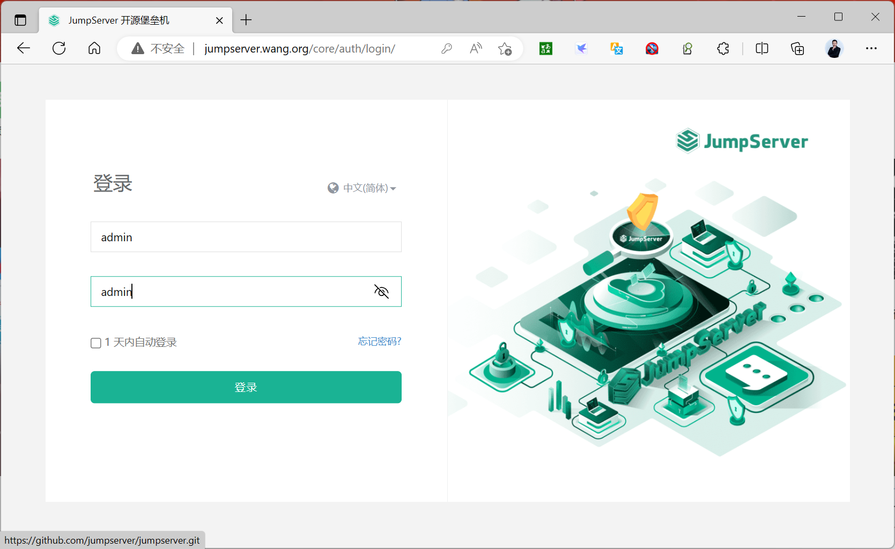

[← 返回JumpServer 堡垒机目录]({{ '/subjects/JumpServer/' | relative_url }})



# 10 官方脚本安装

官方安装脚本会准备配置、镜像和容器，再提供管理命令。它减少手工输入，但并不免除版本选择、脚本审查、数据备份与验收。原资料先后写下 v4.10.7、v4.10.2，却展示 v4.8.1 的安装目录和镜像，又混入 v3 的终端输出；这些记录不能当作同一次安装。本篇保留其中有用的流程，示例版本统一以 **v4.8.1** 说明，实际操作应改为当前明确支持的版本并阅读对应[官方安装文档](https://docs.jumpserver.org/)。

## 安装前确认

检查主机的 CPU、内存、磁盘与 Docker／Compose 版本是否满足所选 JumpServer 版本的要求，确认 80、2222 等计划使用的端口没有冲突。决定数据库与审计数据将保存在哪里，并先安排备份目录。若主机已有旧版 JumpServer，先备份并阅读升级说明，不能把全新安装脚本直接当作无损升级器。

## 获取并核对脚本

从所选版本的发行页获取 quick_start.sh，保存为文件后先阅读。不要把随时间变化的 latest 链接与固定版本号混用，也不要在看不到脚本内容时直接把网络响应送入 Shell：

~~~bash
VERSION=4.8.1
curl -fL -o quick_start.sh \
  "https://github.com/jumpserver/jumpserver/releases/download/v$VERSION/quick_start.sh"
less quick_start.sh
~~~

如果发行页提供校验和，应核对下载文件；如果链接、依赖或配置项与该版本文档不符，应先查清原因。确认脚本来源与内容后，按官方步骤运行，并保存安装器输出的实际目录与配置路径。运行脚本会修改主机和容器环境，因此应使用符合组织权限要求的账号操作。

## 启动与管理

原 v4.8.1 示例的安装器输出指向 /opt/jumpserver-installer-v4.8.1，并提供 jmsctl.sh。**目录由实际安装输出决定**，不要因为复制旧日志而进入错误的版本目录：

~~~bash
cd /opt/jumpserver-installer-v4.8.1
./jmsctl.sh --help
./jmsctl.sh start
docker ps
~~~

可以通过 jmsctl.sh 的帮助查看当前版本支持的停止、重启、备份与升级操作。执行备份后应检查备份文件及恢复方法；仅看到“备份完成”字样不足以证明可恢复。原资料列出的若干 docker ps 输出反映了不同版本的组件拆分，因此不要求今天的容器名和数量完全一致。

## 验收与常见误判

先观察安装器和容器日志，确认核心服务、数据库、Redis 与连接组件都已就绪；再在浏览器打开实际绑定的 Web 地址，完成管理员初始化、登录、资产授权和一次测试会话。最后确认会话录像或命令审计能够检索。一个容器显示 Started、或 Web 页可以打开，都不是全链路完成的证据。

原资料同时出现 admin/admin、admin/ChangeMe 等默认凭据，属于不同版本或实验环境。实际初始凭据以当前安装器输出为准，首次登录后立即设置独立密码和多因素认证，并限制管理入口的访问范围。

如果安装失败，按顺序检查脚本版本、主机资源、镜像下载、数据服务健康状态和具体组件日志。不要把 v3 的 10 个容器清单与 v4 的 8 个容器清单拼接成故障判断标准。正式使用前，还应把安装配置、数据库与审计存储纳入周期备份，并进行一次恢复演练。



<nav class="article-end" aria-label="章节导航">
  <a href="{{ '/subjects/JumpServer/09-docker-compose-deployment.html' | relative_url }}">← 上一篇：Docker Compose 部署</a>
  <a href="{{ '/subjects/JumpServer/' | relative_url }}">返回 JumpServer 专题目录</a>
  <a href="{{ '/subjects/JumpServer/11-initial-login-and-configuration.html' | relative_url }}">下一篇：首次登录与配置 →</a>
</nav>