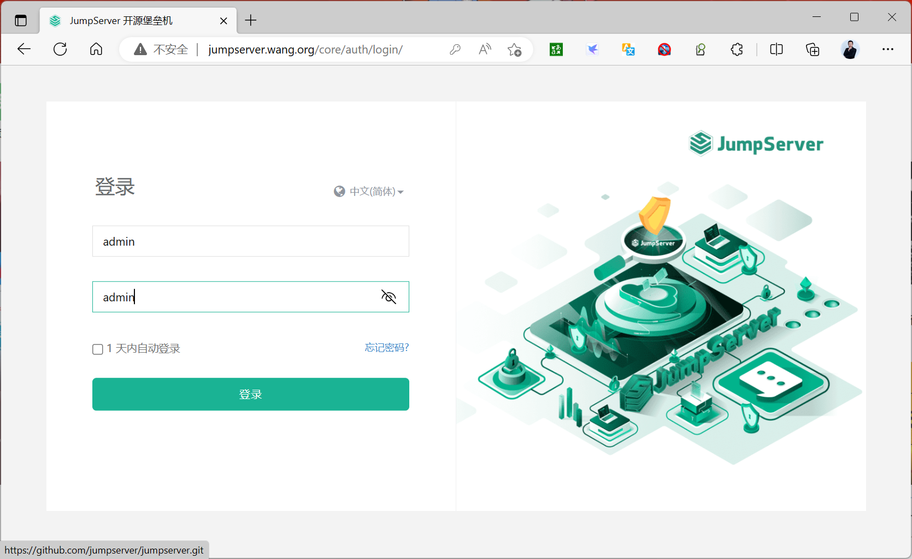

[← 返回JumpServer 堡垒机目录]({{ '/subjects/JumpServer/' | relative_url }})



# 10 官方脚本一键安装
### 2.5 官方脚本一键安装

官方脚本实现基于docker安装jumpserver

<https://docs.jumpserver.org/zh/v3/installation/setup_linux_standalone/online_install/>

范例：基于jumpserver-v4.10.7

```bash
[root@ubuntu2404 ~]#VERSION=4.10.7
[root@ubuntu2404 ~]#VERSION=4.10.2
[root@ubuntu2404 ~]#curl -sSL
https://resource.fit2cloud.com/jumpserver/jumpserver/releases/download/v${VERSIO
N}/quick_start.sh|bash
>>> The Installation is Complete
1. You can use the following command to start, and then visit
cd /opt/jumpserver-installer-v4.8.1
./jmsctl.sh start
2. Other management commands
./jmsctl.sh stop
./jmsctl.sh restart
./jmsctl.sh backup
./jmsctl.sh upgrade
For more commands, you can enter ./jmsctl.sh --help to understand
3. Web access
http://10.0.0.100:80
Default username: admin  Default password: ChangeMe
More information
Official Website: https://www.jumpserver.org/
Documentation: https://docs.jumpserver.org/
```

```text
[+] Running 8/8
```

✔ Container jms_web         Started

```text
12.7s
```

✔ Container jms_koko        Started

```text
12.4s
```

✔ Container jms_redis       Running

```text
0.0s
```

✔ Container jms_lion        Started

```text
12.4s
```

✔ Container jms_core        Started

```text
12.2s
```

✔ Container jms_postgresql  Running

```text
0.0s
```

✔ Container jms_chen        Started

```text
12.0s
```

✔ Container jms_celery      Started

```bash
12.2s
[root@ubuntu2404 ~]#docker ps
CONTAINER ID   IMAGE                       COMMAND                  CREATED
STATUS                            PORTS
NAMES
a4ee60d1a3c2   jumpserver/lion:v4.8.1-ce   "./entrypoint.sh sup…"   16 seconds
ago   Up 3 seconds (health: starting)   8081/tcp
jms_lion
dce76b8f0aad   jumpserver/core:v4.8.1-ce   "./entrypoint.sh sta…"   16 seconds
ago   Up 4 seconds (health: starting)   8080/tcp
jms_core
9b554c4ea5e3   jumpserver/web:v4.8.1-ce    "/docker-entrypoint.…"   16 seconds
ago   Up 3 seconds (health: starting)   0.0.0.0:80->80/tcp, :::80->80/tcp
jms_web
80d65f53aaa2   jumpserver/core:v4.8.1-ce   "./entrypoint.sh sta…"   16 seconds
ago   Up 4 seconds (health: starting)   8080/tcp
jms_celery
980db242e72b   jumpserver/chen:v4.8.1-ce   "./entrypoint.sh wisp"   16 seconds
ago   Up 5 seconds (health: starting)   8082/tcp
jms_chen
5b3b54ae024d   jumpserver/koko:v4.8.1-ce   "./entrypoint.sh ./k…"   16 seconds
ago   Up 3 seconds (health: starting)   0.0.0.0:2222->2222/tcp, :::2222-
>2222/tcp   jms_koko
99e2e2439829   postgres:16.3-bullseye      "docker-entrypoint.s…"   54 seconds
ago   Up 53 seconds (healthy)           5432/tcp
jms_postgresql
ed61ede68580   redis:7.0-bullseye          "docker-entrypoint.s…"   54 seconds
ago   Up 53 seconds (healthy)           6379/tcp
jms_redi
```

```bash
[root@ubuntu2404 ~]#docker images
REPOSITORY        TAG             IMAGE ID       CREATED         SIZE
jumpserver/koko   v4.8.1-ce       4cd2b589f520   2 weeks ago     590MB
jumpserver/chen   v4.8.1-ce       b72a46887166   2 weeks ago     461MB
jumpserver/core   v4.8.1-ce       ef8512b7d83a   2 weeks ago     861MB
jumpserver/lion   v4.8.1-ce       85b6988752e7   2 weeks ago     209MB
jumpserver/web    v4.8.1-ce       5f7cfa4c7af7   2 weeks ago     237MB
postgres          16.3-bullseye   019e55863fd0   11 months ago   400MB
redis             7.0-bullseye    9316221abf0d   22 months ago   117MB
#安装完成后，直接访问即可，默认用户名和密码是admin/admin，首次登录需要修改密码，但不能使用原密
码
http://jumpserver_ip/
```

范例：基于jumpserver-v4.3.1

```bash
[root@ubuntu2404 ~]#VERSION=4.8.1
[root@ubuntu2204 ~]#VERSION=4.3.1
#国内
[root@ubuntu2204 ~]#curl -sSL
https://resource.fit2cloud.com/jumpserver/jumpserver/releases/download/v${VERSIO
N}/quick_start.sh|bash
[root@ubuntu2204 ~]#curl -sSL
https://resource.fit2cloud.com/jumpserver/jumpserver/releases/latest/download/qu
ick_start.sh | bash
#海外
[root@ubuntu2204 ~]#curl -sSL
https://github.com/jumpserver/jumpserver/releases/download/v${VERSION}/quick_sta
rt.sh | bash
```

```bash
[root@ubuntu2204 ~]#docker ps
CONTAINER ID   IMAGE                       COMMAND                  CREATED
STATUS                    PORTS                                       NAMES
1cd86066015d   jumpserver/chen:v4.3.1-ce   "./entrypoint.sh wisp"   49 minutes
ago   Up 49 minutes (healthy)   8082/tcp
jms_chen
f876fe3f9801   jumpserver/koko:v4.3.1-ce   "./entrypoint.sh ./k…"   49 minutes
ago   Up 49 minutes (healthy)   0.0.0.0:2222->2222/tcp, :::2222->2222/tcp
jms_koko
567529f9882d   jumpserver/core:v4.3.1-ce   "./entrypoint.sh sta…"   49 minutes
ago   Up 49 minutes (healthy)   8080/tcp
jms_core
677ea20e1989   jumpserver/lion:v4.3.1-ce   "./entrypoint.sh sup…"   49 minutes
ago   Up 49 minutes (healthy)   4822/tcp, 8081/tcp
jms_lion
2688e31bf923   jumpserver/web:v4.3.1-ce    "/docker-entrypoint.…"   49 minutes
ago   Up 49 minutes (healthy)   0.0.0.0:80->80/tcp, :::80->80/tcp
jms_web
fd2adda18a98   jumpserver/core:v4.3.1-ce   "./entrypoint.sh sta…"   49 minutes
ago   Up 49 minutes (healthy)   8080/tcp
jms_celery
cb3f8f9d6718   redis:7.0-bullseye          "docker-entrypoint.s…"   50 minutes
ago   Up 50 minutes (healthy)   6379/tcp
jms_redis
e3f062040814   postgres:16.3-bullseye      "docker-entrypoint.s…"   50 minutes
ago   Up 50 minutes (healthy)   5432/tcp
jms_postgresql
```

范例：基于jumpserver-v4.0.2

```bash
#最新安装基于jumpserver-v4.0.2
[root@ubuntu2204 ~]#VERSION=4.0.2
#国内
[root@ubuntu2204 ~]#curl -sSL
https://resource.fit2cloud.com/jumpserver/jumpserver/releases/download/v${VERSIO
N}/quick_start.sh|bash
[root@ubuntu2204 ~]#curl -sSL
https://resource.fit2cloud.com/jumpserver/jumpserver/releases/latest/download/qu
ick_start.sh | bash
#海外
[root@ubuntu2204 ~]#curl -sSL
https://github.com/jumpserver/jumpserver/releases/download/v${VERSION}/quick_sta
rt.sh | bash
```

范例：基于jumpserver-v3.10.7

```bash
#最新安装基于jumpserver-v3.10.7
[root@ubuntu2204 ~]#VERSION=3.10.7
#国内
[root@ubuntu2204 ~]#curl -sSL
https://resource.fit2cloud.com/jumpserver/jumpserver/releases/latest/download/qu
ick_start.sh | bash
#海外
[root@ubuntu2204 ~]#curl -sSL
https://github.com/jumpserver/jumpserver/releases/download/v${VERSION}/quick_sta
rt.sh | bash
```

范例：

```bash
#最新安装基于jumpserver-v3.6.2
[root@ubuntu2204 ~]#curl -sSL
https://resource.fit2cloud.com/jumpserver/jumpserver/releases/latest/download/qu
ick_start.sh | bash
......
>>> 安装完成了
1. 可以使用如下命令启动, 然后访问
cd /opt/jumpserver-installer-v3.0.4
./jmsctl.sh start
2. 其它一些管理命令
./jmsctl.sh stop
./jmsctl.sh restart
./jmsctl.sh backup
./jmsctl.sh upgrade
更多还有一些命令, 你可以 ./jmsctl.sh --help 来了解
3. Web 访问
http://192.168.250.1:80
默认用户: admin  默认密码: admin
4. SSH/SFTP 访问
ssh -p2222 admin@192.168.250.1
sftp -P2222 admin@192.168.250.1
5. 更多信息
我们的官网: https://www.jumpserver.org/
我们的文档: https://docs.jumpserver.org/
```

```text
[+] Running 10/10
```

✔ Container jms_kael    Started

```text
0.1s
```

✔ Container jms_celery  Started

```text
0.1s
```

✔ Container jms_koko    Started

```text
0.1s
```

✔ Container jms_lion    Started

```text
0.1s
```

✔ Container jms_chen    Started

```text
0.1s
```

✔ Container jms_magnus  Started

```text
0.1s
```

✔ Container jms_web     Started

```text
0.1s
```

✔ Container jms_core    Started

```text
0.4s
```

✔ Container jms_mysql   Running

```text
0.0s
```

✔ Container jms_redis   Running

```bash
[root@ubuntu2204 ~]#docker images
REPOSITORY           TAG       IMAGE ID       CREATED       SIZE
jumpserver/web       v3.10.3   0ee78cf967db   4 days ago    1.52GB
jumpserver/core-ce   v3.10.3   63c4dd51406b   4 days ago    1.56GB
jumpserver/koko      v3.10.3   076f77b0aa4b   4 days ago    1.06GB
jumpserver/lion      v3.10.3   c82cbcccb148   4 days ago    255MB
jumpserver/kael      v3.10.3   ff371a084eae   4 days ago    269MB
jumpserver/chen      v3.10.3   a8990c6cf53e   4 days ago    572MB
jumpserver/magnus    v3.10.3   ff5c80e9d2b2   4 days ago    147MB
jumpserver/mariadb   10.6      9ee9424356c4   2 weeks ago   392MB
jumpserver/redis     6.2       c6b27afb23d5   2 weeks ago   113MB
[root@ubuntu2204 ~]#docker ps
CONTAINER ID   IMAGE                        COMMAND                   CREATED
STATUS                   PORTS
NAMES
e226cdf1f1a4   jumpserver/kael:v3.10.3      "./entrypoint.sh"         2 minutes
ago   Up 2 minutes (healthy)   8083/tcp
jms_kael
d98a8be74dda   jumpserver/lion:v3.10.3      "./entrypoint.sh"         2 minutes
ago   Up 2 minutes (healthy)   4822/tcp, 8081/tcp
jms_lion
9bf5b81684f4   jumpserver/magnus:v3.10.3    "./entrypoint.sh"         2 minutes
ago   Up 2 minutes (healthy)   0.0.0.0:33061-33062->33061-33062/tcp, :::33061-
33062->33061-33062/tcp, 0.0.0.0:63790->63790/tcp, :::63790->63790/tcp
jms_magnus
d8d82a29fd57   jumpserver/web:v3.10.3       "/docker-entrypoint.…"   2 minutes
ago   Up 2 minutes (healthy)   0.0.0.0:80->80/tcp, :::80->80/tcp
jms_web
773b23b7778d   jumpserver/core-ce:v3.10.3   "./entrypoint.sh sta…"   2 minutes
ago   Up 2 minutes (healthy)   8080/tcp
jms_celery
80649a6477a9   jumpserver/koko:v3.10.3      "./entrypoint.sh"         2 minutes
ago   Up 2 minutes (healthy)   0.0.0.0:2222->2222/tcp, :::2222->2222/tcp,
5000/tcp                                                          jms_koko
4acad62d7966   jumpserver/core-ce:v3.10.3   "./entrypoint.sh sta…"   2 minutes
ago   Up 2 minutes (healthy)   8080/tcp
jms_core
c290fa8eb00a   jumpserver/chen:v3.10.3      "./entrypoint.sh"         2 minutes
ago   Up 2 minutes (healthy)   8082/tcp
jms_chen
825f9d423e19   jumpserver/mariadb:10.6      "docker-entrypoint.s…"   4 minutes
ago   Up 4 minutes (healthy)   3306/tcp
jms_mysql
3c8ecac560a0   jumpserver/redis:6.2         "docker-entrypoint.s…"   4 minutes
ago   Up 4 minutes (healthy)   6379/tcp
jms_redis
[root@ubuntu2204 ~]#ls /opt
containerd  jumpserver  jumpserver-installer-v3.10.3
```

```bash
[root@ubuntu2204 ~]#tree /opt/jumpserver
/opt/jumpserver
└── config
├── certs
├── config.txt
├── mariadb
│   └── mariadb.cnf
├── mysql
│   └── my.cnf
├── nginx
│   ├── cert
│   │   ├── server.crt
│   │   └── server.key
│   └── lb_http_server.conf
└── redis
└── redis.conf
7 directories, 7 files
[root@ubuntu2204 ~]#tree /opt/jumpserver-installer-v3.10.3/
/opt/jumpserver-installer-v3.10.3/
├── cn-quick_start.sh
├── compose
│   ├── docker-compose-celery-xpack.yml
│   ├── docker-compose-celery.yml
│   ├── docker-compose-chen.yml
│   ├── docker-compose-core-xpack.yml
│   ├── docker-compose-core.yml
│   ├── docker-compose-es.yml
│   ├── docker-compose-init-db-xpack.yml
│   ├── docker-compose-init-db.yml
│   ├── docker-compose-kael.yml
│   ├── docker-compose-koko.yml
│   ├── docker-compose-lb.yml
│   ├── docker-compose-lion.yml
│   ├── docker-compose-magnus-xpack.yml
│   ├── docker-compose-magnus.yml
│   ├── docker-compose-mariadb.yml
│   ├── docker-compose-minio.yml
│   ├── docker-compose-mysql.yml
│   ├── docker-compose-network_v6.yml
│   ├── docker-compose-network.yml
│   ├── docker-compose-panda.yml
│   ├── docker-compose-razor.yml
│   ├── docker-compose-redis.yml
│   ├── docker-compose-video-worker.yml
│   ├── docker-compose-video.yml
│   ├── docker-compose-web.yml
│   └── docker-compose-xrdp.yml
├── config-example.txt
├── config_init
│   ├── mariadb
│   │   └── mariadb.cnf
│   ├── mysql
│   │   └── my.cnf
│   ├── nginx
│   │   ├── cert
│   │   │   ├── server.crt
│   │   │   └── server.key
│   │   └── lb_http_server.conf
│   ├── README.md
│   └── redis
│       └── redis.conf
├── jmsctl.sh
├── LICENSE
├── locale
│   ├── en
│   │   └── LC_MESSAGES
│   │       ├── jumpserver-installer.mo
│   │       └── jumpserver-installer.po
│   └── zh_CN
│       └── LC_MESSAGES
│           ├── jumpserver-installer.mo
│           └── jumpserver-installer.po
├── quick_start.sh
├── README.md
├── scripts
│   ├── 0_prepare.sh
│   ├── 1_config_jumpserver.sh
│   ├── 2_install_docker.sh
│   ├── 3_load_images.sh
│   ├── 4_install_jumpserver.sh
│   ├── 5_db_backup.sh
│   ├── 6_db_restore.sh
│   ├── 7_upgrade.sh
│   ├── 8_uninstall.sh
│   ├── const.sh
│   ├── docker
│   │   └── docker-compose
│   ├── docker.service
│   └── utils.sh
├── static.env
└── utils
├── build.sh
└── messages.sh
15 directories, 59 files
#安装完成后，直接访问即可，默认用户名和密码是admin/admin，首次登录需要修改密码，但不能使用原密
码
http://jumpserver_ip/
```





<nav class="article-end" aria-label="章节导航">
  <a href="{{ '/subjects/JumpServer/09-docker-compose-deployment.html' | relative_url }}">← Previous: Docker Compose Deployment</a>
  <a href="{{ '/subjects/JumpServer/' | relative_url }}">Back to JumpServer Bastion Host Index</a>
  <a href="{{ '/subjects/JumpServer/11-initial-login-and-configuration.html' | relative_url }}">Next: Initial Login and Configuration →</a>
</nav>
