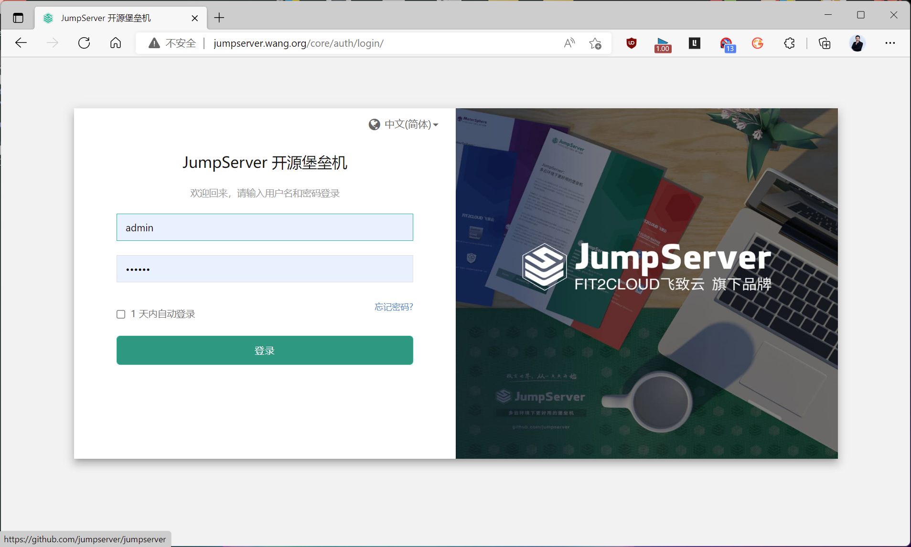
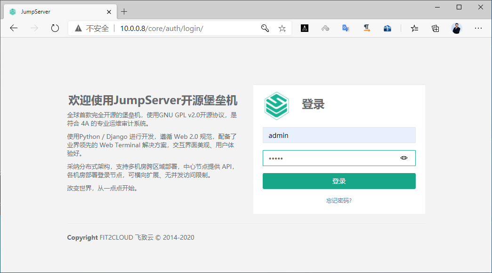
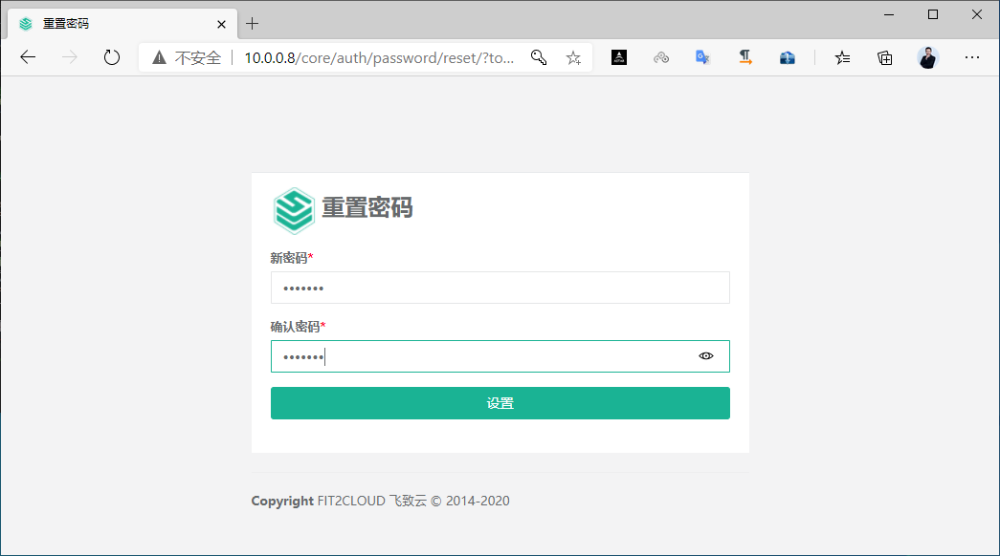
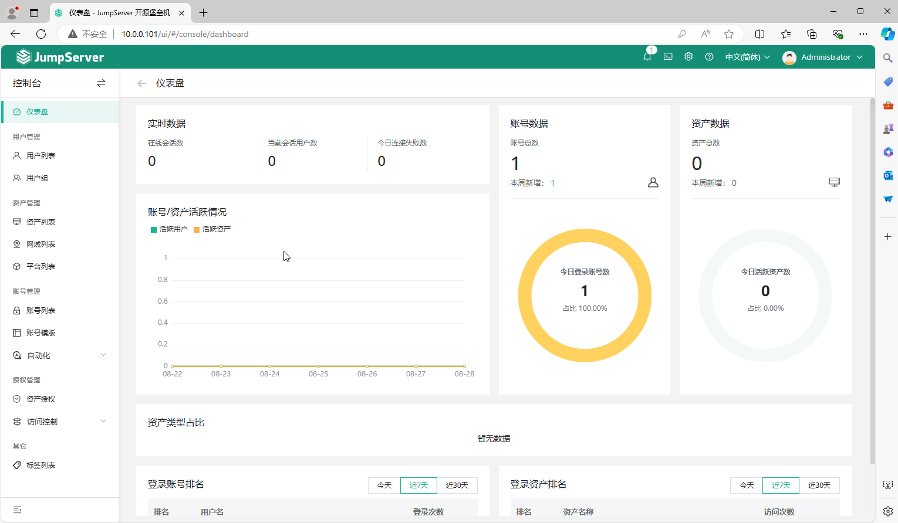
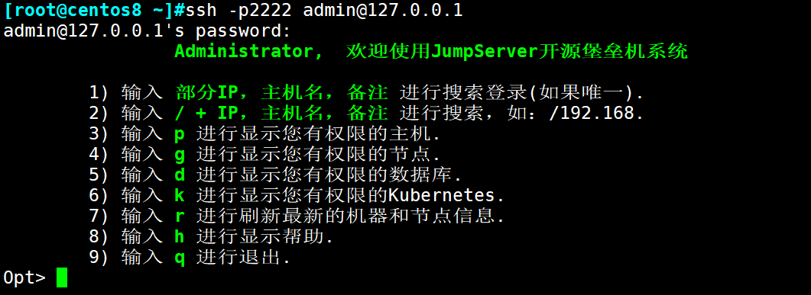
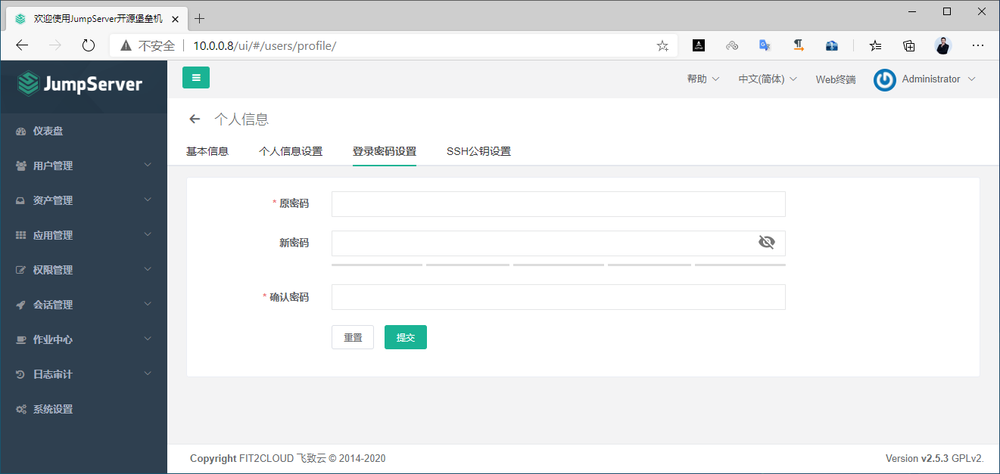
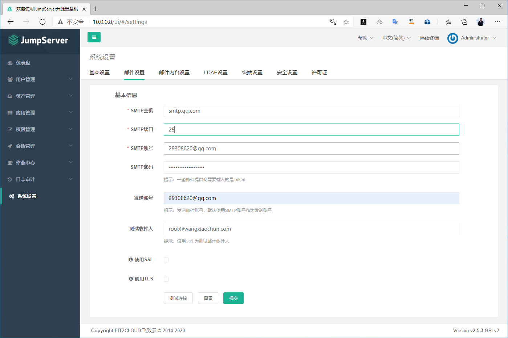
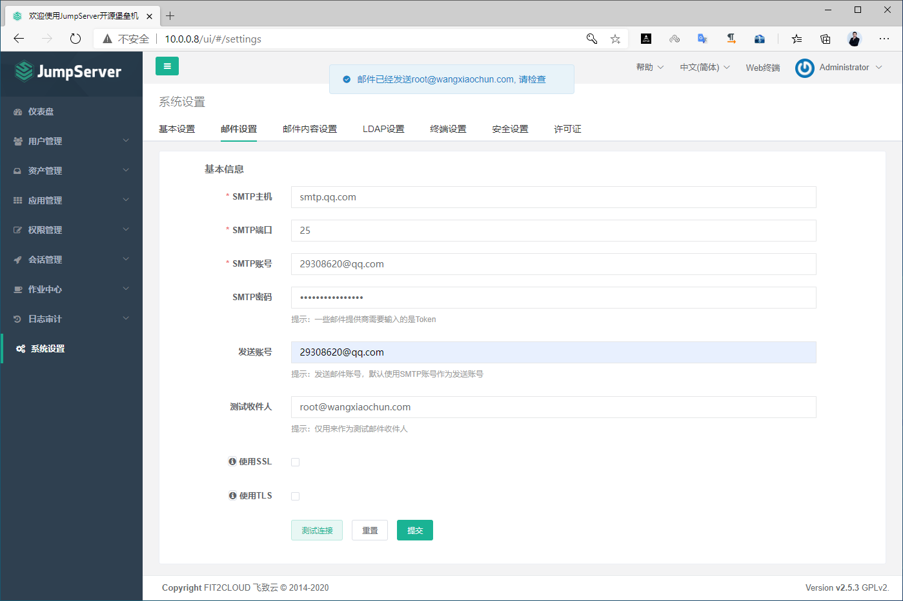
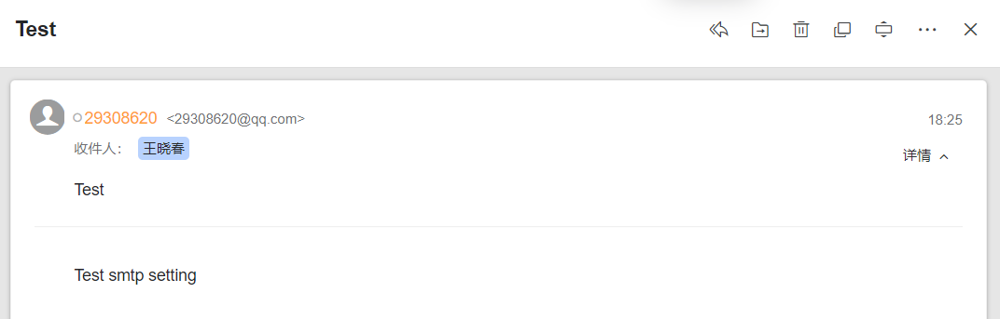

[← Back to JumpServer Bastion Host Index]({{ '/subjects/JumpServer/' | relative_url }})



# 11 Initial Login and Configuration
## 3 JumpServer 常见功能

官方文档:

<https://docs.jumpserver.org/zh/master/>

### 3.1 登录并初始化配置

### 首次登录

### 浏览器访问

```text
http:<JumpServerIP>
```

旧版的登录 JumpServer 默认用户: admin  密码: admin

注意：v4.0.0 版以后的密码：默认用户: admin  密码:ChangeMe





第一次登录要求重置密码,不能使用原密码，但支持123456弱密码



用新密码重新登录


JumpServer-v4.0.2



### ssh 登录

可以用admin用户和修改过的新密码, 连接jumpserver的ssh端口2222/tcp进行连接访问

注意:新版需要实现资产授权后才能连接登录



### 修改 admin 用户的密码



### 配置邮件





测试连接,可以收到邮件





<nav class="article-end" aria-label="章节导航">
  <a href="{{ '/subjects/JumpServer/10-installing-with-the-official-script.html' | relative_url }}">← Previous: Installing with the Official Script</a>
  <a href="{{ '/subjects/JumpServer/' | relative_url }}">Back to JumpServer Bastion Host Index</a>
  <a href="{{ '/subjects/JumpServer/12-creating-jumpserver-users-and-groups.html' | relative_url }}">Next: Creating JumpServer Users and Groups →</a>
</nav>
