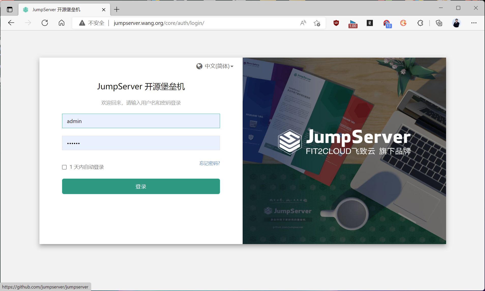
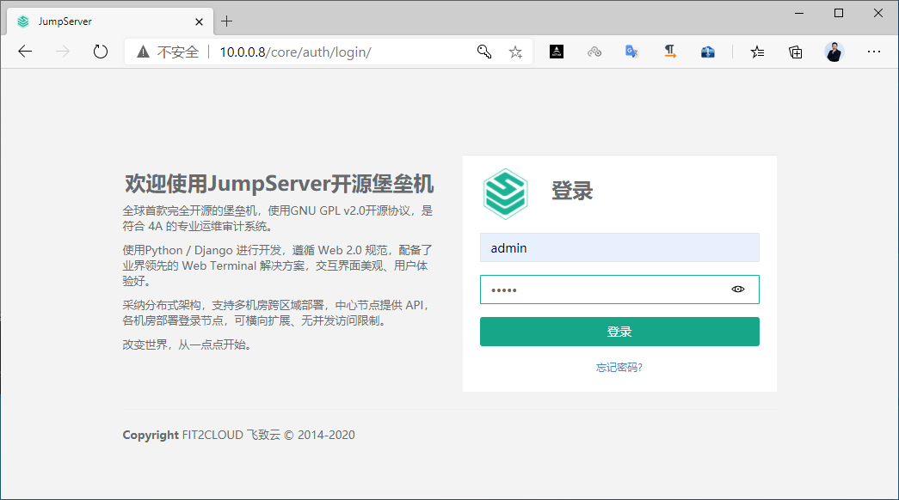
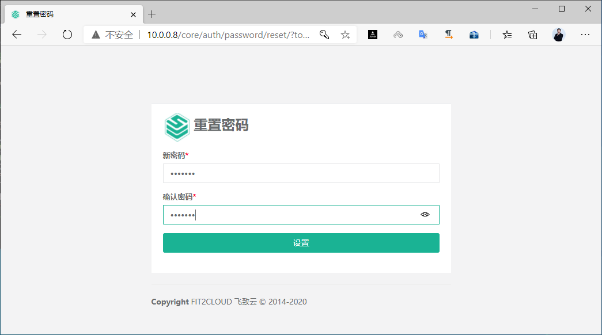
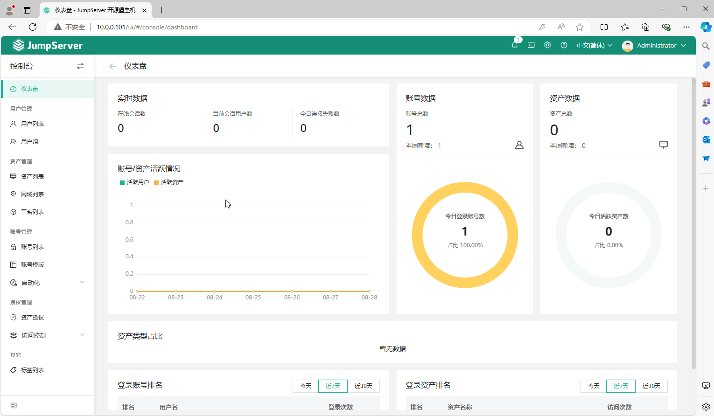
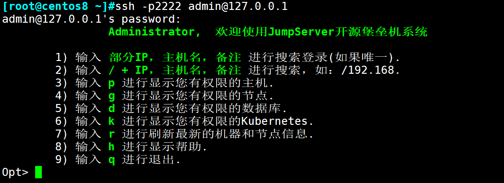
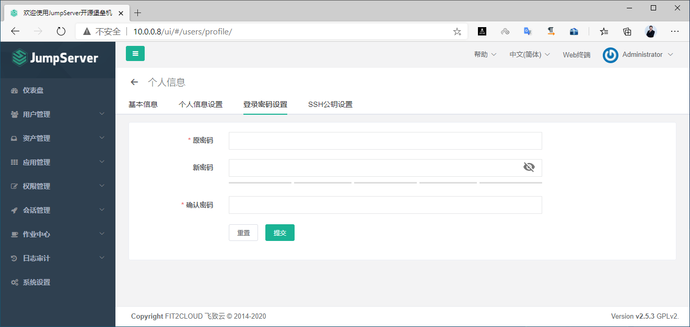
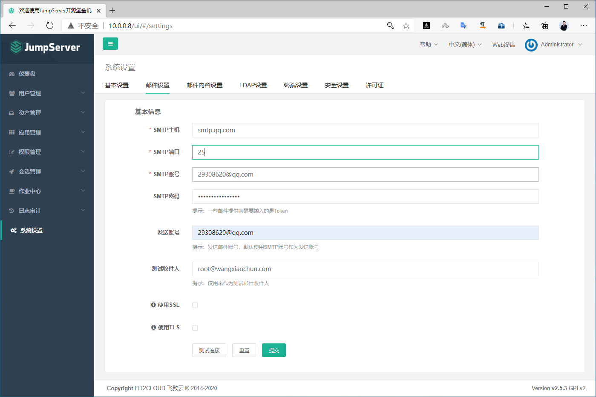
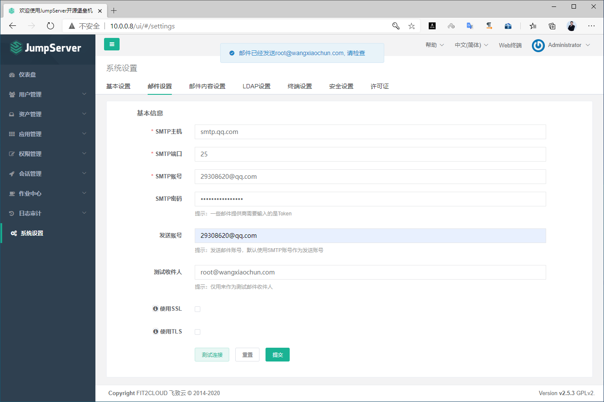
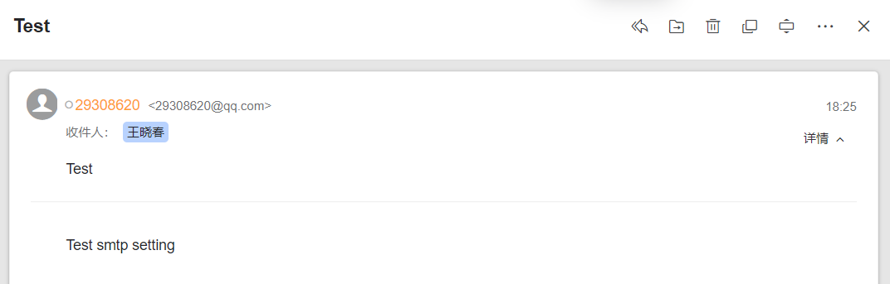

[← 返回JumpServer 堡垒机目录]({{ '/subjects/JumpServer/' | relative_url }})



# 11 登录并初始化配置

安装后的首要工作不是添加资产，而是确认访问入口、初始化管理员并配置通知渠道。以下截图来自不同历史版本；以实际部署版本的[官方文档](https://docs.jumpserver.org/)和安装器输出为准。

<https://docs.jumpserver.org/zh/master/>

### 首次登录与修改密码

在浏览器打开安装时配置的 JumpServer 地址。例如测试环境把容器 80 端口映射到宿主机 8080，则访问地址应包含 8080；生产环境宜使用 HTTPS 域名，不要照抄旧示例中的默认端口。

```text
https://<JumpServer 域名>
```

原资料分别写有 admin/admin 和 admin/ChangeMe，反映不同历史版本，不能当作当前安装的初始凭据。查看**本次安装器实际输出**或部署文档，并在首次登录后立即设置独立的强密码与多因素认证。





如果系统要求首次重置密码，按提示完成后重新登录。即使某版本界面接受简单密码，也不代表它适合真实环境。



重新登录后检查管理员首页及个人资料，确认进入的是预期实例，而不是同名测试环境。


以下是 v4.0.2 的历史页面，用于识别界面变化。



### 验证 SSH 接入

JumpServer 可提供 SSH 接入端口，原示例使用 2222/tcp。连接端口可达不等于可访问任何资产：还需要创建资产、配置资产账号并给登录用户授权。应使用普通测试账号完成一次会话，再核对记录，避免只用管理员账号验证。



### 后续修改管理员密码

若需要轮换管理员密码，从当前用户设置进入；修改后用新凭据重新登录，并确认自动化集成未依赖旧密码。



### 配置邮件并测试通知

邮件用于邀请、重置密码和告警等通知。填写 SMTP 地址、端口、加密方式和发信账号后，先发送测试邮件，再检查收件箱与垃圾邮件目录；“页面提示已发送”并不等于邮件已投递。发信凭据也应纳入密钥管理。





以下截图展示原资料中的测试结果。实际验收应记录测试时间、收件地址与投递结果。





<nav class="article-end" aria-label="章节导航">
  <a href="{{ '/subjects/JumpServer/10-installing-with-the-official-script.html' | relative_url }}">← 上一篇：官方脚本安装</a>
  <a href="{{ '/subjects/JumpServer/' | relative_url }}">返回 JumpServer 专题目录</a>
  <a href="{{ '/subjects/JumpServer/12-creating-jumpserver-users-and-groups.html' | relative_url }}">下一篇：创建用户和组 →</a>
</nav>
