[← Back to JumpServer Bastion Host Index]({{ '/subjects/JumpServer/' | relative_url }})



# 13 Creating Assets and Linking Privileged and Regular Users
### 3.3 创建资产并关联特权用户和普通用户

JumpServer 可以管理各种类型的资产

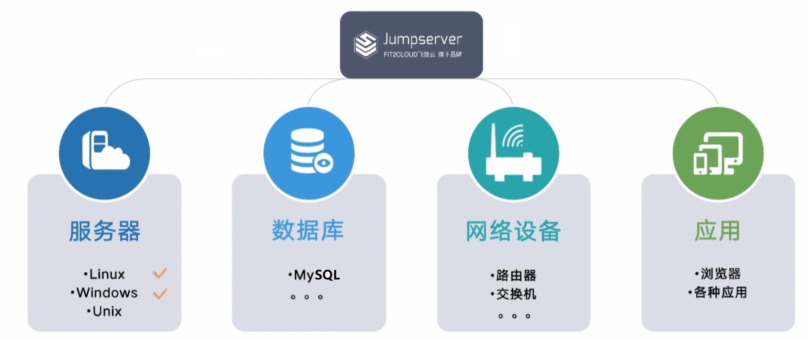

JumpServer中的三种用户类型

JumpServer的登录用户:

分配给用户用于登录JumpServer时使用

在Jumpserver上面创建

系统用户中的特权用户(旧名：管理用户):

对后端服务器具有管理权限的系统帐号 root或administrator 及sudo ALL权限的用户,用于管理后端服务器

新版中已取消此名称,改名为系统用户中特权用户

在后端服务器上创建的具有系统管理特权的系统用户新版建议在账号管理--账号模版创建，后续无需针对每个后端服务单独创建

系统用户中的普通用户(旧名：系统用户):

给登录用户使用ssh连接后端服务器时对应的系统用户 ,一般是后端服务器的普通的系统用户帐号

新版中改名为系统用户中普通用户

在后端服务器上创建的具有一般权限的系统用户

新版建议在账号管理---账号模版创建，后续无需针对每个后端服务单独创建，只需要授权后会自动创建

### 通过帐号模版创建系统用户中特权用户(管理用户)

管理用户是jumpServer用来管理后端服务器或其它资产的管理员用户,此用户必须对后端服务器有管理权限

管理用户特点:

通常是后端服务器的root或者是具备root权限的超级用户用于推送或者是创建系统用户用于获取被管理的硬件资产信息

新版: 新建帐号模板

通过帐号模版实现，方便后续重复使用

在帐号管理---帐号模板 创建

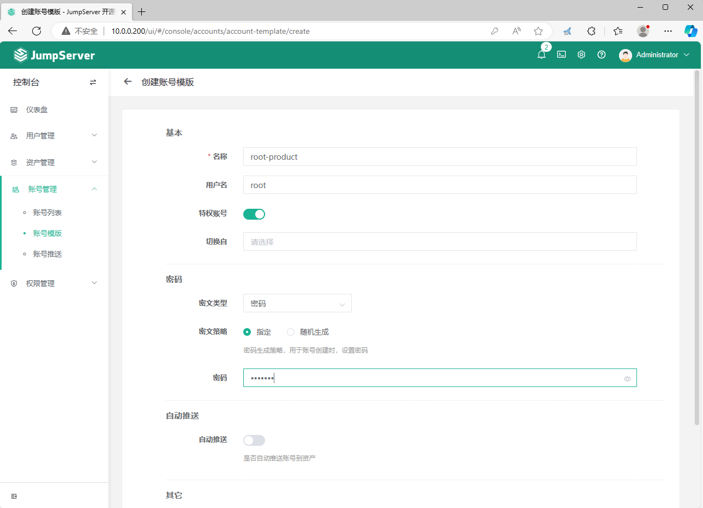

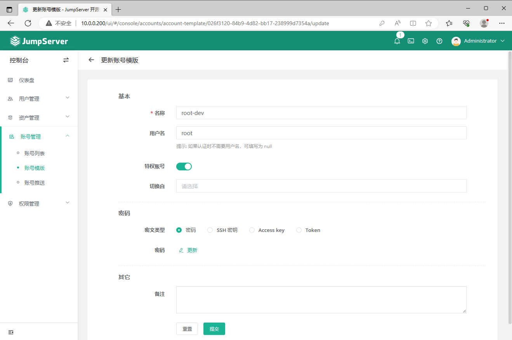

### 通过帐号模版创建系统普通用户(系统用户中普通用户)

系统用户是分配给JumpServer用户,用来让JumpServer用户在连接后端服务器和其它资产,一般不会给管理权限

生产环境中,一般都会利用自动化运维工具提前在后端服务器创建好系统用户,在所有后端服务器统一用户 ID信息,而非在jumpserver中创建

新版界面

通过帐号模版实现，方便后续重复使用

4.3.1 版本对应界面

密文策略：选择“随机生成”，如果是指定，用户将无法自动创建

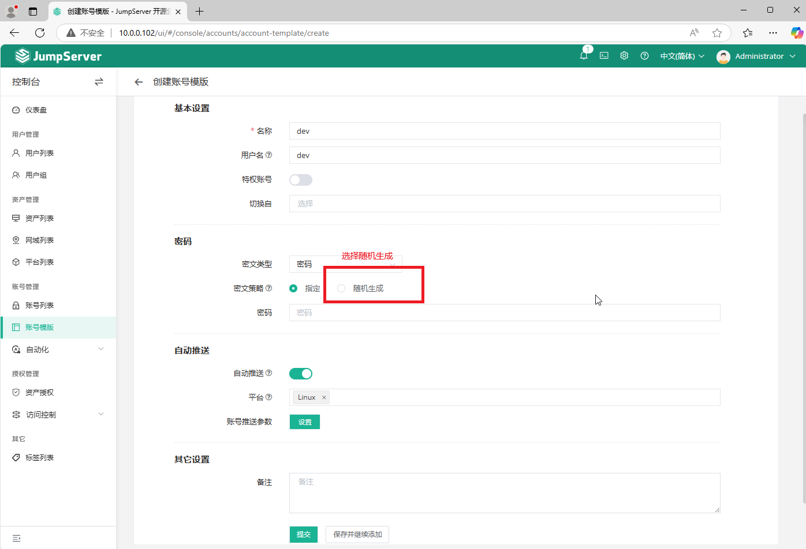

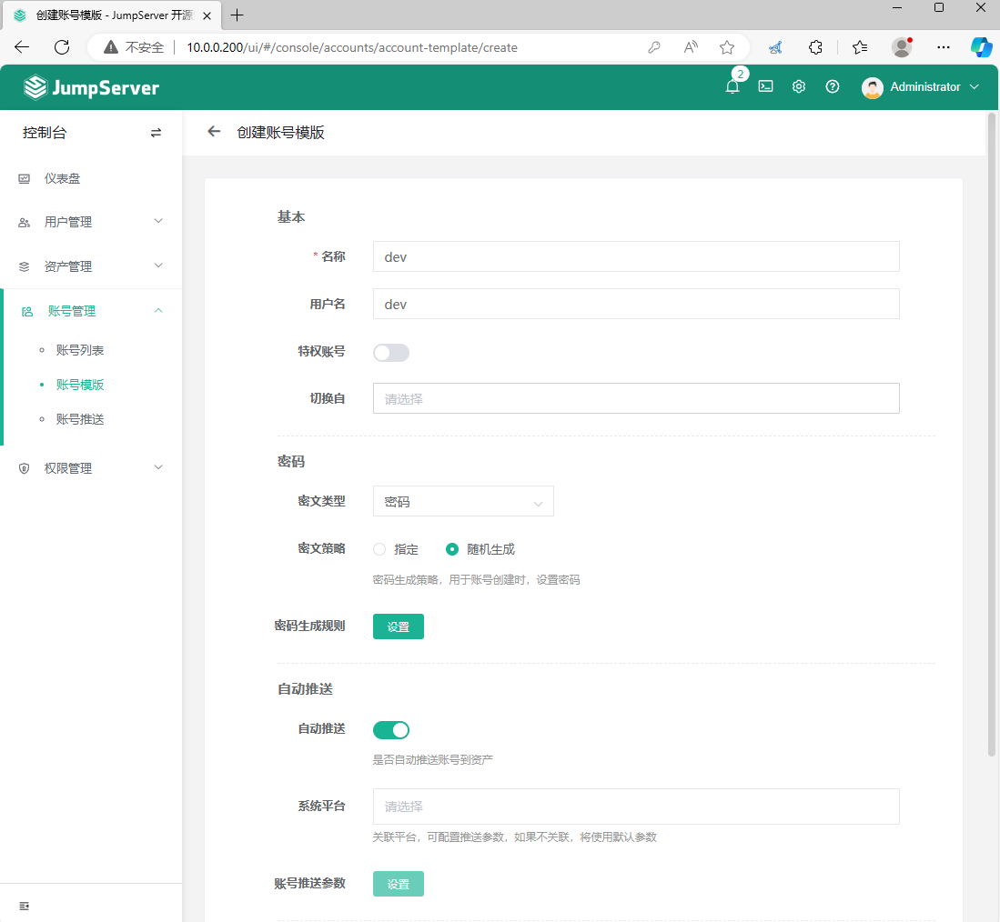

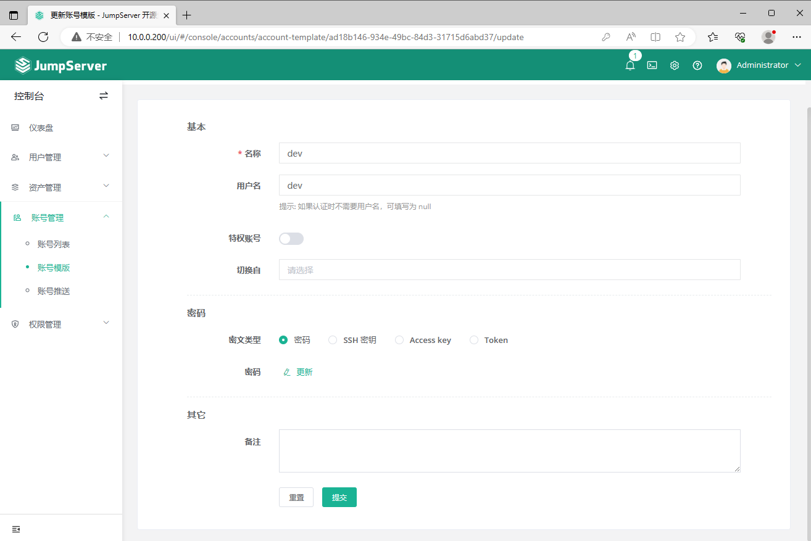

### 创建资产并关联特权用户和普通用户

创建可以被jumpServer用户访问的后端服务器和其它资产,比如:路由器,交换机等

### 创建资产并关联系统帐号的特权用户和普通用户

4.X以上版本界面

添加特权用户和普通用户（会自动创建）

注意：添加ssh和sftp协议

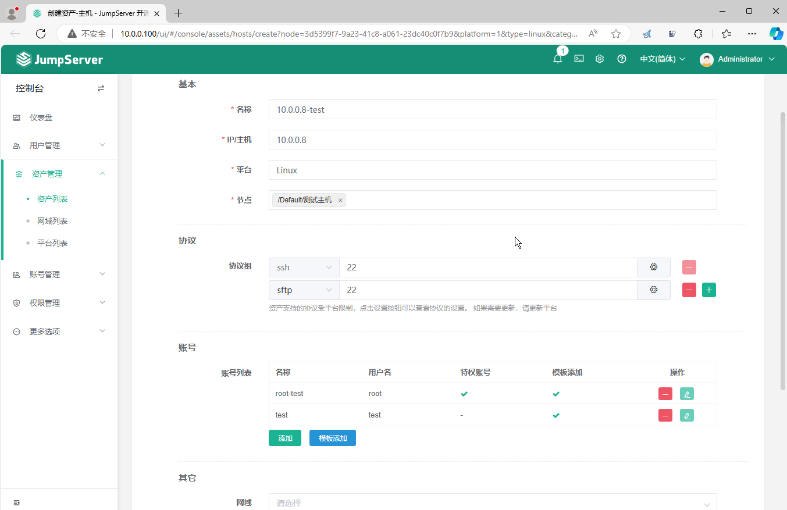

创建多个资产

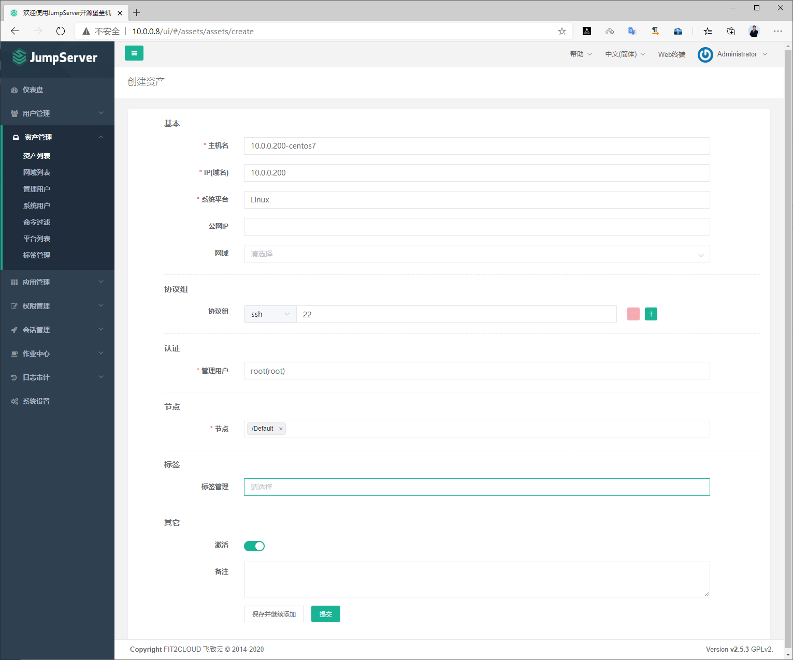

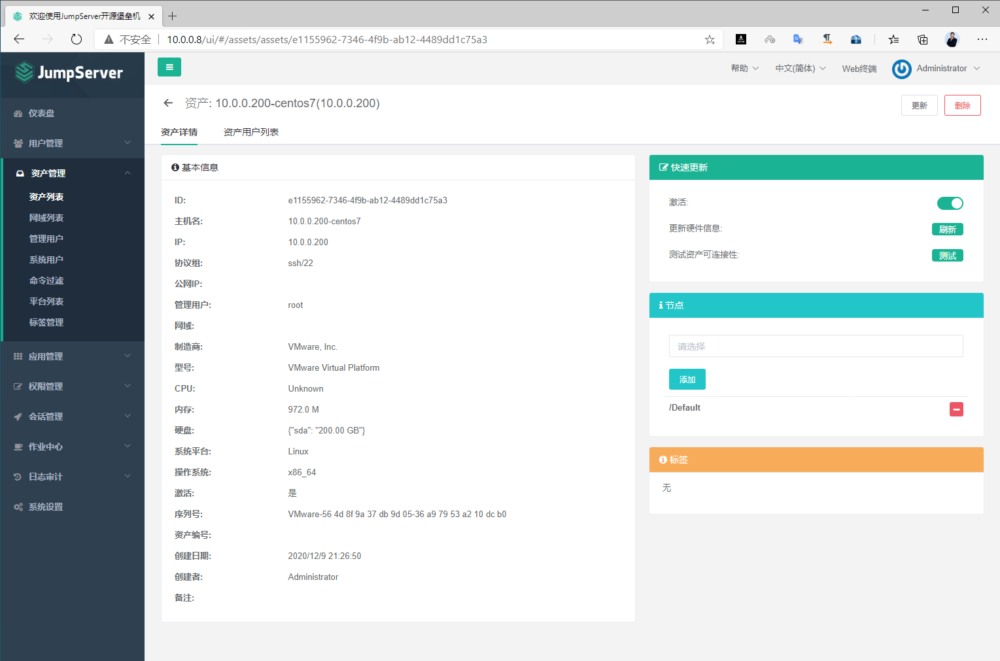

### 创建节点实现资产分类

创建节点将资产分类

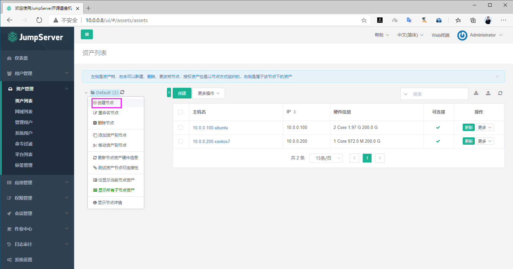

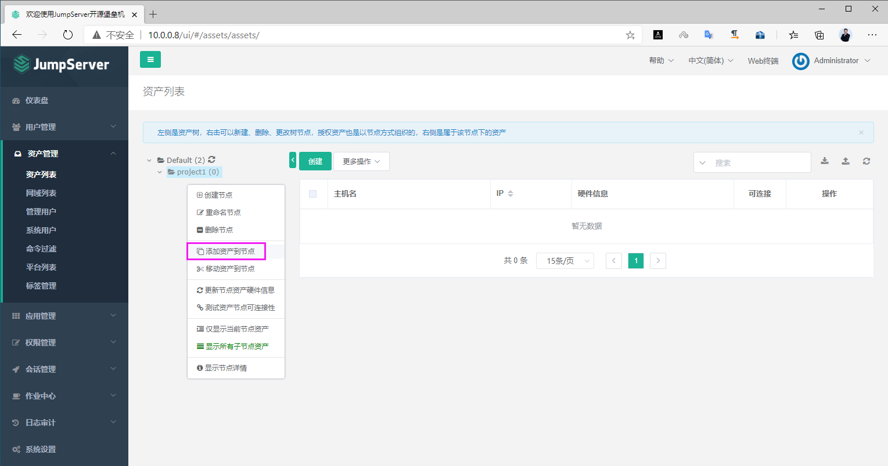

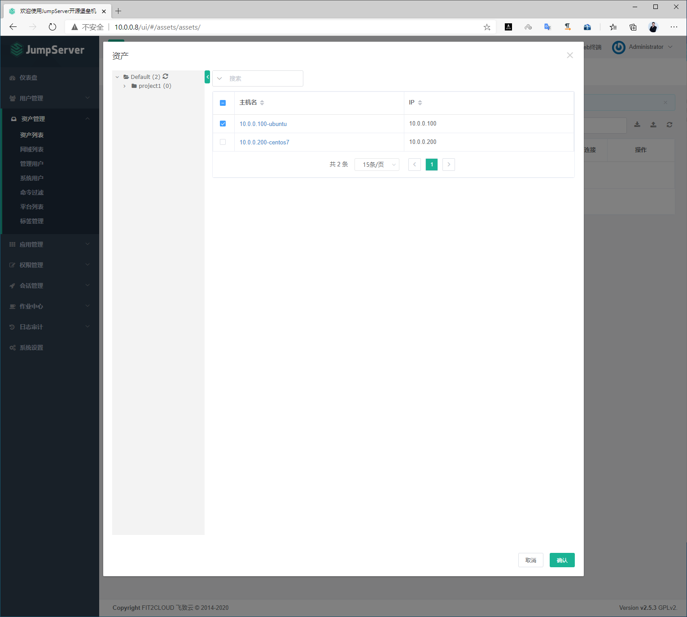

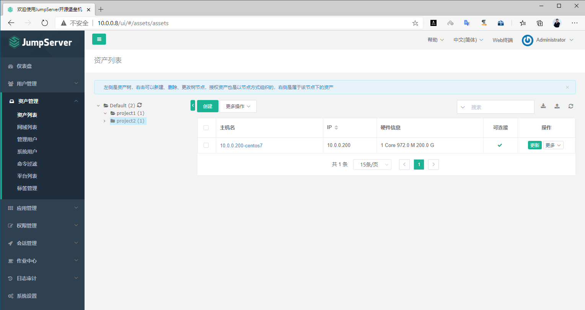



<nav class="article-end" aria-label="章节导航">
  <a href="{{ '/subjects/JumpServer/12-creating-jumpserver-users-and-groups.html' | relative_url }}">← Previous: Creating JumpServer Users and Groups</a>
  <a href="{{ '/subjects/JumpServer/' | relative_url }}">Back to JumpServer Bastion Host Index</a>
  <a href="{{ '/subjects/JumpServer/14-granting-users-access-to-assets.html' | relative_url }}">Next: Granting Users Access to Assets →</a>
</nav>
