[← 返回JumpServer 堡垒机目录]({{ '/subjects/JumpServer/' | relative_url }})



# 13 创建资产并关联特权用户和普通用户

上一章创建的是登录 JumpServer 的人员。本章要登记**被访问的资产**，并配置 JumpServer 连接这些资产时使用的账号。把三类身份分清，才能理解后续的授权规则。

JumpServer 可以纳管主机、网络设备和数据库等资产；不同类型的连接协议和账号字段不同。先确认目标资产网络可达、协议开放，再按类型登记。

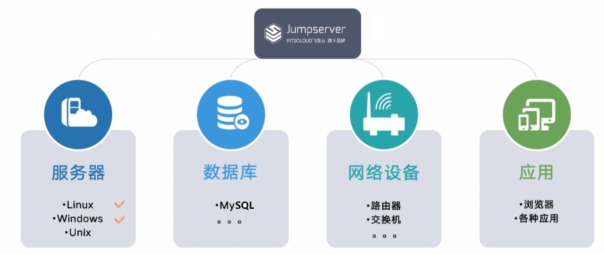

| 身份 | 所在位置 | 用途 |
| --- | --- | --- |
| 平台登录用户 | JumpServer | 识别运维人员，决定其能看到哪些资产 |
| 资产特权账号 | 目标主机或设备 | 在已授权情况下执行账号推送、资产探测等管理任务；旧资料称“管理用户” |
| 资产普通账号 | 目标主机或设备 | 供人员在会话中以较低权限操作；旧资料常称“系统用户” |

“账号模板”用于批量描述目标资产账号及其凭据策略，不等于账号已经在每台主机上存在。是否自动创建或推送，要看资产类型、特权账号权限、任务设置和执行结果。

### 通过帐号模版创建系统用户中特权用户(管理用户)

如果需要由平台创建普通资产账号或采集主机信息，先准备具备相应权限的特权账号，并在账号管理中建立模板。不要默认使用 root 或给予 sudo ALL；只授予所需操作权限，并保护其凭据。模板建立后，先在一台测试资产上验证连接与推送，再扩大范围。

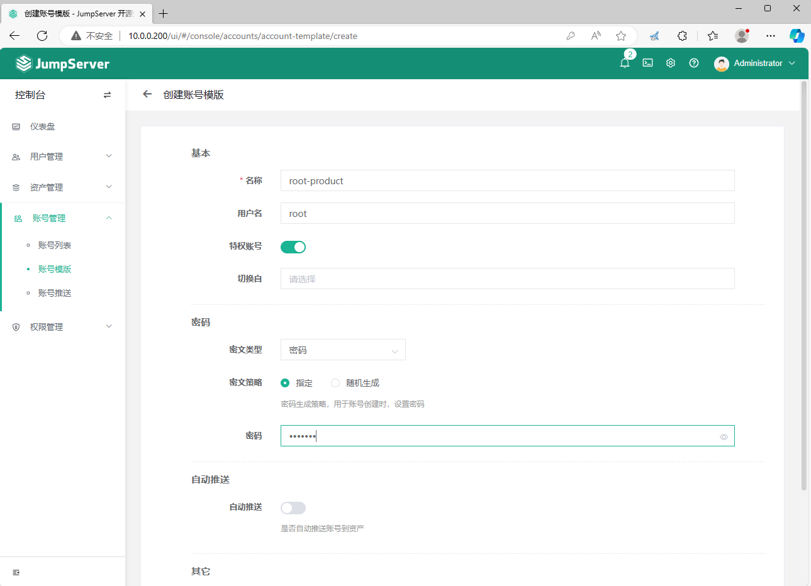

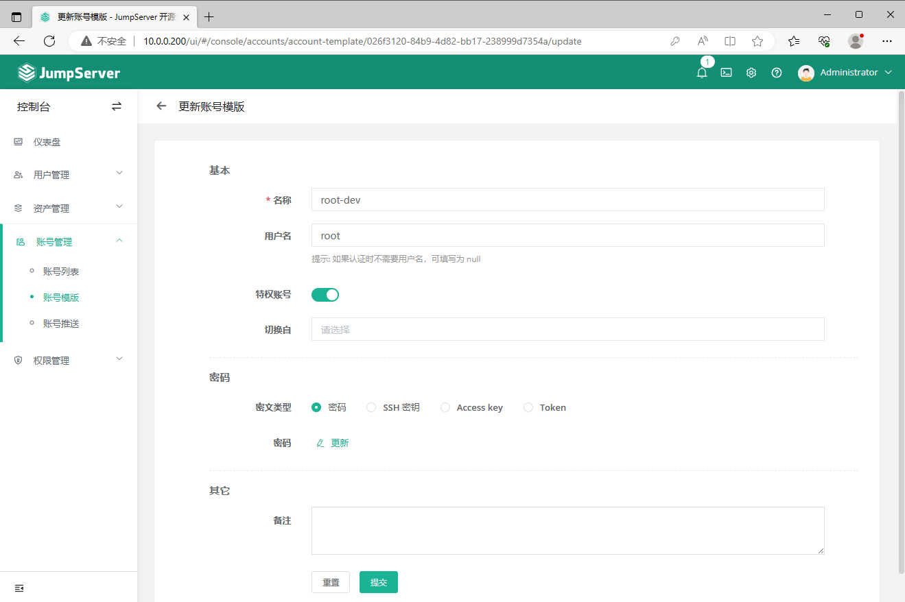

### 通过帐号模版创建系统普通用户(系统用户中普通用户)

普通资产账号用于实际会话，应按岗位设置权限。可以由现有配置管理流程预先创建，也可以在当前版本支持的条件下由 JumpServer 推送；两条路径应择一明确，避免重复创建或覆盖账号。下列截图来自 v4.3.1 左右的账号模板界面，字段名称可能变化。若选择随机生成凭据，应确认它如何保存、轮换和恢复，而不是仅看“创建成功”。

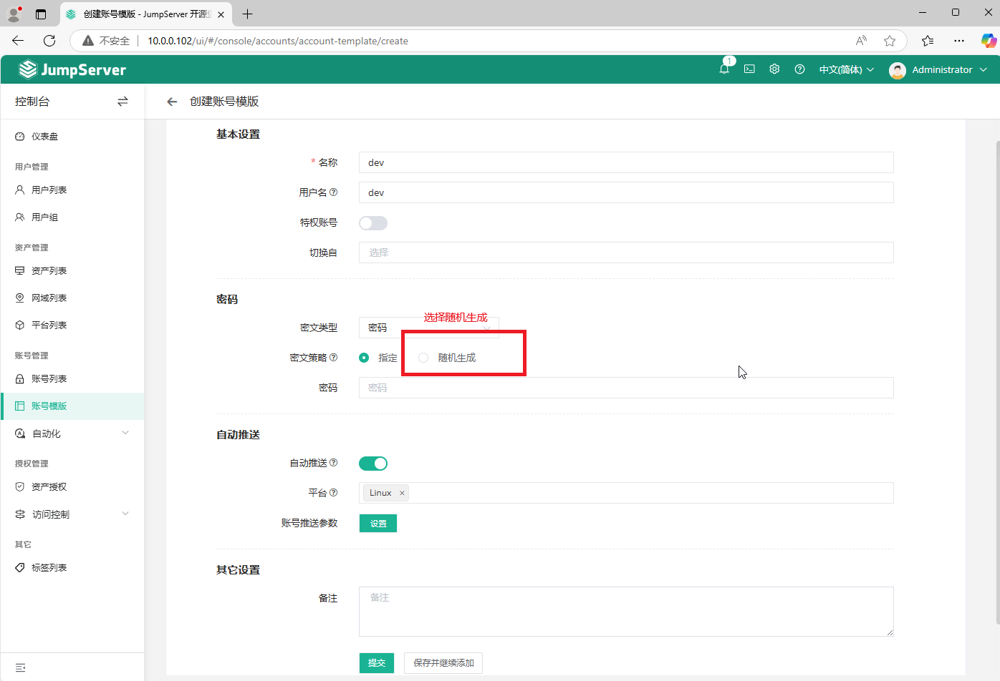

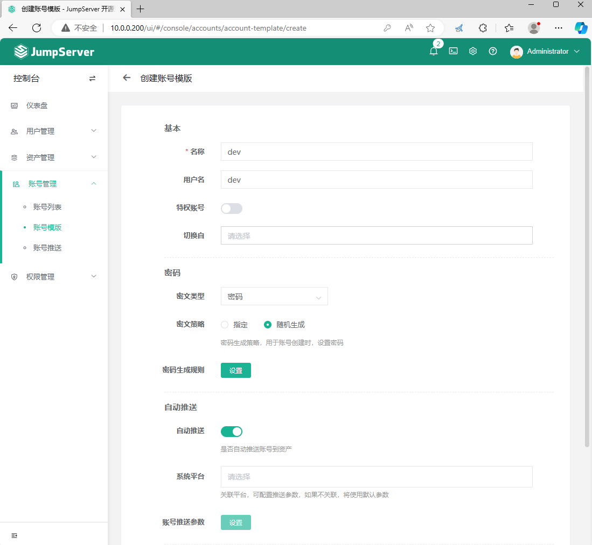

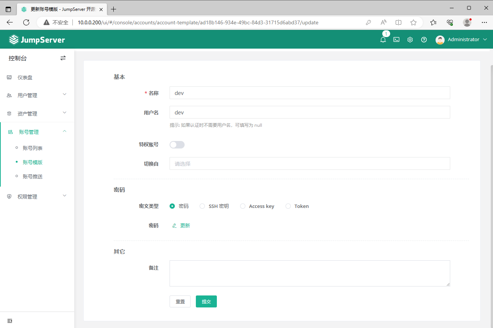

### 创建资产并关联特权用户和普通用户

登记资产时填写名称、地址、资产类型与连接协议，并关联可用的资产账号。资产存在于列表中，仍不代表普通用户已有访问权；下一篇还要创建授权规则。

### 创建资产并关联系统帐号的特权用户和普通用户

下图展示 4.x 界面的主机登记过程。只有确实需要文件传输时才配置 SFTP，并确认目标主机支持相应协议；账号是否被自动创建，应查看推送任务结果，而不是凭资产页面的选项推断。

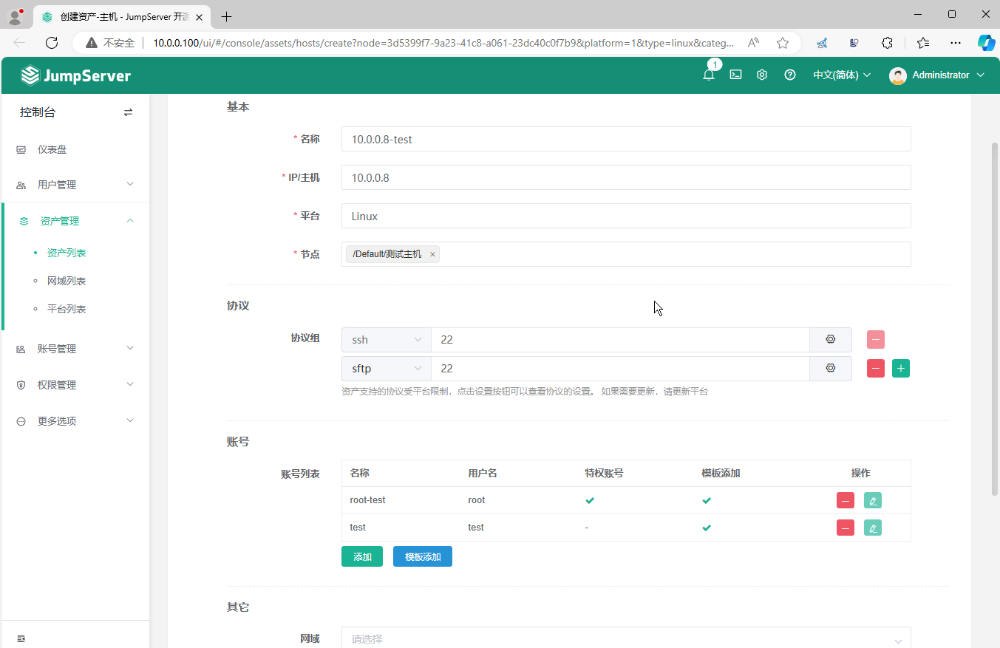

添加多台资产后，逐台核对地址、连接端口和账号状态，避免把同一模板错误地应用到生产与测试环境。

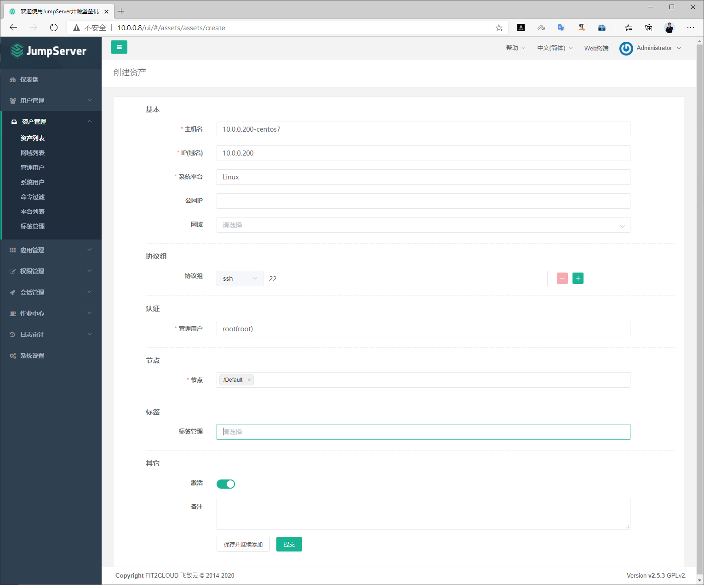

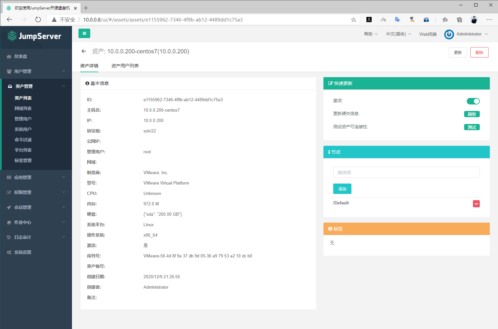

### 创建节点实现资产分类

节点可按环境、业务或地域分类资产，便于批量查找和授权。节点授权可能被子节点或后来加入的资产继承，因此先设计节点边界，再批量导入资产。

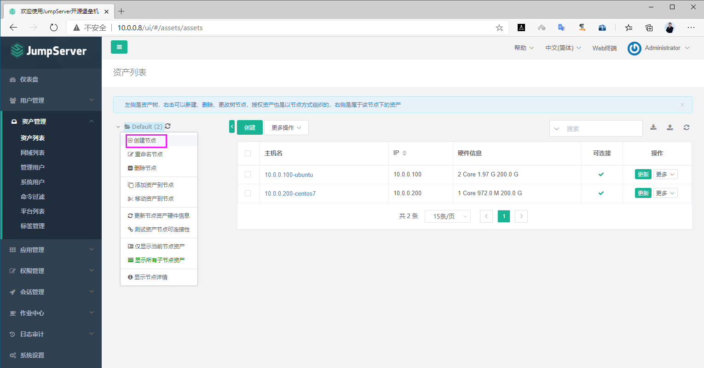

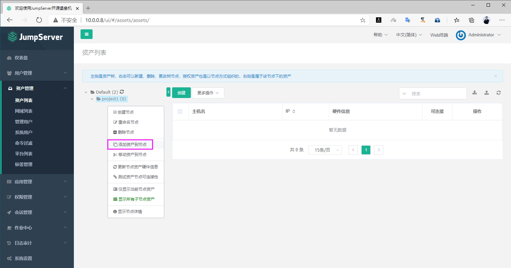

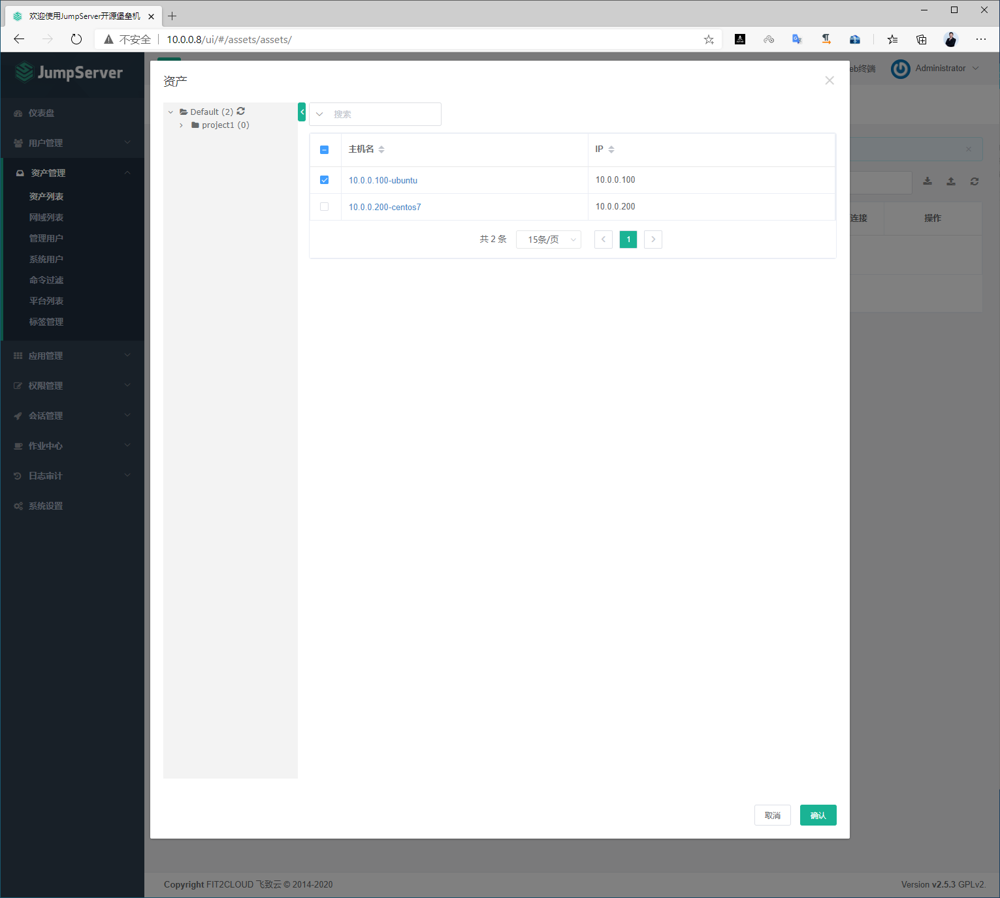

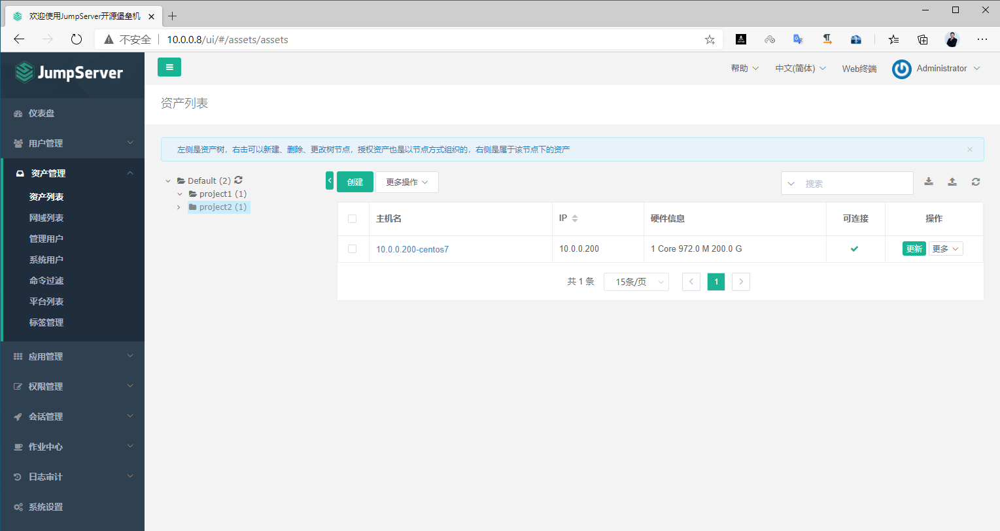



<nav class="article-end" aria-label="章节导航">
  <a href="{{ '/subjects/JumpServer/12-creating-jumpserver-users-and-groups.html' | relative_url }}">← 上一篇：创建用户和组</a>
  <a href="{{ '/subjects/JumpServer/' | relative_url }}">返回 JumpServer 专题目录</a>
  <a href="{{ '/subjects/JumpServer/14-granting-users-access-to-assets.html' | relative_url }}">下一篇：授权用户访问资产 →</a>
</nav>
