[← Back to JumpServer Bastion Host Index]({{ '/subjects/JumpServer/' | relative_url }})



# 15 Database Authorization
### 3.5 数据库授权

注意: JumpServer v2.5 此功能有Bug ,可以选择 V2.4版或者其它版本

### 在后端服务器安装MySQL并创建数据库和用户

范例：容器运行MySQL

```bash
[root@ubuntu2204 ~]#docker run -d --name mysql -p 3306:3306 -e
MYSQL_ROOT_PASSWORD=123456 -e MYSQL_DATABASE=wordpress -e MYSQL_USER=wordpress -e
MYSQL_PASSWORD=123456 registry.cn-beijing.aliyuncs.com/bowenxiaochun/mysql:8.0.29-
oracle
```

范例：Ubuntu 安装 MySQL

```bash
[root@ubuntu2204 ~]#apt -y install mysql-server
[root@ubuntu2204 ~]#sed -i '/127.0.0.1/s/^/#/'
/etc/mysql/mysql.conf.d/mysqld.cnf
[root@ubuntu2204 ~]#vim /etc/mysql/mysql.conf.d/mysqld.cnf
#bind-address           = 127.0.0.1
#mysqlx-bind-address    = 127.0.0.1
[root@ubuntu2204 ~]#systemctl restart mysql
[root@ubuntu2204 ~]#mysql
mysql> create database wordpress;
mysql> create user wordpress@'10.0.0.%' identified by '123456';
mysql> grant all on wordpress.* to wordpress@'10.0.0.%' ;
```

### 创建数据库的系统用户

创建针对数据库的专用系统用户

新版

在账号模版创建

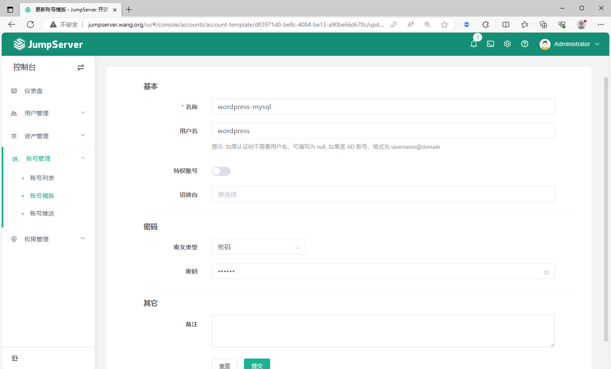

### 创建数据库资产（应用）

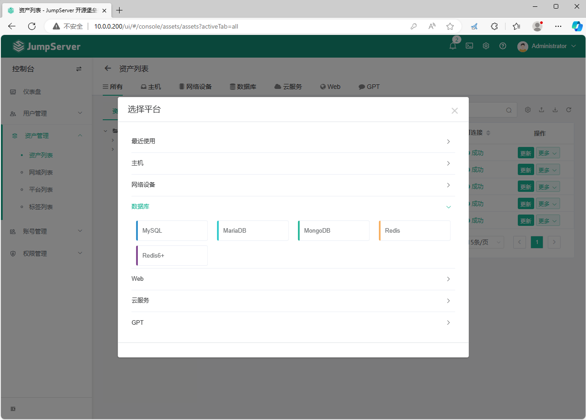

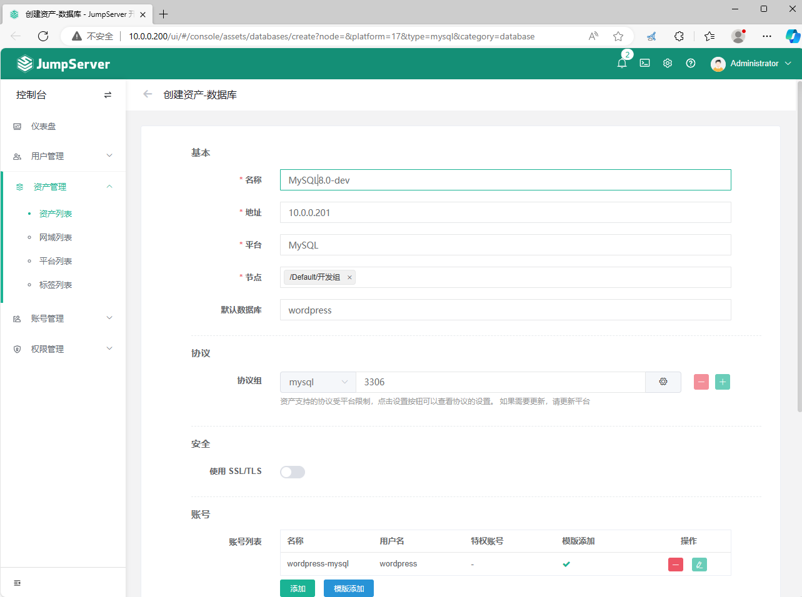

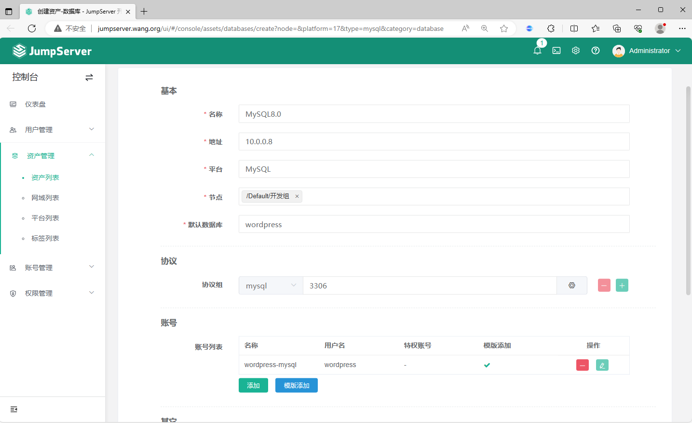

### 创建数据库授权规则

数据库应用的授权规则合并到到到资产授权中，需要在资产授权中针对指定资产数据数专门做授权，不支持针对节点授权

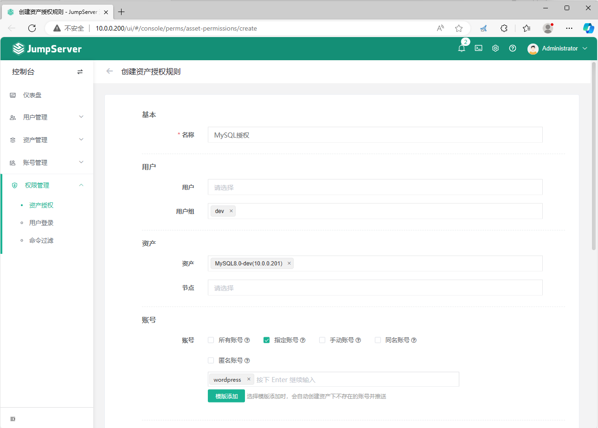

### 测试数据库连接

### web 方式连接MySQL资产

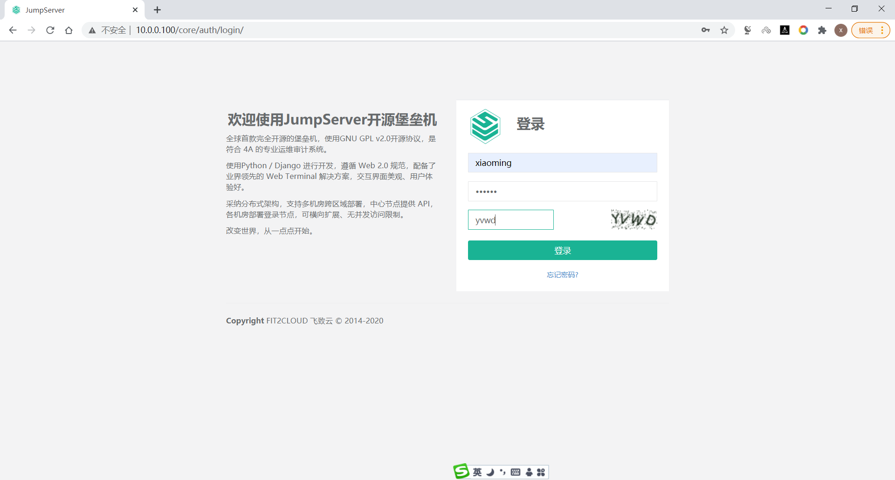

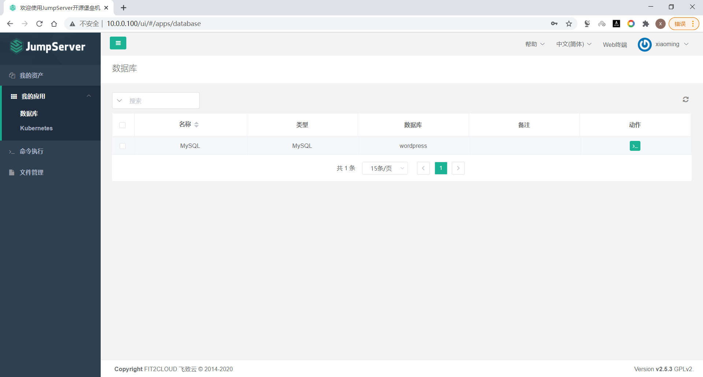

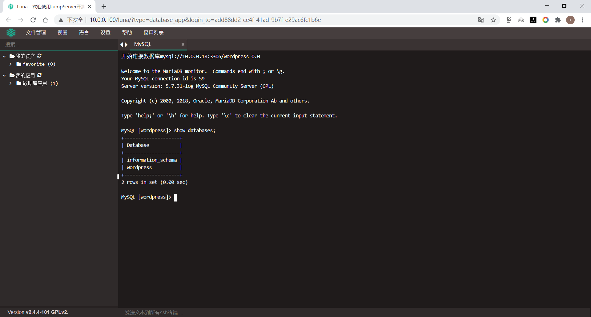

### 用ssh连接MySQL资产

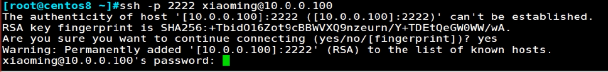

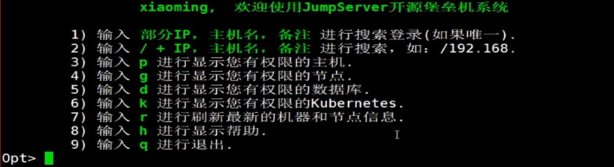

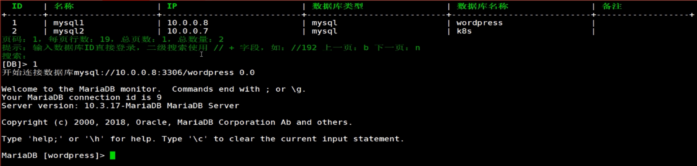



<nav class="article-end" aria-label="章节导航">
  <a href="{{ '/subjects/JumpServer/14-granting-users-access-to-assets.html' | relative_url }}">← Previous: Granting Users Access to Assets</a>
  <a href="{{ '/subjects/JumpServer/' | relative_url }}">Back to JumpServer Bastion Host Index</a>
  <a href="{{ '/subjects/JumpServer/16-session-management.html' | relative_url }}">Next: Session Management →</a>
</nav>
