[← 返回JumpServer 堡垒机目录]({{ '/subjects/JumpServer/' | relative_url }})



# 15 数据库授权

数据库资产与主机资产一样，需要分别配置目标、连接账号和人员授权。不同的是，数据库协议组件、账号权限与 Web 查询界面可能随 JumpServer 版本变化；先在当前版本的支持列表中确认所用数据库类型。

原资料提到 v2.5 的历史问题，不应据此建议部署更旧的 v2.4。遇到连接异常时，应核对正在使用的版本、对应修复记录和协议组件日志。

### 准备测试数据库与专用账号

先准备一台仅供练习的 MySQL 服务，并确认 JumpServer 的数据库连接组件能访问它。原资料的 Docker 命令被硬换行拆断，还把弱密码和数据库端口直接暴露；这里不把该历史命令作为安装步骤。无论 MySQL 部署在容器还是宿主机，都应遵循相同的验证顺序：服务可达、数据库存在、专用账号能登录、权限只覆盖练习库。

例如，数据库管理员可在 MySQL 中创建专用库与账号。下方是 SQL 结构示意，主机匹配范围和密码都需按实际网络填写，且权限应比 ALL PRIVILEGES 更窄：

```sql
CREATE DATABASE demo_db CHARACTER SET utf8mb4;
CREATE USER 'demo_reader'@'<JumpServer 来源地址>' IDENTIFIED BY '<独立密码>';
GRANT SELECT ON demo_db.* TO 'demo_reader'@'<JumpServer 来源地址>';
```

不要通过注释掉 MySQL 的绑定地址来“顺手”开放所有网络接口。应只监听需要的私网地址，并在防火墙中限定来源。连接前先从 JumpServer 所在网络测试目标地址与端口。

### 创建数据库的系统用户

在账号模板中录入数据库连接身份，或按当前版本界面为该资产关联已有账号。这里的“系统用户”是旧版术语，不是 JumpServer 平台登录人员；不要把数据库管理员密码交给每位普通读者。

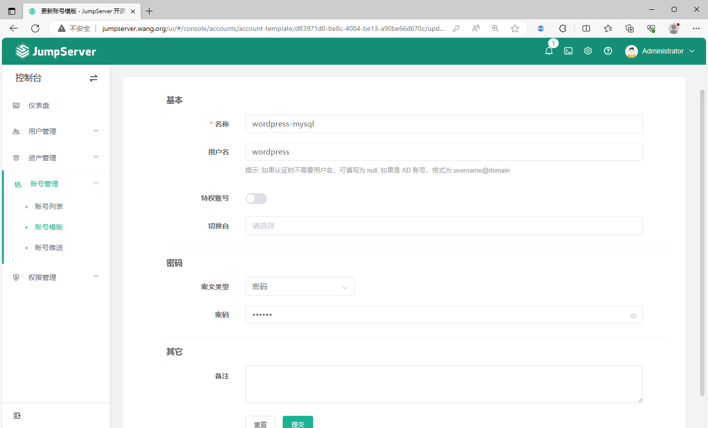

### 创建数据库资产

填写数据库类型、私网地址、端口、库名和协议组件要求的字段，并关联刚创建的数据库账号。以下截图依次展示模板、资产登记与账号选择，页面位置可能因版本而异。

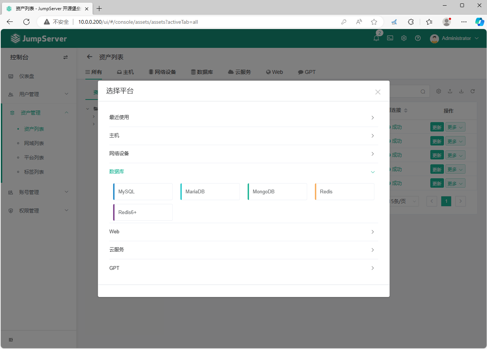

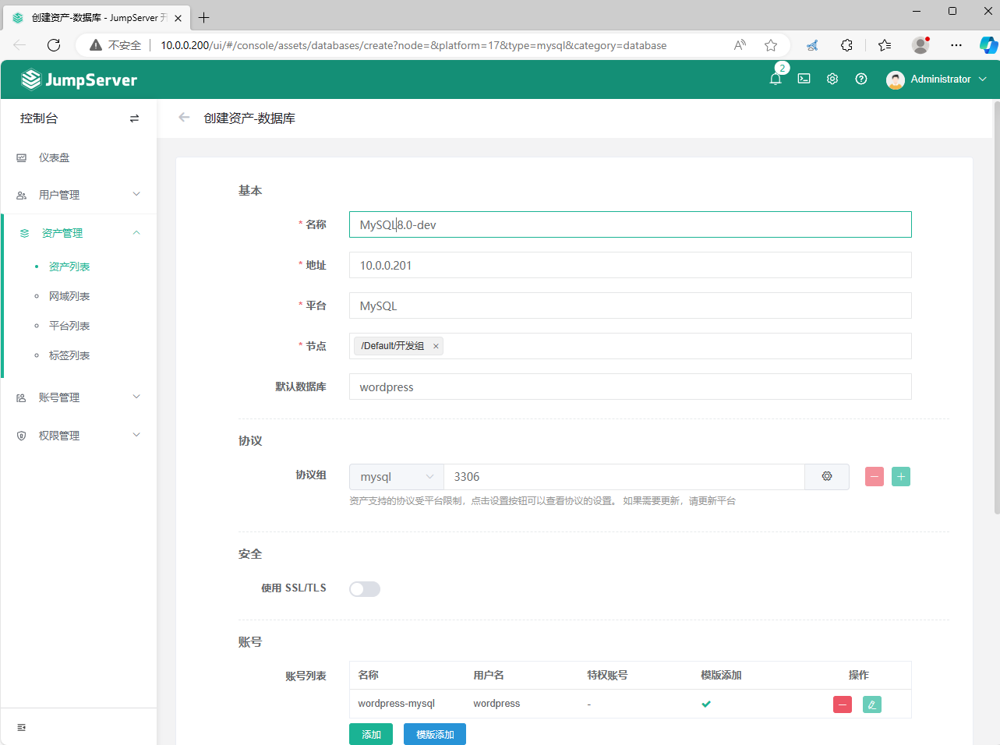

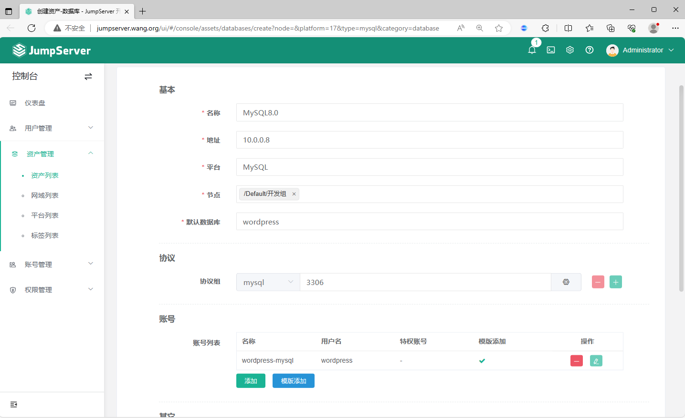

### 创建数据库授权规则

在资产授权中选定人员或组、数据库资产及允许使用的账号。原资料的某版本界面只能针对具体数据库资产授权，不能以节点批量授权；当前版本是否支持节点授权，应以界面和文档为准。授权后用普通测试用户验证只看到该数据库，而不是仅用管理员测试。

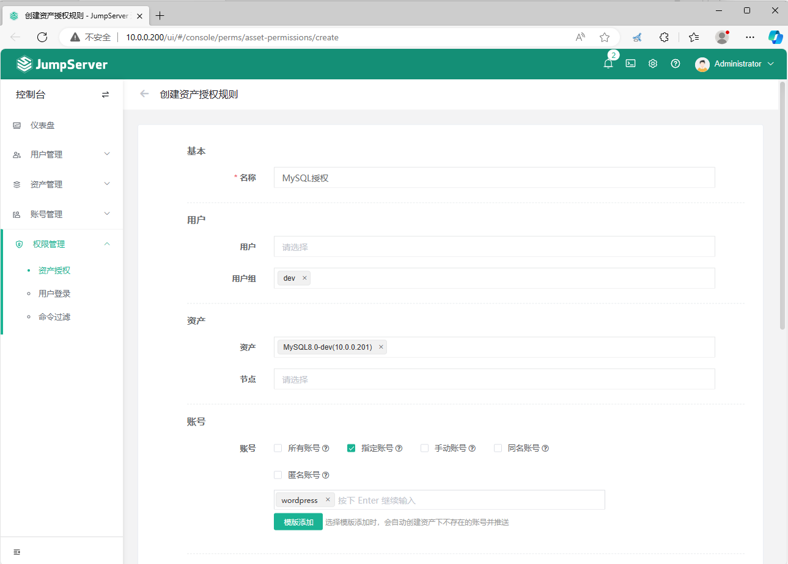

### 测试数据库连接

### 通过 Web 界面连接

确认能进入数据库会话，并尝试一条只读查询；随后检查审计记录。Web 查询能力和可见字段取决于协议组件与版本。

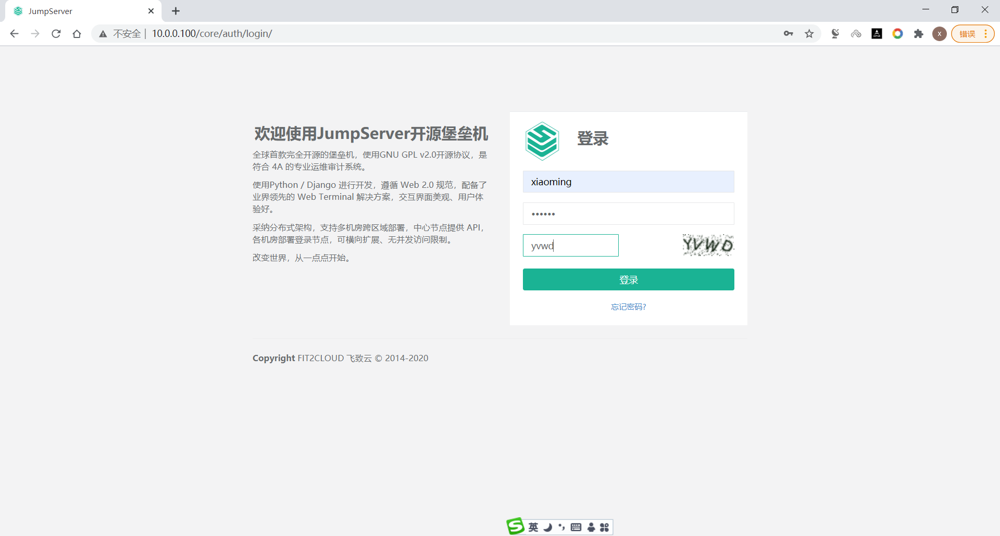

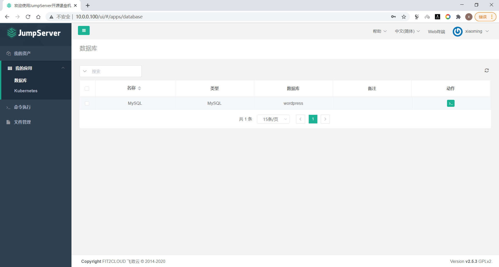

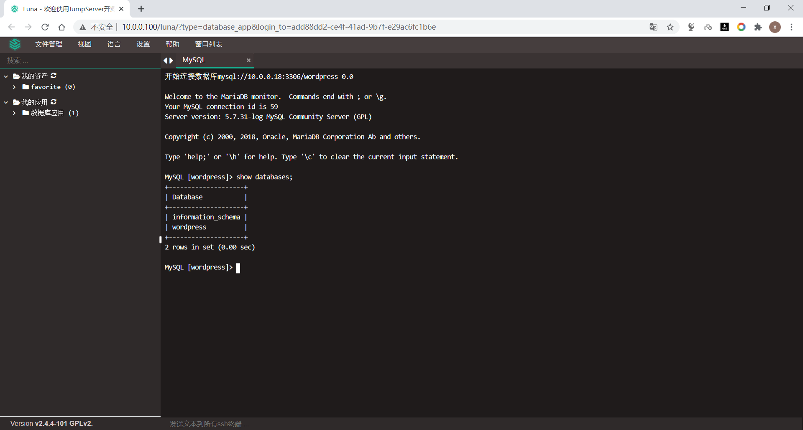

### 通过客户端入口连接

若当前版本支持命令行或客户端代理入口，按平台显示的地址和端口连接，再选择获授权的数据库资产。不要把截图中的旧端口和账号当作通用值；客户端连通后也应核对会话记录与账号权限。

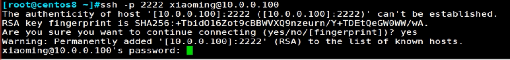

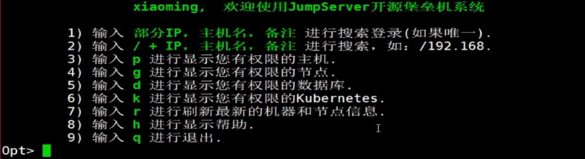

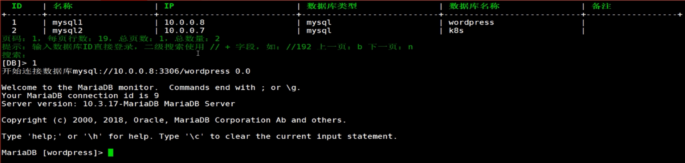



<nav class="article-end" aria-label="章节导航">
  <a href="{{ '/subjects/JumpServer/14-granting-users-access-to-assets.html' | relative_url }}">← 上一篇：授权用户访问资产</a>
  <a href="{{ '/subjects/JumpServer/' | relative_url }}">返回 JumpServer 专题目录</a>
  <a href="{{ '/subjects/JumpServer/16-session-management.html' | relative_url }}">下一篇：会话管理 →</a>
</nav>
