[← 返回JumpServer 堡垒机目录]({{ '/subjects/JumpServer/' | relative_url }})



# 16 会话管理
### 3.6 会话管理

会话管理可以实现查看当前在线的会话命令记录、历史会话过去的执行过的命令,也可以强制将用户踢出

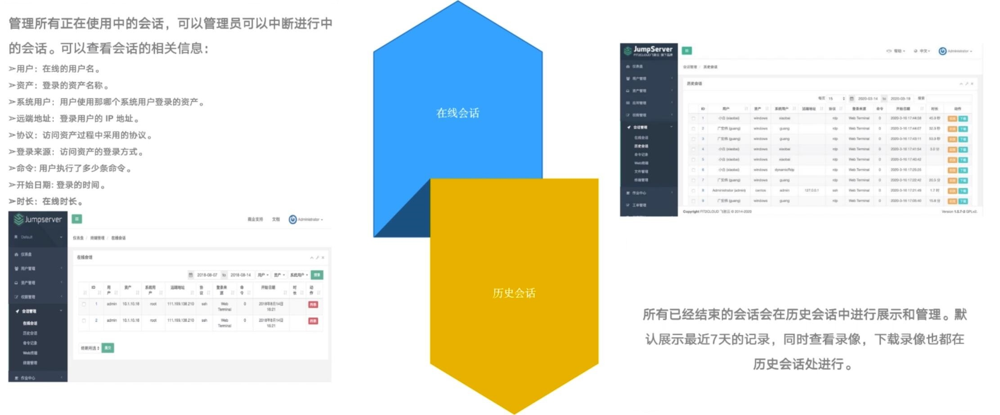

### 查看在线会话

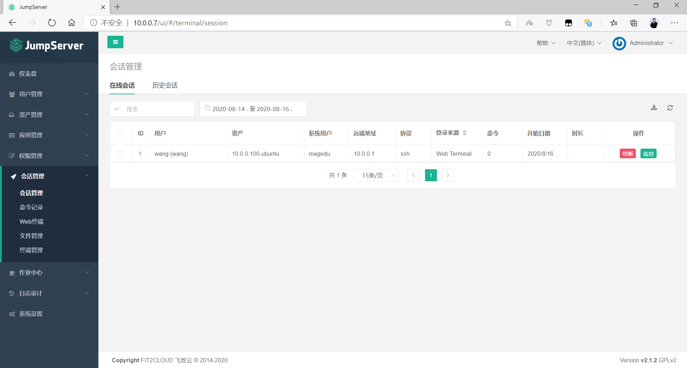

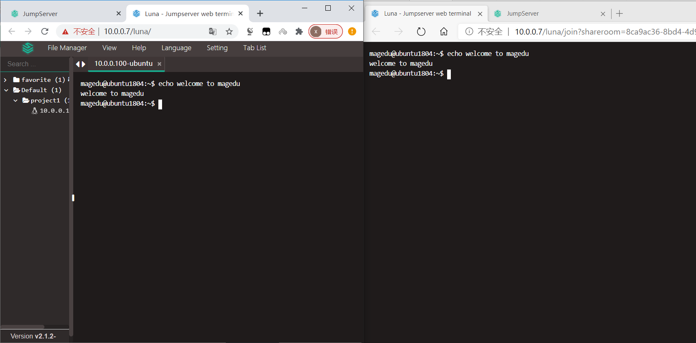

### 查看历史会话

### 在线回放

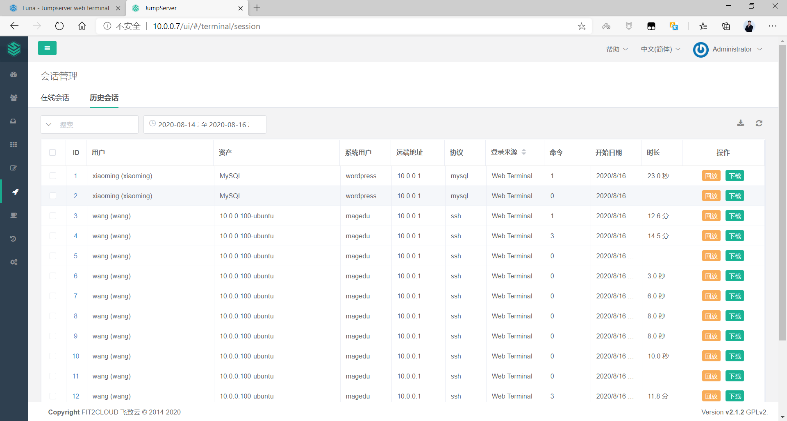

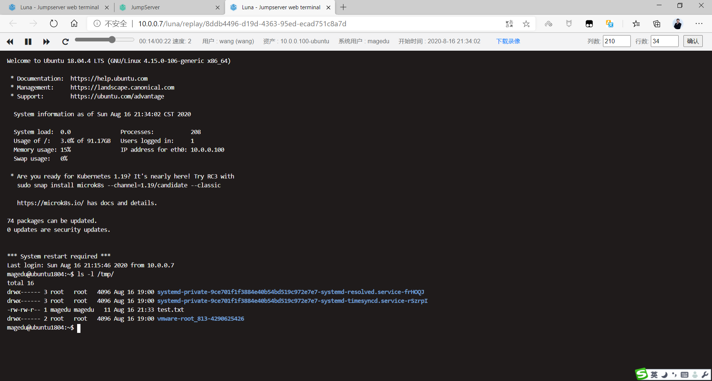

### 离线查看录像

可以将历史会话过程下载再播放,但需要下载相关的播放器

注意：JumpServer-v2.19.1版的录像无法打开

<https://github.com/jumpserver/VideoPlayer/releases>

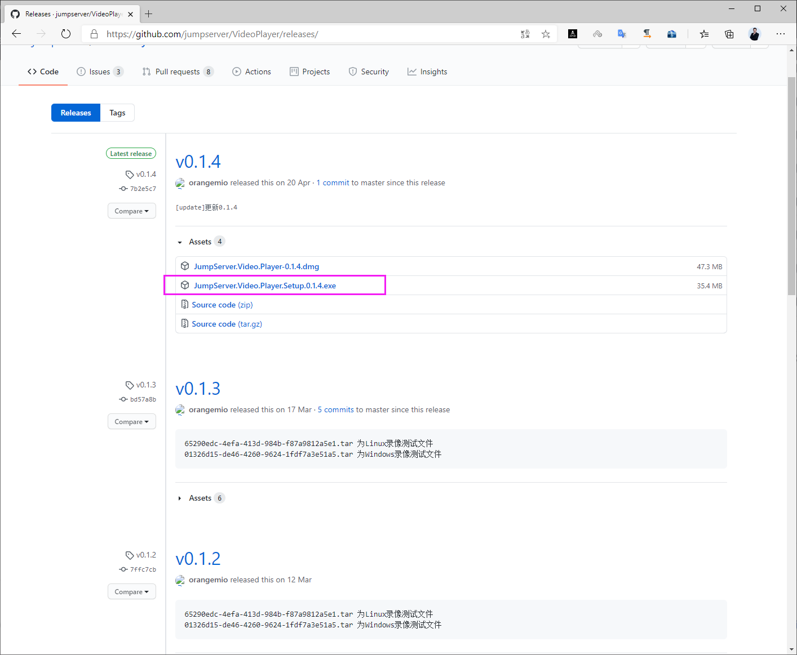

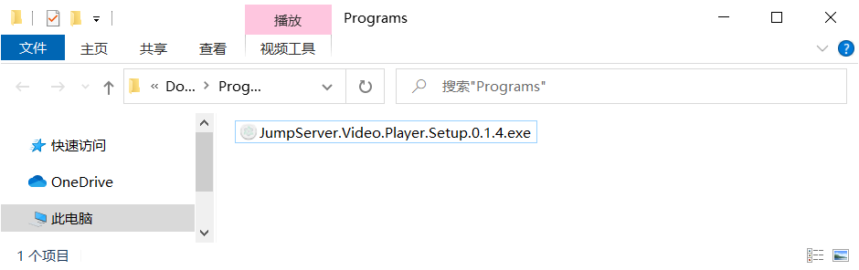

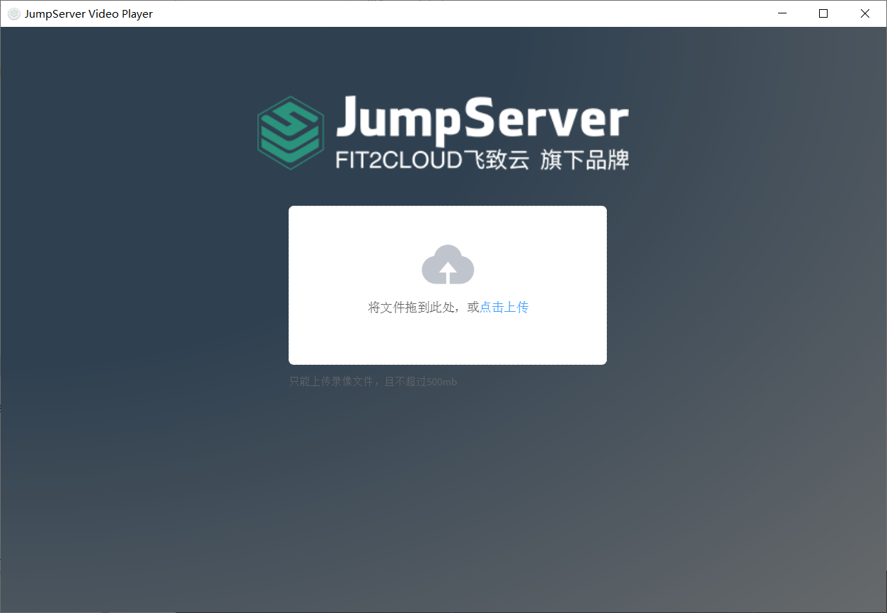

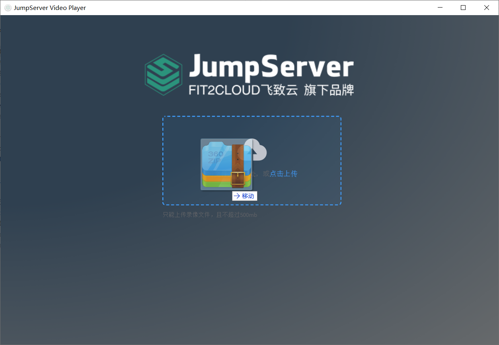

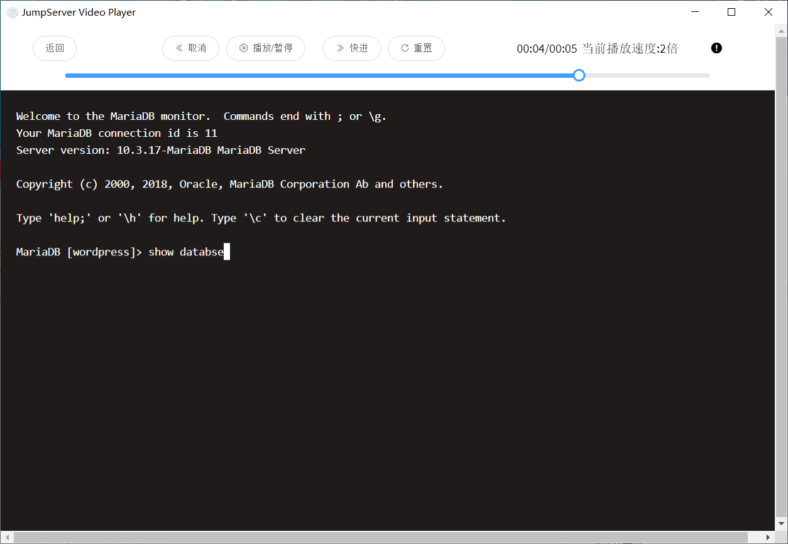

### 查看命令历史

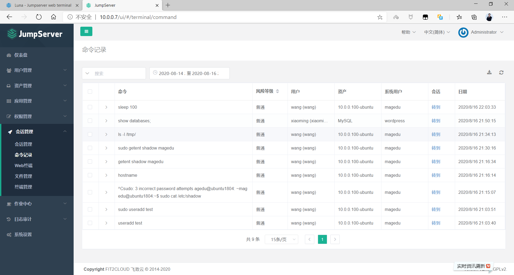

### 终端管理

可以在线监控用户正在进行的操作过程,甚至可以强制中断用户的连接,将其踢出会话

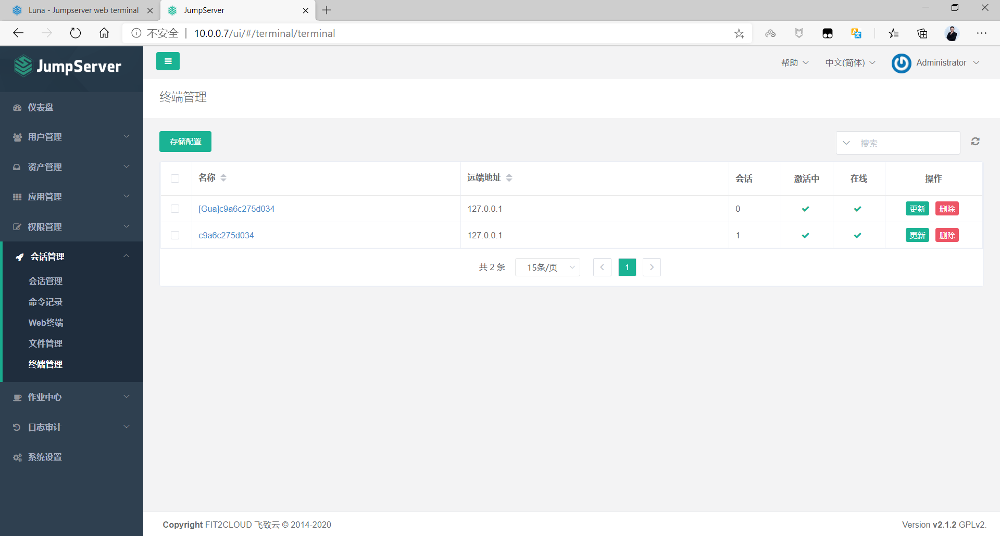



<nav class="article-end" aria-label="章节导航">
  <a href="{{ '/subjects/JumpServer/15-database-authorization.html' | relative_url }}">← Previous: Database Authorization</a>
  <a href="{{ '/subjects/JumpServer/' | relative_url }}">Back to JumpServer Bastion Host Index</a>
  <a href="{{ '/subjects/JumpServer/17-command-filters.html' | relative_url }}">Next: Command Filters →</a>
</nav>
