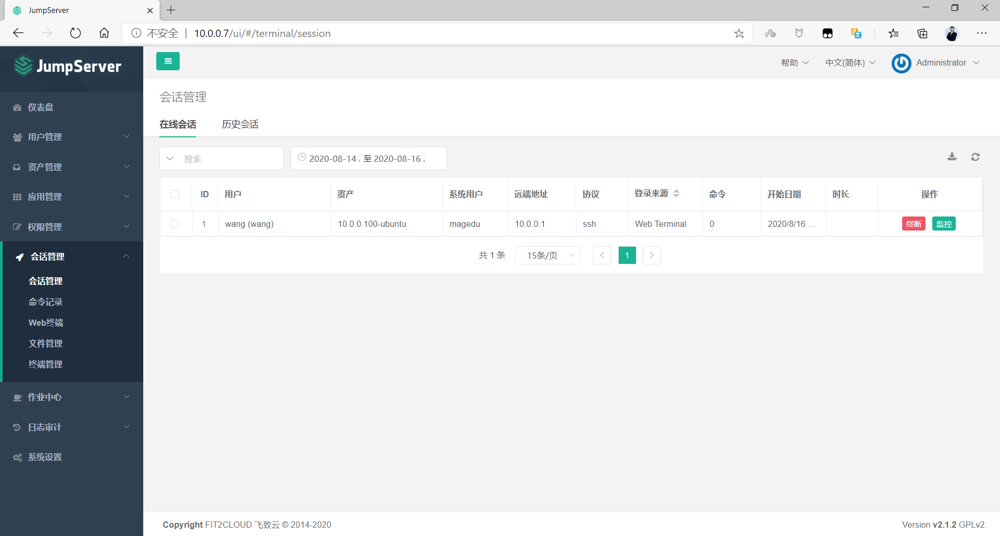
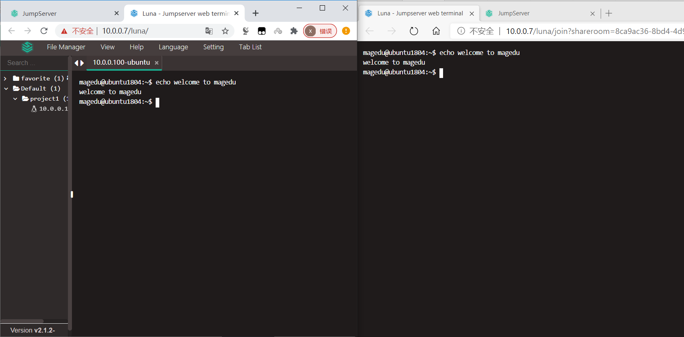
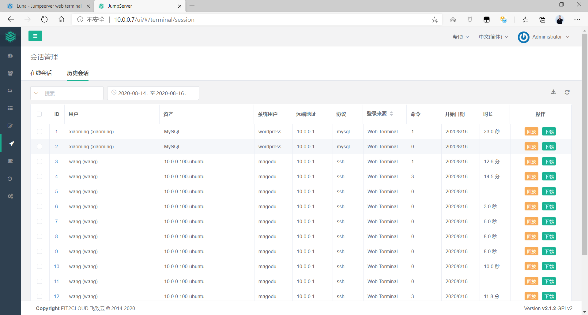
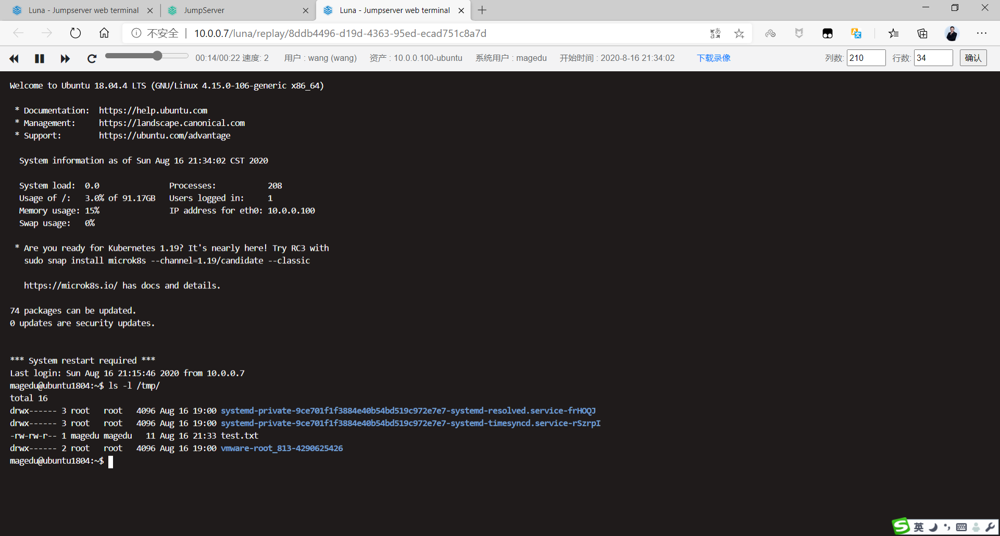
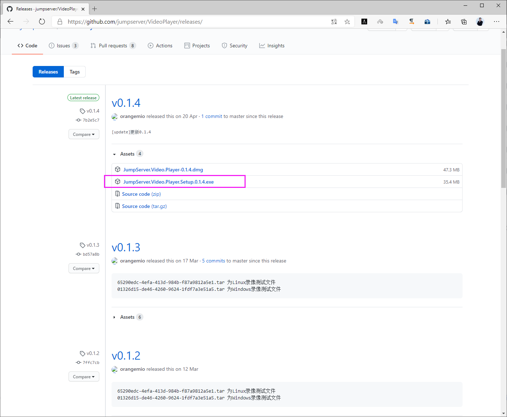
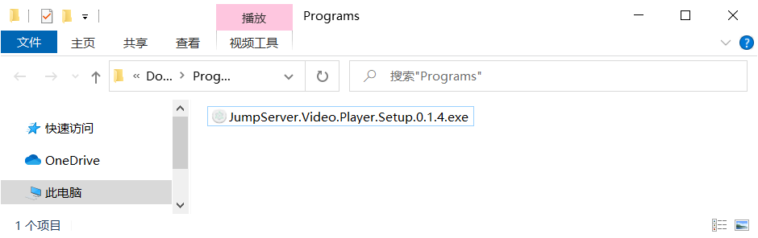
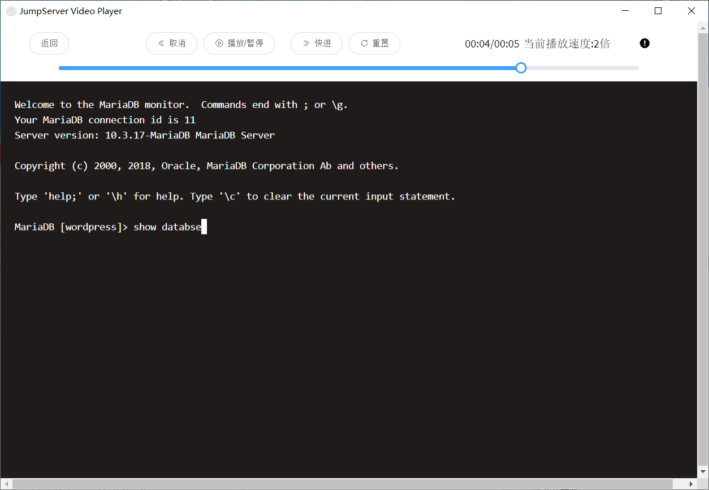
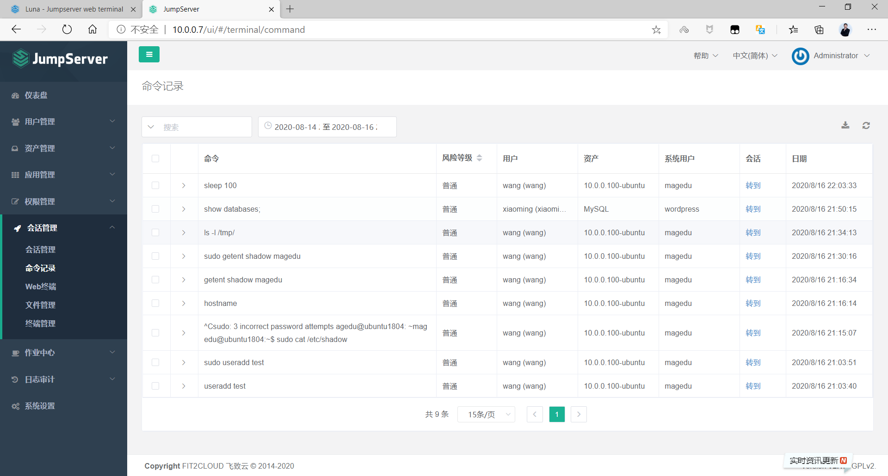
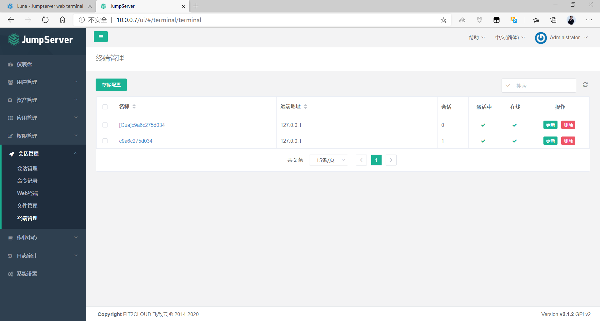

[← 返回JumpServer 堡垒机目录]({{ '/subjects/JumpServer/' | relative_url }})



# 16 会话管理

会话管理把“当前谁在连接哪台资产”和“过去执行了什么”联系起来。在线会话用于实时发现异常连接；历史会话、录像和命令记录用于事后核查。能否记录完整内容取决于连接协议、组件状态和审计存储配置。

具有相应审计权限的人员可以查看会话状态；部分版本还允许管理员强制终止会话。这种操作会中断正在进行的维护，应先确认会话归属和影响范围。

### 查看在线会话

在在线列表中核对用户、资产、资产账号、开始时间与来源。若发现超出授权时间的连接，可先联系操作人；必须中断时，再使用平台提供的终止动作，并记录处理原因。

### 查看历史会话

历史列表用于按人员、资产和时间范围检索。应选择与事件对应的会话，而不是只看最近一条记录。

### 在线回放

录像回放可帮助还原终端或图形界面操作，但录像可能受协议、存储和保留期影响。审计判断还应结合命令记录和目标系统日志。

### 离线查看录像

某些版本允许下载录像，使用对应格式的播放器离线查看。下载前应确认操作人有审计权限，下载后的录像也要按敏感审计资料管理。原资料提到 v2.19.1 的播放故障，是历史版本问题；若当前录像打不开，应核对格式、播放器版本、文件完整性和服务端转换任务。

<https://github.com/jumpserver/VideoPlayer/releases>

### 查看命令历史

命令历史便于筛选特定操作，但不是所有交互行为都一定能转换为命令记录。检索时同时核对会话、用户和资产，避免把同名命令归给错误人员。

### 终端管理

终端管理可在具备权限时观察进行中的会话，并在必要时强制断开连接。完成后应检查该会话的录像、命令记录和告警是否按预期保存。



<nav class="article-end" aria-label="章节导航">
  <a href="{{ '/subjects/JumpServer/15-database-authorization.html' | relative_url }}">← 上一篇：数据库授权</a>
  <a href="{{ '/subjects/JumpServer/' | relative_url }}">返回 JumpServer 专题目录</a>
  <a href="{{ '/subjects/JumpServer/17-command-filters.html' | relative_url }}">下一篇：命令过滤器 →</a>
</nav>
