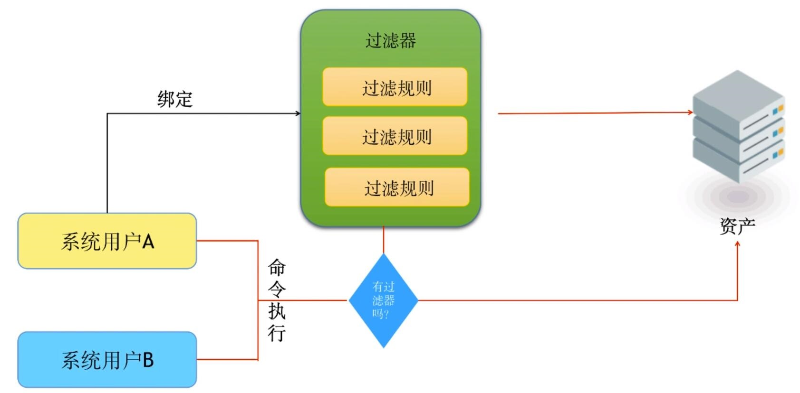
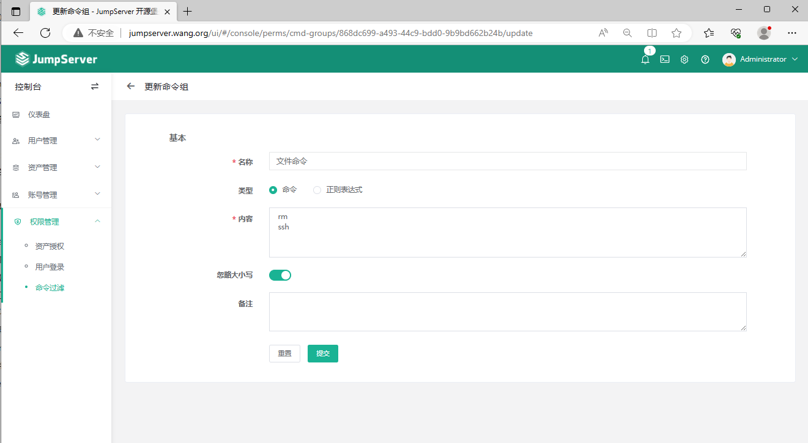
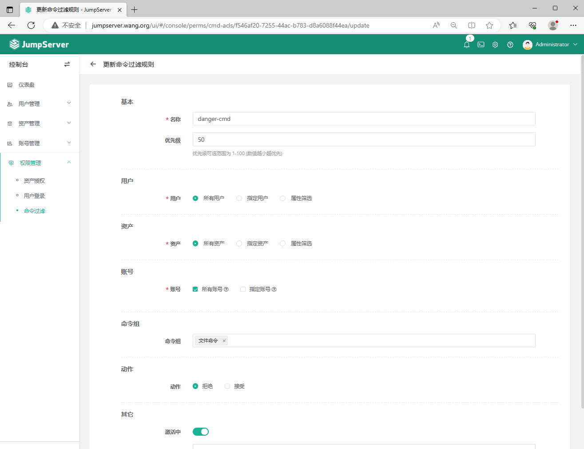
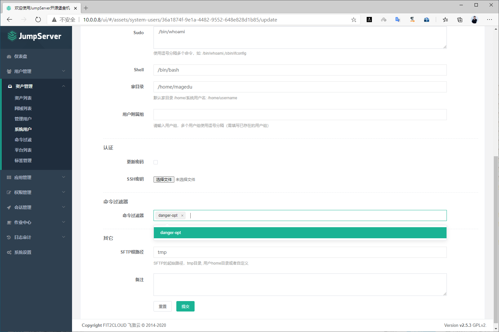
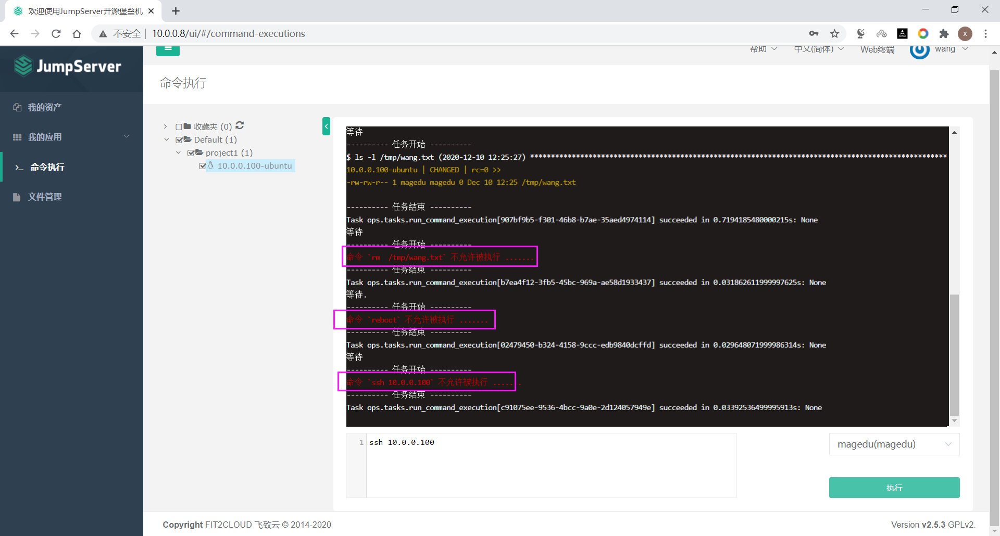

[← 返回JumpServer 堡垒机目录]({{ '/subjects/JumpServer/' | relative_url }})



# 17 命令过滤器
### 3.7 命令过滤器

使用命令过滤器可以禁止用户执行特定的危险命令,防止误操作或恶意行为

系统用户可以绑定一些命令过滤器，一个过滤器可以定义一些规则 当用户使用这个系统用户登录资产， 然后执行一个命令.这个命令需要被绑定过滤器的所有规则匹配，高优先级先被匹配， 当一个规则匹配到了，如果规则的动作是允许，这个命令会被放行， 如果规则的动作是禁止，命令将会被禁止执行， 否则就匹配下一个规则，如果最后没有匹配到规则，则允许执行

### 创建命令过滤器

创建命令组，指定禁止哪些危险命令

创建命令过滤规则，指定哪些用户在哪些资产禁止执行上面创建的命令组

### 将过滤器绑定系统用户

### 测试



<nav class="article-end" aria-label="章节导航">
  <a href="{{ '/subjects/JumpServer/16-session-management.html' | relative_url }}">← Previous: Session Management</a>
  <a href="{{ '/subjects/JumpServer/' | relative_url }}">Back to JumpServer Bastion Host Index</a>
  <a href="{{ '/subjects/JumpServer/18-bulk-asset-export-and-import.html' | relative_url }}">Next: Bulk Asset Export and Import →</a>
</nav>
