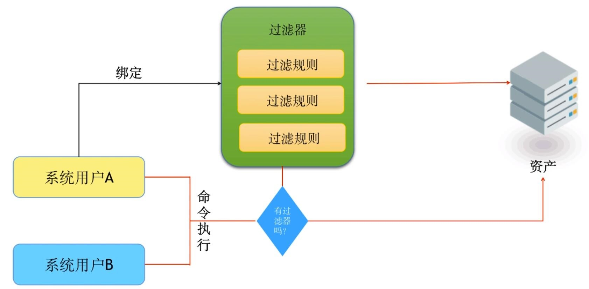
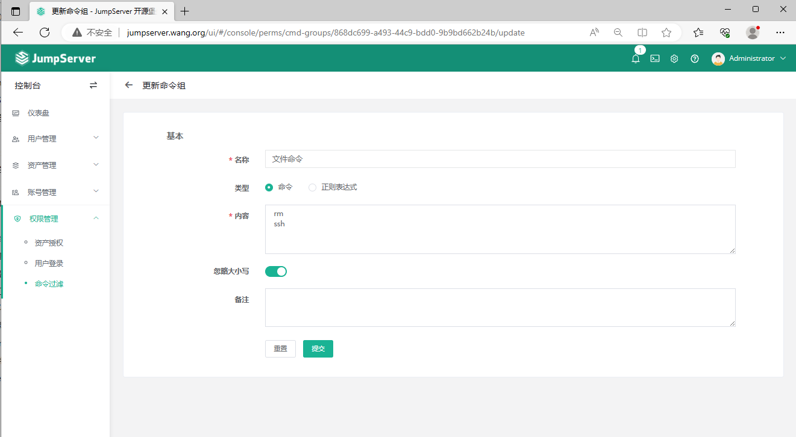
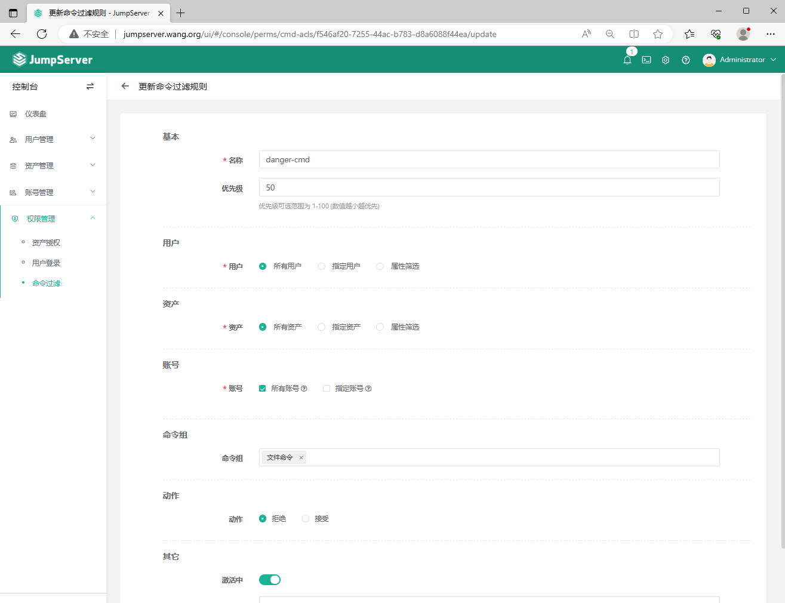
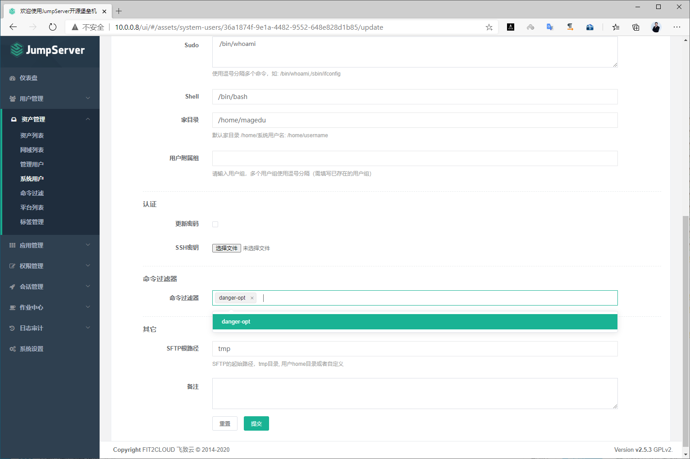
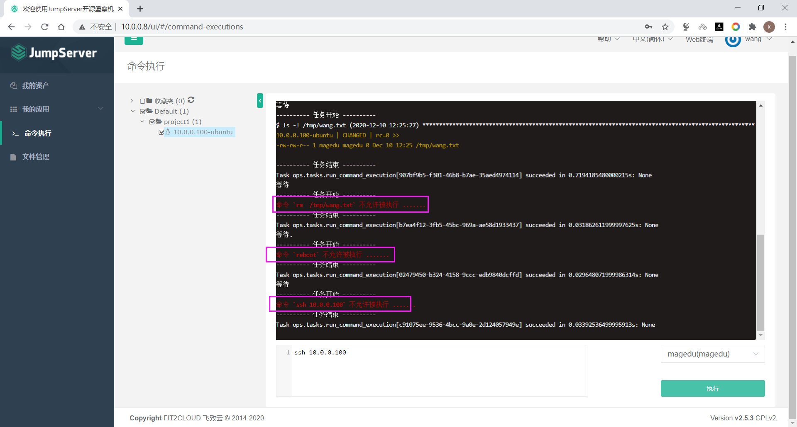

[← 返回JumpServer 堡垒机目录]({{ '/subjects/JumpServer/' | relative_url }})



# 17 命令过滤器

命令过滤器对经过 JumpServer 的终端命令增加一层规则检查，可用于减少误执行特定命令的机会。它是平台侧的辅助控制，不能替代目标主机的文件权限、sudo 策略与审计。

原资料描述的匹配逻辑是：用户以关联了过滤器的资产账号进入会话后，平台按规则优先级逐项匹配命令；第一条匹配规则决定允许或禁止。若没有任何规则匹配，默认行为可能是允许，因此**只写少数禁止规则不能证明其余命令都安全**。不同版本的规则类型、匹配范围和默认动作应以当前文档及实测为准。

### 创建命令过滤器

先定义命令组，明确匹配哪些命令及其参数形式。测试时既要验证预期命令被拦截，也要验证正常维护命令不会被误拦。

再创建过滤规则，选择人员／组、资产范围、命令组和处理动作，并核对优先级。规则覆盖范围不宜一开始就扩展到全部资产。

### 将过滤器绑定系统用户

规则只有与实际会话使用的资产账号及相应授权链路关联后才有意义。绑定完成后，用普通测试用户连接一台测试资产验证。

### 测试

分别测试命中规则、未命中规则和不同优先级冲突的情况；记录平台提示与审计日志。还应注意脚本、交互式程序或替代调用路径是否绕过了预期的命令匹配，不能把单次测试成功等同于完整的主机权限隔离。



<nav class="article-end" aria-label="章节导航">
  <a href="{{ '/subjects/JumpServer/16-session-management.html' | relative_url }}">← 上一篇：会话管理</a>
  <a href="{{ '/subjects/JumpServer/' | relative_url }}">返回 JumpServer 专题目录</a>
  <a href="{{ '/subjects/JumpServer/18-bulk-asset-export-and-import.html' | relative_url }}">下一篇：资产批量导出与导入 →</a>
</nav>
