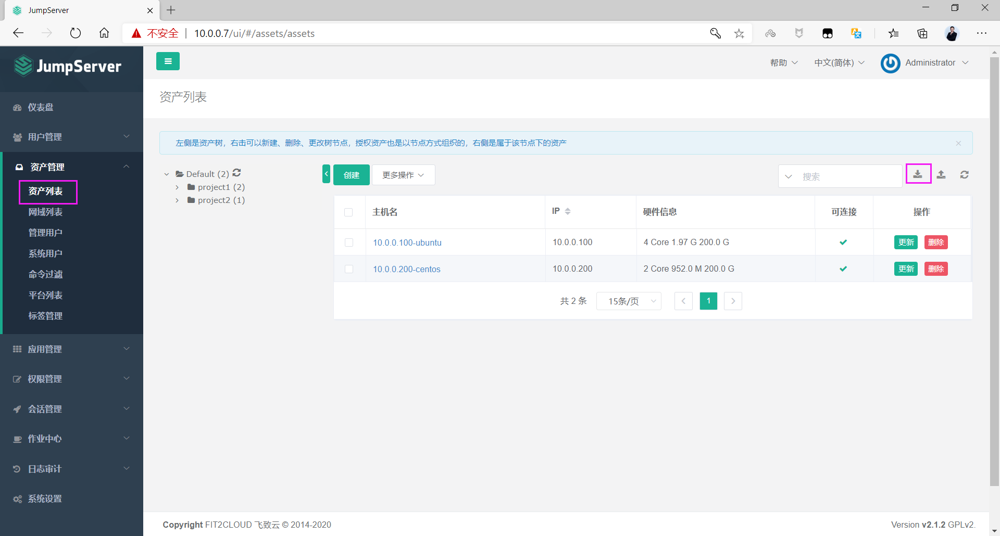
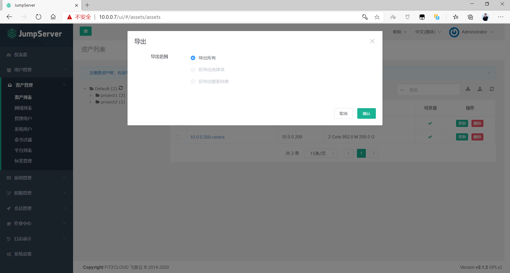
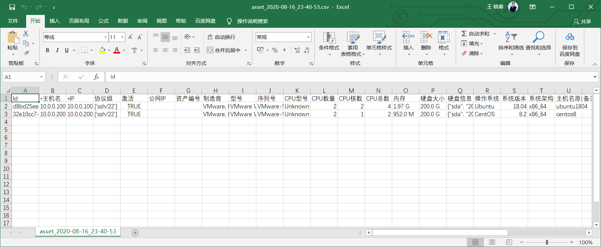
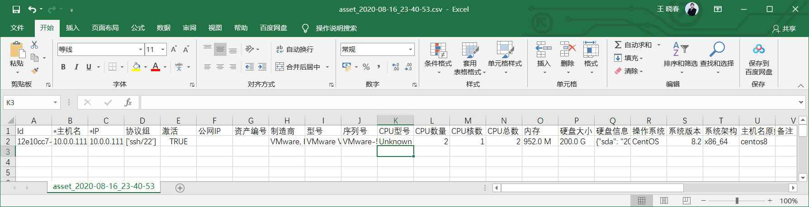
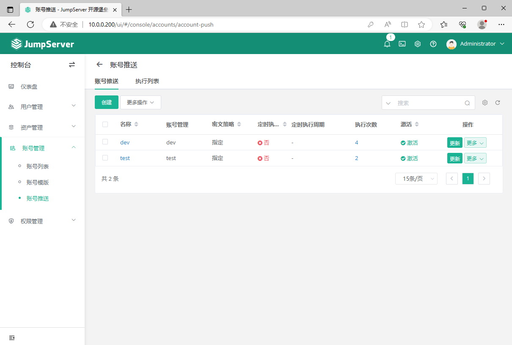
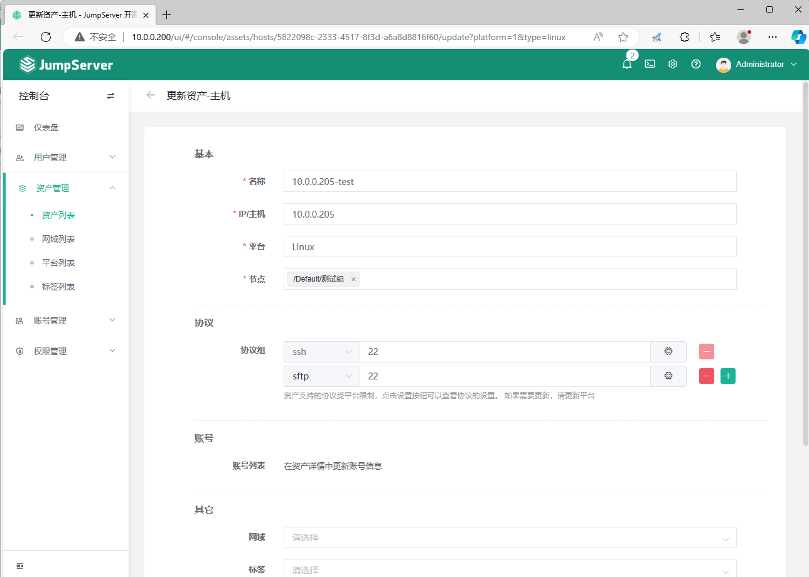
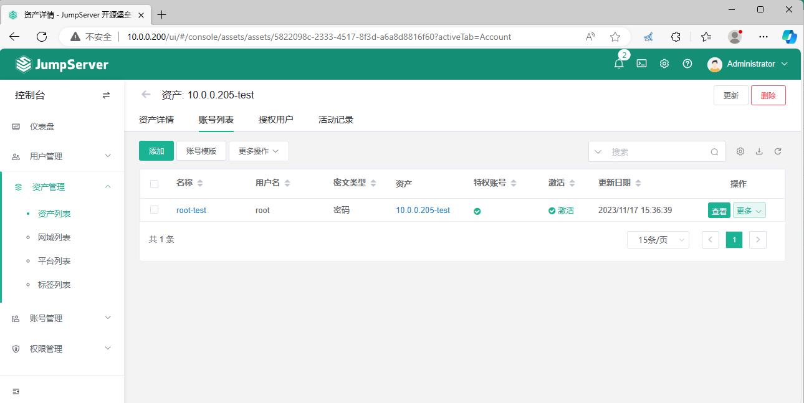
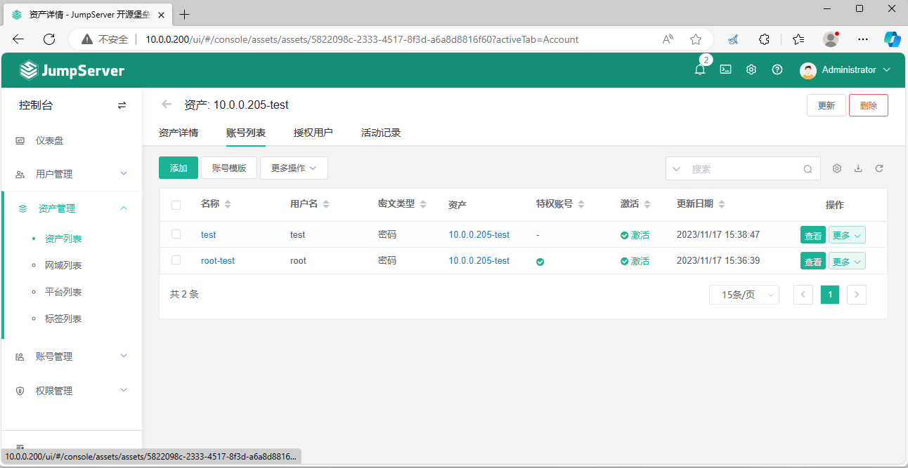
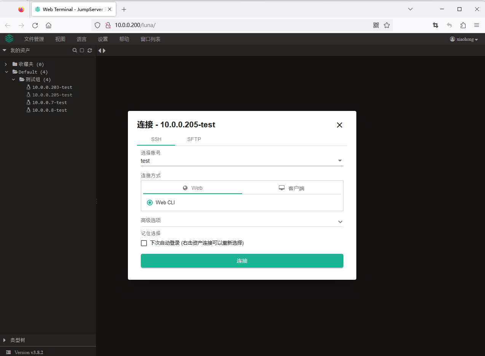
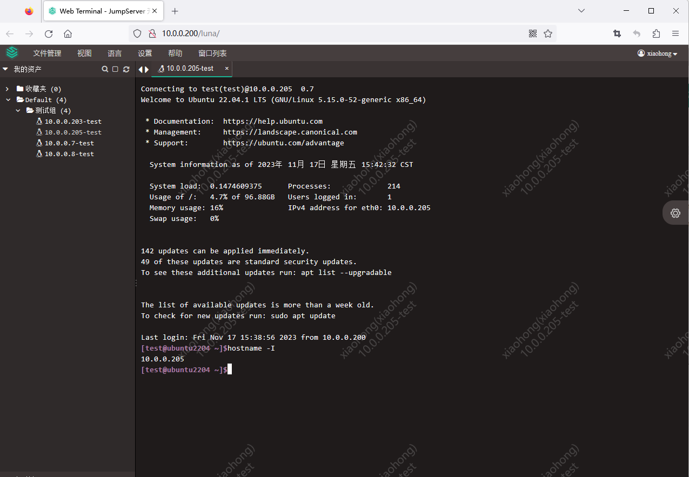

[← 返回JumpServer 堡垒机目录]({{ '/subjects/JumpServer/' | relative_url }})



# 18 资产的批量导出和导入

资产较多时可用导入文件批量创建，但导入只解决“登记资产”这一步；账号关联、授权和连通性仍需分别验证。先从当前版本导出少量测试资产作为模板，比凭旧截图手写字段更可靠。

开始前确认资产命名、地址、节点和协议字段的约定，避免导入后出现重复主机或混用生产、测试环境。

### 资产的批量导出

选择一两台字段完整的测试资产导出，检查文件编码、表头和敏感字段。导出的资产信息可能包含内部地址或账号标识，应按受控文件保存；不要直接提交到公开仓库。







### 批量导入资产

复制导出模板，按当前版本要求填写新资产。若模板的 id 列属于已有资产的内部标识，新建时应按导入说明清空或删除它，避免意外更新旧记录。先导入一台并检查结果，再批量导入其余资产；出错时核对行号、字段类型和重复地址。



导入资产后，若计划由平台管理主机账号，还需关联账号模板并执行对应的推送任务。是否自动创建用户取决于配置和任务结果，不是“导入成功”的必然后果。



### 系统用户关联资产

到资产详情检查特权账号和普通账号是否已关联，再核对其连接测试结果。批量应用模板前，确认特权账号不会被错误地分配给普通登录用户。



下方截图展示旧版和新版资产详情中的账号选择。页面操作完成后还应查看推送任务日志。





如果启用了账号推送且任务成功，可在**测试主机**上核对账号是否存在，例如：

```bash
[root@ubuntu2204 ~]#getent passwd test
test:x:1001:1001::/home/test:/bin/bash
```

### 测试登录新添加的主机

最后用已授权的普通平台用户连接新资产，验证可访问范围、所用资产账号和会话审计。这样才能确认“导入—账号—授权—连接”整条链路都已完成。







<nav class="article-end" aria-label="章节导航">
  <a href="{{ '/subjects/JumpServer/17-command-filters.html' | relative_url }}">← 上一篇：命令过滤器</a>
  <a href="{{ '/subjects/JumpServer/' | relative_url }}">返回 JumpServer 专题目录</a>
</nav>
