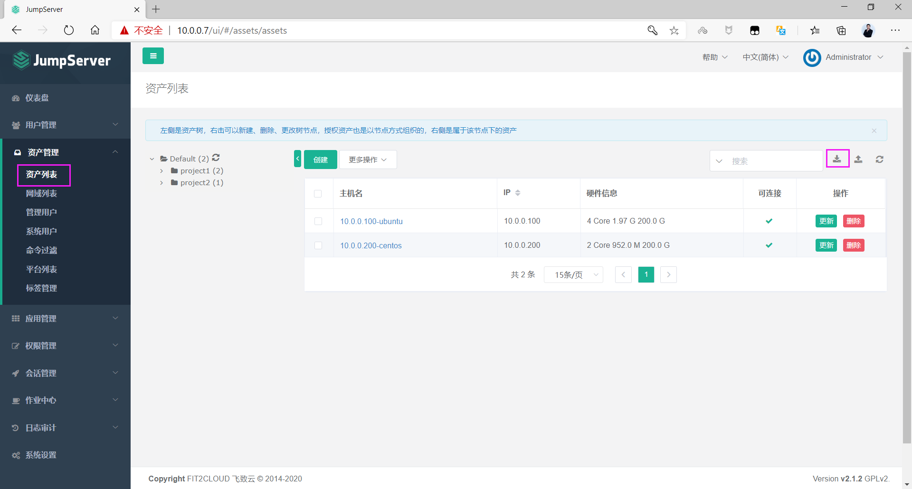
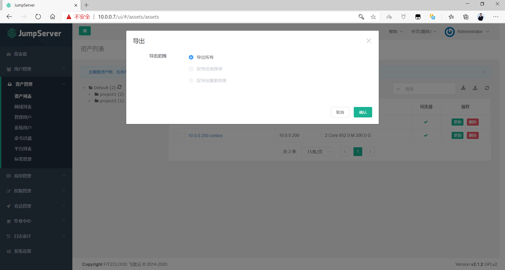
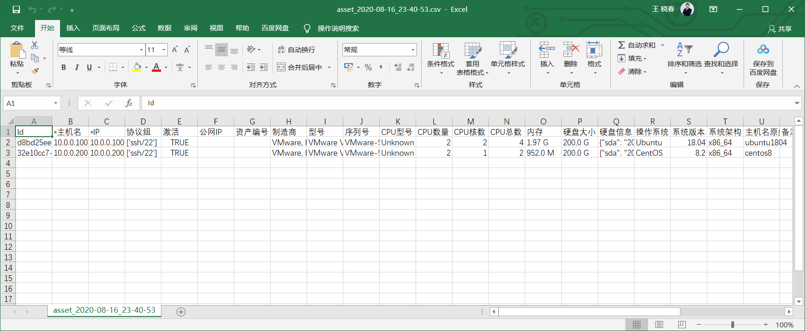
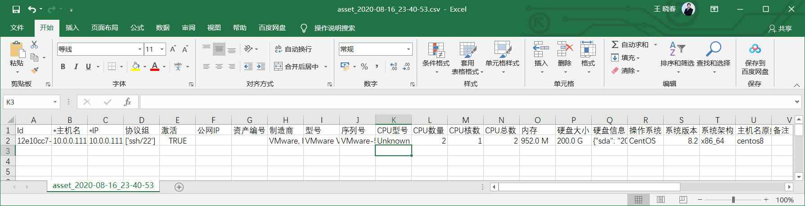
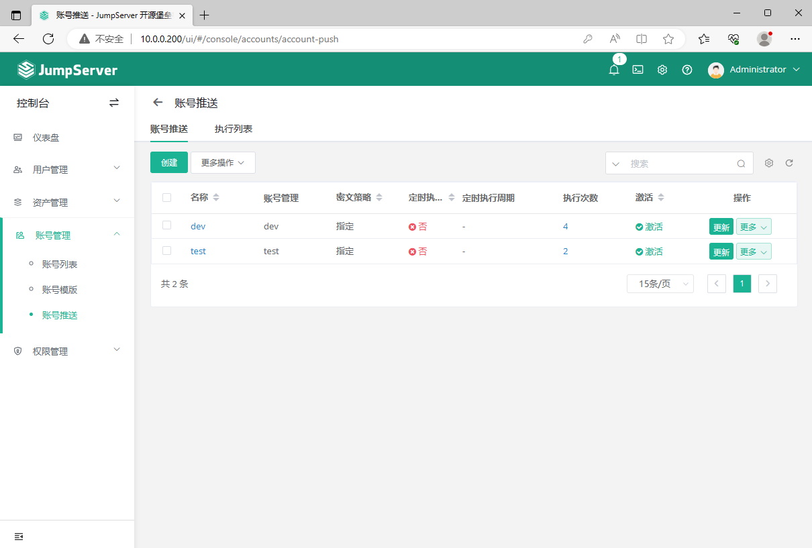
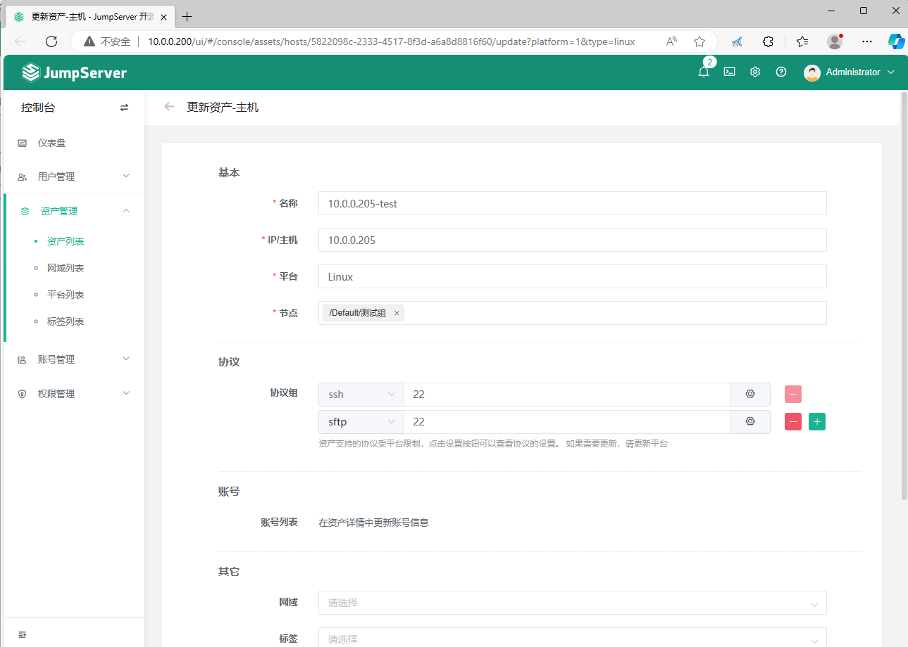
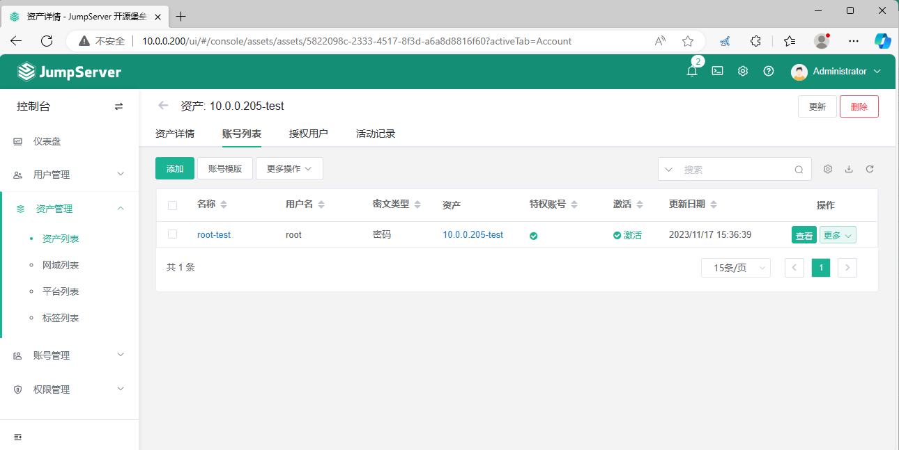
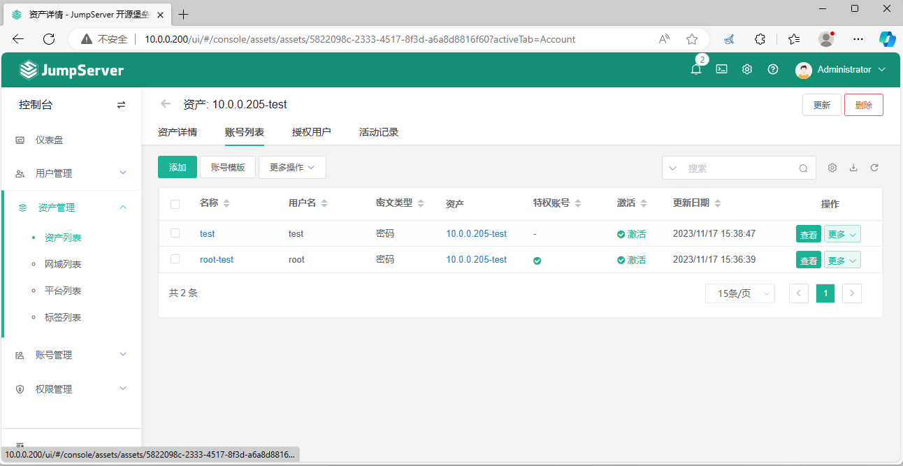
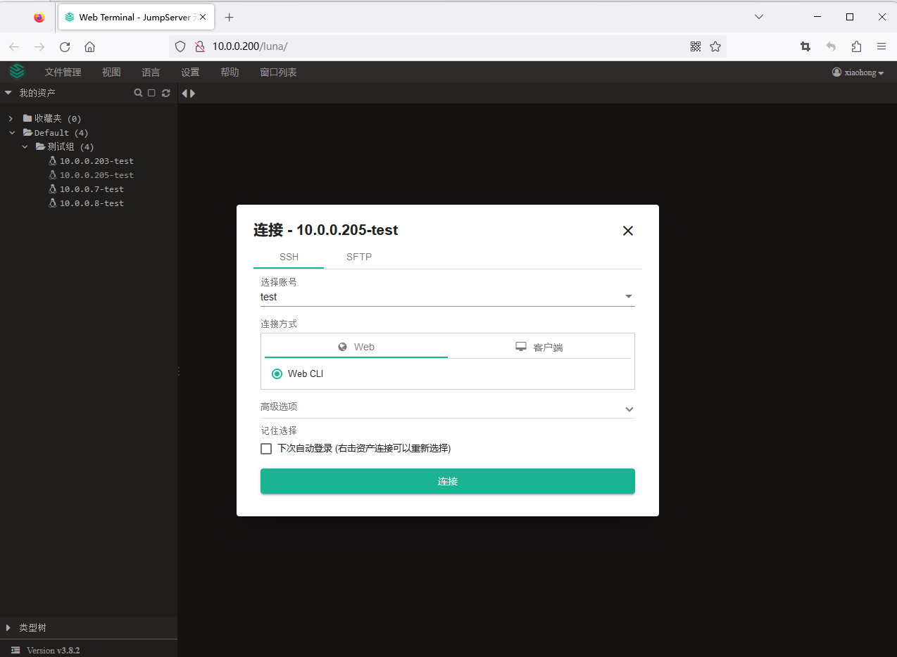
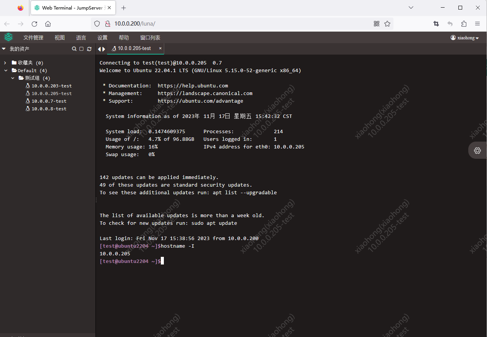

[← 返回JumpServer 堡垒机目录]({{ '/subjects/JumpServer/' | relative_url }})



# 18 资产的批量导出和导入
### 3.8 资产的批量导出和导入

当需要管理的后端服务器很多时,每台主机手动导入效率很低,可以利用资产的导出导入功能实现批量导入,提高效率

### 资产的批量导出







### 批量导入资产

参考上面导出的文件格式,生成导入的文件,再批量导入资产

注意: 删除id列,修改主机名和IP字段,再导入



新版

还需要将系统帐号推送到新添加的服务器



### 系统用户关联资产

导入成功后，系统用户并没有自动关联资产，需要手动关联

在资产列表--更新新添加的资产信息，从帐号模板中一次性添加系统帐号特权用户和普通用户



在资产详情中更新账号信息页面，从选择模版中一次性添加系统帐号中特权和普通用户





添加完成后，系统用户中的普通用户会自动在后端服务器创建

```bash
[root@ubuntu2204 ~]#getent passwd test
test:x:1001:1001::/home/test:/bin/bash
```

### 测试登录新添加的主机







<nav class="article-end" aria-label="章节导航">
  <a href="{{ '/subjects/JumpServer/17-command-filters.html' | relative_url }}">← Previous: Command Filters</a>
  <a href="{{ '/subjects/JumpServer/' | relative_url }}">Back to JumpServer Bastion Host Index</a>
</nav>
