[← 返回 Kubernetes 目录]({{ '/subjects/Kubernetes/' | relative_url }})



# 01 云原生生态与 Kubernetes 架构

# 1 云原生生态系统

## 1.1 软件架构的演进

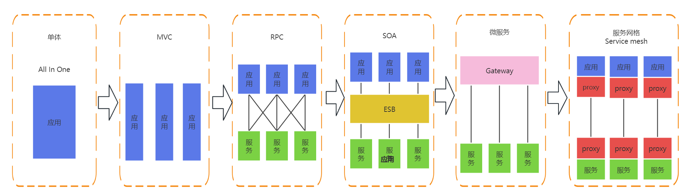

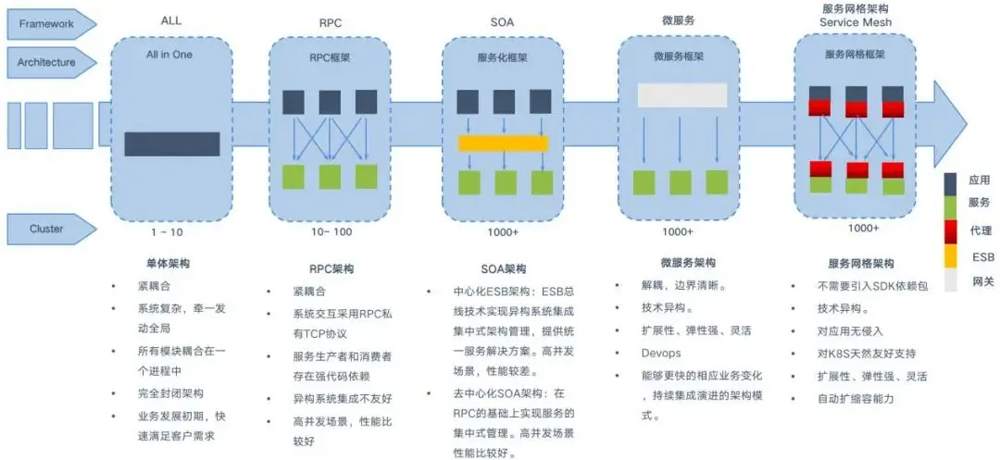

### 从单体架构到微服务

**单体架构（All in One）**：传统架构，都部署在单机系统，一个项目一个工程：比如商品、订单、支付、库存、登录、注册等等，统一部署，一个进程。

**MVC**：Model（模型）、View（视图）和 Controller（控制器）用于分离数据、界面与控制逻辑，便于在单个应用内部协作开发。但代码分层不等于服务拆分：如果整套应用仍以一个进程部署，运维上仍是单体架构。

**RPC（Remote Procedure Call）**：将各个功能拆分为独立的服务和应用，以独立项目分别开发和部署。各个服务和应用相关通过RPC方式调用。远程过程调用解决远程调用服务的一种技术，使得调用者像调用本地服务一样方便透明。

**SOA（Service Oriented Architecture）**：各个服务之间通过ESB(Enterprise Service Bus)进行通信。ESB是一个由大量规则和原则集成的软件架构，可以将一系列不同的应用程序集成到单个基础架构中。此外ESB属于重量级产品，部署规划异常笨重；ESB的单点依赖和商业ESB的费用问题反而成为了所有服务的瓶颈。

**微服务（microservices）**：按业务能力拆分应用，每个服务可独立开发、部署和扩缩容，并通过 HTTP API、RPC 或消息机制协作。服务边界应由业务内聚性决定，并非拆得越小越好；不同服务可选用不同语言和数据存储，但也必须处理跨服务通信与数据一致性。

开发者需要使用各种开发框架，比如调用 JAVA 的 spring cloud的 SDK 实现功能性和非功能性代码。非业务性的基础功能仍然需要依赖开发者的能力实现。

### 传统 Spring Cloud 与 Kubernetes 提供的解决方案对比

| 能力 | Kubernetes | Spring Cloud |
| --- | --- | --- |
| 弹性伸缩 | HPA、VPA 等对工作负载扩缩容 | Spring Cloud 本身不负责基础设施扩缩容 |
| 服务发现 | KubeDNS / CoreDNS | Spring Cloud Eureka,Nacos |
| 配置中心 | ConfigMap / Secret | Spring Cloud Config |
| 服务网关 | Ingress Controller / Gateway API 实现 | Spring Cloud Gateway、Zuul 等 |
| 负载均衡 | Service 和外部负载均衡器 | Spring Cloud LoadBalancer 等客户端组件 |
| 身份与访问控制 | RBAC 控制 Kubernetes API 访问；应用鉴权仍需另行实现 | Spring Security 等处理应用鉴权 |
| 可观测性 | Metrics API、Prometheus 等生态组件 | Actuator、Micrometer 等生态组件 |
| 降级熔断 | Kubernetes 本身不直接提供应用级熔断 | Resilience4j 等实现应用级容错 |

这两者解决的问题不在同一层：Kubernetes 管理容器化工作负载与集群资源，Spring 生态更接近应用内部的开发与治理。Kubernetes 不能直接替代应用级鉴权、熔断、业务重试等机制，实际系统可以组合使用。

### 服务网格 service Mesh

服务网格尝试把服务间通信的部分横切能力，例如流量路由、传输安全和可观测性，从业务代码移到基础设施层。常见实现使用边车代理（Sidecar Proxy），但并非所有服务网格都依赖边车；引入网格也不意味着业务代码从此无需处理超时、幂等和故障。

## 1.2 云计算

### 虚拟化技术与标准的变迁

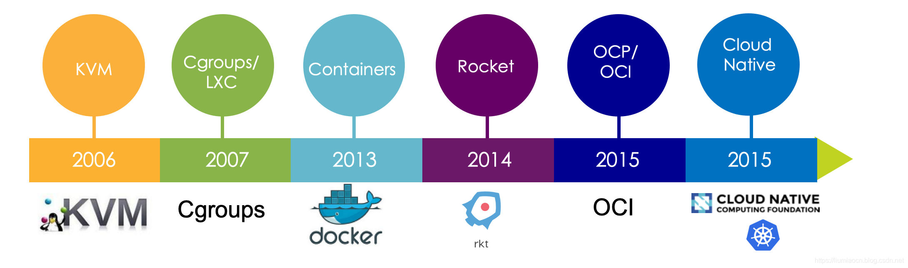


2006年：在2006年12月19由Avi Kivity宣告了KVM的诞生，而在2007年2月，KVM发布到内核2.6.20中

2007年：cgroups最早是由Google的工程师在2006年发起，早期名称为proccess containers，为了和其他Linux内核的名词产生混乱，2007年被重命名为cgroup，合并到了2.6.24版的内核中。LXC正式在 cgroups和namespace的基础上实现的隔离与控制。

2013年：docker诞生。

2014年：coreos与docker分道扬镳，另起炉灶起了一套容器的机制Rocket，并得到了Google等公司的大力支持。而随后也直接成为CNCF的项目之一，然而现在已经由于无人更新淡出人们的视野了，也成为了CNCF 第一个剔除的项目。

2015年：在2015年，由Docker和Linux基金会携手发布了OCP（Open Container Project），后来此项目被Linux基金会的执行董事Jim Zemlin宣布更名为开放容器计划OCI（Open Container Initiative），后续有更多的公司诸如CoreOS、Redhat等加入一起支持该计划，维护并推进Docker的规范，以建立一个容器的通用标准。

2015年：CNCF成立，建议以Kubernetes为中心的云原生解决方案。


### 技术的发展带来的变迁

**基本构建单元的变迁**：应用构建单元的变迁过程：物理机 -> 虚拟机 -> Buildpacks -> 容器。

**隔离方式的变迁**：隔离方式从重量级变为轻量级，速度更快，尺寸更小。

**提供上的变迁**：服务商的变迁也实现了从闭源到开源，从单一开源服务上到多服务商提供服务的过程。

#### 最小构建单位的变迁


- <https://blog.csdn.net/liumiaocn/article/details/100749302>


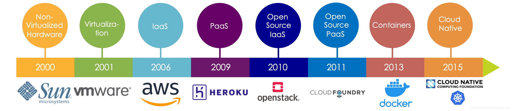


2000年：应用程序的运行还是在物理机上运行的时代，以sun的非虚拟化的硬件为代表，当我们需要启动一个新的应用时，往往需要购买一台或者多台新的物理服务器来解决所需要的资源问题，物理机器是构建应用的最小单元。

2001年：vmware的虚拟技术使得构建应用的最小单元变成了一台虚拟机，可以通过在一台物理机器上运行多个VM，意味着使用者需要更少的硬件资源投入。

2006年：在这一年，Amazon的AWS（Amazon Web Services）通过EC2（Elastic Compute Cloud）在 IaaS获得成功，虽然构建应用的最小单元仍然是VM（被成为AMI：Amazon Machine Image），已经可以做到按小时来出租服务器。

2009年：在这一年Heroku在PaaS（Platform-as-a-Service）获得成功，构建应用的最小单位被成为 buildpack，在buildpack中应用满足12要素，部署新的版本在Heroku上已经非常简单，只需要执行git push heroku即可。

2010年：OpenStack召集了大量的供应商提供了开源的IaaS与AWS和VMWare来进行对抗，而构建应用的最小单位仍然是VM。

2011年：Pivotal提供了一个开源的可以与Heroku的PaaS相抗衡的开源PaaS，这就是后来2014年启动的 CF（Cloud Foundry），在这种方式下，构建应用的最小单位被称为Garden containers，其中可以包含 Heroku的buildpack、Docker容器甚至非Linux操作系统。

2013年：Docker将LXC、Union File System和cgroups结合起来形成了容器标准，得到了全世界数百万开发者的极大认可，几乎是一夜之间红遍大江南北，使得隔离、重用性以及一致性得到了保证，构建应用的最小单位变成了容器。

2015 年：CNCF 成立。云原生实践逐渐将应用架构、容器化交付和自动化编排联系起来：按业务需要拆分服务，使用镜像交付，再由编排平台调度和管理工作负载。微服务不是使用 Kubernetes 的前提，单体应用也可以容器化。


**美国国家标准与技术研究院（NIST）定义**：云计算是一种按使用量付费的模式，这种模式提供可用的、便捷的、按需的网络访问， 进入可配置的计算资源共享池（资源包括网络，服务器，存储，应用软件，服务），这些资源能够被快速提供，只需投入很少的管理工作，或与服务供应商进行很少的交互。

云计算是指服务的交付和使用模式，指通过网络以按需、易扩展的方式获得所需的资源（可以是IT和软件、互联网相关的，也可以使任意其他的服务）。提供资源的网络被称为“云”。“云”中的资源在使用者看来是可以无限扩展的，并且可以随时获取，按需使用，随时扩展，按使用付费。意味着计算能力也可以作为一种商品进行流通，就像煤气、水电一样，取用方便，费用低廉。最大的不同在于，它是通过网络进行传输的。

## 1.3 CNCF和云原生

### 1.3.1 CNCF


Cloud Native Computing Foundation，云原生计算基金会（以下简称CNCF） 成立于2015年7月，是Linux 基金会旗下的一个开源软件基金会，它致力于云原生（Cloud Native）技术的普及和可持续发展,其口号是坚持和整合开源技术来让编排容器作为微服务架构的一部分。

官方网站: https://www.cncf.io/

早期对 CNCF 关注方向的概括包括容器化封装、动态编排和面向微服务。如今 CNCF 的项目范围已扩展到观测、安全、存储等更多领域，不能把这三项当作现行项目准入条件。

CNCF 这个组织的作用是推广技术，形成社区，开源项目管理与推进生态系统健康发展。很多公司都参与 CNCF 组织成为其成员。

当前CNCF的成员有:


- <https://landscape.cncf.io/?group=members>


CNCF 组织由以下部分组成：

从读者理解生态治理的角度，可以区分几类角色：不同等级的会员支持基金会运作；理事会负责组织治理；技术监督委员会（TOC）负责技术方向和项目流程；最终用户社区反馈生产实践；市场相关组织负责推广。具体会员等级与治理规则以 CNCF 官方页面为准。

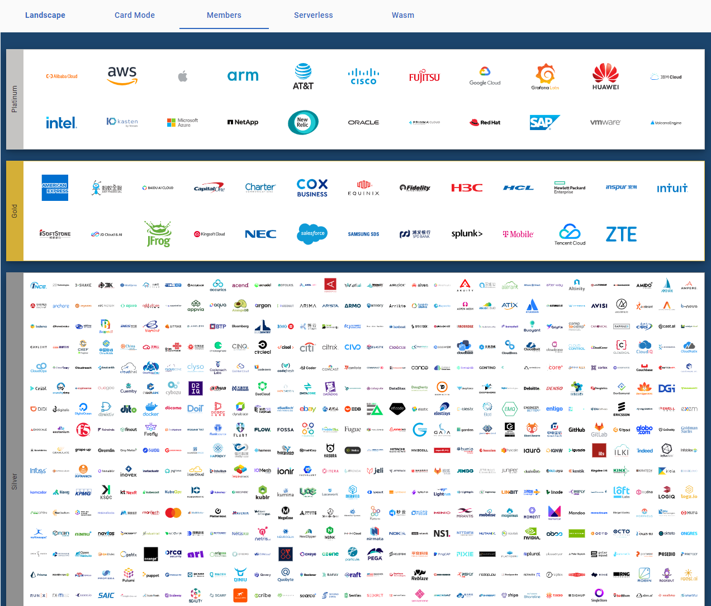

### 1.3.2 云原生

随着云计算的红火发展，云原生（Cloud Native）的概念应运而生。自从Pivotal公司的Matt Stine于2013年首次提出云原生的概念以来，随之经过多年的推广,但是可惜的是，云原生却没有一个标准的定义，因为云原生本身一直在发展变化之中，所谓的解释权不归某个人或组织所有。

**云原生概念的发展历程**

2013年：Pivotal公司的Matt Stine于首次提出此概念


- <https://www.mattstine.com/>


2015年：Matt Stine《迁移到云原生架构》云原生包括：12因素、微服务、自敏捷架构、基于API协作、扛脆弱性

2015年：CNCF的云原生初始定义包括：容器化封装、自动化管理、面向微服务

2017年：Matt Stine 采访梳理了云原生架构：模块化、可观察、可部署、可测试、可替换、可处理6特质

2018年：CNCF 把服务网格(Service Mesh)和声明式API给加入到云原生的概念中。

**CNCF 官方定义云原生**
<https://github.com/cncf/toc/blob/main/DEFINITION.md#%E4%B8%AD%E6%96%87%E7%89%88%E6%9C%AC>

云原生技术有利于各组织在公有云、私有云和混合云等新型动态环境中，构建和运行可弹性扩展的应用。

云原生的代表技术包括:容器、服务网格、微服务、不可变基础设施和声明式API。这些技术能够构建容错性好、易于管理和便于观察的松耦合系统。结合可靠的自动化手段，云原生技术使工程师能够轻松地对系统作出频繁和可预测的重大变更。

云原生计算基金会（CNCF）致力于培育和维护一个厂商中立的开源生态系统，来推广云原生技术。我们通过将最前沿的模式民主化，让这些创新为大众所用。

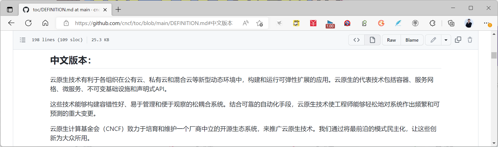

当前CNCF的云原生定义v1.0如下：

云原生的代表技术包括: 微服务、容器、服务网格、不可变基础设施和声明式API。云原生技术有利于各组织在公有云、私有云和混合云等新型动态环境中，构建和运行可弹性扩展的应用。云原生计算基金会（CNCF）致力于培育和维护一个厂商中立的开源生态系统，来推广云原生技术。

**Vmware 云原生定义**


<https://tanzu.vmware.com/cloud-native>

什么是云原生，什么是云原生应用？云原生是一种构建和运行应用程序的方法，它利用了云计算交付模型的优势。当公司使用云原生架构构建和运营应用程序时，他们可以更快地将新想法推向市场，并更快地响应客户需求。


虽然公共云已经影响了几乎每个行业的基础设施投资思维，但类似云的交付并不是公共环境独有的。云原生开发适用于公有云和私有云；它是关于如何创建和部署应用程序，而不是在哪里。


更重要的是能够为开发人员提供对计算能力的按需访问以及现代数据和应用程序服务。云原生开发融合了 DevOps、持续交付、微服务和容器的概念。


云原生技术出现的背景是组织在推行云计算时，由于公有云、私有云和混合云的复杂环境已经变得越来越普及，所以在这种基础架构之下如何保证松耦合的系统能够更好地被监控和管理，是云原生技术需要面对和解决的问题。

**云原生的发展带来的价值**

云原生的收益不是“无限扩展”的保证，而是提供一套更容易扩展和恢复的工程方法：

- **可移植性**：标准接口与开源生态降低对单一供应商的依赖，但云厂商专有服务仍可能形成锁定。
- **弹性与故障恢复**：可按需求调整副本，并在进程或节点故障后重建工作负载；跨可用区容灾还需额外设计。
- **交付速度与可维护性**：独立部署、自动化测试和发布流程能够缩短反馈周期，前提是服务边界与运维能力合理。
- **资源利用率**：调度器依据请求量、限制和约束放置工作负载，帮助共享集群资源。

### 1.3.3 CNCF 项目

CNCF是旨在推动以容器为中心的云原生系统。从 2016 年 11 月，CNCF 开始维护了一个名为云原生全景图 Cloud Native Landscape 的仓库，汇总目前比较流行的云原生技术， 如Kubernetes、Prometheus、Envoy等 ,加以分类，希望能为企业构建云原生体系提供参考。

**CNCF 云原生相关参考资料**


- <http://dockone.io/article/3006>
- <https://www.kubernetes.org.cn/5482.html>


#### 1.3.3.1 CNCF 全景图

CNCF的全景图（Landscape）包含了CNCF中托管的项目，还有很多是非CNCF项目。当前一直持续更新中，可以参看如下连接获得更加详细的内容和及时更新的内容：

https://landscape.cncf.io/images/landscape.png

也可以通过如下链接交互式地确认各个部分的内容：

https://landscape.cncf.io/


- <https://landscape.cncf.io/>
- <https://github.com/cncf/landscape>
- <https://landscape.cncf.io/images/landscape.png>


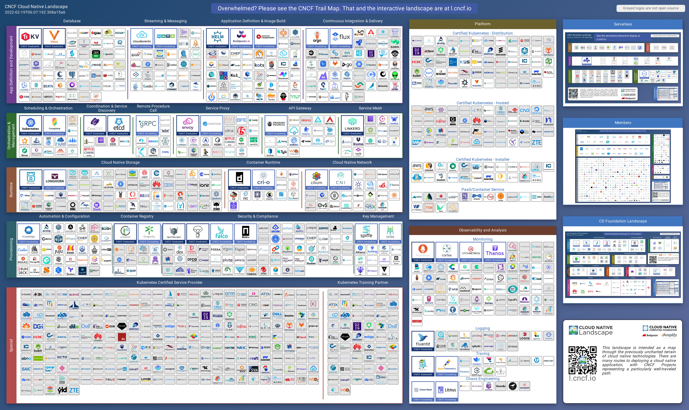

**CNCF 全景图分类示例**。全景图既收录 CNCF 托管项目，也收录其他生态产品；以下是阅读图时可参考的分类，而不是 CNCF 项目清单。

**应用开发和管理解决方案集合**
- Database
- streaming & message
- Application Definition & image build
- Continuous Integration & Delivery

**编排管理解决方案集合**
- Scheduling & Orchestration
- Coordination & Service Discovery
- Remote Procedure Call
- Service Proxy
- API Gateway
- Service Mesh

**运行时解决方案集合**
- Cloud Native Storage
- Container Runtime
- Cloud Native Network

**基础功能解决方案集合**
- Automation & Configuration
- Container Registry
- Security & Compliance
- Key Management

**平台解决方案集合**
- Certified Kubernetes - Distribution
- Certified Kubernetes - Hosted
- Certified Kubernetes - Installer
- PaaS/Container Service

**检测和分析解决方案集合**
- Monitoring
- Logging
- Tracing
- Chaos Engineering

#### 1.3.3.2 CNCF 项目成熟度分级

当前所有的CNCF项目可以访问 https://www.cncf.io/projects

CNCF 当前包含著名的项目有 Containerd、Kubernetes、Prometheus 、Etcd、Harbor、CoreDNS、Envoy、Helm 等。每个CNCF项目都需要有个成熟度等级，申请成为CNCF项目的时候需要确定项目的成熟度级别。


成熟度级别（ Maturity Level）包括以下三种：

| 阶段 | 含义 |
| --- | --- |
| Sandbox（沙箱） | 探索早期想法，验证社区与技术方向。 |
| Incubating（孵化） | 社区、治理和采用度进一步成熟。 |
| Graduated（毕业） | 达到更高的项目成熟度和可持续性要求。 |

项目进入 CNCF 及晋级需要经过相应申请与评审流程，技术监督委员会（TOC）参与技术治理。成熟度可作为评估项目治理和生产采用度的线索，但不是“毕业项目一定适合所有企业”的保证；还应结合维护情况、功能和自身场景判断。

CNCF各个项目成熟度查询链接: https://www.cncf.io/projects/

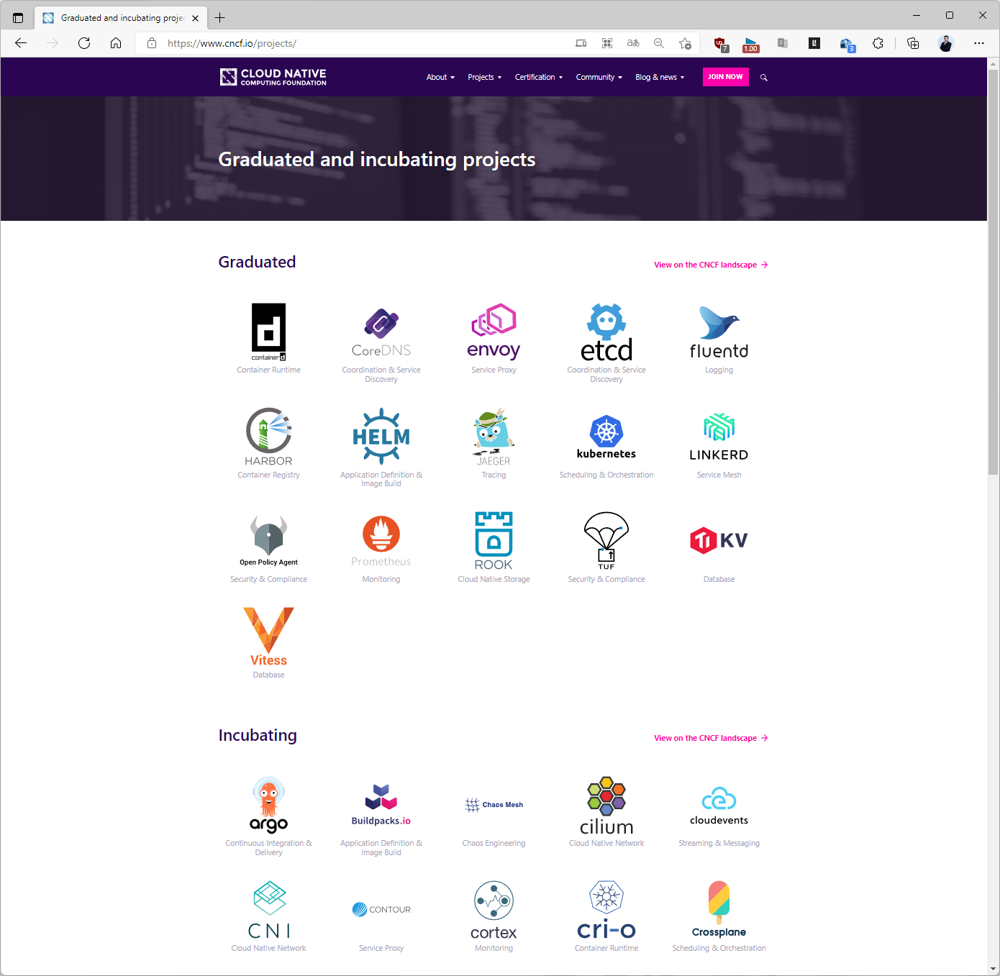

### 1.3.4 CNCF 路线图 Trail Map


- <https://github.com/cncf/landscape/blob/master/README.md#trail-map>
- <https://blog.csdn.net/liumiaocn/article/details/100653635>


在复杂的基础架构之上如何推动云原生应用的更好落地，从而更好地适应环境与业务的发展，CNCF给出了路线图Trail Map用于对于用户在整体上给出了指导建议，分成十个步骤进行实施，而在不同的步骤都可以结合Landscape中列出的产品或服务进行选择。

步骤1: 容器化


先确定应用及依赖能否作为镜像稳定构建、运行，再把配置与持久化数据从镜像中分离。Docker 是构建镜像的一种常见工具；容器化和微服务拆分是两个独立决策，不必同时进行。


步骤2: CI/CD


建立从代码提交到镜像构建、测试、发布的流水线。部署前应有质量门禁，并设计失败后的回滚或修复流程，而不是把“自动发布”理解为跳过验证。


步骤3: 应用定义与编排


用 Kubernetes 声明应用所需的副本、资源和访问方式，由控制器持续协调实际状态。Helm Chart 可把一组相关资源组织成可安装、升级的应用包；使用前仍需审查模板和默认值。


步骤4: 监控&分析


可观测性至少要回答“服务是否健康、故障发生在哪里、请求经历了什么”。指标可用 Prometheus，日志可用 Fluent Bit/Fluentd 等组件收集，追踪可借助 OpenTelemetry 与 Jaeger 等系统；具体组合取决于现有平台。


注意：步骤4开始为可选内容。

步骤5: 服务代理、服务发现和服务网格。


集群内的 Service 和 CoreDNS 提供基本服务发现；如果需要更细的服务间流量治理，可评估 Envoy、Linkerd 等方案。服务网格会增加控制平面、数据平面的运维成本，不应只因“云原生路线图”就引入。


步骤6: 网络&策略


选择与集群兼容的 CNI 网络实现，例如 Calico、Flannel 等，并验证是否支持所需的 NetworkPolicy。OPA 等策略引擎可在准入等环节表达组织规则；网络策略与准入策略解决的是不同问题。


步骤7: 分布式数据库与存储


数据库和存储应按数据模型、性能、可用性和恢复目标选择。Vitess 用于 MySQL 水平扩展，Rook 用于管理部分分布式存储，TiKV 是分布式键值数据库；etcd 则主要保存 Kubernetes 集群状态，不能把它当作普通业务数据库。无论哪种方案，备份与恢复都必须单独验证。


步骤8: 流与消息处理


同步服务调用可评估 gRPC；异步事件与消息分发可评估 NATS。二者解决的通信模型不同，不宜仅凭“比 JSON REST 更快”来选择；还应考虑可靠性、顺序、重试和客户端兼容性。


步骤9: 镜像私库&运行环境


Harbor 可作为私有镜像仓库并提供扫描等能力。节点上的容器运行时可选 containerd 或 CRI-O 等实现；Kubernetes 与运行时通信要求 CRI 兼容，镜像和底层执行格式则与 OCI 规范相关，两种接口不能混为一谈。


步骤10: 软件分发


TLS 保护传输链路，但无法单独证明下载到的镜像或软件包来自预期发布者。制品签名和验证（如 Notary 相关方案）可以补充来源与完整性校验；TUF 关注安全更新元数据。部署前还要确定谁负责签名密钥与信任策略。


## 1.4 容器编排工具

### 1.4.1 Docker-Compose

Docker-Compose 是一个单机版的容器编排工具,用来管理一个主机上的多个容器，即单个主机上容器管家。如果当主机上中有几十成百的容器,而且需要按一定的次序启动时，如果手动执行docker命令去一个一个的启动那将非常麻烦。利用 Docker-Compose后只需要编写一个文件，在这个文件里面声明好要启动的容器和次序，配置相关一些参数，最后只需要执行一下这个文件，Docker就会按照提前声明的配置去把所有的容器启动起来。但是Docker-Compose只能管理当前主机上的Docker容器，即不能去启动和管理其他主机上的Docker容器。

### 1.4.2 Docker Swarm

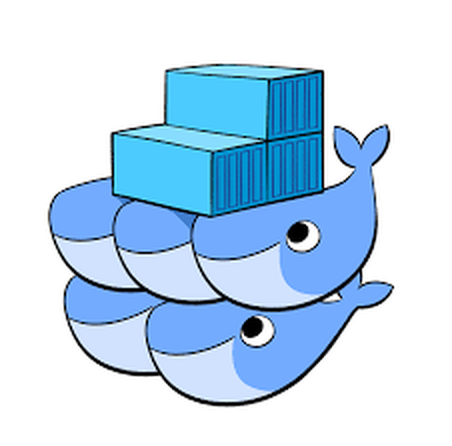

Docker Swarm则是由Docker 公司自行研发的一款用来管理多主机上的Docker容器的工具。可以负责帮用户启动容器，监控容器状态，如果容器的状态不正常它自动重新启动一个新的容器，来提供服务，同时也提供服务之间的负载均衡，而这些功能是Docker-Compose 是无法实现的。Swarm 现在与Docker Engine完全集成，并使用标准API和网络。Swarm模式内置于Docker CLI中，无需额外安装，并且易于获取新的Swarm命令。

### 1.4.3 Marathon


编排框架 Marathon 基于 Apache Mesos 项目。Apache Mesos 通过 API提供了跨数据中心的资源管理和调度抽象，而这些数据中心可能是物理上分散的。Mesos 上的系统可以使用底层的计算、网络和存储资源，就像虚拟机通过虚拟机管理程序使用底层资源一样。Marathon 使用了Mesos 并在它上面运行，针对长期运行的应用程序提供了容器编排功能。它既支持Mesos 容器运行时，也支持Docker 容器运行时。

### 1.4.4 Kubernetes

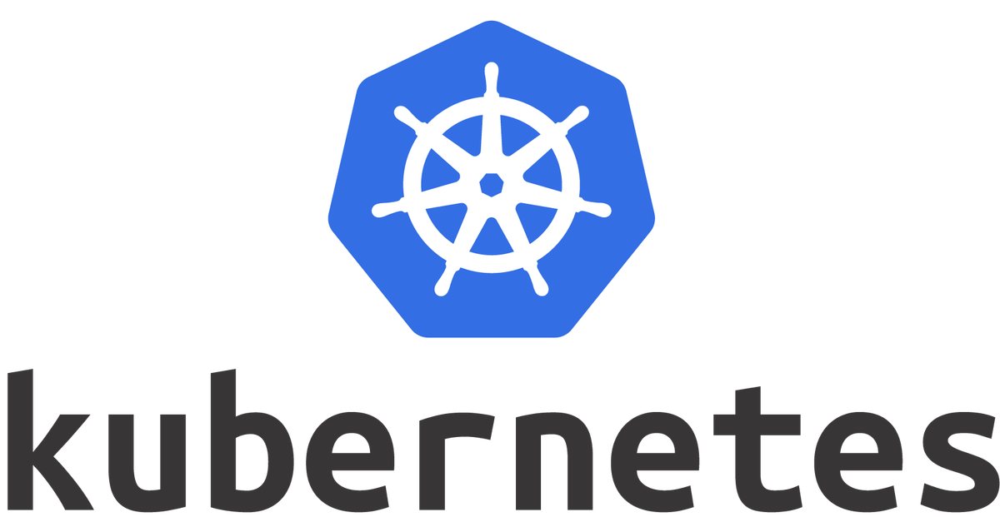

Kubernetes就由Google的内部项目Borg发展而来，用go语言实现，后捐献给CNCF成为开源项目。它本身的角色定位是和 Docker Swarm 是一样的，也是一个跨主机的容器管理平台。Kubernetes当前已成为容器编排领域的领导者,甚至是行业标准。

# 2 Kubernetes 介绍和架构

## 2.1 Kubernetes 介绍

Kubernetes其实源于希腊语意思（舵手，领航员）。由于名称长所以既不太好读也不太好写，因为首字母k和末尾字母s之间共有8个字母，经常简称为k8s。

Kubernetes 是谷歌在2014年开始实施的一个开源项目，当时google已经有了大规模服务容器管理的经验，使用内部Borg系统负责对google内部的一些服务进行调度和管理，它的目的是让用户不必操心资源管理的问题，让他们专注自己的核心业务，并且最大化数据中心的利用率。Kubernetes被认为是Borg的开源版本（研发团队有重合、功能简化聚焦、架构类似）。

当前很多工程师现在投身Kubernetes 的系统研究，推进K8S的发展。2019年5月4日，Twitter宣布弃用使用了长达数十年的Mesos系统，全面拥抱Kubernetes ，足可见Kubernetes 在目前云计算生态和环境下的重要地位。越来越多的服务以 Docker 的方式进行运行通过Kubernetes 进行编排。

Kubernetes 建立在 Google 公司超过十余年的运维经验基础之上，Google 所有的应用都运行在容器上,再与社区中最好的想法和实践相结合，Google 每周运行数十亿个容器，Kubernetes 基于与之相同的原则来设计，能够在不扩张运维团队的情况下进行规模扩展，当前已成为最受欢迎和行业最主流的容器管理平台。Kubernetes 用于管理云平台中多个主机上的容器化的应用，Kubernetes的目标是让部署容器化的应用简单并且高效,Kubernetes提供了应用部署，规划，更新，维护的强大和灵活的机制。

Kubernetes一个核心的特点就是能够自主的管理容器来保证云平台中的容器按照用户的期望状态运行着,用户可以运行一个微型服务，让规划器来找到合适的位置节点，后续用户不需要关心怎么去做，Kubernetes会自动去监控，然后去重启，新建等，总之让应用可以一直提供服务，同时，Kubernetes系提供了人性化的相关工具,可以让用户能够方便的部署自己的应用。

官网：https://kubernetes.io/

github：https://github.com/kubernetes/kubernetes

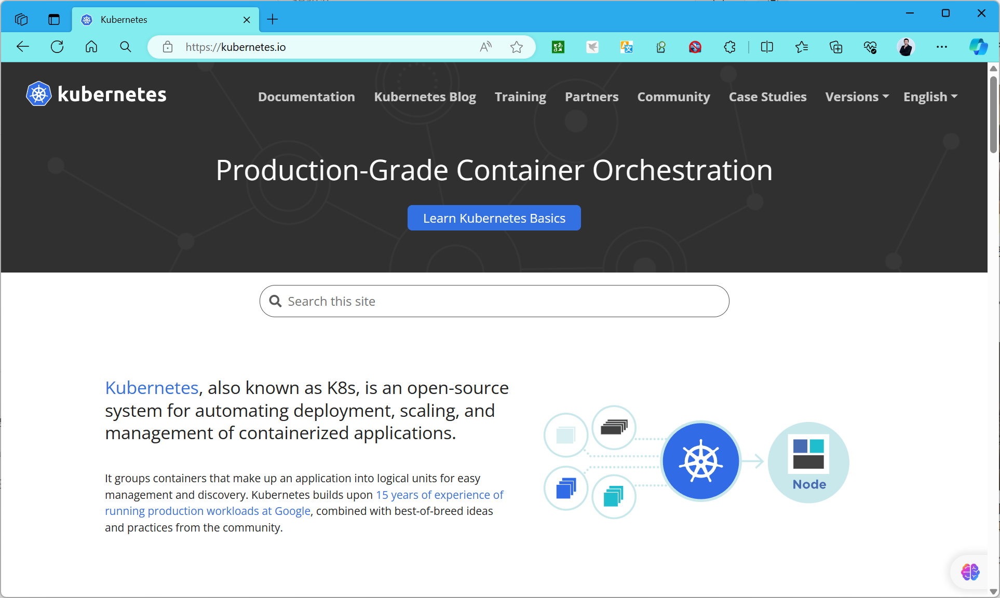

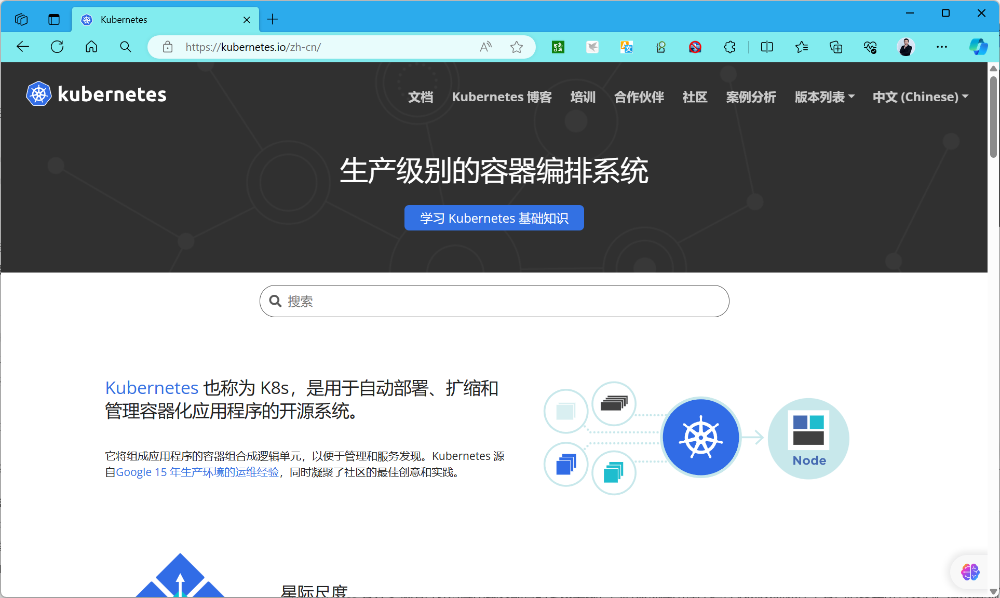

**Kubernetes 特性**
```text
https://kubernetes.io/zh-cn/
https://kubernetes.io/zh-cn/docs/concepts/overview/#why-you-need-kubernetes-and-what-can-it-do
```

**自动化上线和回滚**

Kubernetes 会分步骤地将针对应用或其配置的更改上线，同时监视应用程序运行状况以确保你不会同时终止所有实例。如果出现问题，Kubernetes 会为你回滚所作更改。你应该充分利用不断成长的部署方案生态系统。

**服务发现与负载均衡**

无需修改你的应用程序即可使用陌生的服务发现机制。Kubernetes 为容器提供了自己的 IP 地址和一个DNS 名称，并且可以在它们之间实现负载均衡。

**存储编排**

自动挂载所选存储系统，包括本地存储、诸如 GCP 或 AWS 之类公有云提供商所提供的存储或者诸如NFS、iSCSI、Gluster、Ceph、Cinder 或 Flocker 这类网络存储系统。

**水平扩缩**

使用一个简单的命令、一个 UI 或基于 CPU 使用情况自动对应用程序进行扩缩。

**自我修复**

重新启动失败的容器，在节点死亡时替换并重新调度容器，杀死不响应用户定义的健康检查的容器，并且在它们准备好服务之前不会将它们公布给客户端。

**为扩展性设计**

无需更改上游源码即可扩展你的 Kubernetes 集群。

**自动装箱**

根据资源需求和其他约束自动放置容器，同时避免影响可用性。 将关键性的和尽力而为性质的工作负载进行混合放置，以提高资源利用率并节省更多资源。

**批量执行**

除了服务之外，Kubernetes 还可以管理你的批处理和 CI 工作负载，在期望时替换掉失效的容器。

**IPv4/IPv6 双协议栈**

为 Pod 和 Service 分配 IPv4 和 IPv6 地址

**Secret 和配置管理**：部署和更新 Secret 和应用程序的配置而不必重新构建容器镜像， 且不必将软件堆栈配置中的秘密信息暴露出来。

## 2.2 Kubernetes 架构

**kubernetes设计架构参考**


- <https://www.kubernetes.org.cn/kubernetes%E8%AE%BE%E8%AE%A1%E6%9E%B6%E6%9E%84>


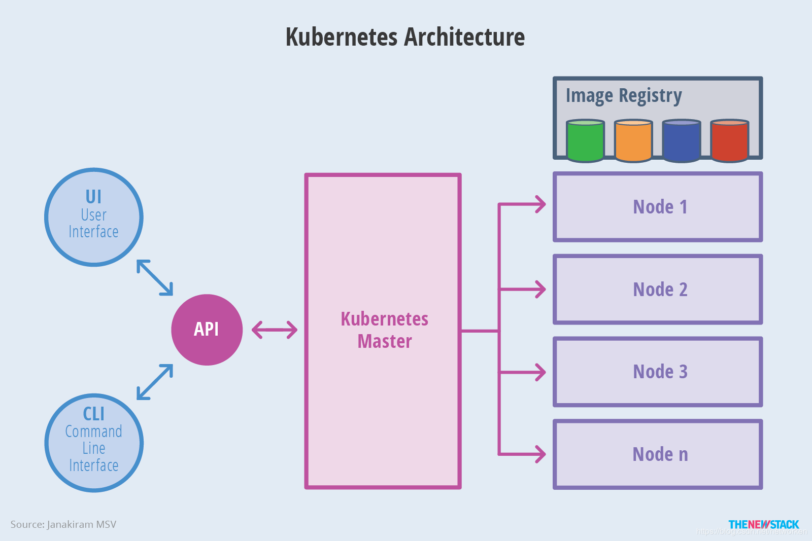

**集群架构图示**

Kubernetes 集群（CLUSTER）由控制平面（CONTROL PLANE）和多个工作节点（图中的 Node 1、Node 2）组成：

- **控制平面**：包括 etcd、kube-api-server、kube-scheduler（Scheduler）、kube-controller-manager（Controller Manager）和 cloud-control-manager；后者可连接 CLOUD PROVIDER API。
- **工作节点**：每个节点运行 kubelet、kube-proxy 和容器运行时接口（CRI），并承载一个或多个 Pod。

Kubernetes 是一个由许多主机节点组成、各节点分工不同的分布式系统。

**节点类型**：Kubernetes 的主机节点主要分为两类。

- **Master 节点**：管理（控制）节点，相当于公司的管理层。主要由 API Server、Controller-Manager 和 Scheduler 三个组件，以及存储集群状态的 Etcd 服务组成。
- **Node 节点**：也称 Worker 或 Minion 节点，相当于具体完成工作的基层员工。主要包含 Kubelet、Kube Proxy 及容器运行时（当时 Docker 仍是最常用的实现），负责承载各类应用容器。

**Kubernetes的节点运行逻辑**

Kubernetes 把多个工作节点组成一个可统一管理的集群。用户向 API Server 提交工作负载期望状态，调度器为待运行的 Pod 选择节点，控制器持续比较期望状态与实际状态；节点加入、故障或移除后，控制器会按工作负载策略尝试重建或重新调度 Pod。它不是把所有机器直接合并成一台具有共享内存的服务器。

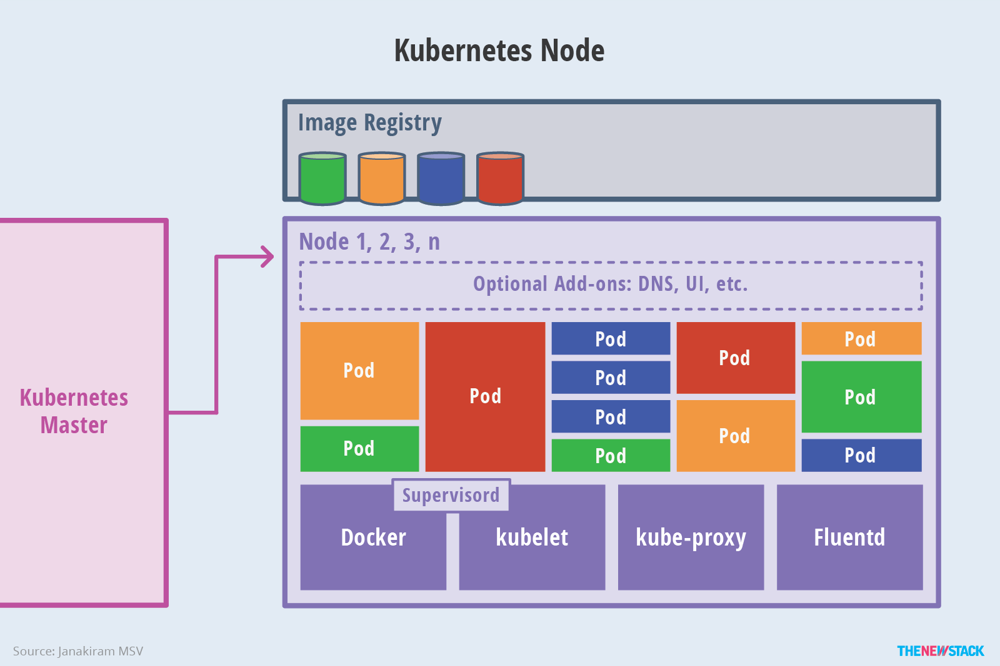

## 2.3 Kubernetes 组件


- <https://kubernetes.io/zh/docs/concepts/overview/components/>


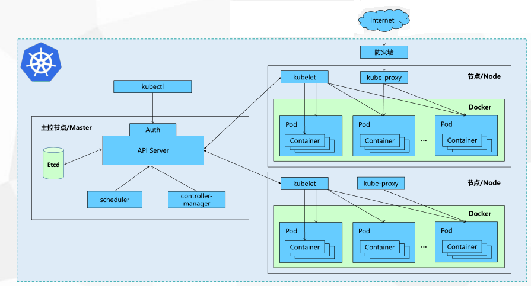

**Kubernetes 组件分层**：包括 Control Plane Components（控制平面组件）、Node Components（节点组件）和 Addons（附件／插件）三类。

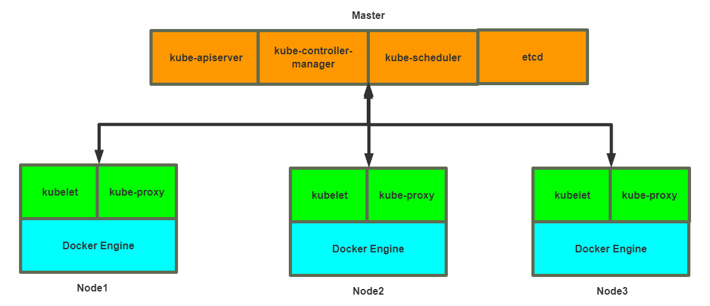

工作节点托管Pods 是应用程序工作负载的组成部分。该控制平面管理集群中的工作节点和Pod。在生产环境中，控制平面通常在多台计算机上运行，而群集通常在多个节点上运行，从而提供了容错能力和高可用性。

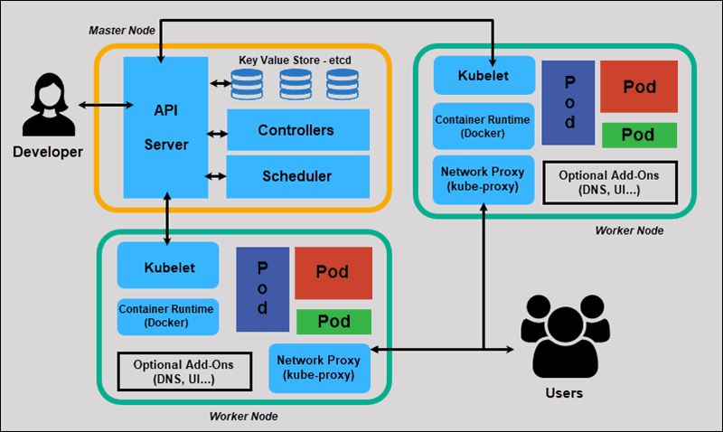

**Kubernetes Architecture（架构图说明）**

图中的虚线框表示 **Control Plane（控制平面）**，右侧的 **Worker Node(s)** 表示工作节点；带 `*` 的组件为可选组件。原图中的英文标签按组件关系整理如下：

| 层次 | 组件 | 作用 |
| --- | --- | --- |
| 控制平面 | Controller Manager | 运行内置控制器，例如 Node Controller、Replication Controller。 |
| 控制平面 | Cloud Controller Manager* | 运行云控制器，处理负载均衡器端点（Load Balancer endpoint）和存储卷分配（Storage volume allocation）等云资源。 |
| 云提供商接口 | Cloud provider API* | 用于管理 AWS、Azure、GCP 等云平台资源，供 Cloud Controller Manager 调用。 |
| 控制平面 | Scheduler | 监视 API server 中的变更，将尚未调度的工作负载分配到可用工作节点。 |
| 控制平面 | API server | 跟踪集群组件状态并管理组件间的交互；从 etcd 读取数据，也向 etcd 写入数据。 |
| 数据存储 | etcd | 保存全部集群配置数据的键值存储（key value store）。 |
| 附加组件 | Cluster DNS* | 为 Pod 和 Service 提供集群内 DNS，通常由 CoreDNS 的 Kubernetes 插件实现。 |
| 工作节点 | kube-proxy | 管理到节点上 Pod 的网络连接，例如使用 iptables 规则。 |
| 工作节点 | kubelet | 根据收到的 Pod 规格（Pod specifications）管理容器，并使用容器运行时。 |
| 工作节点 | Container Runtime | 实现 CRI 的容器运行时，例如 CRI-O 或 containerd。 |

**组件交互关系**：Controller Manager、Cloud Controller Manager、Scheduler 和 Cluster DNS 通过 API server 观察变化；Cloud Controller Manager 与 Cloud provider API 通信；API server 从 etcd 读取数据并向其写入数据；工作节点的 kube-proxy、kubelet 与 API server 交互，kubelet 使用 Container Runtime。

### 2.3.1 控制平面组件

控制平面的组件做出有关集群的全局决策（例如，调度），以及检测和响应集群事件（例如，当部署的replicas 无法达到要求时，自动启动新的Pod）。Control Plane组件可以在群集中的任何计算机上运行。但是，为简单起见，通常在同一台计算机上启动所有Control Plane组件，并且不在该计算机上运行用户容器。

#### 2.3.1.1 kube-apiserver
```text
https://github.com/kubernets/kube-apiserver
https://kubernetes.io/zh-cn/docs/reference/command-line-tools-reference/kube-apiserver/
```

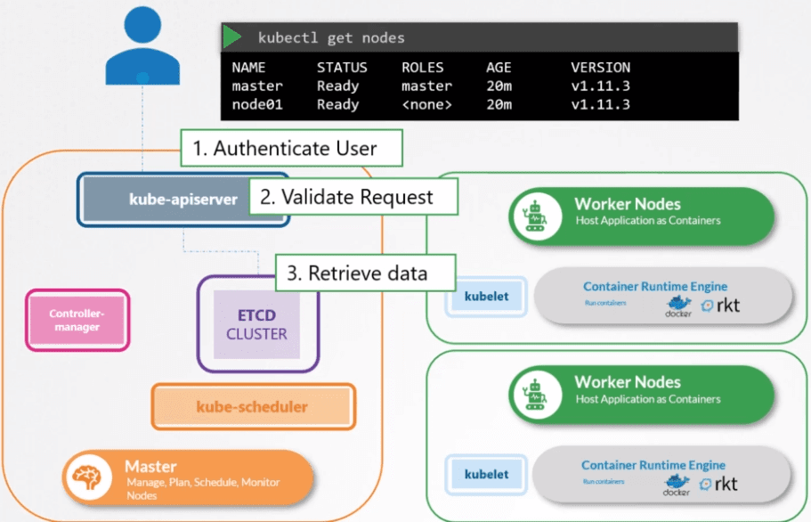

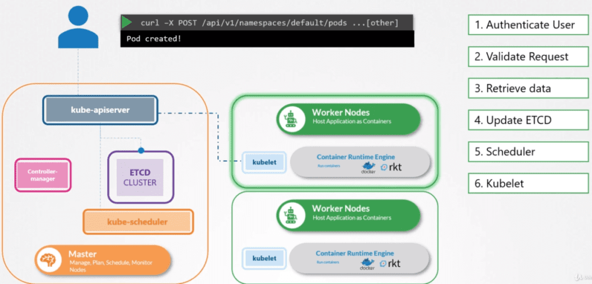

Kubernetes API Server 是整个集群的访问入口，负责验证和配置 Pod、Service、ReplicationController 等 API 对象的数据。它提供 REST 操作，也是访问集群共享状态的前端；其他组件通过它交互。

**访问方式**：对应的程序为 `kube-apiserver`，通过 6443/TCP 对外提供服务。客户端通过 HTTPS 连接 API Server；如果在前端使用负载均衡器（LB），需要采用四层负载均衡。API Server 可比作公司的前台接待，是集群的统一入口。

**状态存储**：API Server 本身无状态，集群数据存储在 etcd 中。

#### 2.3.1.2 kube-controller-manager
```text
https://github.com/kubernetes/kube-controller-manager
https://kubernetes.io/zh-cn/docs/reference/command-line-tools-reference/kube-controller-manager/
```

Controller Manager 是集群内部的管理控制中心，负责 Node、Pod 副本、服务端点（Endpoint）、命名空间（Namespace）、服务账号（ServiceAccount）和资源定额（ResourceQuota）等对象的管理。当 Node 异常宕机时，它会发现故障并执行自动修复，尽可能让集群保持预期的工作状态。

**控制回路**：Controller Manager 根据客户端通过 API 提交的终态声明，持续驱动 API 对象的“实际状态”接近“期望状态”。它作为守护进程运行，对应的程序是 `kube-controller-manager`；内嵌的控制回路不断通过 API Server 监视集群共享状态并作出调整。Kubernetes 自带的控制器包括副本控制器、节点控制器、命名空间控制器和服务账号控制器等。它可比作公司的管理层或大管家，负责管理集群资源。

#### 2.3.1.3 kube-scheduler
```text
https://github.com/kubernetes/kube-scheduler
https://kubernetes.io/zh-cn/docs/reference/command-line-tools-reference/kube-scheduler/
```

kube-scheduler 调度器负责根据当前集群状态，为 Pod 选择最合适的运行节点。对应的程序是 `kube-scheduler`；它可比作公交系统的调度室，负责向相应的 Worker 节点分配工作。

调度程序如何分配这些 Pod？

调度程序会查看每个 Pod，并尝试为其找到最佳节点。例如：

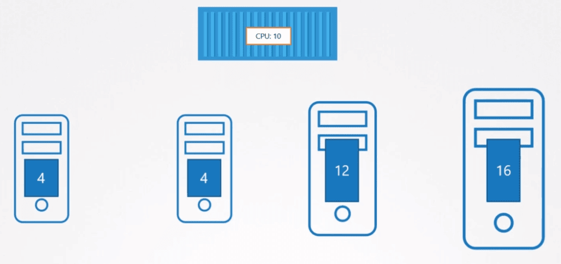

在上图中，Pod 具有 CPU 和内存要求。调度程序将经历 2 个阶段来确定 Pod 的最佳节点。在第一阶段，调度程序尝试筛选出不符合此 Pod 要求的节点。例如，没有 Pod 请求的足够 CPU 和内存资源的节点。因此，前 2 个小节点被过滤掉。

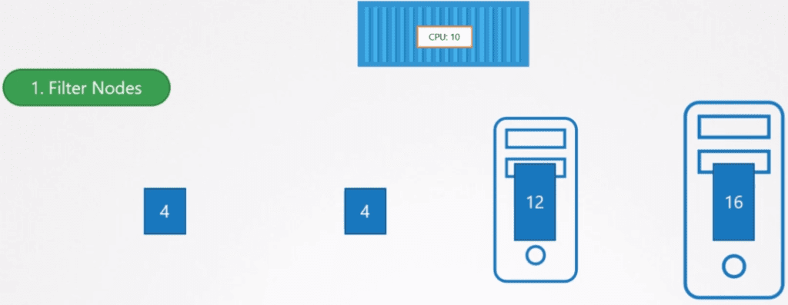

因此，我们现在只剩下 2 个节点，可以放置 pod。现在，调度程序如何从 2 个节点中选择一个节点。在第二阶段，调度程序进一步选出最符合此 Pod 要求的节点。Kube 调度程序对节点进行排名，以确定最适合 Pod 的节点。它使用优先级函数将分数分配给节点，范围为 0 到 10。例如，调度程序计算放置 Pod 后节点上可用的资源数。

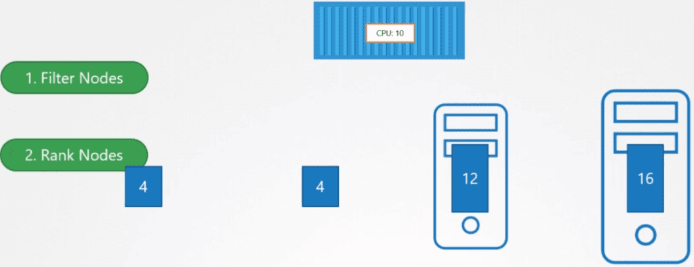

在这种情况下，第 3 个节点将有 2 个 CPU，第 4 个节点有 6 个可用 CPU。因此，与第3个节点相比，第4个节点的排名更好。现在 Kube 调度程序会将 pod 放在第 4 个节点中。

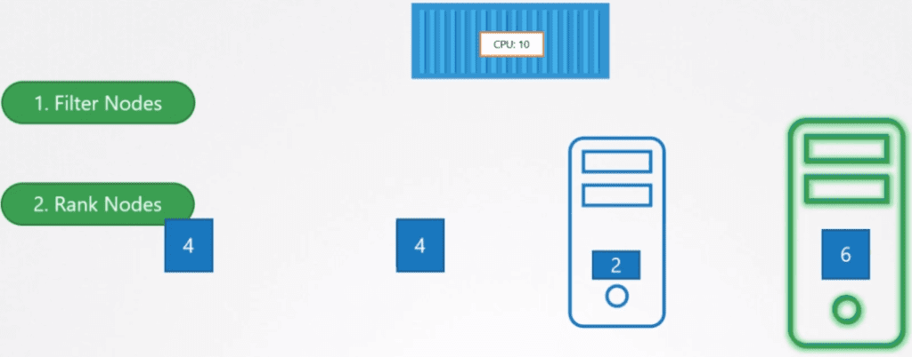

我们可以自定义 Kube 调度程序。您也可以编写自己的计划程序。

#### 2.3.1.4 Cluster Store (etcd)


- <https://github.com/etcd-io/etcd>


Kubernetes 需要使用 key/value数据存储系统 Clustrer Store， 用于保存所有集群状态数据， 支持分布式集群功能。通常为奇数个节点实现,如3,5,7等,通过节点间通过 raft 协议进行选举。Kubernetes 当前使用etcd来实现集群数据存储功能,生产环境使用时需要为 etcd数据提供定期备份机制。etcd 由CoreOS公司用GO语言开发,仅会同API Server交互。

etcd 对应的程序为 etcd

**Etcd 硬件要求**


- <https://etcd.io/docs/v3.5/op-guide/hardware/>


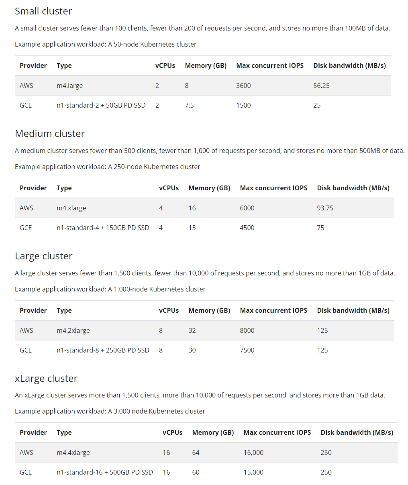

#### 2.3.1.5 cloud-controller-manager (可选)

cloud-controller-manager运行与基础云提供商交互的控制器。cloud-controller-manager二进制文件是Kubernetes 1.6版中引入的alpha功能。cloud-controller-manager允许云供应商的代码和Kubernetes代码彼此独立地发展。在以前的版本中，核心的Kubernetes代码依赖于特定于云提供商的代码来实现功能。在将来的版本中，云供应商专用的代码应由云供应商自己维护，并在运行Kubernetes时链接到云控制器管理器。

以下控制器具有云提供程序依赖性：

**节点控制器**：用于检查云提供程序以确定节点停止响应后是否已在云中删除该节点。

**路由控制器**：用于在基础云基础架构中设置路由

**服务控制器**：用于创建，更新和删除云提供商负载平衡器。

**卷控制器**：用于创建，附加和安装卷，以及与云提供商交互以编排卷。

### 2.3.2 节点组件(工作平面组件)


节点组件在每个worker节点上运行，维护运行中的Pod，并提供Kubernetes运行时环境。

#### 2.3.2.1 kubelet


- <https://github.com/kubernetes/kubelet>
- <https://kubernetes.io/zh-cn/docs/reference/command-line-tools-reference/kubelet/>


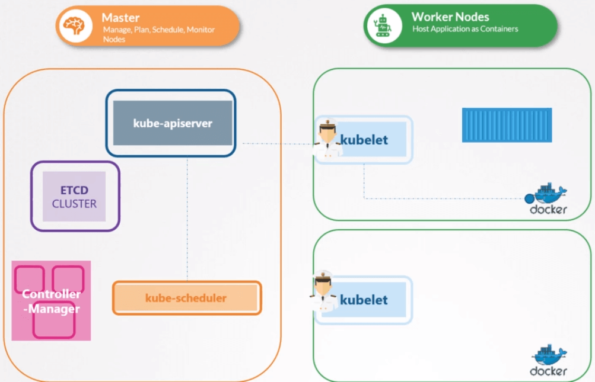

**kubelet** 是运行在每个 Worker 节点上的集群代理，对应程序为 kubelet。它与 Master 节点通信，接收指令，监视并管理分配到本节点的 Pod，向 Master 上报节点与 Pod 的状态。它还负责在 Pod 中创建容器、检查容器健康状态、返回 Pod 运行状态，以及准备 Pod 所需的数据卷。

**kubelet 支持三个主要标准接口**：**CRI**（Container Runtime Interface）连接容器运行时，本材料使用 containerd 实现容器管理。**CNI**（Container Network Interface）供网络插件为 Pod 提供网络功能。**CSI**（Container Storage Interface）提供存储服务的标准接口。

#### 2.3.2.2 kube-proxy


- <https://github.com/kubernetes/kube-proxy>
- <https://kubernetes.io/zh-cn/docs/reference/command-line-tools-reference/kube-proxy/>


**kube-proxy** 是运行在每个 Node 节点上的网络代理，对应程序为 kube-proxy。它将 Service 资源的定义转换为节点本地的网络规则，在主机上维护规则并执行连接转发，使 Service 网络中的流量能够到达后端 Pod，同时承担相应的负载均衡工作。

**代理模式**有两种。**iptables 模式**将 Service 定义转换为适配当前节点的 iptables 规则。**IPVS 模式**将其转换为适配当前节点的 IPVS 规则，并辅以少量 iptables 规则。

范例: 查看当前的模式
```bash
[root@master1 ~]#curl 127.0.0.1:10249/proxyMode
iptables
```

#### 2.3.2.3 Container Runtime

容器运行时负责拉取镜像、创建和运行容器。kubelet 通过 CRI 与运行时通信，常见实现为 containerd 和 CRI-O。Docker Engine 本身不实现 CRI；若要在较新版本的 Kubernetes 中使用它，需要额外的 cri-dockerd 适配器。

### 2.3.3 附件 Addons

插件负责扩展Kubernetes集群的功能的应用程序，通常以Pod形式托管运行于Kubernetes集群之上。插件使用Kubernetes资源来实现集群功能。因为它们提供了集群级功能，所以插件的命名空间资源属于kube-system命名空间。以下 Network 和DNS 插件是必选插件,其余是可选的重要插件。

#### 2.3.3.1 Network 附件

网络插件，经由CNI(Container Network Interface)接口，负责为Pod提供专用的通信网络。当前网络插件有多种实现,目前常用的CNI网络插件有calico和flannel。

#### 2.3.3.2 DNS 域名解析

虽然并非严格要求其他附加组件，但是所有Kubernetes群集都应具有群集DNS，因为许多示例都依赖它。除了传统IT环境中的DNS服务器之外，Kubernetes集群DNS 也是一个专用DNS服务器，它为Kubernetes服务提供DNS记录。由Kubernetes启动的容器会在其DNS搜索中自动包括此DNS服务器，目前常用DNS应用：CoreDNS，kube-dns。

#### 2.3.3.3 外网入口

为服务提供外网入口，如：Ingress Controller，nginx，Contour等。

#### 2.3.3.4 Web UI（Dashboard）

Dashboard仪表板是Kubernetes集群的通用基于Web的UI。它允许用户管理集群中运行的应用程序以及集群本身并进行故障排除。

#### 2.3.3.5 Container Resource Monitoring 容器资源监控

容器资源监视在中央数据库中记录有关容器的一般时间序列指标，并提供用于浏览该数据的用户界面UI。

常用的监控系统: Prometheus

#### 2.3.3.6 Cluster-level Logging 集群级日志

一个集群级别的日志记录机制是负责保存容器日志到提供有搜索和浏览接口的中央日志存储，如：Fluentd-elasticsearch,PLG等。

#### 2.3.3.7 负载均衡器

OpenELB 是适用于非云端部署的Kubernetes环境的负载均衡器，可利用BGP和ECMP协议达到性能最优和高可用性。

## 2.4 Kubernetes 组件间安全通信

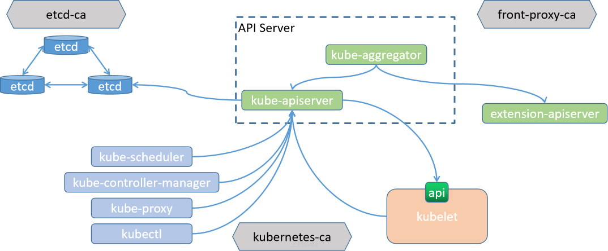

以 kubeadm 建立的集群为例，常见三组 CA 分别用于不同的信任边界：`etcd-ca` 为 etcd 服务端及其客户端证书签名；`ca` 为 Kubernetes API Server 和相关客户端证书签名；`front-proxy-ca` 为 API 聚合层的前端代理客户端证书签名。它们并不等同于“三种节点间通信模式”。
在控制平面执行 `kubeadm certs check-expiration` 可查看由 kubeadm 管理的证书及 CA 的到期时间。原始终端截图被 PDF 抽取成许多独立的 `no` 行，无法直接阅读；下面只保留命令和主要列的含义，实际时间以本集群输出为准：

```bash
kubeadm certs check-expiration
```

输出中 `CERTIFICATE` 表示证书名称，`EXPIRES` 和 `RESIDUAL TIME` 分别表示到期时间与剩余时间，`CERTIFICATE AUTHORITY` 指明签发它的 CA，`EXTERNALLY MANAGED` 表示是否由外部管理。末尾另列出 CA 证书的有效期。若无法读取集群中的 `kubeadm-config`，命令可能回退到默认配置，此时要结合实际部署方式核实结果。

## 2.5 Kubernetes 相关术语

### 2.5.1 Pod

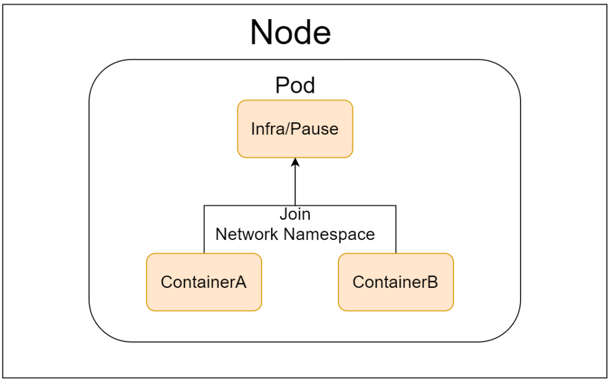

Pod是其运行应用及应用调度的最小逻辑单元。本质上是共享Network、IPC和UTS名称空间以及存储资源的容器集。可将其想象成一台物理机或虚拟机，各容器就是该主机上的进程。各容器共享网络协议栈、网络设备、路由、IP地址和端口等，但Mount、PID和USER仍隔离。

Pod 可挂载 Volume，供其中的一个或多个容器使用；但数据能否在 Pod 删除后保留，取决于卷类型。`emptyDir` 随 Pod 消失，持久卷（PV/PVC）则可按存储与回收策略保留数据。

Pod 具有动态性，删除后可通过资源清单重建，这体现了“不可变基础设施”的思路，也有助于应对误删除或主机故障等异常。设计上，仅应将关系紧密的应用分别放入同一 Pod 的不同容器中。

### 2.5.2 Service

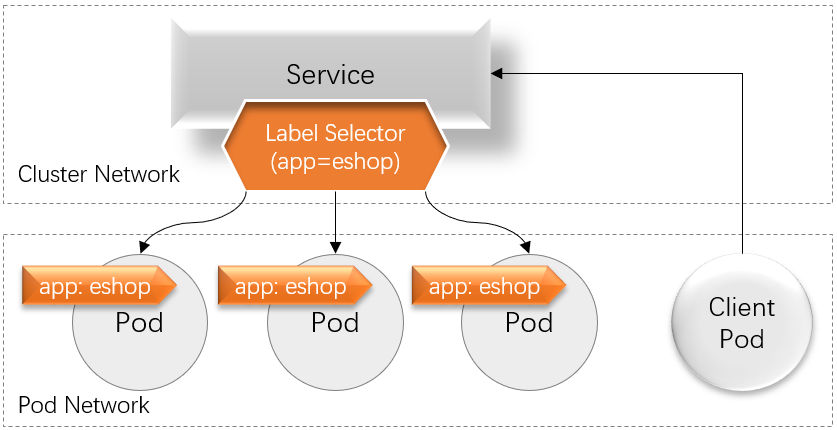

Pod具有动态性，其IP地址也会在基于配置清单重构后重新进行分配，因而需要服务发现机制的支撑。Kubernetes使用Service资源和DNS服务（CoreDNS）进行服务发现。Service能够为一组提供了相同服务的Pod提供负载均衡机制，其IP地址（Service IP，也称为Cluster IP）即为客户端流量入口。一个Service对象存在于集群中的各节点之上，不会因个别节点故障而丢失，可为Pod提供固定的前端入口。

Service 使用标签选择器（Label Selector）匹配 Pod 上的标签（Label）。只有标签符合筛选条件的 Pod 才会被 Service 发现，并作为后端端点使用。

### 2.5.3 Workloads

**Kubernetes Workload Objects（工作负载对象）**

原图展示了工作负载控制器与 Pod、容器之间的关系：

| 对象 | 作用 |
| --- | --- |
| Horizontal Pod Autoscaler | 根据各类指标扩缩 Pod 数量。 |
| Deployment | 创建 ReplicaSet，并负责应用的滚动发布与回滚。 |
| CronJob | 按时间表创建 Job。 |
| ReplicationController | Deployment 的前身，原图提示不再使用。 |
| StatefulSet | 针对有状态应用的需求创建和管理 Pod。 |
| ReplicaSet | 维持期望数量的 Pod 实例。 |
| Job | 创建执行一次性任务的短生命周期 Pod。 |
| DaemonSet | 确保每个符合条件的节点运行一个对应的 Pod。 |
| Pod | Kubernetes 最小的计算资源单元，可包含 1 个或多个容器。 |
| Init Container | 执行启动前任务，例如数据库迁移。 |
| Container | 运行主应用或边车（sidecar）应用。 |

**对象关系**：上述控制器管理 Pod；Pod 包含 Init Container 与普通 Container。

通常不直接管理每一个 Pod，而是通过 Deployment、StatefulSet、DaemonSet、Job 或 CronJob 等工作负载资源声明期望状态。控制器根据模板创建、删除或更新 Pod，并借助标签选择器关联受管对象；节点上的 kubelet 则负责按 Pod 规格启动容器、执行健康探测并报告状态。

各类控制器的目标不同：Deployment 与 ReplicaSet 维持副本数并支持滚动更新；StatefulSet 为有状态副本提供稳定标识；DaemonSet 在符合条件的节点上运行守护 Pod；Job/CronJob 管理一次性和定时任务。需要扩缩容时，还应区分手动修改副本数和 HPA 等自动扩缩机制。

### 2.5.4 Network Model

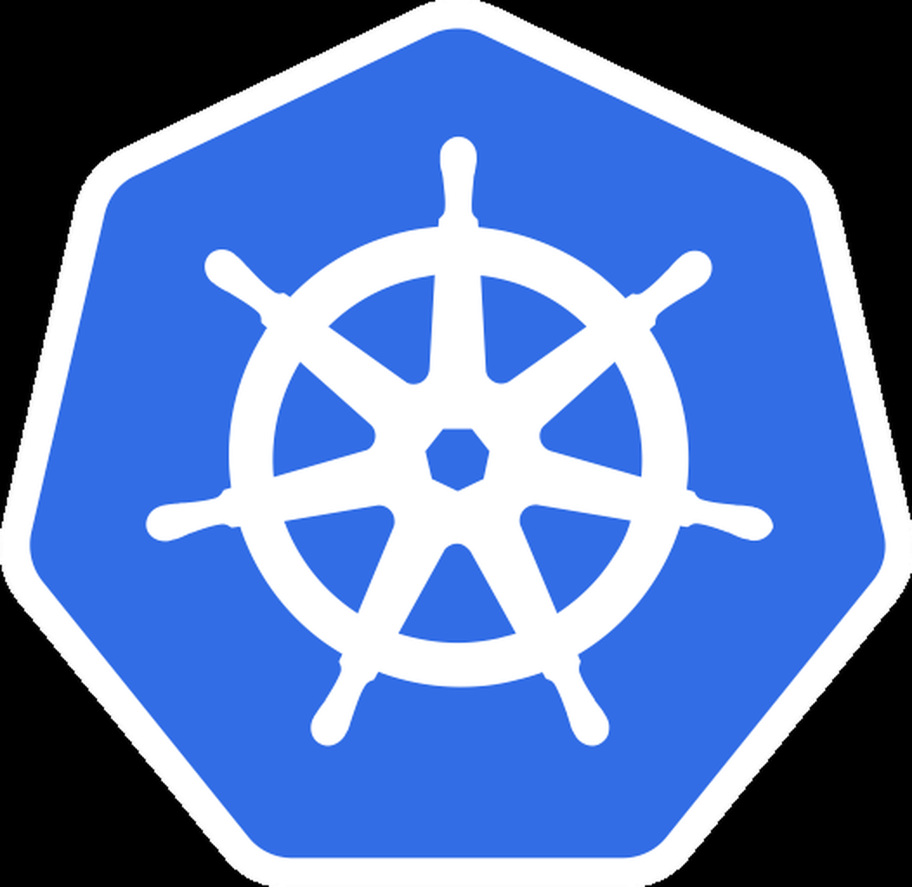

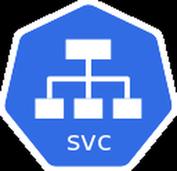

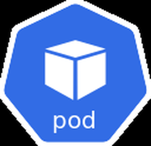

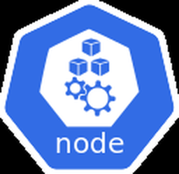

理解 Kubernetes 网络时，可以把节点网络、Pod 网络和 Service 地址段分开：节点网络由基础设施提供；Pod 网络由 CNI 插件建立；Service 的虚拟地址与转发规则由集群组件维护。它们通过路由、网络插件和节点上的转发机制协同工作，不是安装时都必须由 Kubernetes 分配的三张物理网络。

**三个网络功能**

**节点网络**

集群节点间的通信网络，并负责打通与集群外部端点间的通信。节点网络的IP地址配置在集群节点主机的物理接口上。网络及各节点地址需要于Kubernetes部署前完成配置，非由Kubernetes管理。因而，需要由管理员或借助于主机虚拟化管理程序实现。

**Pod网络**

Pod 网络为 Pod 提供可通信的地址。Pod 在创建时分配 IP，重建后 IP 可能变化；通常由 Flannel、Calico、Cilium 等 CNI 插件实现。某些网络方案可让 Pod 地址与节点网络路由直接互通，但具体行为取决于插件和部署方式。

**Service网络**

主要用于解决 pod 使用动态地址问题。在部署Kubernetes集群时指定，各Service对象使用的地址将从该网络中分配。Service网络的IP地址并不配置在任何物理接口,而是存在于每个节点内核中其相关的iptables或ipvs规则中。

Service 地址由 Kubernetes 管理。阅读流量路径时，应分别看：同一 Pod 内容器通过共享网络命名空间通信；不同 Pod 通过 Pod 网络通信；客户端通过 Service 转发到后端 Pod；集群外部流量则通过 NodePort、LoadBalancer、Ingress/Gateway 等入口进入。基本 Pod 网络模型要求 Pod 之间、节点与 Pod 之间可直接通信，不依赖应用自行处理 NAT；具体封装和路由由 CNI 实现。

### 2.5.5 Kubernetes中应用部署一般流程

先选择适合应用的工作负载类型并定义 Pod 模板、资源请求、探针和副本策略；控制器创建 Pod 后，再按访问需求创建 Service，提供稳定的集群内入口。需要外部访问时，另外配置 Ingress、Gateway 或 LoadBalancer，并确认后端就绪与网络策略。

## 2.6 Kubernetes 分层架构

Kubernetes设计理念和功能其实就是一个类似Linux的分层架构，如下图所示。

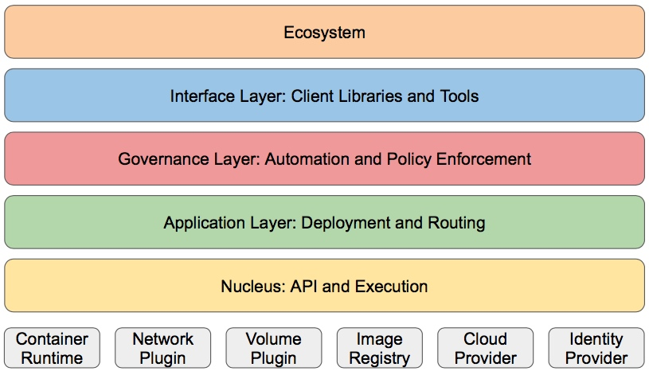

核心层：对应上图的最下面的黄色部分,Kubernetes最核心的功能，对外提供API构建高层的应用，对内提供插件式应用执行环境。

应用层：部署（无状态应用、有状态应用、批处理任务、集群应用等）和路由（服务发现、DNS解析等）。

管理层：系统度量、自动扩缩容、动态卷供给，以及 RBAC、ResourceQuota、NetworkPolicy 等策略管理。PodSecurityPolicy（PSP）已被移除，不应再作为新集群的准入方案。

接口层：kubectl命令行工具、客户端SDK以及集群联邦。

生态系统：在接口层之上的庞大容器集群管理调度的生态系统，可以划分为两个范畴。

集群外部通常还需日志、监控、CI/CD 和配置管理系统；集群内部则依赖 CRI、CNI、CSI 等标准接口以及相应实现。镜像仓库可以部署在集群内或集群外，不属于某一固定层。

## 2.7 Kubernetes 版本

Kubernetes 在2014年10月15日在Github上首次开源发布 v0.4版

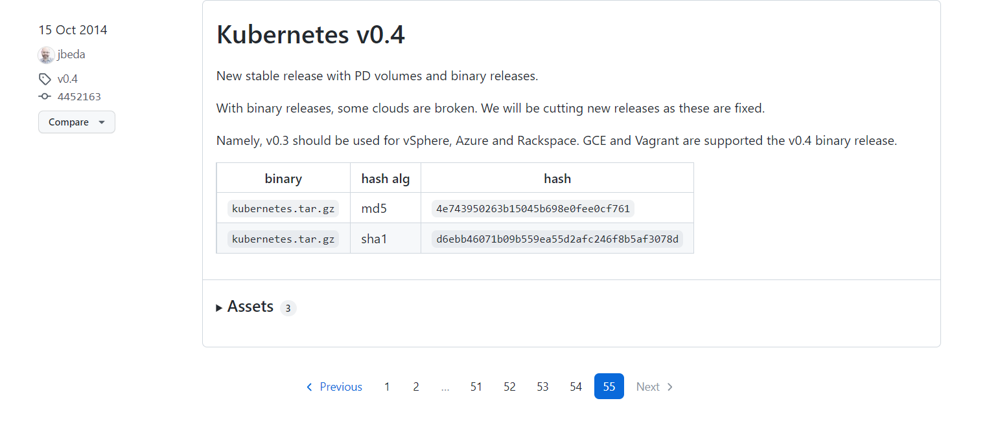

**支持的版本**

Kubernetes 使用 `vX.Y.Z` 版本号：`X` 为主版本，`Y` 为次版本，`Z` 为补丁版本。发布节奏和社区支持窗口会随时间调整，不应只凭此处历史数字规划升级；部署前应查询 Kubernetes 官方发布与版本偏差策略，确认目标版本仍受支持。

**小版本**

控制平面、kubelet 和 kubectl 允许一定的次版本偏差，但允许范围与具体版本、组件有关，不能把早期 `v1.8` 的示例照搬到新集群。升级前应查阅目标版本的[官方版本偏差策略](https://kubernetes.io/zh-cn/releases/version-skew-policy/)，通常先升级控制平面，再逐步升级节点组件。

生产环境建议各个组件都采用相同的版本。

补丁版本

补丁版本通常包含对关键错误的修复。您应该运行给定小版本的最新补丁版本。

## 2.8 Kubernetes 扩展接口

Kubernetes的设计初衷是支持可插拔架构，从而利于扩展kubernetes的功能。

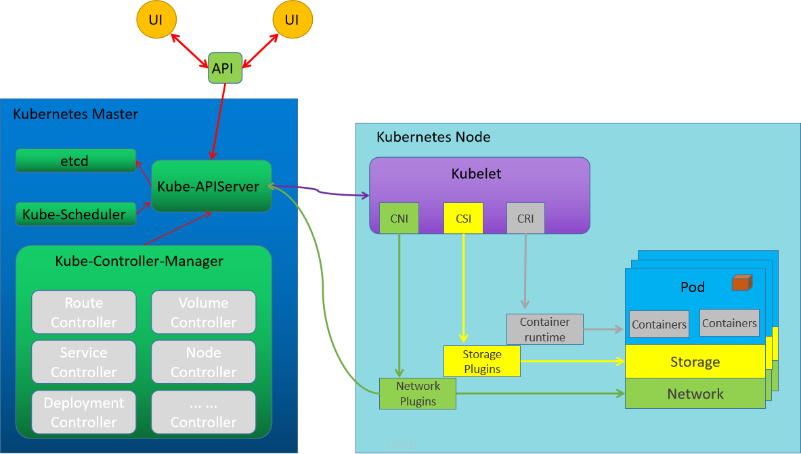

Kubernetes提供了三个特定功能的接口,kubernetes通过调用这几个接口，来完成相应的功能。

| 接口 | 解决的问题 | 常见实现 |
| --- | --- | --- |
| CRI（Container Runtime Interface） | kubelet 如何与容器运行时通信 | containerd、CRI-O |
| CNI（Container Network Interface） | Pod 网络如何配置与连接 | Calico、Flannel、Cilium |
| CSI（Container Storage Interface） | 存储卷如何供给与挂载 | 各类云盘或分布式存储 CSI 驱动 |

CRI 自 Kubernetes 1.5 引入后逐步成为运行时标准接口。CNI 和 CSI 分别让网络、存储能力可插拔；但仅“符合接口”并不保证插件满足集群所需的性能、策略或持久化能力。CSI 驱动并非所有无持久存储需求集群的必备组件。

## 2.9 容器运行时接口（CRI）

CRI是kubernetes定义的一组gRPC服务。Kubelet作为客户端，基于gRPC协议通过Socket和容器运行时通信。CRI 是一个插件接口，它使 kubelet 能够使用各种容器运行时，无需重新编译集群组件。Kubernetes 集群中需要在每个节点上都有一个可以正常工作的容器运行时， 这样 kubelet 能启动 Pod及其容器。容器运行时接口（CRI）是 kubelet 和容器运行时之间通信的主要协议。

CRI 包括两类服务：

**镜像服务（Image Service）**负责拉取、检查和删除镜像；**运行时服务（Runtime Service）**负责 Pod 沙箱和容器的创建、启动、停止与状态查询。kubelet 通过这两组 gRPC 服务管理节点上的工作负载。

**开放容器计划 Open Container Initiative**

OCI 是一个轻量级的开放治理结构（项目），在 Linux 基金会的支持下形成，其明确目的是围绕容器格式和运行时创建开放行业标准。 OCI 于 2015 年 6 月 22 日由 Docker、CoreOS 和容器行业的其他领导者发起。

OCI目前包含两个规范：创建容器的格式和运行时的开源行业标准，包括镜像规范（Image Specification）和运行时规范(Runtime Specification)。 运行时规范概述了如何运行在磁盘上解压的“文件系统包”。 在高层次上，OCI 实现将下载 OCI Image，然后将该图像解压缩到 OCI Runtime 文件系统包中。 此时 OCI Runtime Bundle 将由 OCI Runtime 运行。

2015年6月22日，由Docker公司牵头，CoreOS、Google、RedHat等公司共同宣布，Docker公司将Libcontainer捐给OCI，并更名为runC，一个轻量级的跨平台的容器运行时。 这基本上就是一个命令行小工具，可以直接利用 libcontainer 运行容器，而无需通过 docker engine。runC 的目标是使标准容器在任何地方都可用。与此同时，除了runc之外，Kata、gVisor也符合OCI规范。

**容器运行时**

理解容器运行时可分两个层次：containerd、CRI-O 等较高层组件向 kubelet 提供 CRI 服务并管理镜像与容器生命周期；runc 等较低层组件按 OCI 运行时规范创建容器进程。两层角色不同，不应把“CRI 兼容”与“OCI 兼容”当作同一个条件。


早期 Kubernetes 内置的 dockershim 是适配 Docker Engine 的桥接层，已在 v1.24 移除；它不是独立的通用运行时。现代集群通常直接采用 containerd 或 CRI-O，是否使用 Docker 构建镜像与节点选择何种 CRI 运行时是两件事。

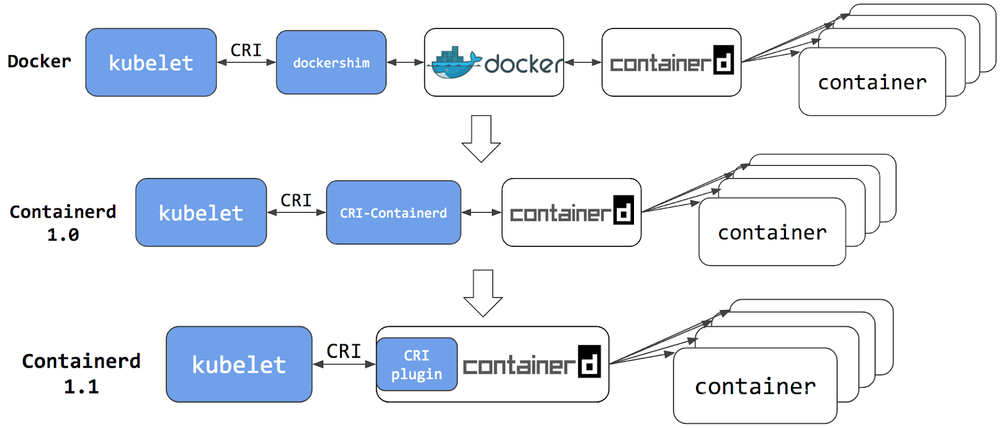

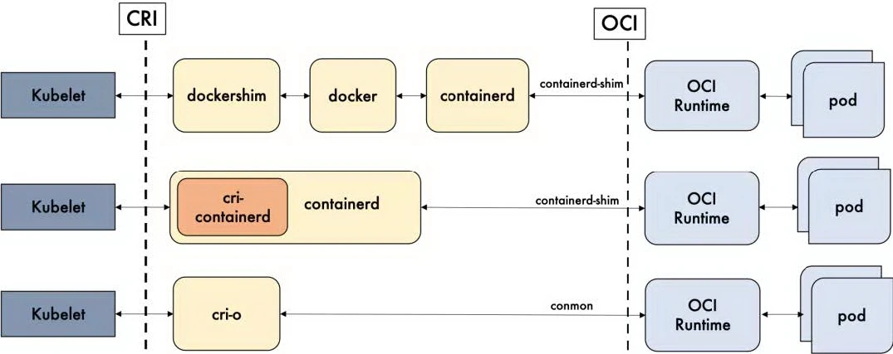

**Kubernetes 和容器运行时通信的方式**
```text
unix:///var/run/dockershim.sock   #基于docker,k8s-v1.23前
unix:///var/run/cri-dockerd.sock  #基于docker,k8s-v1.24后
unix:///run/containerd/containerd.sock #基于containerd
unix:///var/run/crio/crio.sock             #基于cri-o
```

## 2.10 Kubernetes v1.24 之后不再支持 Docker ?

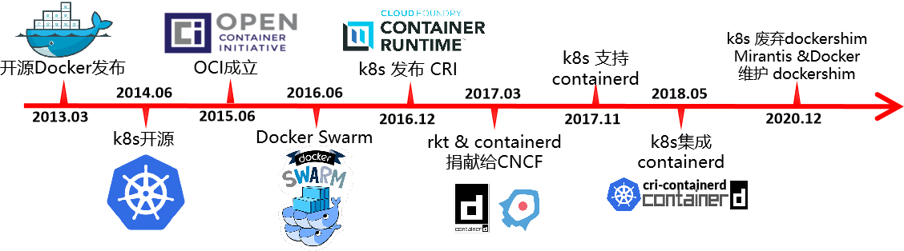

2014年 Docker & Kubernetes 蜜月期

2015~2016年 Kubernetes & RKT vs Docker, 最终Docker 胜出

2016年 Kubernetes逐渐赢得任务编排的胜利

2017年 rkt 和 containerd 捐献给 CNCF

2020年 kubernetes宣布废弃dockershim，但 Mirantis 和 Docker 宣布维护 dockershim

Kubernetes v1.24 从 kubelet 中移除了内置 dockershim，因此 kubelet 不再直接通过内置适配层连接 Docker Engine。**这不影响运行由 Docker 构建的 OCI 镜像**：节点可直接使用 containerd、CRI-O，或在确有需要时另装 cri-dockerd 连接 Docker Engine。

**官方说明**
<https://kubernetes.io/zh-cn/docs/setup/production-environment/container-runtimes/>

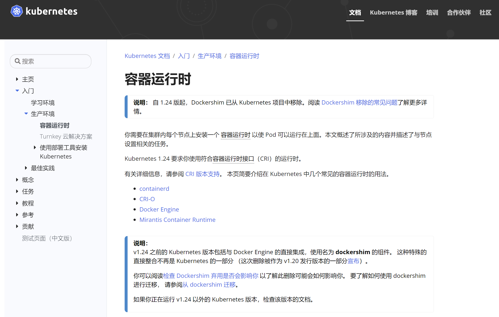

**移除 Dockershim 的说明**


- <https://kubernetes.io/zh-cn/blog/2022/02/17/dockershim-faq/>


**Dockershim的历史背景**


- <https://mp.weixin.qq.com/s/elkfBVzN8-zC30111zFpMw>

```text
Kubernetes CNCF 2022-05-03 10:40 发表于香港
作者：Kat Cosgrove
```


从 Kubernetes v1.24 开始，Dockershim 会给移除，这对于项目来说是个积极的举措。然而，无论是在社会上，还是在软件开发中，上下文对于完全理解某些东西都是很重要的，这值得更深入的研究。在 Kubernetes v1.24 中移除 dockershim 的同时，我们在社区中看到了一些困惑（有时达到恐慌的程度），和对这一决定的不满，很大程度上是由于缺乏关于这移除的上下文。弃用并最终将 dockershim 从 Kubernetes 移除的决定，并不是迅速或轻率做出的。尽管如此，它已经操作了很长时间，以至于今天的许多用户都比这个决定更新，当然也比导致 dockershim 首先成为必要的选择更新。

```text
那么，dockershim 是什么，为什么它会消失？
```


在 Kubernetes 的早期，我们只支持一个容器运行时。那个运行时是 Docker Engine。当时，没有太多其他选择，Docker 是处理容器的主要工具，所以这不是个有争议的选择。最终，我们开始添加更多的容器运行时，比如 rkt 和 hypernetes，很明显 Kubernetes 用户希望选择最适合他们的运行时。因此 Kubernetes 需要种方法，来允许集群操作者灵活地使用他们选择的任何运行时。


发布CRI[1]（Container Runtime Interface，容器运行时接口）就是为了提供这种灵活性。CRI 的引入对项目和用户来说都很棒，但它也引入了一个问题：Docker Engine 作为容器运行时的使用早于 CRI，Docker Engine 与 CRI 不兼容。为了解决这个问题，引入了一个小软件垫片（"shim"，dockershim）作为 kubelet 组件的一部分，专门用于填补 Docker Engine 和 CRI 之间的空白，允许集群运营商继续使用 Docker Engine 作为他们的容器运行时，基本上不会给中断。


然而，这个小小的软件垫片从来就不是永久的解决方案。多年来，它的存在给 kubelet 本身带来了许多不必要的复杂性。由于这个垫片，Docker 的一些集成实现不一致，导致维护人员的负担增加，并且维护特定于供应商的代码不符合我们的开源理念。为了减少这种维护负担，并向一个支持开放标准的更具协作性的社区发展，KEP-2221 获引入[2]，它建议去掉 dockershim。随着 Kubernetes v1.20 的发布，这一弃用成为正式。

我们没有很好地传达这一点，不幸的是，弃用声明导致了社区内的一些恐慌。对于 Docker 作为一家公司来说这意味着什么，由 Docker 构建的容器镜像能否运行，以及 Docker Engine 实际是什么导致了社交媒体上的一场大火。这是我们的过失；我们应该更清楚地沟通当时发生了什么以及原因。为了解决这个问题，我们发布了一个博客[3]和相关的常见问题[4]，以减轻社区的恐惧，并纠正一些关于 Docker 是什么，以及容器如何在 Kubernetes 中工作的误解。由于社区的关注，Docker 和 Mirantis 共同同意以cri-docker[5]的形式继续支持 dockershim 代码，允许你在需要时继续使用 Docker Engine 作为你的容器运行时。为了让那些想尝试其他运行时（如 containerd 或 cri-o）的用户感兴趣，编写了迁移文档[6]。


我们后来对社区进行了调查[7]，发现仍然有许多用户有问题和顾虑[8]。作为回应，Kubernetes 维护者和 CNCF 致力于通过扩展文档和其他程序来解决这些问题。事实上，这篇博文就是这个计划的一部分。随着如此多的最终用户成功地迁移到其他运行时，以及文档的改进，我们相信现在每个人都有了迁移的道路。


无论是作为工具还是作为公司，Docker 都不会消失。它是云原生社区和 Kubernetes 项目历史的重要组成部分。没有他们我们不会有今天。也就是说，从 kubelet 中移除 dockershim 最终对社区、生态系统、项目和整个开源都有好处。这是我们所有人一起支持开放标准的机会，我们很高兴在 Docker 和社区的帮助下这样做。


**Docker 的运行机制**

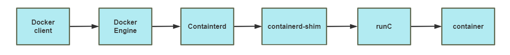

**Kubernetes 调用 Docker 的变化**

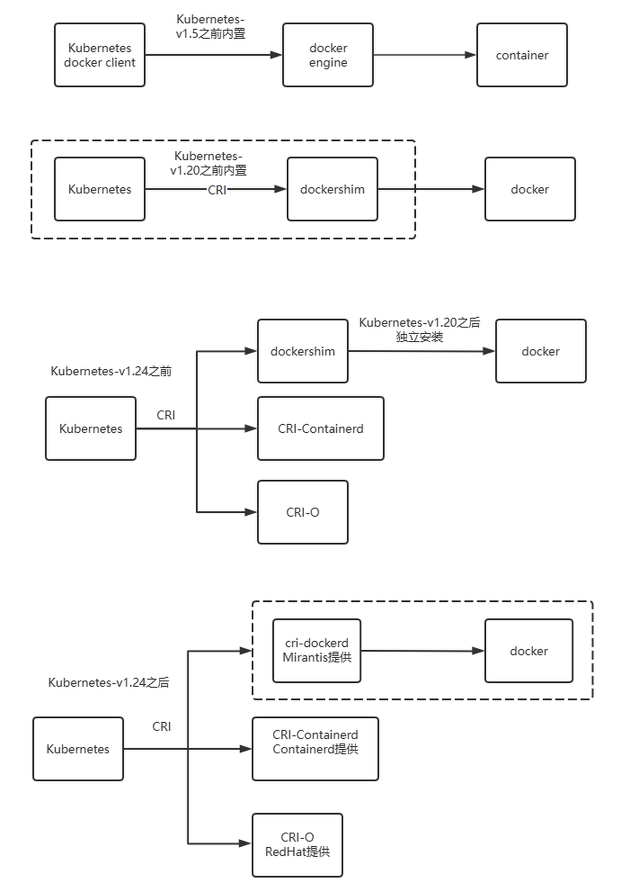

**cri-dockerd 项目**


- <https://github.com/Mirantis/cri-dockerd>


Mirantis 和 Docker 已同意合作，在 Kubernetes 之外独立维护 shim 代码，作为 Docker 引擎 API 的一致 CRI 接口。 对于 Mirantis 客户，这意味着 Docker Engine 的商业支持版本 Mirantis Container Runtime (MCR) 将符合 CRI。 这意味着您可以像以前一样继续基于 Docker 引擎构建 Kubernetes，只需从内置的 dockershim 切换到外部的。Mirantis 和 Docker 打算共同努力确保它继续像以前一样工作，并且它通过所有一致性测试并继续像内置版本一样工作。 Mirantis 将在 Mirantis Kubernetes Engine 中使用它，而 Docker 将继续在 Docker Desktop 中发布这个 shim。


**Kubernetes的CRI方案**

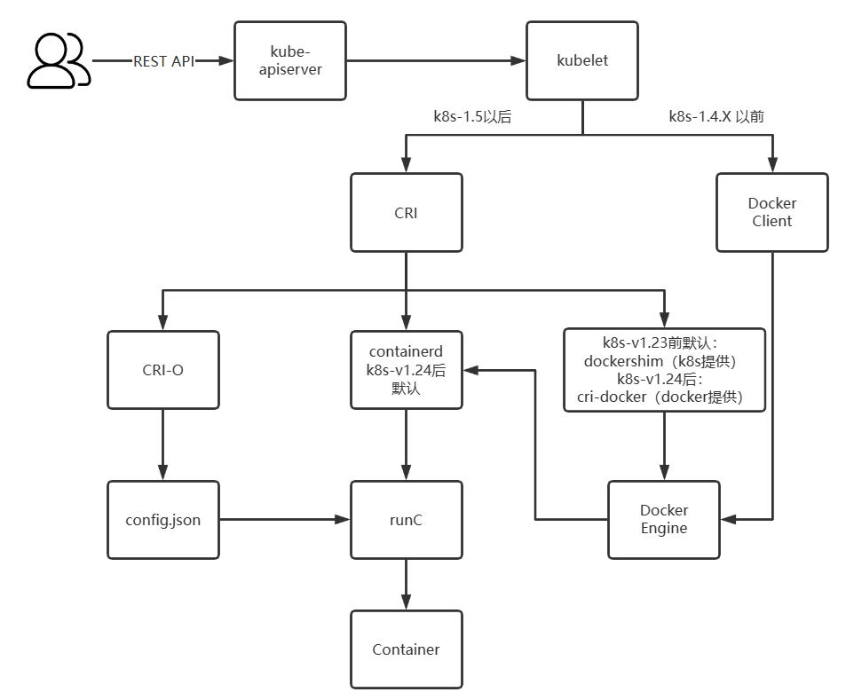

方式1: Containerd

containerd 是常见的 CRI 运行时，但是否默认使用它取决于节点上安装的运行时、kubeadm 配置和发行版，不应假设所有集群相同。

方式2: Docker

Docker Engine 没有实现 CRI， 而这是容器运行时在 Kubernetes 中工作所需要的。因此必须安装一个额外的服务,早期使用由k8s提供的dockershim,但它在 1.24 版本从 kubelet 中被移除。还可以借助于Mirantis维护的cri-dockerd插件方式来实现Kubernetes集群的创建。

cri-dockerd 项目站点: https://github.com/Mirantis/cri-dockerd

方式3: CRI-O

CRI-O 专为 Kubernetes 的 CRI 接口设计，可与 OCI 运行时配合创建容器。部署时先安装与 Kubernetes 版本兼容的 CRI-O，再配置 kubelet 使用其 CRI socket；它不是安装在 Docker 上的插件。



<nav class="article-end" aria-label="章节导航">
  <a href="{{ '/subjects/Kubernetes/' | relative_url }}">返回 Kubernetes 目录</a>
  <a href="{{ '/subjects/Kubernetes/02-deployment-overview.html' | relative_url }}">下一章：部署模型与 Minikube →</a>
</nav>
