[← 返回 Kubernetes 目录]({{ '/subjects/Kubernetes/' | relative_url }})



# 02 部署模型与 Minikube

# 3 Kubernetes 集群部署

本篇先区分控制平面的运行方式，再比较适合练习与生产的安装工具，最后用 Minikube 运行一个本地集群。原资料中的版本号与命令输出保留为历史示例，实际部署应以所选 Kubernetes 版本的官方文档为准。

## 3.1 Kubernetes 集群组件运行模式

**独立组件模式**

一种方式是把 API Server、Controller Manager、Scheduler 等控制平面组件直接安装为宿主机进程，由 systemd 等管理。这样便于逐个观察组件，但需要自行处理证书、配置、启动顺序和升级。DNS 等附加组件通常仍以 Pod 运行。

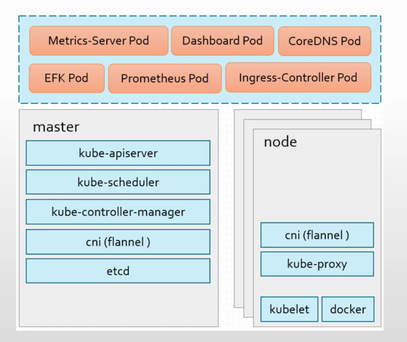

**静态 Pod 模式**

另一种方式是由每台控制平面节点上的 kubelet 根据本地清单文件启动 API Server、Controller Manager、Scheduler 等静态 Pod。静态 Pod 不依赖 API Server 下发的调度指令，但其容器仍由节点上的容器运行时执行。**容器运行时不等于 Docker**：现代集群通常使用符合 CRI 的 containerd 或 CRI-O。`kube-proxy` 等工作负载组件通常以 DaemonSet 部署，而不是静态 Pod。

`kubeadm` 常采用静态 Pod 方式初始化控制平面。较新的官方镜像仓库是 `registry.k8s.io`；旧资料中的 `k8s.gcr.io` 已不宜作为新部署的默认地址。

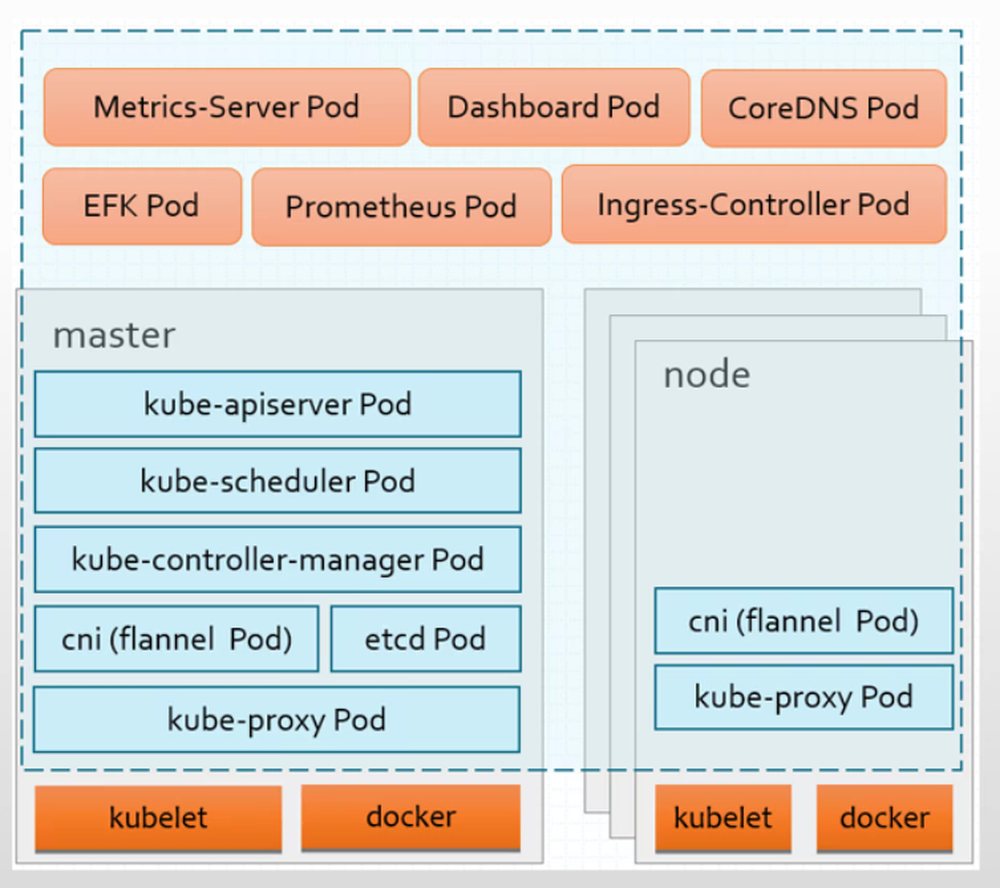

## 3.2 部署方法介绍和架构

### 3.2.1 部署方法

部署方法应按目标环境选，而不是只看工具数量。CNCF 的一致性认证可帮助核对发行版对 Kubernetes API 的兼容性，但**认证不等于部署、升级和备份都自动可靠**；原资料中的“23 种”是历史快照，不作为当前数量。


- <https://www.cncf.io/certification/software-conformance/>


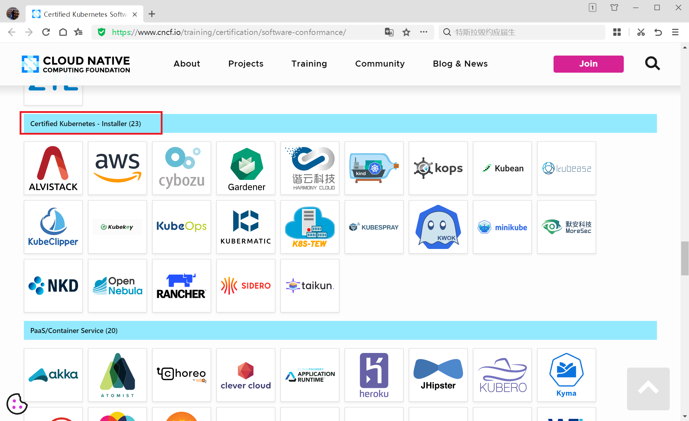

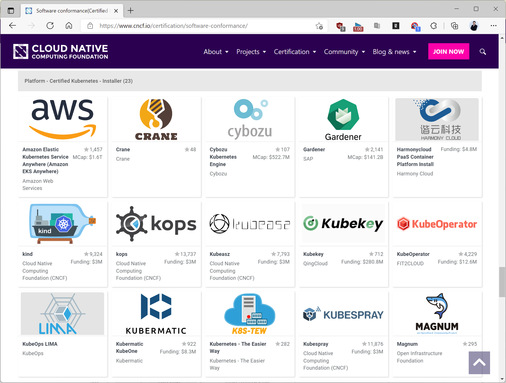


- <https://landscape.cncf.io/?group=certified-partners-and-providers>


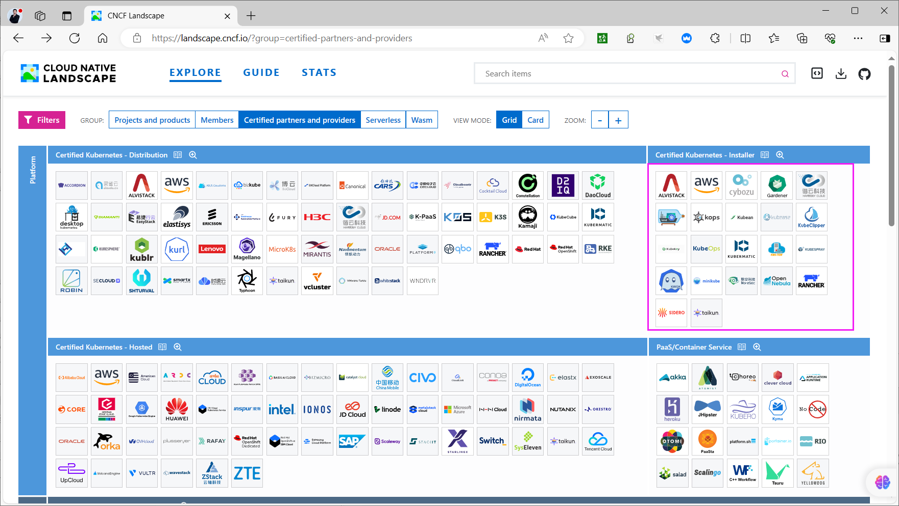
<https://docs.google.com/spreadsheets/d/1uF9BoDzzisHSQemXHIKegMhuythuq_GL3N1mlUUK2h0/edit#gid=0>

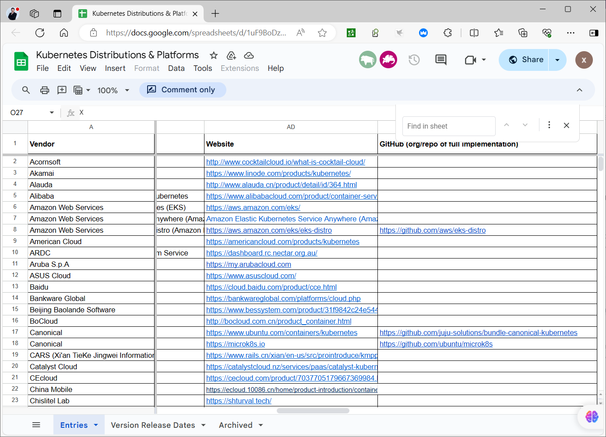

常见方法可按用途分为本地练习、官方初始化、自动化部署和托管服务：

**Minikube**：在本地创建练习集群，适合学习 Pod、Service 和基本运维命令，不应直接当作生产高可用方案。

官方文档：<https://minikube.sigs.k8s.io/docs/start/>

**kubeadm**：负责初始化控制平面并让节点加入集群，适合需要自行管理 Kubernetes 的环境。`kubeadm init` 和 `kubeadm join` 只是关键步骤；投入使用前还要规划容器运行时、网络插件、证书、升级、etcd 备份和高可用入口。它既可用于学习，也可用于生产，前提是上述运维责任有人承担。

官方链接：https://kubernetes.io/docs/reference/setup-tools/kubeadm/kubeadm/

官方安装链接：https://kubernetes.io/docs/setup/production-environment/tools/kubeadm/install-kubeadm/

Kubespray、KubeKey、Sealos、RKE、kOps 等工具提供不同程度的自动化，但实现原理与适用平台并不相同。`kind` 主要用于本地开发和 CI 测试，不能简单与生产集群安装工具归为同一类。

**手动二进制部署**：

逐个下载并配置组件，有助于理解控制平面和证书链，但安装与后续升级复杂。它不因为“手动”就天然更适合生产；选择前应评估团队维护能力和可重复部署方案。

官方下载链接：

https://github.com/kubernetes/kubernetes/releases

https://github.com/kubernetes/kubernetes/blob/master/CHANGELOG/CHANGELOG-1.18.md#downloads-for-v1182

**使用发行包安装组件**：`kubelet`、`kubeadm`、`kubectl` 等可通过对应版本的软件仓库安装，但“安装软件包”不等于“集群已部署”。旧资料中的 `packages.cloud.google.com` 地址已不宜照抄；新部署应按 [Kubernetes 官方安装文档](https://kubernetes.io/docs/setup/production-environment/tools/kubeadm/install-kubeadm/) 选择与目标版本对应的仓库。

**使用自动化工具或托管集群**：

Ansible 类工具可以把节点初始化、组件安装和配置变更变成可重复流程，但仍需要设计版本升级、备份和故障恢复。云厂商的托管集群会接管部分控制平面工作，代价是依赖平台接口与计费模式。

参考链接：

https://github.com/easzlab/kubeasz

https://landscape.cncf.io/

Kubespray 文档应从项目仓库当前版本的 README 进入，避免使用无效的旧链接。

**Rancher**

Rancher 更偏向**管理多个 Kubernetes 集群的平台**：既能导入已有集群，也能在受支持的环境中创建集群，并集中提供身份、权限和集群可视化管理。它解决的是跨集群运维问题，不能与 `kubeadm` 这种单集群初始化工具简单画等号。选择前应核对当前版本支持的集群类型和升级路径。

官方网站:


- <https://rancher.com/>


**中文文档**


- <https://www.rancher.cn/>


**Sealos**

Sealos 提供 Kubernetes 集群部署与管理能力，部分场景支持离线安装。选用时应核对当前版本支持的 Kubernetes 版本、运行时、网络方案和升级路径，而不是依据“稳定性极高”或证书年限等宣传描述做决定。

**官方网站**


- <https://www.sealyun.com/>


gitee


- <https://gitee.com/mirrors/sealos>


参考链接：<https://blog.csdn.net/m0_46700908/article/details/123848539>

比较上述方案时，可列出自己的约束：是否需要离线部署、目标节点数量、是否已有云平台、谁负责控制平面升级，以及发生 etcd 故障时如何恢复。只有这些问题得到答案，“安装只需一条命令”才有实际意义。


### 3.2.2 部署架构

#### 3.2.2.1 堆叠式 etcd

控制平面节点同时运行 etcd，节点数量较少、部署相对直接，但控制平面与 etcd 的故障域相同。生产环境通常使用奇数个 etcd 成员以便形成多数派；仍需为 API Server 准备稳定入口，并定期备份 etcd。

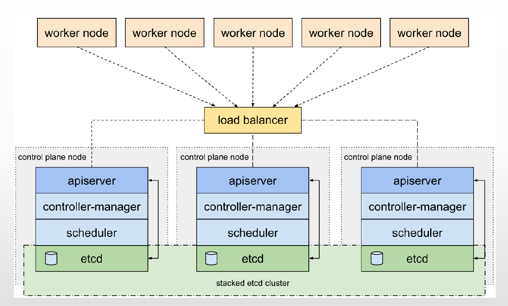

#### 3.2.2.2 外置 etcd

etcd 在独立节点上运行，控制平面与存储层可以分别扩缩容，代价是更多主机、证书和运维步骤。选择哪种拓扑，要结合节点数量、故障域与恢复目标，而不是只看图中组件是否分开。

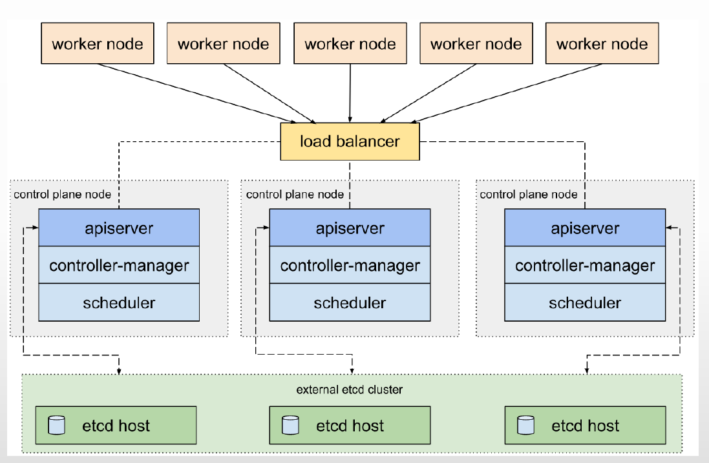

## 3.3 运行 Minikube 本地集群

Minikube 适合在本机练习 Kubernetes 命令。先按 [官方安装页](https://minikube.sigs.k8s.io/docs/start/) 确认操作系统、CPU 架构、容器驱动和可用内存。原资料使用较旧版本，下面只提炼仍有价值的故障信号，不把旧终端记录当作今天的安装脚本。

### 3.3.1 安装并启动


- <https://minikube.sigs.k8s.io/docs/start/>


若在 Linux 上使用 Docker 驱动，先安装并验证 Docker，再安装与本机架构匹配的 Minikube。**不要仅为运行 Minikube 给用户配置免密 sudo 或随意加入高权限组**；应遵循组织已有的主机权限策略。以下给出启动与验证的最小流程，实际安装步骤以官方文档为准：

```bash
minikube start --driver=docker
minikube status
minikube kubectl -- get nodes
minikube kubectl -- get pods -A
```

原资料记录了 Minikube v1.25.2 启动 Kubernetes v1.23.3 的过程。它出现两个值得理解的信号：**内存不足警告**表示宿主机需要留出运行余量；**镜像仓库访问失败**表示需要检查网络或镜像源，而不是直接判定 Kubernetes 组件故障。旧日志把 `AGE` 列拆成多行、混入下载进度，不利于阅读，因此这里保留结论而不保留逐字输出。

验证时重点看 `minikube status` 是否显示控制平面与 kubelet 正常、`get nodes` 中节点是否为 `Ready`，以及 `get pods -A` 中系统 Pod 是否稳定运行。若启动失败，可先检查 `minikube logs`，再根据错误判断是资源、驱动还是网络问题。不要把某次示例的 Pod 名称、版本号或镜像地址当作通用预期值。

### 3.3.2 在线交互练习

如果暂时不方便在本机安装，可使用官方教程提供的在线练习环境，先熟悉 `kubectl` 对 Pod、Deployment 和 Service 的基本操作。在线环境通常是临时的，不能用于保存长期实验数据。


- <https://kubernetes.io/docs/tutorials/hello-minikube/>


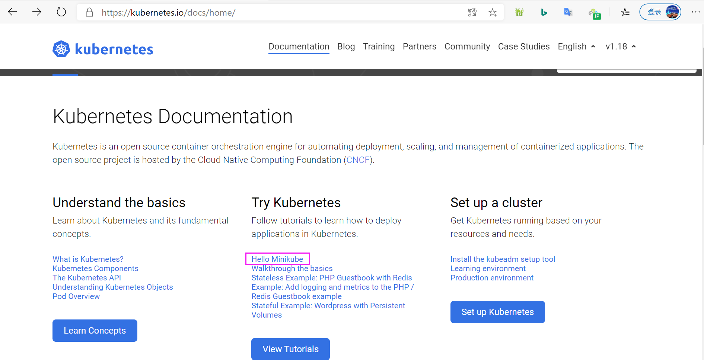

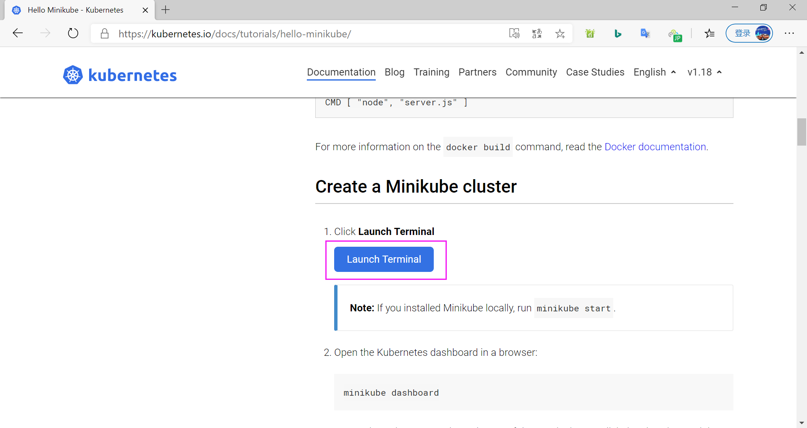

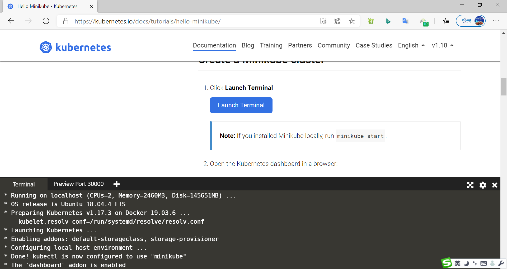

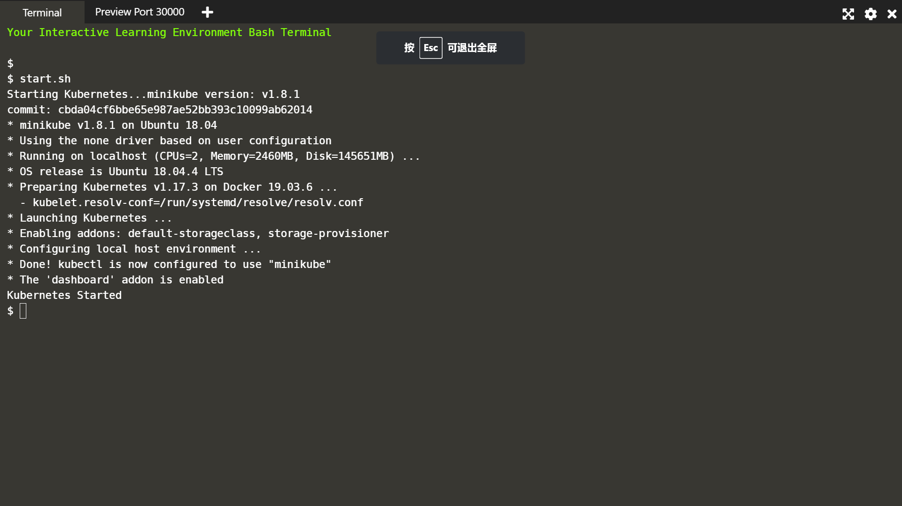

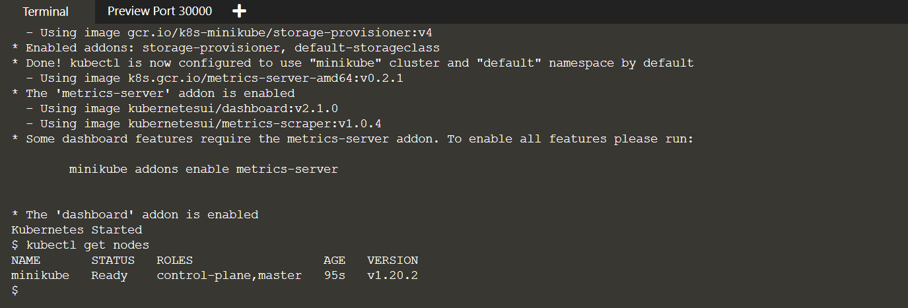

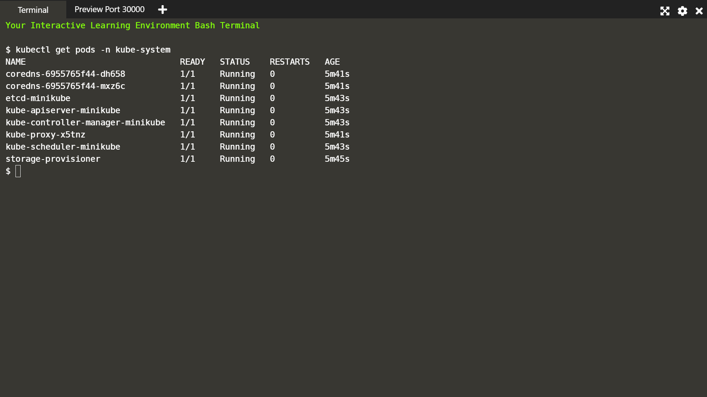



<nav class="article-end" aria-label="章节导航">
  <a href="{{ '/subjects/Kubernetes/01-cloud-native-architecture.html' | relative_url }}">← 上一章：云原生生态与 Kubernetes 架构</a>
  <a href="{{ '/subjects/Kubernetes/' | relative_url }}">返回 Kubernetes 目录</a>
  <a href="{{ '/subjects/Kubernetes/03-kubeadm-docker-ha.html' | relative_url }}">下一章：Kubeadm 与 Docker 高可用部署 →</a>
</nav>
