[← 返回 Kubernetes 目录]({{ '/subjects/Kubernetes/' | relative_url }})



# 02 部署模型与 Minikube

# 3 Kubernetes 集群部署

## 3.1 Kubernetes 集群组件运行模式

**独立组件模式**

各关键组件以二进制方式部署在主机节点上，并以守护进程运行。附件（Add-ons）则以 Pod 形式运行。此模式需要自行申请和颁发各类证书，因此部署过程较为繁琐。

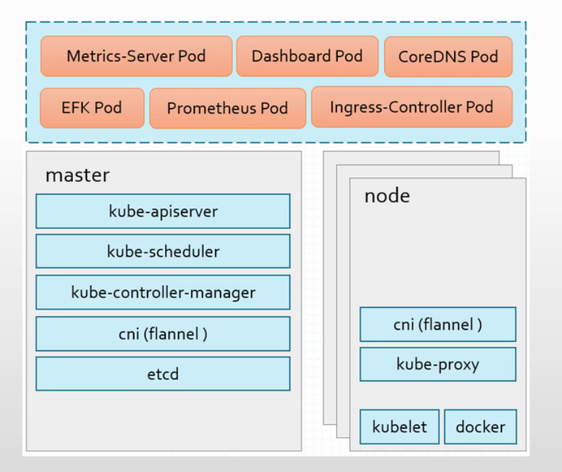

**静态Pod模式**

在静态 Pod 模式下，kubelet 和容器运行时 Docker 以二进制守护进程部署，其他组件以 Pod 形式运行。控制平面组件作为静态 Pod 运行在 Master 主机上，由 kubelet 创建和管理，不依赖 kube-apiserver 等控制平面组件。kube-proxy 等组件也以 Pod 形式运行。

相关pod早期是从仓库k8s.gcr.io下载镜像，新版改为仓库registry.k8s.io。使用kubernetes官方提供的kubeadm工具实现kubernetes集群方便快速的部署。


## 3.2 部署方法介绍和架构

### 3.2.1 部署方法

Kubernetes 部署方式有很多,建议使用CNCF认证的安装方法进行安装,当前有23钟安装方式通过了CNCF认证。


- <https://www.cncf.io/certification/software-conformance/>


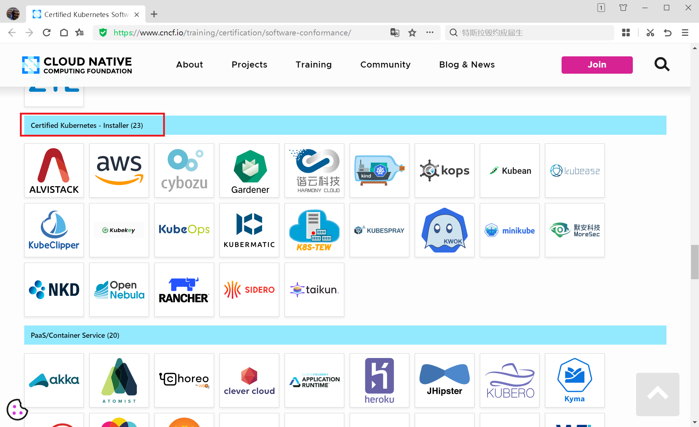

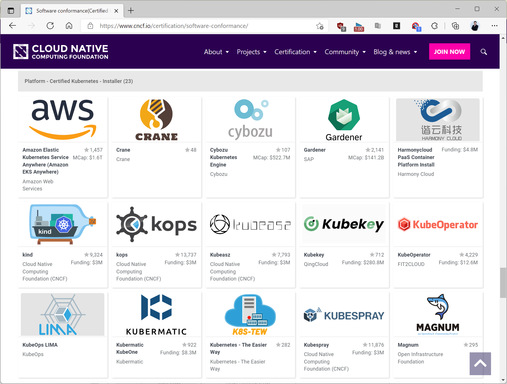


- <https://landscape.cncf.io/?group=certified-partners-and-providers>


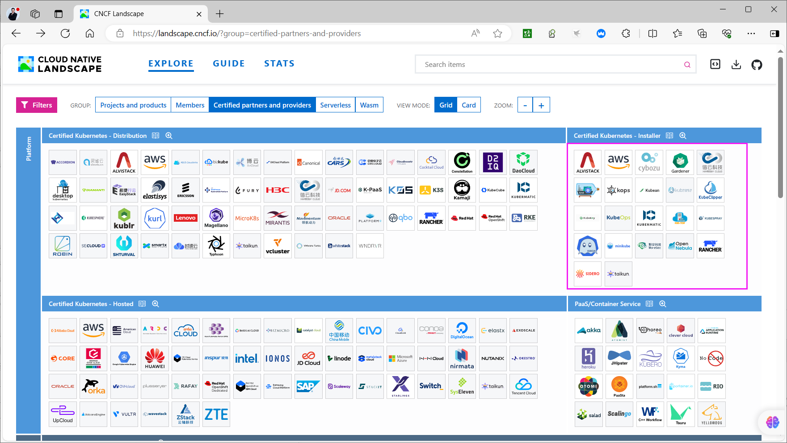
```text
https://docs.google.com/spreadsheets/d/1uF9BoDzzisHSQemXHIKegMhuythuq_GL3N1mlUUK2h0/edit#gid=0
```

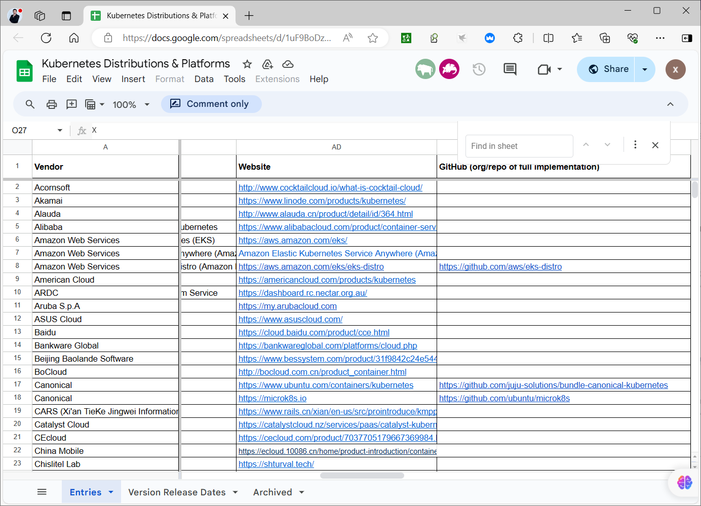

常见的安装方法如下:

**Minukube**：是一个工具，可以在本地快速运行一个单点的kubernetes，用于体验和初步了解。

官方链接：https://kubernetes.io/docs/setup/learning-environment/minikube/

**kubeadm**：Kubeadm 是在 Kubernetes 1.4 版本中首次引入的，于2016年9月发布。它的目的是提供一个简单易用的方式来初始化和管理 Kubernetes 集群。随着 Kubernetes 的不断发展，kubeadm 也在不断更新和改进，成为了 Kubernetes 官方推荐的集群初始化工具之一。Kubeadm 只需要两个简单命令 kubeadm init和kubeadm join即可方便的实现安装，但不利于了解kubenetes的底层细节，适合初学者入门学习使用，早期版本在开发或测试环境使用较多,当前已经生产可用。

官方链接：https://kubernetes.io/docs/reference/setup-tools/kubeadm/kubeadm/

官方安装链接：https://kubernetes.io/docs/setup/production-environment/tools/kubeadm/in stall-kubeadm/

当前有很多kubernetes的安装方法都是kubeadm二次封装,比如:kubespray,kubekey,Sealos,Rancher Kubernetes Engine,Kops,Kubicorn,kind等。

二进制安装：

从官方下载发行版的二进制相关包，手动部署安装每个组件，最终实现kubernetes集群，部署过程复杂，后期维护对技术要求高，必须对kubernetes有较深入的理解才可实现，对于初学者不推荐，适合于生产环境使用。

官方下载链接：

https://github.com/kubernetes/kubernetes/releases

https://github.com/kubernetes/kubernetes/blob/master/CHANGELOG/CHANGELOG-1.18.md#downloads-for-v1182

yum/apt 源安装：

**利用 yum 和 apt 源进行安装**

官方源：

https://packages.cloud.google.com/apt/

https://packages.cloud.google.com/yum

阿里源：

https://developer.aliyun.com/mirror/kubernetes?spm=a2c6h.13651102.0.0.3e221b11na6DD C

https://mirrors.aliyun.com/kubernetes/

**使用批量部署工具**

使用自动化运维工具，如：ansible/saltstack实现快速kubernetes的部署，部署快，要求较低，后期维护方便。

参考链接：

https://github.com/easzlab/kubeasz

https://landscape.cncf.io/

Readme (kubespray.io)

Rancher

Rancher 最初是为了支持多种容器编排引擎而构建的，其中包括 Rancher 自己的容器编排引擎Cattle。随着 Kubernetes 的兴起，Rancher 2 开始转向部署和管理在任何地方、任何提供商上运行的 Kubernetes 集群。Rancher 可以创建来自 Kubernetes 托管服务提供商的集群，创建节点并安装 Kubernetes，或者导入在任何地方运行的现有 Kubernetes 集群。Rancher 基于 Kubernetes 添加新的功能，包括统一所有集群的身份验证和 RBAC，让系统管理员从一个位置控制全部集群的访问。

此外，Rancher 可以为集群和资源提供更精细的监控和告警，将日志发送到外部提供商，并通过应用商店（Application Catalog）直接集成 Helm。如果你拥有外部 CI/CD 系统，你可以将其与Rancher 对接。没有的话，你也可以使用 Rancher 提供的 Fleet 自动部署和升级工作负载。Rancher 是一个 全栈式 的 Kubernetes 容器管理平台，为你提供在任何地方都能成功运行Kubernetes 的工具。

官方网站:


- <https://rancher.com/>


**中文文档**


- <https://www.rancher.cn/>


Sealos

Sealos是一个Go语言开发的简单且轻量的Kubernetes集群部署工具，支持离线安装，工具使用简单，工具与部署资源包分离，稳定性极高，排查故障简单并且方便在不同版本间快速升级，并且拥有100年证书。

**官方网站**


- <https://www.sealyun.com/>


gitee


- <https://gitee.com/mirrors/sealos>


参考链接：<https://blog.csdn.net/m0_46700908/article/details/123848539>

Sealos诞生的过程是很有趣的。K8s早期版本时，官网上找不到可用度高的安装工具。最初的方海涛写了一个可用度较高的安装脚本放在阿里云市场上，有很多人下载，可见需求量之多。但是此脚本也存在很多问题，程序十分复杂。于是第二个版本——ansible诞生了。但ansible只是使用起来方便许多，并没有解决根本的安装复杂问题，很多用户安装ansible本身都不成功，特别是在离线的环境中更容易出错，需要把ansible放到docker中。为了解决这个问题，他思考了很长时间，最后在kubeproxy源码上找到了灵感。借用负载均衡器的实现方式，去掉很重的组件，使整个脚本变得简单，于是第三个版本 golang解决了以往的问题。把事情做到简单极致，一条命令解决一切。Sealos已经诞生三年，即使在今天依然非常先进，这也是Sealos有竞争力的地方。


Sealos从诞生之日起就是商业化的，最早的脚本便放在市场上进行售卖了。在云市场上架，人工审核要一周的时间，需要人为催促或者手动上传，整个过程非常消耗精力和时间。为了解决这个问题，方海涛创造一个网站售卖Sealos，机器人通过网站的API将Sealos传到云市场，保持最快的更新速度。整个过程全部由机器人自动构建、自动测试、自动上架。


早期开发团队的运营每天写代码写到24点左右，之后开始在云市场上找客户，拿到他们的联系方式与他们联络，积累了一些种子客户。后续的发展主要通过技术博客引流，目前已经到了用户口碑传播的阶段，真正进入了爆发期，甚至有一段时间短短两周的增长超过之前两年总和。所以把作品做到极致是实现爆发增长的必要因素，在产品还不够极致时去推广很多时候反而适得其反。


### 3.2.2 部署架构

#### 3.2.2.1 HA topology - stacked etcd

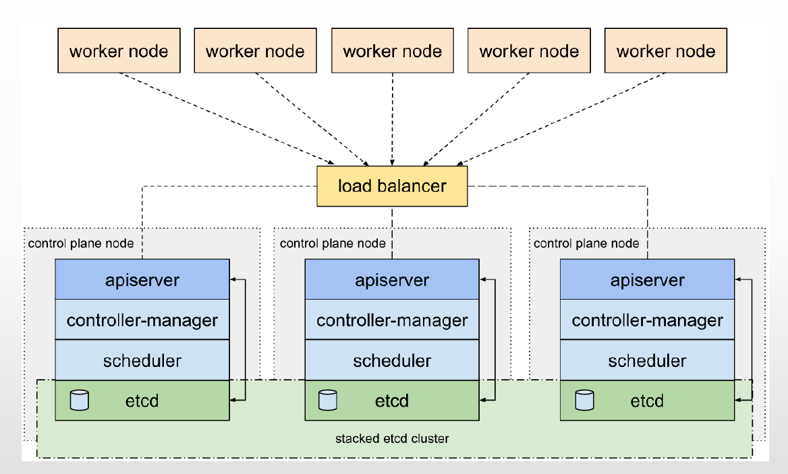

#### 3.2.2.2 HA topology - external etcd

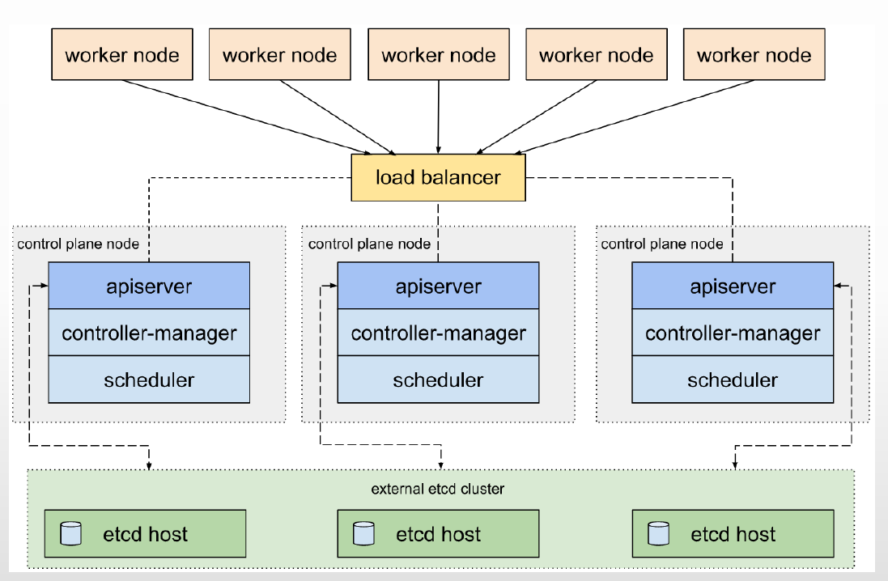

## 3.3 运行 Minikube cluster

有两种方法使用Minikube cluster

### 3.3.1 手动部署 Minikube cluster


- <https://minikube.sigs.k8s.io/docs/start/>


示例:
```bash
#安装docker
[root@ubuntu2004 ~]#apt update && apt install docker.io

#创建普通用户并授权
[root@ubuntu2004 ~]#useradd -G docker -m -s /bin/bash  bowen
[root@ubuntu2004 ~]#vim /etc/sudoers
bowen ALL=(ALL) NOPASSWD: /usr/bin/docker

#下载并部署
[root@ubuntu2004 ~]#su - bowen
[bowen@ubuntu2004 ~]$curl -LO
https://storage.googleapis.com/minikube/releases/latest/minikube-linux-amd64
[bowen@ubuntu2004 ~]$sudo install minikube-linux-amd64 /usr/local/bin/minikube

#启动,注意:内存必须大于3G才能启动
[bowen@rubuntu2004 ~]$minikube start
* minikube v1.25.2 on Rocky 8.4
* Automatically selected the docker driver. Other choices: none, ssh
```


X The requested memory allocation of 1950MiB does not leave room for system overhead (total system memory: 1950MiB). You may face stability issues.* Suggestion: Start minikube with less memory allocated: 'minikube start --memory=1950mb'

```bash
* Starting control plane node minikube in cluster minikube
* Pulling base image ...
* Downloading Kubernetes v1.23.3 preload ...
> preloaded-images-k8s-v17-v1...: 505.68 MiB / 505.68 MiB  100.00% 4.99 MiB
> index.docker.io/kicbase/sta...: 379.06 MiB / 379.06 MiB  100.00% 1.59 MiB
! minikube was unable to download gcr.io/k8s-minikube/kicbase:v0.0.30, but
successfully downloaded docker.io/kicbase/stable:v0.0.30 as a fallback image
* Creating docker container (CPUs=2, Memory=1950MB) ...
! This container is having trouble accessing https://k8s.gcr.io
* To pull new external images, you may need to configure a proxy:
https://minikube.sigs.k8s.io/docs/reference/networking/proxy/
* Preparing Kubernetes v1.23.3 on Docker 20.10.12 ...
- kubelet.housekeeping-interval=5m
- Generating certificates and keys ...
- Booting up control plane ...
- Configuring RBAC rules ...
* Verifying Kubernetes components...
- Using image gcr.io/k8s-minikube/storage-provisioner:v5
* Enabled addons: default-storageclass, storage-provisioner
* kubectl not found. If you need it, try: 'minikube kubectl -- get pods -A'
* Done! kubectl is now configured to use "minikube" cluster and "default"
namespace by default

#验证
[bowen@ubuntu2004 ~]$minikube kubectl -- get po -A
> kubectl.sha256: 64 B / 64 B [--------------------------] 100.00% ? p/s 0s
> kubectl: 44.43 MiB / 44.43 MiB [--------------] 100.00% 9.88 MiB p/s 4.7s
NAMESPACE     NAME                               READY   STATUS    RESTARTS
AGE
kube-system   coredns-64897985d-l967b            1/1     Running   0
18s

kube-system   etcd-minikube                      1/1     Running   0
30s
kube-system   kube-apiserver-minikube            1/1     Running   0
30s
kube-system   kube-controller-manager-minikube   1/1     Running   0
30s
kube-system   kube-proxy-rrf49                   1/1     Running   0
18s
kube-system   kube-scheduler-minikube            1/1     Running   0
32s
kube-system   storage-provisioner                1/1     Running   0
28s

[bowen@ubuntu2004 ~]$ minikube kubectl -- get nodes
NAME       STATUS   ROLES                  AGE   VERSION
minikube   Ready    control-plane,master   46s   v1.23.3

#或者
[bowen@ubuntu2004 ~]$alias kubectl="minikube kubectl --"
[bowen@ubuntu2004 ~]$kubectl get po -A
```

### 3.3.2 在线开启 Minikube cluster


- <https://kubernetes.io/docs/tutorials/hello-minikube/>


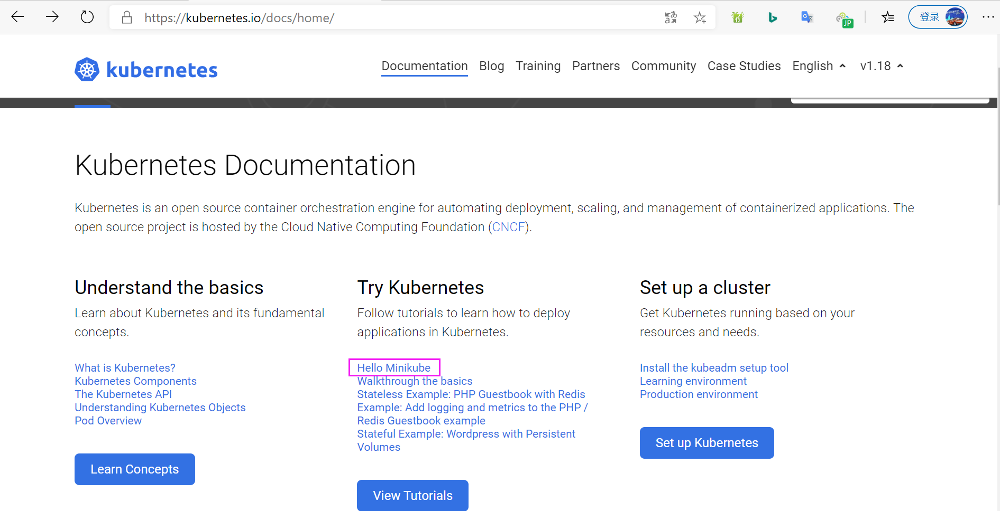

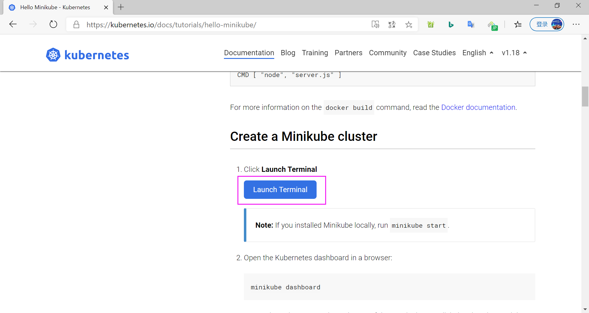

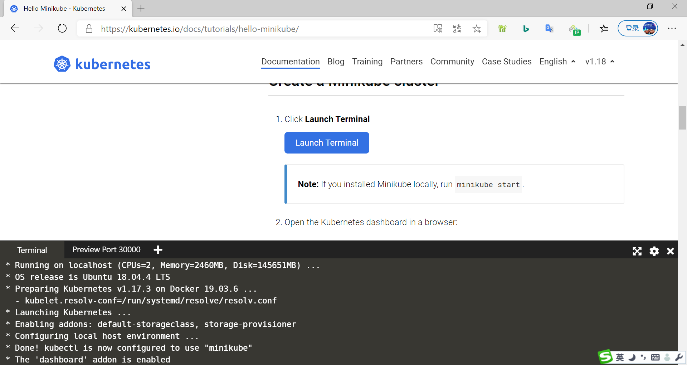

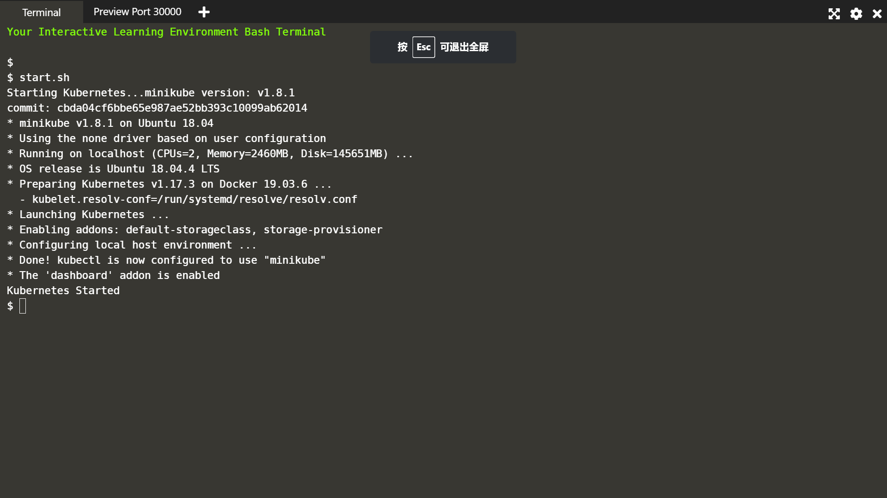

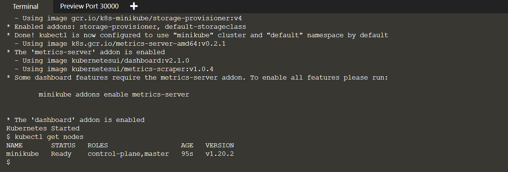

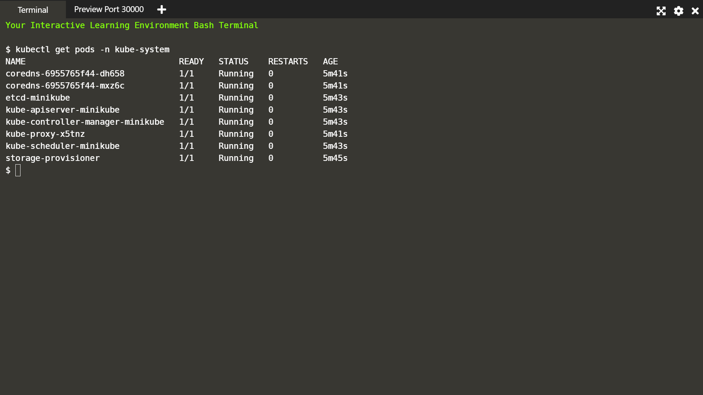



<nav class="article-end" aria-label="章节导航">
  <a href="{{ '/subjects/Kubernetes/01-cloud-native-architecture.html' | relative_url }}">← 上一章：云原生生态与 Kubernetes 架构</a>
  <a href="{{ '/subjects/Kubernetes/' | relative_url }}">返回 Kubernetes 目录</a>
  <a href="{{ '/subjects/Kubernetes/03-kubeadm-docker-ha.html' | relative_url }}">下一章：Kubeadm 与 Docker 高可用部署 →</a>
</nav>
