[← 返回 Kubernetes 目录]({{ '/subjects/Kubernetes/' | relative_url }})



# 03 Kubeadm 与 Docker 高可用部署

## 3.4 基于 Kubeadm 和 Docker 部署 kubernetes 高可用集群

### 3.4.1 kubeadm 介绍和环境说明

#### 3.4.1.1 kubeadm 介绍


参考文档：
```text
https://kubernetes.io/docs/setup/production-environment/tools/kubeadm/
https://kubernetes.io/docs/setup/production-environment/tools/kubeadm/install-kubeadm/
https://kubernetes.io/zh-cn/docs/setup/production-environment/tools/kubeadm/create-cluster-kubeadm/
https://github.com/kubernetes/kubeadm/blob/master/docs/design/design_v1.10.md
```

kubeadm 是 Kubernetes 社区提供的集群构建工具，负责构建并启动最小化可用集群的基本步骤，也可用于集群的部署、升级、降级和卸载等生命周期管理。其主要职责是初始化并拉起集群，对应下图中背景为蓝色的部分。蓝色区域之外的其他组件仍需自行部署。

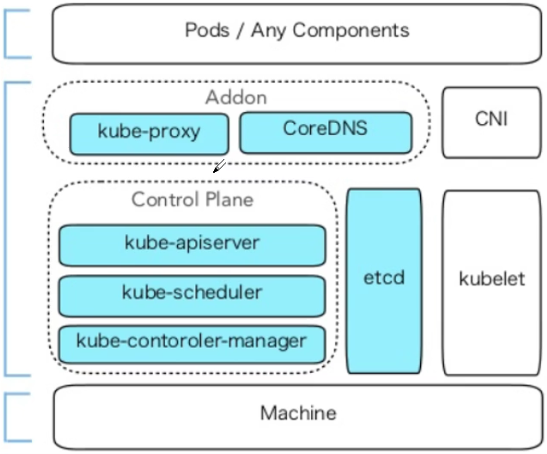

注意：在kubeadm方式安装时，Kubernetes 的所有组件中除kubelet 是以传统服务进程的方式运行，其它都以容器运行。

#### 3.4.1.2 部署环镜说明

当前部署版本为当前次新版本1.30.2/1.22.1，后面需要使用 kubeadm 做 kubernetes 版本升级演示。

部署环境：


IP主机名角色

10.0.0.101 master1.bowen.org K8s 集群主节点 1，Master和etcd

10.0.0.102 master2.bowen.org K8s 集群主节点 2，Master和etcd

10.0.0.103 master3.bowen.org K8s 集群主节点 3，Master和etcd

10.0.0.104 node1.bowen.org K8s 集群工作节点 1

10.0.0.105 node2.bowen.org K8s 集群工作节点 2

10.0.0.106 node3.bowen.org K8s 集群工作节点 3

10.0.0.107 ha1.bowen.org K8s 主节点访问入口 1,提供高可用及负载均衡

10.0.0.108 ha2.bowen.org K8s 主节点访问入口 2,提供高可用及负载均衡

10.0.0.100 kubeapi.bowen.org VIP，在ha1和ha2主机实现

10.0.0.200 harbor.bowen.org容器镜像仓库（可选）

注意： Master节点内存至少2G以上，否则在初始化时会出错。
```text
[ERROR Mem]: the system RAM (952 MB) is less than the minimum 1700 MB
```

**网络地址规划**
```text
物理主机网络         10.0.0.0/24
集群pod网络         --pod-network-cidr=10.244.0.0/16
应用service网络     --service-cidr=10.96.0.0/12
```

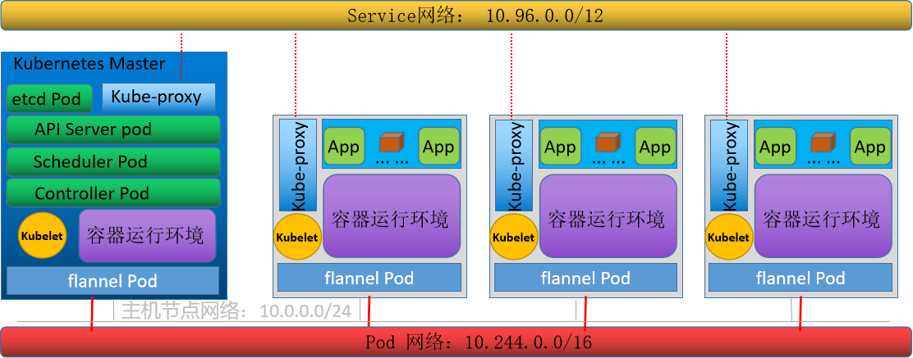

#### 3.4.1.3 基于 kubeadm 和 Docker 实现Kubernetes集群流程说明

每个节点主机的初始环境准备准备代理服务,以便访问k8s.gcr.io，或根据部署过程提示的方法获取相应的I国内镜像的image（可选）Kubernetes集群API访问入口的高可用和harbor（可选）在所有Master和Node节点都安装容器运行时 Docker在所有节点安装和配置 cri-dockerd(kubernetes-v1.24版本以后需要)。

在所有Master和Node节点都安装kubeadm 、kubelet、kubectl(集群管理工具,在node节点可不安装)在第一个 master 节点运行 kubeadm init 初始化命令 ,并验证 master 节点状态在第一个 master 节点安装配置CNI规范的网络插件flannel,calico等在其它master节点运行kubeadm join 命令加入到控制平面集群中实现高可用(测试环境可选)在所有 node 节点使用 kubeadm join 命令加入集群 , 并验证 node 节点状态创建 pod 并启动容器测试访问 ，并测试网络通信。

### 3.4.2 初始环境准备
```text
https://kubernetes.io/zh-cn/docs/setup/production-environment/tools/kubeadm/install-kubeadm/
```

硬件准备环境: 每个主机至少2G以上内存,CPU2核以上操作系统: 最小化安装支持Kubernetes的Linux系统唯一的主机名，MAC地址以及product_uuid和主机名解析保证各个节点网络配置正确,并且保证通信正常禁用 swap禁用 SELinux放行Kubernetes使用到的相关端口或禁用firewalld/iptables配置正确的时区和时间同步内核参数优化所有节点实现基于 ssh key 验证(可选)。
```bash
#DMI（Desktop Management Interface）是一种由 Intel 制定的系统管理的硬件标准,定义了一组在
计算机系统中获取有关硬件和系统配置的方法
#查看product_uuid
[root@ubuntu2204 ~]#cat /sys/class/dmi/id/product_uuid
e0c84d56-f33b-6754-eab2-d5e7cb846dc1

[root@rocky8 ~]#cat /sys/class/dmi/id/product_uuid
10324d56-9c12-c716-dfa1-196e5242b4d3

#按照前面规划配置唯一的主机名
[root@ubuntu2204 ~]#hostnamectl set-hostname master1.bowen.org

[root@ubuntu2204 ~]#cat /etc/hosts
10.0.0.100 kubeapi.bowen.org kubeapi
10.0.0.101 master1.bowen.org master1
10.0.0.102 master2.bowen.org master2
10.0.0.103 master3.bowen.org master3
10.0.0.104 node1.bowen.org  node1
10.0.0.105 node2.bowen.org  node2
10.0.0.106 node3.bowen.org  node3
10.0.0.200 harbor.bowen.org harbor

#注意;网卡配置中不要加search指令
[root@ubuntu2204 ~]#cat /etc/netplan/01-netcfg.yaml
# This file describes the network interfaces available on your system
# For more information, see netplan(5).
network:
version: 2
renderer: networkd
ethernets:

eth0:
addresses:
- 10.0.0.101/24
gateway4: 10.0.0.2
nameservers:
addresses: [180.76.76.76, 223.6.6.6]
```

**端口和协议**
```text
https://kubernetes.io/zh-cn/docs/reference/networking/ports-and-protocols/#control-plane
```

当你在一个有严格网络边界的环境里运行 Kubernetes，例如拥有物理网络防火墙或者拥有公有云中虚拟网络的自有数据中心， 了解 Kubernetes 组件使用了哪些端口和协议是非常有用的。

控制面

协议方向端口范围目的使用者

TCP入站6443 Kubernetes API 服务器所有

TCP入站2379-2380 etcd 服务器客户端 API kube-apiserver、etcd

TCP入站10250 kubelet API自身、控制面

TCP入站10259 kube-scheduler自身

TCP入站10257 kube-controller-manager自身

尽管 etcd 的端口也列举在控制面的部分，但你也可以在外部自己托管 etcd 集群或者自定义端口。

工作节点

协议方向端口范围目的使用者

TCP入站10250 kubelet API自身、控制面

TCP入站10256 kube-proxy自身、负载均衡器

TCP入站30000-32767 NodePort Services†所有

#### 3.4.2.1 操作系统及 Kubernetes 组件版本

以下案例中部署集群使用的操作系统、容器引擎、Kubernetes 版本信息：

**OS**：Ubuntu 20.04 LTS，Ubuntu 22.04 LTS，Ubuntu 24.04 LTS CRI: Docker 20.10.10  Cgroup Driver: systemd Kubernetes: 1.22.1，1.30.0

运行试验虚拟机的外部环境：

VMware workstation: Version 16 Pro VMnet 8 网段: 10.0.0.0/24 VMnet 8 给虚拟机分配的网关: 10.0.0.2。

#### 3.4.2.2 实现基于 ssh key 验证(可选)

在10.0.0.101上实现到10.0.0.102--10.0.0.109 所有主机的 ssh key 验证,方便后续管理。

#### 3.4.2.3 主机名并实现主机名解析

在每个主机设置不同的主机名,IP 和主机名解析：
```text
~# cat >> /etc/hosts <<EOF
10.0.0.100 kubeapi kubeapi.bowen.org
10.0.0.101 master1 master1.bowen.org
10.0.0.102 master2 master2.bowen.org
10.0.0.103 master3 master3.bowen.org
10.0.0.104 node1 node1.bowen.org
10.0.0.105 node2 node2.bowen.org
10.0.0.106 node3 node3.bowen.org
10.0.0.107 ha1 ha1.bowen.org
10.0.0.108 ha2 ha2.bowen.org
10.0.0.109 harbor harbor.bowen.org
EOF
```

在 VMware 的宿主机Windows 上添加 hosts 解析：
```text
#c:\windows\system32\drivers\etc\hosts
10.0.0.100 k8s kubeapi.bowen.org
10.0.0.101 master1 master1.bowen.org
10.0.0.102 master2 master2.bowen.org
10.0.0.103 master3 master3.bowen.org

10.0.0.104 node1 node1.bowen.org
10.0.0.105 node2 node2.bowen.org
10.0.0.106 node3 node3.bowen.org

10.0.0.107 ha1 ha1.bowen.org
10.0.0.108 ha2 ha2.bowen.org
10.0.0.109 harbor harbor.bowen.org
```

#### 3.4.2.4 主机时间同步

**在集群的 Master 和各 node 同步时间**
```bash
[root@master1 ~]#timedatectl set-timezone Asia/Shanghai
[root@master1 ~]#apt update
[root@master1 ~]#apt install  chrony -y
[root@master1 ~]#vim /etc/chrony/chrony.conf
#加下面一行
pool ntp.aliyun.com        iburst maxsources 2

pool ntp.ubuntu.com        iburst maxsources 4
pool 0.ubuntu.pool.ntp.org iburst maxsources 1
pool 1.ubuntu.pool.ntp.org iburst maxsources 1
pool 2.ubuntu.pool.ntp.org iburst maxsources 2

[root@master1 ~]#systemctl enable chrony
[root@master1 ~]#systemctl restart chrony

[root@master1 ~]#chronyc    sources
210 Number of sources = 9
MS Name/IP address         Stratum Poll Reach LastRx Last sample
===============================================================================
^* 203.107.6.88                  2   6    37    27   -734us[ -353us] +/-   15ms
^- chilipepper.canonical.com     2   6    37    22  +4195us[+4195us] +/-  241ms
^? pugot.canonical.com           2   6   103    83    +35ms[  +36ms] +/-  236ms
^? chilipepper.canonical.com     0   6     0     -     +0ns[   +0ns] +/-    0ns
^- alphyn.canonical.com          2   6   130    89    +31ms[  +32ms] +/-  207ms
^- time.cloudflare.com           3   6    37    27    +33ms[  +33ms] +/-  140ms
^- 139.199.215.251               2   6    37    27  -1208us[ -827us] +/-   63ms
^- 119.28.183.184                2   6    37    26  -1463us[-1463us] +/-   54ms
^- ntp.xtom.nl                   2   6    37    26  -1647us[-1647us] +/-   94ms
```

#### 3.4.2.5 禁用 SELinux

RHEL/CentOS/Rocky 系列关闭 SELinux：
```text
~# setenforce 0
~# sed -i 's#^\(SELINUX=\).*#\1disabled#' /etc/sysconfig/selinux
```

#### 3.4.2.6 关闭防火墙

**RHEL/CentOS/Rocky系统**
```text
~# systemctl disable --now firewalld
```

Ubuntu系统：
```text
#如果安装ufw
~# ufw disable
#确认关闭
~# ufw status

#如果安装firewalld
~# systemctl disable --now firewalld
```

#### 3.4.2.7 禁用 Swap 设备

**在集群的 Master 和各 node 执行**
```bash
#方法1
~# swapoff -a
~# sed -i  '/swap/s/^/#/' /etc/fstab
~# for i in {101..106};do ssh 10.0.0.$i "sed -i  '/swap/s/^/#/' /etc/fstab"; ssh
10.0.0.$i swapoff -a ; done

#方法2
~# systemctl stop swap.img.swap
~# systemctl mask swap.img.swap 或者 systemctl mask swap.target

#方法3
~# systemctl mask swap.img.swap 或者 systemctl mask swap.target
~# reboot

#确认是否禁用swap
~# systemctl -t swap
~# swapon -s
```

#### 3.4.2.8 内核优化

根据硬件和业务需求,对内核参数做相应的优化。

注意:安装docker时会自动修改内核参数。

如果是安装 Docker 没有配置，就需要手动配置以下的内核参数。允许 iptables 检查桥接流量,若要显式加载此模块，需运行 modprobe br_netfilter。为了让 Linux 节点的 iptables 能够正确查看桥接流量，还需要确认net.bridge.bridge-nf-call-iptables设置为 1。
```bash
#加载模块
modprobe overlay
modprobe br_netfilter

lsmod  |grep -E  'overlay|br_netfilter'
br_netfilter           32768  0
bridge                421888  1 br_netfilter
overlay               212992  0

#开机加载
cat <<EOF | tee /etc/modules-load.d/k8s.conf
overlay
br_netfilter
EOF

#设置所需的 sysctl 参数，参数在重新启动后保持不变
cat <<EOF | sudo tee /etc/sysctl.d/k8s.conf
net.bridge.bridge-nf-call-iptables  = 1
net.bridge.bridge-nf-call-ip6tables = 1
net.ipv4.ip_forward                 = 1
EOF

#应用 sysctl 参数生效而不重新启动
sysctl --system
```

### 3.4.3  部署 harbor 仓库和高可用反向代理

#### 3.4.3.1 安装 harbor  ( 可选)

**下载链接**


- <https://github.com/docker/compose/releases>
- <https://github.com/goharbor/harbor/releases>


**安装harbor**
```bash
#准备相关的离线安装包
[root@harbor ~]#ls
docker-compose-Linux-x86_64

harbor-offline-installer-v2.3.2.tgz
install_harbor.sh

#运行一键安装harbor脚本
[root@harbor ~]#cat install_harbor.sh
#!/bin/bash
#FileName:          install_harbor.sh
#Description:       The test script

DOCKER_VERSION="20.10.10"
UBUNTU_DOCKER_VERSION="5:${DOCKER_VERSION}~3-0~`lsb_release -si`-`lsb_release -
cs`"
DOCKER_COMPOSE_VERSION=1.29.2
DOCKER_COMPOSE_FILE=docker-compose-Linux-x86_64
HARBOR_VERSION=2.3.2
HARBOR_BASE=/apps
HARBOR_NAME=harbor.bowen.org
#HARBOR_NAME=`hostname -I|awk '{print $1}'`
HARBOR_IP=`hostname -I|awk '{print $1}'`
HARBOR_ADMIN_PASSWORD=REPLACE_WITH_STRONG_PASSWORD

COLOR_SUCCESS="echo -e \\033[1;32m"
COLOR_FAILURE="echo -e \\033[1;31m"
END="\033[m"

. /etc/os-release

color () {
RES_COL=60
MOVE_TO_COL="echo -en \\033[${RES_COL}G"
SETCOLOR_SUCCESS="echo -en \\033[1;32m"
SETCOLOR_FAILURE="echo -en \\033[1;31m"
SETCOLOR_WARNING="echo -en \\033[1;33m"
SETCOLOR_NORMAL="echo -en \E[0m"
echo -n "$1" && $MOVE_TO_COL
echo -n "["
if [ $2 = "success" -o $2 = "0" ] ;then
${SETCOLOR_SUCCESS}
echo -n $"  OK  "
elif [ $2 = "failure" -o $2 = "1"  ] ;then
${SETCOLOR_FAILURE}
echo -n $"FAILED"
else
${SETCOLOR_WARNING}
echo -n $"WARNING"
fi
${SETCOLOR_NORMAL}
echo -n "]"

echo
}

install_docker(){
if [ $ID = "centos" -o $ID = "rocky" ];then
if [ $VERSION_ID = "7" ];then
cat >  /etc/yum.repos.d/docker.repo  <<EOF
[docker]
name=docker
gpgcheck=0
#baseurl=https://mirrors.aliyun.com/docker-ce/linux/centos/7/x86_64/stable/
baseurl=https://mirrors.tuna.tsinghua.edu.cn/docker-ce/linux/centos/7/x86_64/stable/
EOF
else
cat >  /etc/yum.repos.d/docker.repo  <<EOF
[docker]
name=docker
gpgcheck=0
#baseurl=https://mirrors.aliyun.com/docker-ce/linux/centos/8/x86_64/stable/
baseurl=https://mirrors.tuna.tsinghua.edu.cn/docker-ce/linux/centos/8/x86_64/stable/
EOF
fi
yum clean all
${COLOR_FAILURE} "Docker有以下版本"${END}
yum list docker-ce --showduplicates
${COLOR_FAILURE}"5秒后即将安装: docker-"${DOCKER_VERSION}" 版本....."${END}
${COLOR_FAILURE}"如果想安装其它Docker版本，请按ctrl+c键退出，修改版本再执
行"${END}
sleep 5
yum -y install docker-ce-$DOCKER_VERSION docker-ce-cli-$DOCKER_VERSION
\
|| { color "Base,Extras的yum源失败,请检查yum源配置" 1;exit; }
else
dpkg -s docker-ce &> /dev/null && $COLOR"Docker已安装，退出" 1 && exit
apt update || { color "更新包索引失败" 1 ; exit 1; }
apt  -y install apt-transport-https ca-certificates curl software-
properties-common || \
{ color "安装相关包失败" 1 ; exit 2;  }
curl -fsSL https://mirrors.tuna.tsinghua.edu.cn/docker-ce/linux/ubuntu/gpg | sudo apt-key add -
add-apt-repository "deb [arch=amd64]
https://mirrors.tuna.tsinghua.edu.cn/docker-ce/linux/ubuntu $(lsb_release -cs)
stable"
apt update
${COLOR_FAILURE} "Docker有以下版本"${END}
apt-cache madison docker-ce
${COLOR_FAILURE}"5秒后即将安装: docker-"${UBUNTU_DOCKER_VERSION}" 版
本....."${END}
${COLOR_FAILURE}"如果想安装其它Docker版本，请按ctrl+c键退出，修改版本再执
行"${END}
sleep 5
apt -y  install docker-ce=${UBUNTU_DOCKER_VERSION} docker-ce-
cli=${UBUNTU_DOCKER_VERSION}
fi
if [ $? -eq 0 ];then
```


color "安装软件包成功"  0 else color "安装软件包失败，请检查网络配置" 1 exit fi

```ini
mkdir -p /etc/docker
tee /etc/docker/daemon.json <<-'EOF'
{
"registry-mirrors": ["https://si7y70hh.mirror.aliyuncs.com"],
"insecure-registries":["harbor.bowen.org:80"]
}
EOF
systemctl daemon-reload
systemctl enable docker
systemctl restart docker
docker version && color "Docker 安装成功" 0 ||  color "Docker 安装失败" 1
echo 'alias rmi="docker images -qa|xargs docker rmi -f"' >> ~/.bashrc
echo 'alias rmc="docker ps -qa|xargs docker rm -f"' >> ~/.bashrc
}

install_docker_compose(){
if [ $ID = "centos" -o $ID = "rocky" ];then
${COLOR_SUCCESS}"开始安装 Docker compose....."${END}
sleep 1
if [ ! -e  ${DOCKER_COMPOSE_FILE} ];then
curl -L
https://github.com/docker/compose/releases/download/${DOCKER_COMPOSE_VERSION}/${
DOCKER_COMPOSE_FILE} -o /usr/bin/docker-compose
else
mv ${DOCKER_COMPOSE_FILE} /usr/bin/docker-compose
fi
chmod +x /usr/bin/docker-compose
else
apt -y install docker-compose
fi
if docker-compose --version ;then
${COLOR_SUCCESS}"Docker Compose 安装完成"${END}
else
${COLOR_FAILURE}"Docker compose 安装失败"${END}
exit
fi
}

install_harbor(){
${COLOR_SUCCESS}"开始安装 Harbor....."${END}
sleep 1
if  [ ! -e  harbor-offline-installer-v${HARBOR_VERSION}.tgz ] ;then
wget
https://github.com/goharbor/harbor/releases/download/v${HARBOR_VERSION}/harbor-
offline-installer-v${HARBOR_VERSION}.tgz || ${COLOR_FAILURE} "下载失败!" ${END}
fi
[ -d ${HARBOR_BASE} ] ||  mkdir ${HARBOR_BASE}
tar xvf harbor-offline-installer-v${HARBOR_VERSION}.tgz  -C ${HARBOR_BASE}
cd ${HARBOR_BASE}/harbor
cp harbor.yml.tmpl harbor.yml

sed -ri "/^hostname/s/reg.mydomain.com/${HARBOR_NAME}/" harbor.yml
sed -ri "/^https/s/(https:)/#\1/" harbor.yml
sed -ri "s/(port: 443)/#\1/" harbor.yml
sed -ri "/certificate:/s/(.*)/#\1/" harbor.yml
sed -ri "/private_key:/s/(.*)/#\1/" harbor.yml
sed -ri "s/Harbor12345/${HARBOR_ADMIN_PASSWORD}/" harbor.yml
sed -i 's#^data_volume: /data#data_volume: /data/harbor#' harbor.yml
#mkdir -p /data/harbor
${HARBOR_BASE}/harbor/install.sh && ${COLOR_SUCCESS}"Harbor 安装完成"${END} ||
${COLOR_FAILURE}"Harbor 安装失败"${END}
cat > /lib/systemd/system/harbor.service <<EOF
[Unit]
Description=Harbor
After=docker.service systemd-networkd.service systemd-resolved.service
Requires=docker.service
Documentation=http://github.com/vmware/harbor

[Service]
Type=simple
Restart=on-failure
RestartSec=5
ExecStart=/usr/bin/docker-compose -f  ${HARBOR_BASE}/harbor/docker-compose.yml
up
ExecStop=/usr/bin/docker-compose -f ${HARBOR_BASE}/harbor/docker-compose.yml
down

[Install]
WantedBy=multi-user.target
EOF

systemctl daemon-reload
systemctl enable  harbor &>/dev/null ||  ${COLOR}"Harbor已配置为开机自动启动"${END}
if [ $?  -eq 0 ];then
echo
color "Harbor安装完成!" 0
echo "------------------------------------------------------------------
-"
echo -e "请访问链接: \E[32;1mhttp://${HARBOR_IP}/\E[0m"
echo -e "用户和密码: \E[32;1madmin/${HARBOR_ADMIN_PASSWORD}\E[0m"
else
color "Harbor安装失败!" 1
exit
fi
}

docker info  &> /dev/null  && ${COLOR_FAILURE}"Docker已安装"${END} ||
install_docker

docker-compose --version &> /dev/null && ${COLOR_FAILURE}"Docker Compose已安
装"${END} || install_docker_compose

install_harbor

#安装完成后，可以看到下面图式
```

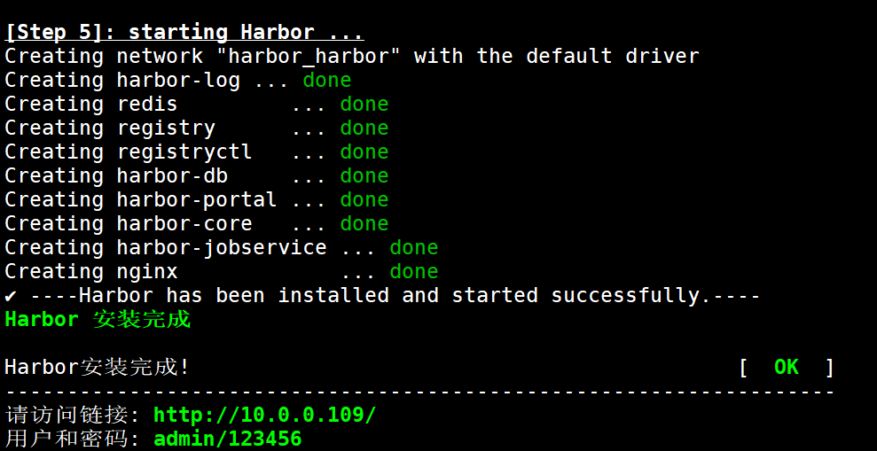

安装完毕后，可以用浏览器访问：http://harbor.bowen.org

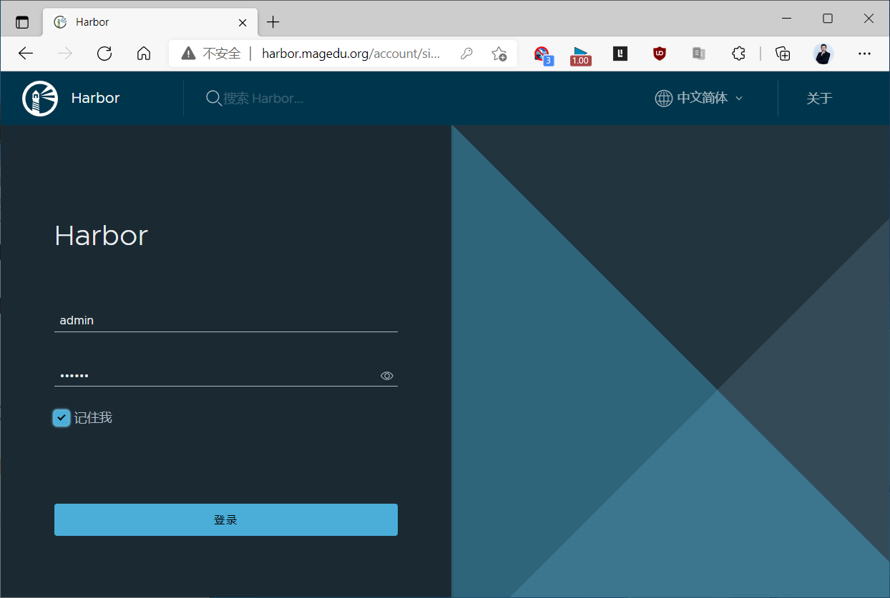

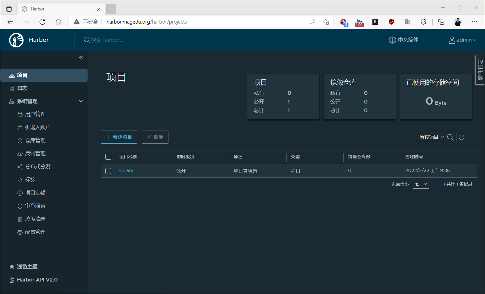

**建立新项目**

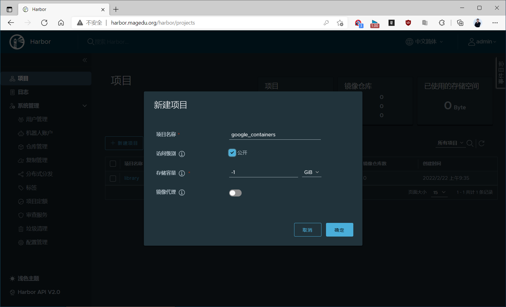

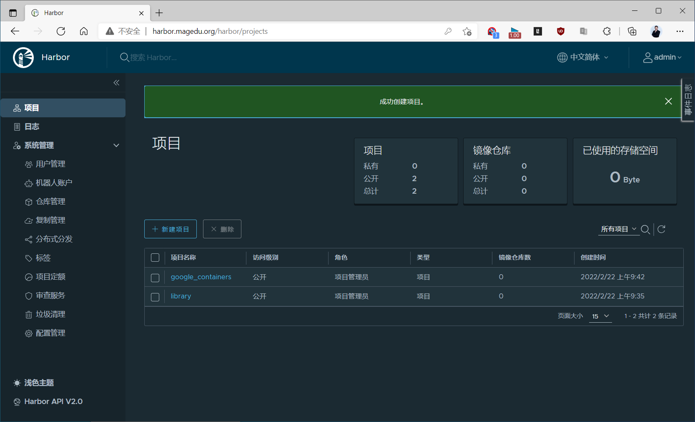

#### 3.4.3.2 实现高可用的反向代理

可以利用Haproxy（或nginx）和keepalived 实现Kube-API server的高可用和负载均衡。

##### 3.4.3.2.1 实现 keepalived

在两台主机ha1和ha2 按下面步骤部署和配置 keepalived。
```bash
[root@ha1 ~]#apt update && apt -y install keepalived

#keepalived配置
[root@ha1 ~]#cp  /usr/share/doc/keepalived/samples/keepalived.conf.vrrp
/etc/keepalived/keepalived.conf

[root@ha1 ~]#vim /etc/keepalived/keepalived.conf

[root@ha1 ~]#cat /etc/keepalived/keepalived.conf
! Configuration File for keepalived

global_defs {
notification_email {
acassen
}
notification_email_from Alexandre.Cassen@firewall.loc
smtp_server 192.168.200.1
smtp_connect_timeout 30
router_id ha1.bowen.org  #指定router_id,#在ha2上为ha2.bowen.org
}

vrrp_script check_haproxy {
#script "/etc/keepalived/check_haproxy.sh"
script "killall -0 haproxy"
interval 1
weight -30
fall 3
rise 2

timeout 2
}

vrrp_instance VI_1 {
state MASTER            #在ha2上为BACKUP
interface eth0
garp_master_delay 10
smtp_alert
virtual_router_id 66   #指定虚拟路由器ID,ha1和ha2此值必须相同
priority 100           #在ha2上为80
advert_int 1
authentication {
auth_type PASS
auth_pass 123456   #指定验证密码,ha1和ha2此值必须相同
}
virtual_ipaddress {
10.0.0.100/24 dev eth0  label eth0:1  #指定VIP,ha1和ha2此值必须相同
}
track_script {
check_haproxy
}
}

[root@ha1 ~]#cat /etc/keepalived/check_haproxy.sh
#!/bin/bash
/usr/bin/killall -0 haproxy  || systemctl restart haproxy

[root@ha1 ~]#chmod +x /etc/keepalived/check_haproxy.sh

[root@ha1 ~]#hostname -I
10.0.0.107
[root@ha1 ~]#systemctl start keepalived.service

#验证keepalived服务是否正常
[root@ha1 ~]#hostname -I
10.0.0.107 10.0.0.100
[root@ha1 ~]#ip a
1: lo: <LOOPBACK,UP,LOWER_UP> mtu 65536 qdisc noqueue state UNKNOWN group
default qlen 1000
link/loopback 00:00:00:00:00:00 brd 00:00:00:00:00:00
inet 127.0.0.1/8 scope host lo
valid_lft forever preferred_lft forever
inet6 ::1/128 scope host
valid_lft forever preferred_lft forever
2: eth0: <BROADCAST,MULTICAST,UP,LOWER_UP> mtu 1500 qdisc fq_codel state UP
group default qlen 1000
link/ether 00:0c:29:40:27:06 brd ff:ff:ff:ff:ff:ff
inet 10.0.0.107/24 brd 10.0.0.255 scope global eth0
valid_lft forever preferred_lft forever
inet 10.0.0.100/24 scope global secondary eth0:1
valid_lft forever preferred_lft forever
inet6 fe80::20c:29ff:fe40:2706/64 scope link
valid_lft forever preferred_lft forever
[root@ha1 ~]#systemctl status keepalived.service
● keepalived.service - Keepalive Daemon (LVS and VRRP)
Loaded: loaded (/lib/systemd/system/keepalived.service; enabled; vendor
preset: enabled)

Active: active (running) since Tue 2020-04-21 11:04:56 CST; 28s ago
Process: 27859 ExecStart=/usr/sbin/keepalived $DAEMON_ARGS (code=exited,
status=0/SUCCESS)
Main PID: 27860 (keepalived)
Tasks: 3 (limit: 2290)
CGroup: /system.slice/keepalived.service
├─27860 /usr/sbin/keepalived
├─27861 /usr/sbin/keepalived
└─27862 /usr/sbin/keepalived
```


Apr 21 11:04:56 ha1.bowen.org Keepalived[27860]: Starting VRRP child process, pid=27862 Apr 21 11:04:56 ha1.bowen.org Keepalived_vrrp[27862]: Registering Kernel netlink reflector Apr 21 11:04:56 ha1.bowen.org Keepalived_vrrp[27862]: Registering Kernel netlink command channel Apr 21 11:04:56 ha1.bowen.org Keepalived_vrrp[27862]: Registering gratuitous ARP shared channel Apr 21 11:04:56 ha1.bowen.org Keepalived_vrrp[27862]: Opening file'/etc/keepalived/keepalived.conf'. Apr 21 11:04:57 ha1.bowen.org Keepalived_vrrp[27862]: Using LinkWatch kernel netlink reflector... Apr 21 11:04:58 ha1.bowen.org Keepalived_vrrp[27862]: VRRP_Instance(VI_1) Transition to MASTER STATE Apr 21 11:04:59 ha1.bowen.org Keepalived_vrrp[27862]: VRRP_Instance(VI_1) Entering MASTER STATE Apr 21 11:04:59 ha1.bowen.org Keepalived_vrrp[27862]: Remote SMTP server[192.168.200.1]:25 connected. Apr 21 11:05:20 ha1.bowen.org Keepalived_vrrp[27862]: Error reading data from remote SMTP server [192.168.200.1]:25.


##### 3.4.3.2.2 实现 Haproxy

通过 Harproxy 实现 kubernetes Api-server的四层反向代理和负载均衡功能。
```bash
#在两台主机ha1和ha2都执行下面操作
[root@ha1 ~]#cat >> /etc/sysctl.conf <<EOF
net.ipv4.ip_nonlocal_bind = 1
EOF
[root@ha1 ~]#sysctl -p

#安装配置haproxy
[root@ha1 ~]#apt -y install haproxy
[root@ha1 ~]#vim /etc/haproxy/haproxy.cfg
[root@ha1 ~]#cat /etc/haproxy/haproxy.cfg
global
log /dev/log    local0
log /dev/log    local1 notice
chroot /var/lib/haproxy
stats socket /run/haproxy/admin.sock mode 660 level admin expose-fd
listeners
stats timeout 30s
user haproxy
group haproxy
daemon

# Default SSL material locations
ca-base /etc/ssl/certs
crt-base /etc/ssl/private

# Default ciphers to use on SSL-enabled listening sockets.
# For more information, see ciphers(1SSL). This list is from:
#  https://hynek.me/articles/hardening-your-web-servers-ssl-ciphers/
# An alternative list with additional directives can be obtained from
#  https://mozilla.github.io/server-side-tls/ssl-config-generator/?server=haproxy
ssl-default-bind-ciphers
ECDH+AESGCM:DH+AESGCM:ECDH+AES256:DH+AES256:ECDH+AES128:DH+AES:RSA+AESGCM:RSA+AE
S:!aNULL:!MD5:!DSS
ssl-default-bind-options no-sslv3

defaults
log global
mode    http
option  httplog
option  dontlognull
timeout connect 5000
timeout client  50000
timeout server  50000
errorfile 400 /etc/haproxy/errors/400.http
errorfile 403 /etc/haproxy/errors/403.http
errorfile 408 /etc/haproxy/errors/408.http
errorfile 500 /etc/haproxy/errors/500.http
errorfile 502 /etc/haproxy/errors/502.http
errorfile 503 /etc/haproxy/errors/503.http
errorfile 504 /etc/haproxy/errors/504.http

##########添加以下内容######################
listen stats
mode http
bind 0.0.0.0:8888
stats enable
log global
stats uri /status
stats auth admin:123456

listen  kubernetes-api-6443
bind 10.0.0.100:6443
mode tcp
server master1 10.0.0.101:6443 check inter 3s fall 3 rise 3
#先暂时禁用master2和master3，等kubernetes安装完成后，再启用
#server master2 10.0.0.102:6443 check inter 3s fall 3 rise 3
#server master3 10.0.0.103:6443 check inter 3s fall 3 rise 3

[root@ha1 ~]#systemctl restart haproxy
Synchronizing state of haproxy.service with SysV service script with
/lib/systemd/systemd-sysv-install.
Executing: /lib/systemd/systemd-sysv-install enable haproxy
[root@ha1 ~]#systemctl status  haproxy
● haproxy.service - HAProxy Load Balancer
Loaded: loaded (/lib/systemd/system/haproxy.service; enabled; vendor preset:
enabled)
Active: active (running) since Tue 2020-04-21 20:23:22 CST; 58min ago

Docs: man:haproxy(1)
file:/usr/share/doc/haproxy/configuration.txt.gz
Main PID: 2224 (haproxy)
Tasks: 2 (limit: 1084)
CGroup: /system.slice/haproxy.service
├─2224 /usr/sbin/haproxy -Ws -f /etc/haproxy/haproxy.cfg -p
/run/haproxy.pid
└─2225 /usr/sbin/haproxy -Ws -f /etc/haproxy/haproxy.cfg -p
/run/haproxy.pid

Apr 21 20:23:21 ha1.bowen.org systemd[1]: Starting HAProxy Load Balancer...
Apr 21 20:23:22 ha1.bowen.org systemd[1]: Started HAProxy Load Balancer.
```

浏览器访问：http://ha1.bowen.org:8888/status ，可以看到下面界面

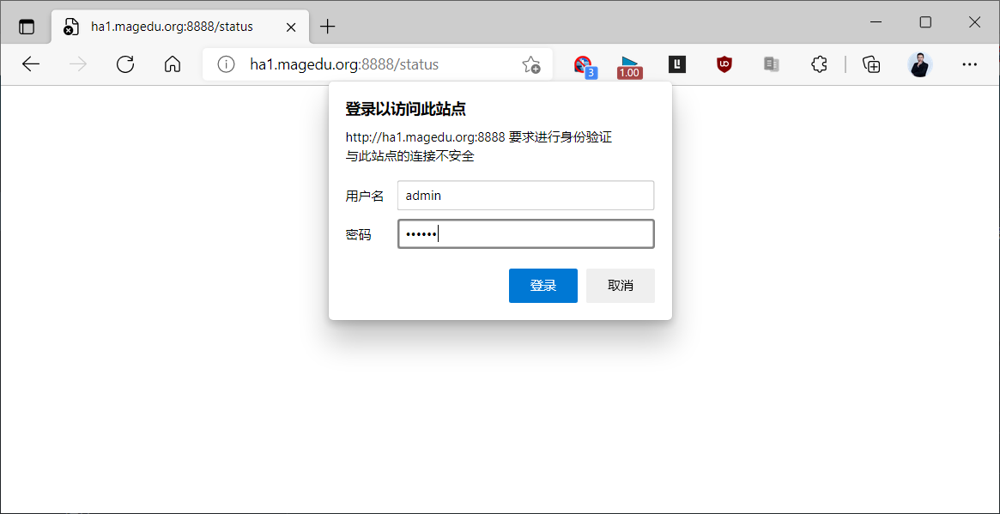

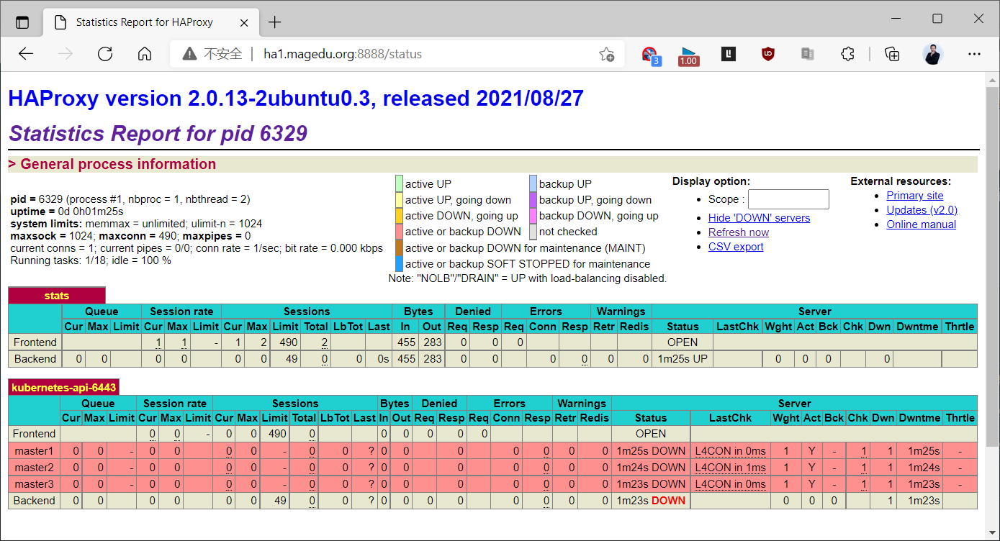

浏览器访问：http://ha2.bowen.org:8888/status ，可以看到下面界面

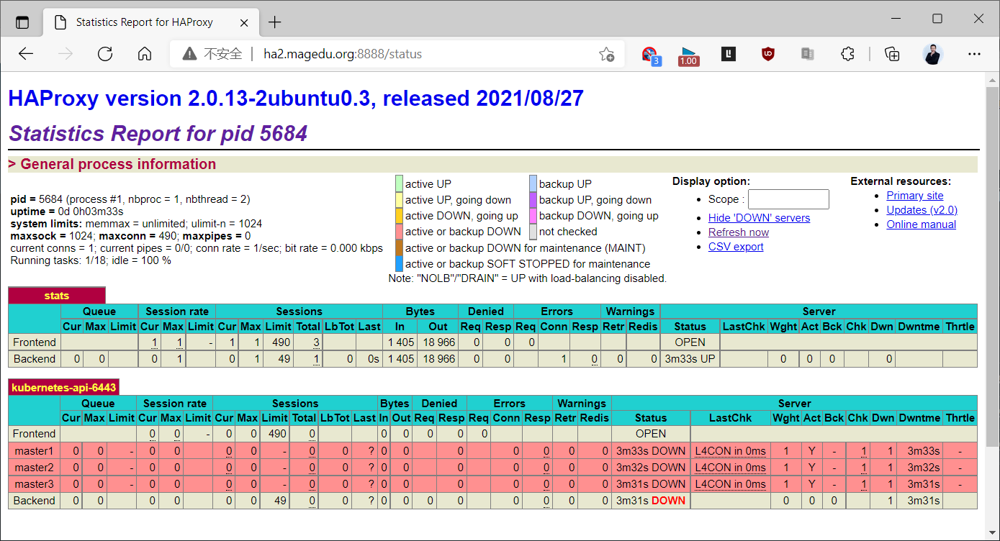

浏览器访问：http://kubeapi.bowen.org:8888/status ，可以看到下面界面


##### 3.4.3.2.3 实现 Nginx

也可以使用Nginx代替Haproxy实现四层反向代理和负载均衡功能。
```nginx
[root@ha1 ~]#apt -y install nginx
[root@ha1 ~]#vim /etc/nginx/nginx.conf
#在最后添加下面行
stream {
upstream  apiservers {
server  master1.bowen.org:6443 max_fails=2 fail_timeout=30s;
#server  master2.bowen.org:6443 max_fails=2 fail_timeout=30s;
#server  master3.bowen.org:6443 max_fails=2 fail_timeout=30s;
}
server {
listen 6443;
proxy_pass apiservers;
}
}

[root@ha1 ~]#systemctl restart nginx
```

### 3.4.4 所有 master 和 node 节点安装和配置 docker

#### 3.4.4.1 安装 docker

范例：在所有master和worker上安装系统内置版本docker
```bash
[root@master1 ~]#apt update && apt -y install docker.io
[root@master1 ~]#docker version
Client:
Version:           24.0.7
API version:       1.43
Go version:        go1.21.1
Git commit:        24.0.7-0ubuntu2~22.04.1
Built:             Wed Mar 13 20:23:54 2024
OS/Arch:           linux/amd64
Context:           default

Server:
Engine:
Version:          24.0.7
API version:      1.43 (minimum version 1.12)
Go version:       go1.21.1
Git commit:       24.0.7-0ubuntu2~22.04.1
Built:            Wed Mar 13 20:23:54 2024
OS/Arch:          linux/amd64
Experimental:     false
containerd:
Version:          1.7.12
GitCommit:
runc:
Version:          1.1.12-0ubuntu2~22.04.1
GitCommit:
docker-init:
Version:          0.19.0
GitCommit:

、
#因为国内无法访问docker官方镜像，需要配置docker访问docker官方镜像
[root@master1 ~]#cat /etc/docker/daemon.json
{
"registry-mirrors": [
"https://docker.m.daocloud.io",
"https://docker.1panel.live"
],
"insecure-registries":["harbor.bowen.org"]
}
[root@master1 ~]#systemctl restart docker
```

范例：指定版本
```bash
#一键安装docker脚本
[root@master1 ~]#cat install_docker.sh
#!/bin/bash
#

#FileName:          install_docker.sh
#Description:       The test script

DOCKER_VERSION="20.10.10"
UBUNTU_DOCKER_VERSION="5:${DOCKER_VERSION}~3-0~`lsb_release -si`-`lsb_release -
cs`"
#UBUNTU_DOCKER_VERSION="5:20.10.9~3-0~`lsb_release -si`-`lsb_release -cs`"
#UBUNTU_DOCKER_VERSION="5:19.03.14~3-0~lsb_release -si-`lsb_release -cs`"

COLOR_SUCCESS="echo -e \\033[1;32m"
COLOR_FAILURE="echo -e \\033[1;31m"
END="\033[m"

. /etc/os-release

color () {
RES_COL=60
MOVE_TO_COL="echo -en \\033[${RES_COL}G"
SETCOLOR_SUCCESS="echo -en \\033[1;32m"
SETCOLOR_FAILURE="echo -en \\033[1;31m"
SETCOLOR_WARNING="echo -en \\033[1;33m"
SETCOLOR_NORMAL="echo -en \E[0m"
echo -n "$1" && $MOVE_TO_COL
echo -n "["
if [ $2 = "success" -o $2 = "0" ] ;then
${SETCOLOR_SUCCESS}
echo -n $"  OK  "
elif [ $2 = "failure" -o $2 = "1"  ] ;then
${SETCOLOR_FAILURE}
echo -n $"FAILED"
else
${SETCOLOR_WARNING}
echo -n $"WARNING"
fi
${SETCOLOR_NORMAL}
echo -n "]"
echo
}

install_docker(){
if [ $ID = "centos" -o $ID = "rocky" ];then
if [ $VERSION_ID = "7" ];then
cat >  /etc/yum.repos.d/docker.repo  <<EOF
[docker]
name=docker
gpgcheck=0
#baseurl=https://mirrors.aliyun.com/docker-ce/linux/centos/7/x86_64/stable/
baseurl=https://mirrors.tuna.tsinghua.edu.cn/docker-ce/linux/centos/7/x86_64/stable/
EOF

else
cat >  /etc/yum.repos.d/docker.repo  <<EOF
[docker]
name=docker
gpgcheck=0
#baseurl=https://mirrors.aliyun.com/docker-ce/linux/centos/8/x86_64/stable/
baseurl=https://mirrors.tuna.tsinghua.edu.cn/docker-ce/linux/centos/8/x86_64/stable/
EOF
fi
yum clean all
${COLOR_FAILURE} "Docker有以下版本"${END}
yum list docker-ce --showduplicates
${COLOR_FAILURE}"5秒后即将安装: docker-"${DOCKER_VERSION}" 版本....."${END}
${COLOR_FAILURE}"如果想安装其它Docker版本，请按ctrl+c键退出，修改版本再执
行"${END}
sleep 5
yum -y install docker-ce-$DOCKER_VERSION docker-ce-cli-$DOCKER_VERSION
\
|| { color "Base,Extras的yum源失败,请检查yum源配置" 1;exit; }
else
dpkg -s docker-ce &> /dev/null && $COLOR"Docker已安装，退出" 1 && exit
apt update || { color "更新包索引失败" 1 ; exit 1; }
apt  -y install apt-transport-https ca-certificates curl software-
properties-common || \
{ color "安装相关包失败" 1 ; exit 2;  }
curl -fsSL https://mirrors.tuna.tsinghua.edu.cn/docker-ce/linux/ubuntu/gpg | sudo apt-key add -
add-apt-repository "deb [arch=amd64]
https://mirrors.tuna.tsinghua.edu.cn/docker-ce/linux/ubuntu $(lsb_release -cs)
stable"
apt update
${COLOR_FAILURE} "Docker有以下版本"${END}
apt-cache madison docker-ce
${COLOR_FAILURE}"5秒后即将安装: docker-"${UBUNTU_DOCKER_VERSION}" 版
本....."${END}
${COLOR_FAILURE}"如果想安装其它Docker版本，请按ctrl+c键退出，修改版本再执
行"${END}
sleep 5
apt -y  install docker-ce=${UBUNTU_DOCKER_VERSION} docker-ce-
cli=${UBUNTU_DOCKER_VERSION}
fi
if [ $? -eq 0 ];then
color "安装软件包成功"  0
else
color "安装软件包失败，请检查网络配置" 1
exit
fi

}

config_docker (){
mkdir -p /etc/docker
tee /etc/docker/daemon.json <<-'EOF'
{
"registry-mirrors": ["https://si7y70hh.mirror.aliyuncs.com"],
"insecure-registries":["harbor.bowen.org:80"]
}

EOF
systemctl daemon-reload
systemctl enable docker
systemctl restart docker
docker version && color "Docker 安装成功" 0 ||  color "Docker 安装失败" 1
}

set_alias (){
echo 'alias rmi="docker images -qa|xargs docker rmi -f"' >> ~/.bashrc
echo 'alias rmc="docker ps -qa|xargs docker rm -f"' >> ~/.bashrc
}

install_docker
config_docker
set_alias
```

#### 3.4.4.2 修改Cgroup Driver为systemd(新版无需执行)

Kubernetes v1.22版本开始，未明确设置kubelet的cgroup driver时，则默认即会将其设置为systemd。从 Docker 20.03 版本开始，默认使用 systemd 作为 Cgroup 驱动程序。如果系统没有安装 systemd，Docker 会自动切换到 cgroupfs 驱动程序。因此 Docker 20.03  版本之后此步无需再执行此步。


#将Docker的默认启动方式cgroupfs修改为systemd,否则在v1.21.X版以后的k8s启动的过程中会出现如下错误，导致kubelet服务无法启动 failed to run Kubelet: failed to create kubelet: misconfiguration: kubelet cgroup driver: "systemd" is different from docker cgroup driver: "cgroupfs"

```bash
#方法1
[root@master1 ~]#vim /etc/docker/daemon.json
{
"registry-mirrors": ["https://si7y70hh.mirror.aliyuncs.com"],
"insecure-registries":["harbor.bowen.org"],
"exec-opts": ["native.cgroupdriver=systemd"]  #加此行
}
#方法2
[root@master1 ~]#vim /usr/lib/systemd/system/docker.service
...
ExecStart=/usr/bin/dockerd --exec-opt native.cgroupdriver=systemd -H fd:// --
containerd=/run/containerd/containerd.sock

[root@master1 ~]#systemctl daemon-reload
[root@master1 ~]#systemctl restart docker

#检查效果
[root@master1 ~]#docker info | grep Cgroup
Cgroup Driver: systemd
```

#### 3.4.4.3 所有主机安装 cri-dockerd(v1.24以后版本)

Kubernetes自v1.24移除了对docker-shim的支持，而Docker Engine默认又不支持CRI规范，因而二者将无法直接完成整合。为此，Mirantis和Docker联合创建了cri-dockerd项目，用于为Docker Engine提供一个能够支持到CRI规范的垫片，从而能够让Kubernetes基于CRI控制Docker 。

项目地址：https://github.com/Mirantis/cri-dockerd

cri-dockerd项目提供了预制的二制格式的程序包，用户按需下载相应的系统和对应平台的版本即可完成安装，这里以Ubuntu 20.04 64bits系统环境，以及cri-dockerd目前最新的程序版本v0.2.5为例。

范例：下载Linux通用二进制文件并创建service和socket文件
```bash
#下载Linux通用版本
[root@ubuntu2404 ~]#wgert https://github.com/Mirantis/cri-dockerd/releases/download/v0.3.18/cri-dockerd-0.3.18.amd64.tgz

[root@ubuntu2404 ~]#tar tf cri-dockerd-0.4.0.amd64.tgz
cri-dockerd/
cri-dockerd/cri-dockerd

[root@ubuntu2404 ~]#tar xf cri-dockerd-0.4.0.amd64.tgz
[root@ubuntu2404 ~]#mv cri-dockerd/cri-dockerd /usr/bin/

#准备service和socket文件
#https://github.com/Mirantis/cri-dockerd/tree/master/packaging/systemd
[root@ubuntu2404 ~]#wget -O /lib/systemd/system/cri-docker.service
https://raw.githubusercontent.com/Mirantis/cri-dockerd/refs/heads/master/packaging/systemd/cri-docker.service

[root@ubuntu2404 ~]#wget -O /lib/systemd/system/cri-docker.socket
https://raw.githubusercontent.com/Mirantis/cri-dockerd/refs/heads/master/packaging/systemd/cri-docker.socket

[root@ubuntu2404 ~]#systemctl daemon-reload && systemctl enable --now  cri-
docker.service
```

范例：下载系统对应的包文件并安装cri-dockerd
```bash
#选择合适的版本
[root@ubuntu2004 ~]#curl -LO https://github.com/Mirantis/cri-dockerd/releases/download/v0.2.5/cri-dockerd_0.2.5.3-0.ubuntu-focal_amd64.deb

[root@ubuntu2004 ~]#dpkg -i cri-dockerd_0.2.5.3-0.ubuntu-focal_amd64.deb
[root@ubuntu2204 ~]#dpkg -i cri-dockerd_0.3.14.3-0.ubuntu-jammy_amd64.deb

[root@master1 ~]#for i in {102..106};do scp cri-dockerd_0.2.5.3-0.ubuntu-
focal_amd64.deb 10.0.0.$i: ; ssh 10.0.0.$i "dpkg -i cri-dockerd_0.2.5.3-0.ubuntu-
focal_amd64.deb";done

#完成安装后，相应的服务cri-dockerd.service便会自动启动。
```

#### 3.4.4.4 所有主机配置 cri-dockerd(v1.24以后版本)

众所周知的原因,从国内 cri-dockerd 服务无法下载 k8s.gcr.io上面相关镜像,导致无法启动,所以需要修改cri-dockerd 使用国内镜像源。
```bash
vim /lib/systemd/system/cri-docker.service
#修改ExecStart行如下
#最新版Kubernetes v1.34.1
ExecStart=/usr/bin/cri-dockerd --container-runtime-endpoint fd:// --pod-infra-
container-image registry.aliyuncs.com/google_containers/pause:3.10.1

#最新版Kubernetes v1.33.1
ExecStart=/usr/bin/cri-dockerd --container-runtime-endpoint fd:// --pod-infra-
container-image registry.aliyuncs.com/google_containers/pause:3.10

#最新版Kubernetes v1.32.3
ExecStart=/usr/bin/cri-dockerd --container-runtime-endpoint fd:// --pod-infra-
container-image registry.aliyuncs.com/google_containers/pause:3.10

#最新版Kubernetes v1.31.1
ExecStart=/usr/bin/cri-dockerd --container-runtime-endpoint fd:// --pod-infra-
container-image registry.aliyuncs.com/google_containers/pause:3.10

#新版Kubernetes v1.30.0
ExecStart=/usr/bin/cri-dockerd --container-runtime-endpoint fd:// --pod-infra-
container-image registry.aliyuncs.com/google_containers/pause:3.9
#旧版
#ExecStart=/usr/bin/cri-dockerd --container-runtime-endpoint fd:// --pod-infra-
container-image registry.aliyuncs.com/google_containers/pause:3.7

systemctl daemon-reload && systemctl restart cri-docker.service

#同步至所有节点
[root@master1 ~]#for i in {102..106};do scp /lib/systemd/system/cri-
docker.service 10.0.0.$i:/lib/systemd/system/cri-docker.service; ssh 10.0.0.$i
"systemctl daemon-reload && systemctl restart cri-docker.service";done
```

如果不配置,会出现下面日志提示
```text
Aug 21 01:35:17 ubuntu2004 kubelet[6791]: E0821 01:35:17.999712    6791
remote_runtime.go:212] "RunPodSandbox from runtime service f
ailed" err="rpc error: code = Unknown desc = failed pulling image
\"k8s.gcr.io/pause:3.6\": Error response from daemon: Get \"https:
//k8s.gcr.io/v2/\": net/http: request canceled while waiting for connection
(Client.Timeout exceeded while awaiting headers)"
```

### 3.4.5 所有 master 和 node 节点安装kubeadm等相关包

所有 master 和 node 节点都安装kubeadm, kubelet,kubectl 相关包。

注意: node节点可以不安装管理工具 kubectl 包,但依赖关系会自动安装。

通过国内镜像站点阿里云安装的参考链接：
```text
https://kubernetes.io/zh-cn/docs/setup/production-environment/tools/kubeadm/install-kubeadm/#installing-kubeadm-kubelet-and-kubectl
https://developer.aliyun.com/mirror/kubernetes
https://mirrors.tuna.tsinghua.edu.cn/help/kubernetes/
```

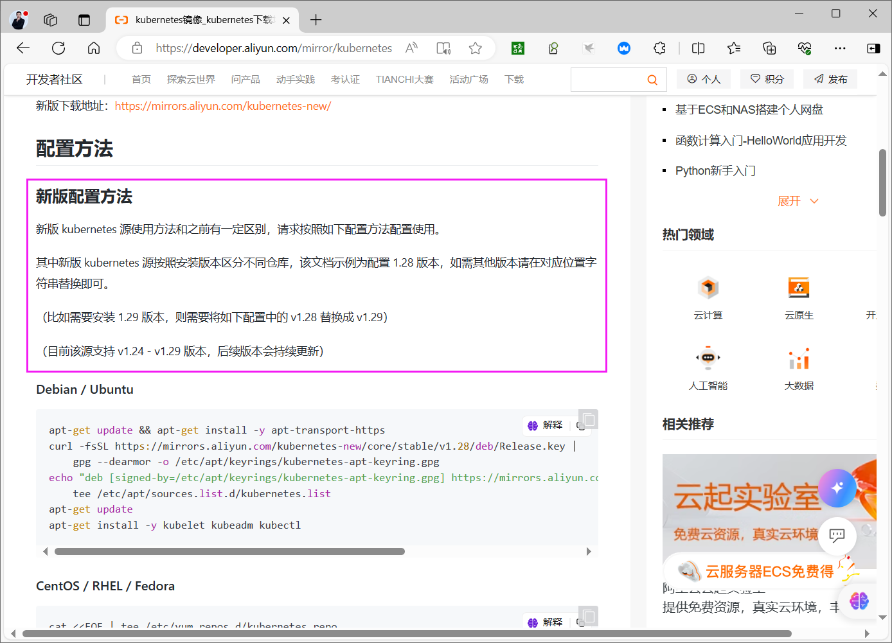

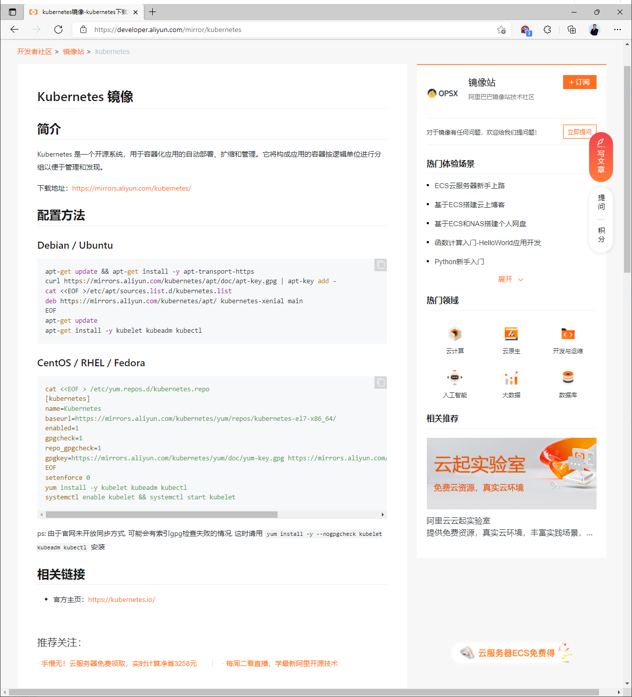

范例: 在所有master和node节点执行下面操作安装k8s相关包
```bash
[root@master1 ~]#apt-get update && apt-get install -y apt-transport-https

#新版:在v1.28版以后
[root@master1 ~]#export K8S_VERSION=v1.33
[root@master1 ~]#export K8S_VERSION=v1.32
[root@master1 ~]#export K8S_VERSION=v1.31
[root@master1 ~]#export K8S_VERSION=v1.30
[root@master1 ~]#export K8S_VERSION=v1.28
[root@master1 ~]#curl -fsSL https://mirrors.aliyun.com/kubernetes-
new/core/stable/${K8S_VERSION}/deb/Release.key |
gpg --dearmor -o /etc/apt/keyrings/kubernetes-apt-keyring.gpg
[root@master1 ~]#echo "deb [signed-by=/etc/apt/keyrings/kubernetes-apt-
keyring.gpg] https://mirrors.aliyun.com/kubernetes-
new/core/stable/${K8S_VERSION}/deb/ /" | tee
/etc/apt/sources.list.d/kubernetes.list

#旧版:在v1.28版以前

[root@master1 ~]#curl https://mirrors.aliyun.com/kubernetes/apt/doc/apt-key.gpg |
apt-key add -
[root@master1 ~]#cat <<EOF >/etc/apt/sources.list.d/kubernetes.list
deb https://mirrors.aliyun.com/kubernetes/apt/ kubernetes-xenial main
EOF
#注意:阿里云页面有坑,复制时在EOF后面有空格,需要删除

[root@master1 ~]#apt-get update

#查看版本信息
[root@master1 ~]# apt-cache madison kubeadm

#查看kubeadm,kubectl,kubelet最新版本
[root@master1 ~]#apt list  kubeadm kubectl kubelet
Listing... Done
kubeadm/kubernetes-xenial 1.23.4-00 amd64
kubectl/kubernetes-xenial 1.23.4-00 amd64
kubelet/kubernetes-xenial 1.23.4-00 amd64

#安装最新版本的k8s相关包,安装kubeadm时会自动安装kubelet和kubectl
[root@master1 ~]#apt -y install   kubeadm

#安装指定版本的k8s相关包
#在所有master和node节点安装 kubeadm，kubelet和kubectl,但是默认为最新版本,所以此处要指定版
本
#注意:因为有依赖关系,安装kubeadm时会自动安装kubelet和kubectl,但是为最新版本,所以此处要指定版
本

#v1.30版需要指定三个安装包，没会自动依赖
[root@master1 ~]#apt -y install   kubeadm  kubelet kubectl
#新版
[root@master1~]#apt -y install kubeadm=1.29.3-1.1 kubelet=1.29.3-1.1
kubectl=1.29.3-1.1
#旧版
[root@master1~]#apt -y install kubeadm=1.22.1-00 kubelet=1.22.1-00
kubectl=1.22.1-00

#服务kubelet因缺少配置文件默认无法启动
[root@master1 ~]#systemctl status kubelet
● kubelet.service - kubelet: The Kubernetes Node Agent
Loaded: loaded (/lib/systemd/system/kubelet.service; enabled; vendor preset:
enabled)
Drop-In: /etc/systemd/system/kubelet.service.d
└─10-kubeadm.conf
Active: activating (auto-restart) (Result: exit-code) since Tue 2020-04-21
22:45:14 CST; 1s ago
Docs: https://kubernetes.io/docs/home/
Process: 7782 ExecStart=/usr/bin/kubelet $KUBELET_KUBECONFIG_ARGS
$KUBELET_CONFIG_ARGS $KUBELET_KUBEADM_ARGS $KUBELET_EXTRA_ARGS (co
Main PID: 7782 (code=exited, status=255)

Apr 21 22:45:14 master1.bowen.org systemd[1]: kubelet.service: Failed with result
'exit-code'.
[root@master1 ~]#tail /var/log/syslog
Apr 21 22:45:24 ubuntu1804 kubelet[7813]: F0421 22:45:24.855696    7813
server.go:198] failed to load Kubelet config file /var/lib/kubelet/config.yaml,
error failed to read kubelet config file "/var/lib/kubelet/config.yaml", error:
open /var/lib/kubelet/config.yaml: no such file or directory

Apr 21 22:45:24 ubuntu1804 systemd[1]: kubelet.service: Main process exited,
code=exited, status=255/n/a
Apr 21 22:45:24 ubuntu1804 systemd[1]: kubelet.service: Failed with result
'exit-code'.
Apr 21 22:45:34 ubuntu1804 systemd[1]: kubelet.service: Service hold-off time
over, scheduling restart.
Apr 21 22:45:34 ubuntu1804 systemd[1]: kubelet.service: Scheduled restart job,
restart counter is at 7.
Apr 21 22:45:34 ubuntu1804 systemd[1]: Stopped kubelet: The Kubernetes Node
Agent.
Apr 21 22:45:34 ubuntu1804 systemd[1]: Started kubelet: The Kubernetes Node
Agent.
Apr 21 22:45:35 ubuntu1804 kubelet[7839]: F0421 22:45:35.063029    7839
server.go:198] failed to load Kubelet config file /var/lib/kubelet/config.yaml,
error failed to read kubelet config file "/var/lib/kubelet/config.yaml", error:
open /var/lib/kubelet/config.yaml: no such file or directory
Apr 21 22:45:35 ubuntu1804 systemd[1]: kubelet.service: Main process exited,
code=exited, status=255/n/a
Apr 21 22:45:35 ubuntu1804 systemd[1]: kubelet.service: Failed with result
'exit-code'.
```

### 3.4.6 在第一个 master 节点准备安装 kubernetes 所需的相关镜像(可选)

在kubernetes集群初始化时,会下载相关镜像,需要访问k8s.gcr.io,但如果从国内连接可能无法访问此域名,可以通过以下方式解决。部署代理后在线下载先下载镜像,再离线导入,此方式适合没有互联网环境通过国内的镜像站点在线下载镜像,此方式适合国内有互联网的环境。

#### 3.4.6.1 kubeadm 命令介绍

**命令kubeadm 用来初始化kubernetes集群**
```bash
#查看 kubeadm命令帮助
[root@master1 ~]#kubeadm  --help

┌──────────────────────────────────────────────────────────┐
│ KUBEADM                                                  │
│ Easily bootstrap a secure Kubernetes cluster             │
│                                                          │
│ Please give us feedback at:                              │
│ https://github.com/kubernetes/kubeadm/issues             │
└──────────────────────────────────────────────────────────┘

Example usage:
```


Create a two-machine cluster with one control-plane node(which controls the cluster), and one worker node(where your workloads, like Pods and Deployments run).

```bash
┌──────────────────────────────────────────────────────────┐
│ On the first machine:                                    │
├──────────────────────────────────────────────────────────┤

│ control-plane# kubeadm init                              │
└──────────────────────────────────────────────────────────┘

┌──────────────────────────────────────────────────────────┐
│ On the second machine:                                   │
├──────────────────────────────────────────────────────────┤
│ worker# kubeadm join <arguments-returned-from-init>      │
└──────────────────────────────────────────────────────────┘

You can then repeat the second step on as many other machines as you like.

Usage:
kubeadm [command]

Available Commands:
certs       Commands related to handling kubernetes certificates
completion  Output shell completion code for the specified shell (bash or zsh)
config      Manage configuration for a kubeadm cluster persisted in a
ConfigMap in the cluster
help        Help about any command
init        Run this command in order to set up the Kubernetes control plane
join        Run this on any machine you wish to join an existing cluster
kubeconfig  Kubeconfig file utilities
reset       Performs a best effort revert of changes made to this host by
'kubeadm init' or 'kubeadm join'
token       Manage bootstrap tokens
upgrade     Upgrade your cluster smoothly to a newer version with this command
version     Print the version of kubeadm

#查看kubeadm 子命令的帮助用法
[root@master1 ~]#kubeadm  help config
[root@master1 ~]#kubeadm  help init
```

#### 3.4.6.2 实现 kubeadm 命令补全
```bash
[root@master1 ~]#kubeadm completion bash > /etc/profile.d/kubeadm_completion.sh
[root@master1 ~]#source /etc/profile.d/kubeadm_completion.sh
[root@master1 ~]#kubeadm <2TAB>
alpha       completion  config      init        join        reset       token
upgrade     version
[root@master1 ~]#
```

#### 3.4.6.3 从国内镜像站点下载相关镜像(可选)

通过kubeadm安装kubernetes时会从国外服务器下载很大镜像文件。

有些镜像因为国情不能直接下载

旧版镜像从仓库k8s.gcr.io下载，新版镜像从registry.k8s.io下载。可以通过科学上网方法提前下载相关镜像,导入私有镜像仓库或直接导入主机,从而实现kubeadm的离线安装。或者初始化Kubernetes集群时通过 kubeadm 命令参数 --image-repository 指定从国内网站下载镜像也可以。
```yaml
#查看版本

[root@master1 ~]#kubeadm version
kubeadm version: &version.Info{Major:"1", Minor:"22", GitVersion:"v1.22.1",
GitCommit:"632ed300f2c34f6d6d15ca4cef3d3c7073412212", GitTreeState:"clean",
BuildDate:"2021-08-19T15:44:22Z", GoVersion:"go1.16.7", Compiler:"gc",
Platform:"linux/amd64"}

#查看kubeadm配置的默认配置
[root@master1 ~]#kubeadm  config  print init-defaults
apiVersion: kubeadm.k8s.io/v1beta3
bootstrapTokens:
- groups:
- system:bootstrappers:kubeadm:default-node-token
token: BOOTSTRAP_TOKEN
ttl: 24h0m0s
usages:
- signing
- authentication
kind: InitConfiguration
localAPIEndpoint:
advertiseAddress: 1.2.3.4
bindPort: 6443
nodeRegistration:
criSocket: /var/run/dockershim.sock
imagePullPolicy: IfNotPresent
name: node
taints: null
---
apiServer:
timeoutForControlPlane: 4m0s
apiVersion: kubeadm.k8s.io/v1beta3
certificatesDir: /etc/kubernetes/pki
clusterName: kubernetes
controllerManager: {}
dns: {}
etcd:
local:
dataDir: /var/lib/etcd
imageRepository: k8s.gcr.io  #此处可看到镜像的默认下载地址
kind: ClusterConfiguration
kubernetesVersion: 1.22.0
networking:
dnsDomain: cluster.local
serviceSubnet: 10.96.0.0/12
scheduler: {}

#查看默认kubeadm使用最新版镜像进行初始化
[root@master1 ~]#kubeadm  config images list
k8s.gcr.io/kube-apiserver:v1.22.4
k8s.gcr.io/kube-controller-manager:v1.22.4
k8s.gcr.io/kube-scheduler:v1.22.4
k8s.gcr.io/kube-proxy:v1.22.4
k8s.gcr.io/pause:3.5
k8s.gcr.io/etcd:3.5.0-0
k8s.gcr.io/coredns/coredns:v1.8.4

[root@master ~]#kubeadm  config images list
k8s.gcr.io/kube-apiserver:v1.24.3

k8s.gcr.io/kube-controller-manager:v1.24.3
k8s.gcr.io/kube-scheduler:v1.24.3
k8s.gcr.io/kube-proxy:v1.24.3
k8s.gcr.io/pause:3.7
k8s.gcr.io/etcd:3.5.3-0
k8s.gcr.io/coredns/coredns:v1.8.6

#查看国内镜像
[root@master1 ~]#kubeadm  config images list  --image-repository
registry.aliyuncs.com/google_containers
registry.aliyuncs.com/google_containers/kube-apiserver:v1.24.4
registry.aliyuncs.com/google_containers/kube-controller-manager:v1.24.4
registry.aliyuncs.com/google_containers/kube-scheduler:v1.24.4
registry.aliyuncs.com/google_containers/kube-proxy:v1.24.4
registry.aliyuncs.com/google_containers/pause:3.7
registry.aliyuncs.com/google_containers/etcd:3.5.3-0
registry.aliyuncs.com/google_containers/coredns:v1.8.6

#下载最新镜像,但由于k8s.gcr.io国内无法下载
[root@master1 ~]#kubeadm  config images pull

#查看指定版本的镜像
[root@master1 ~]#kubeadm  config images list --kubernetes-version=v1.22.1
k8s.gcr.io/kube-apiserver:v1.22.1
k8s.gcr.io/kube-controller-manager:v1.22.1
k8s.gcr.io/kube-scheduler:v1.22.1
k8s.gcr.io/kube-proxy:v1.22.1
k8s.gcr.io/pause:3.5
k8s.gcr.io/etcd:3.5.0-0
k8s.gcr.io/coredns/coredns:v1.8.4  #此行有bug

#从国内镜像站拉取镜像
[root@master1 ~]#kubeadm config images pull --kubernetes-version=v1.30.0 --image-
repository registry.aliyuncs.com/google_containers --cri-socket=unix:///run/cri-
dockerd.sock

[root@master1 ~]#kubeadm config images pull --kubernetes-version=v1.22.1 --image-
repository registry.aliyuncs.com/google_containers

#查看拉取的镜像
```
```bash
[root@master ~]#docker images
REPOSITORY                                                        TAG       IMAGE
ID       CREATED         SIZE
registry.aliyuncs.com/google_containers/kube-apiserver            v1.24.3
d521dd763e2e   4 weeks ago     130MB
registry.aliyuncs.com/google_containers/kube-scheduler            v1.24.3
3a5aa3a515f5   4 weeks ago     51MB
registry.aliyuncs.com/google_containers/kube-proxy                v1.24.3
2ae1ba6417cb   4 weeks ago     110MB
registry.aliyuncs.com/google_containers/kube-controller-manager   v1.24.3
586c112956df   4 weeks ago     119MB
registry.aliyuncs.com/google_containers/etcd                      3.5.3-0
aebe758cef4c   4 months ago    299MB
registry.aliyuncs.com/google_containers/pause                     3.7
221177c6082a   5 months ago    711kB
registry.aliyuncs.com/google_containers/coredns                   v1.8.6
a4ca41631cc7   10 months ago   46.8MB

#或者生成镜像版本的脚本文件修改后再拉取镜像
[root@master1 ~]#kubeadm  config images list --kubernetes-version=v1.22.1 >
k8s_images_v1.22.1.sh

[root@master1 ~]#cat k8s_images_v1.22.1.sh
k8s.gcr.io/kube-apiserver:v1.22.1
k8s.gcr.io/kube-controller-manager:v1.22.1
k8s.gcr.io/kube-scheduler:v1.22.1
k8s.gcr.io/kube-proxy:v1.22.1
k8s.gcr.io/pause:3.5
k8s.gcr.io/etcd:3.5.0-0
k8s.gcr.io/coredns/coredns:v1.8.4

#生成镜像下载脚本
[root@master1 ~]#sed -i 's#k8s\.gcr\.io#docker pull registry.cn-
hangzhou.aliyuncs.com/google_containers#' k8s_images_v1.22.1.sh
[root@master1 ~]#vim k8s_images_v1.22.1.sh
docker pull registry.cn-hangzhou.aliyuncs.com/google_containers/kube-
apiserver:v1.22.1
docker pull registry.cn-hangzhou.aliyuncs.com/google_containers/kube-controller-
manager:v1.22.1
docker pull registry.cn-hangzhou.aliyuncs.com/google_containers/kube-
scheduler:v1.22.1
docker pull registry.cn-hangzhou.aliyuncs.com/google_containers/kube-
proxy:v1.22.1
docker pull registry.cn-hangzhou.aliyuncs.com/google_containers/pause:3.5
docker pull registry.cn-hangzhou.aliyuncs.com/google_containers/etcd:3.5.0-0

#此行需要修改
docker pull registry.cn-
hangzhou.aliyuncs.com/google_containers/coredns/coredns:v1.8.4
#修改成下面形式
docker pull registry.cn-hangzhou.aliyuncs.com/google_containers/coredns:v1.8.4

#只在第一个master1节点上运行此脚本,从国内镜像站点下载相关镜像
[root@master1 ~]#bash k8s_images_v1.22.1.sh
```

### 3.4.7 在第一个 master 节点运行 kubeadm init 初始化命令

在三台 master 中任意一台 master 主机执行kubeadm命令进行集群初始化，而且集群初始化只需要初始化一次。

#### 3.4.7.1 kubeadm init 命令说明

**集群初始化官方帮助**


- <https://kubernetes.io/zh/docs/reference/setup-tools/kubeadm/kubeadm-init/>


**kubeadm init  命令参考说明**


--kubernetes-version：#kubernetes程序组件的版本号，它必须要与安装的kubelet程序包的版本号相同


--control-plane-endpoint：#多主节点必选项,用于指定控制平面的固定访问地址，可是IP地址或DNS名称，会被用于集群管理员及集群组件的kubeconfig配置文件的API Server的访问地址,如果是单主节点的控制平面部署时不使用该选项,注意:kubeadm 不支持将没有 --control-plane-endpoint 参数的单个控制平面集群转换为高可用性集群。--pod-network-cidr：#Pod网络的地址范围，其值为CIDR格式的网络地址，Flannel网络插件的默认值为10.244.0.0/16，Calico网络插件的默认值为192.168.0.0/16--service-cidr：#Service的网络地址范围，其值为CIDR格式的网络地址，默认为10.96.0.0/12；通常，仅Flannel一类的网络插件需要手动指定该地址--service-dns-domain string #指定k8s集群域名，默认为cluster.local，会自动通过相应的DNS 服务实现解析--apiserver-advertise-address：#API 服务器所公布的其正在监听的 IP 地址。如果未设置，则使用默认网络接口。apiserver通告给其他组件的IP地址，一般应该为Master节点的用于集群内部通信的IP地址，0.0.0.0表示此节点上所有可用地址,非必选项--image-repository string #设置镜像仓库地址，默认为 k8s.gcr.io,此地址从国内可能无法访问,可以指向国内的镜像地址--token-ttl #共享令牌（token）的过期时长，默认为24小时，0表示永不过期；为防止不安全存储等原因导致的令牌泄露危及集群安全，建议为其设定过期时长。未设定该选项时，在token过期后，若期望再向集群中加入其它节点，可以使用如下命令重新创建token，并生成节点加入命令。kubeadm token create --print-join-command--ignore-preflight-errors=Swap     #若各节点未禁用Swap设备，默认会安装失败，可以附加此选项让kubeadm忽略该错误--upload-certs #必选项,不加此行到导致不会生成--certificate-key 信息,从而无法将新的Master 加入集群,但不影响Node节点加入,此项将控制平面证书上传到集群的 kube-system 命名空间下的一个 Kubernetes Secret 中。这使得当有新的控制平面节点加入时，它们可以从该 Secret 中拉取证书，从而简化高可用集群的配置。并在命令行中输出。新加入的控制平面节点需要使用这个密钥和证书才能安全地加入集群。--cri-socket  #v1.24版之后指定连接cri的socket文件路径,注意;不同的CRI连接文件是不同的#如果是CRI是containerd，则使用--cri-socket unix:///run/containerd/containerd.sock，k8s-1.24后版本此值是默认值#如果是CRI是docker，则使用--cri-socket unix:///var/run/cri-dockerd.sock#如果是CRI是CRI-o，则使用--cri-socket unix:///var/run/crio/crio.sock#注意:CRI-O与containerd的容器管理机制不一样，所以镜像文件不能通用。--skip-phases=addon/kube-proxy #跳过kube-proxy的部署，结合cilium网络插件替代kube-proxy功能


#### 3.4.7.2  在第一台 master 初始化集群

在第一台master上执行初始化操作，有以下两种方式。基于命令行初始化，此方法虽然灵活，但是后期配置不可追溯调用初始化对应的配置文件进行初始化，此方法繁琐，但是所有配置都可以控制和回溯。

##### 3.4.7.2.1 基于命令行初始化kubernetes集群
```bash
#默认的网络配置进行初始化
[root@master1 ~]#K8S_RELEASE_VERSION=1.33.3
[root@master1 ~]#K8S_RELEASE_VERSION=1.33.1
[root@master1 ~]#K8S_RELEASE_VERSION=1.32.0
[root@master1 ~]#K8S_RELEASE_VERSION=1.31.1
[root@master1 ~]#K8S_RELEASE_VERSION=1.30.0

[root@master1 ~]#kubeadm init --kubernetes-version=v${K8S_RELEASE_VERSION} --
control-plane-endpoint kubeapi.bowen.org  --pod-network-cidr 10.244.0.0/16 --
service-cidr 10.96.0.0/12  --token-ttl=0 --image-repository
registry.aliyuncs.com/google_containers  --upload-certs --cri-
socket=unix:///run/cri-dockerd.sock

#v1.24.0
[root@master1 ~]#K8S_RELEASE_VERSION=1.24.0
[root@master1 ~]#kubeadm init --control-plane-endpoint kubeapi.bowen.org --
kubernetes-version=v${K8S_RELEASE_VERSION} --pod-network-cidr 10.244.0.0/16 --
service-cidr 10.96.0.0/12  --image-repository
registry.aliyuncs.com/google_containers --token-ttl=0 --upload-certs \
--cri-socket=unix:///run/cri-dockerd.sock #注意：v1.24版本需要添加此项才能支持docker

#v1.22.1,#注意：v1.24以前版本无需批定--cri-socket选项
[root@master1 ~]#K8S_RELEASE_VERSION=1.22.1
[root@master1 ~]#kubeadm init --control-plane-endpoint kubeapi.bowen.org --
kubernetes-version=v${K8S_RELEASE_VERSION} --pod-network-cidr 10.244.0.0/16 --
service-cidr 10.96.0.0/12  --image-repository
registry.aliyuncs.com/google_containers --token-ttl=0 --upload-certs

[init] Using Kubernetes version: v1.22.1
[preflight] Running pre-flight checks
[preflight] Pulling images required for setting up a Kubernetes cluster
[preflight] This might take a minute or two, depending on the speed of your
internet connection
[preflight] You can also perform this action in beforehand using 'kubeadm config
images pull'
[certs] Using certificateDir folder "/etc/kubernetes/pki"
[certs] Generating "ca" certificate and key
[certs] Generating "apiserver" certificate and key
[certs] apiserver serving cert is signed for DNS names [kubeapi.bowen.org
kubernetes kubernetes.default kubernetes.default.svc
kubernetes.default.svc.cluster.local master1.bowen.org] and IPs [192.168.0.1
10.0.0.101]
[certs] Generating "apiserver-kubelet-client" certificate and key
[certs] Generating "front-proxy-ca" certificate and key
[certs] Generating "front-proxy-client" certificate and key
[certs] Generating "etcd/ca" certificate and key
[certs] Generating "etcd/server" certificate and key
[certs] etcd/server serving cert is signed for DNS names [localhost
master1.bowen.org] and IPs [10.0.0.101 127.0.0.1 ::1]
[certs] Generating "etcd/peer" certificate and key
[certs] etcd/peer serving cert is signed for DNS names [localhost
master1.bowen.org] and IPs [10.0.0.101 127.0.0.1 ::1]
[certs] Generating "etcd/healthcheck-client" certificate and key
[certs] Generating "apiserver-etcd-client" certificate and key
[certs] Generating "sa" key and public key
[kubeconfig] Using kubeconfig folder "/etc/kubernetes"
[kubeconfig] Writing "admin.conf" kubeconfig file
[kubeconfig] Writing "kubelet.conf" kubeconfig file
[kubeconfig] Writing "controller-manager.conf" kubeconfig file
[kubeconfig] Writing "scheduler.conf" kubeconfig file
[kubelet-start] Writing kubelet environment file with flags to file
"/var/lib/kubelet/kubeadm-flags.env"
[kubelet-start] Writing kubelet configuration to file
"/var/lib/kubelet/config.yaml"
[kubelet-start] Starting the kubelet
[control-plane] Using manifest folder "/etc/kubernetes/manifests"
[control-plane] Creating static Pod manifest for "kube-apiserver"
[control-plane] Creating static Pod manifest for "kube-controller-manager"
[control-plane] Creating static Pod manifest for "kube-scheduler"
[etcd] Creating static Pod manifest for local etcd in
"/etc/kubernetes/manifests"
```


[wait-control-plane] Waiting for the kubelet to boot up the control plane as static Pods from directory "/etc/kubernetes/manifests". This can take up to 4m0s[apiclient] All control plane components are healthy after 9.025416 seconds[upload-config] Storing the configuration used in ConfigMap "kubeadm-config" in the "kube-system" Namespace[kubelet] Creating a ConfigMap "kubelet-config-1.22" in namespace kube-system with the configuration for the kubelets in the cluster[upload-certs] Skipping phase. Please see --upload-certs[mark-control-plane] Marking the node master1.bowen.org as control-plane by adding the labels: [node-role.kubernetes.io/master(deprecated) node-role.kubernetes.io/control-plane node.kubernetes.io/exclude-from-external-load-balancers][mark-control-plane] Marking the node master1.bowen.org as control-plane by adding the taints [node-role.kubernetes.io/master:NoSchedule][bootstrap-token] Using token: BOOTSTRAP_TOKEN[bootstrap-token] Configuring bootstrap tokens, cluster-info ConfigMap, RBAC Roles[bootstrap-token] configured RBAC rules to allow Node Bootstrap tokens to get nodes[bootstrap-token] configured RBAC rules to allow Node Bootstrap tokens to post CSRs in order for nodes to get long term certificate credentials[bootstrap-token] configured RBAC rules to allow the csrapprover controller automatically approve CSRs from a Node Bootstrap Token[bootstrap-token] configured RBAC rules to allow certificate rotation for all node client certificates in the cluster[bootstrap-token] Creating the "cluster-info" ConfigMap in the "kube-public"namespace[kubelet-finalize] Updating "/etc/kubernetes/kubelet.conf" to point to a rotatable kubelet client certificate and key[addons] Applied essential addon: CoreDNS[addons] Applied essential addon: kube-proxy

```bash
Your Kubernetes control-plane has initialized successfully!

To start using your cluster, you need to run the following as a regular user:

mkdir -p $HOME/.kube
sudo cp -i /etc/kubernetes/admin.conf $HOME/.kube/config
sudo chown $(id -u):$(id -g) $HOME/.kube/config

Alternatively, if you are the root user, you can run:

export KUBECONFIG=/etc/kubernetes/admin.conf
```


You should now deploy a pod network to the cluster. Run "kubectl apply -f [podnetwork].yaml" with one of the options listed at:

<https://kubernetes.io/docs/concepts/cluster-administration/addons/>

```bash
You can now join any number of control-plane nodes by copying certificate
authorities
and service account keys on each node and then running the following as root:

kubeadm join kubeapi.bowen.org:6443 --token BOOTSTRAP_TOKEN \
--discovery-token-ca-cert-hash
sha256:CA_CERT_HASH \
--control-plane

Then you can join any number of worker nodes by running the following on each as
root:

kubeadm join kubeapi.bowen.org:6443 --token BOOTSTRAP_TOKEN \
--discovery-token-ca-cert-hash
sha256:CA_CERT_HASH
[root@master1 ~]#

#如果执行失败，可以执行下面命令恢复后，再执上面命令
[root@master1 ~]#kubeadm  reset

#可看到以下容器在启动
[root@master1 ~]#docker ps
CONTAINER ID   IMAGE
COMMAND                  CREATED              STATUS              PORTS
NAMES
d2133886b19c   36c4ebbc9d97
"/usr/local/bin/kube…"   About a minute ago   Up About a minute
k8s_kube-proxy_kube-proxy-v8h7h_kube-system_e1302ce3-f660-436c-bfaa-
3ef728caa318_0
3853b6cf2b7a   registry.cn-hangzhou.aliyuncs.com/google_containers/pause:3.5
"/pause"                 About a minute ago   Up About a minute
k8s_POD_kube-proxy-v8h7h_kube-system_e1302ce3-f660-436c-bfaa-3ef728caa318_0
4b22a331f46d   aca5ededae9c
"kube-scheduler --au…"   About a minute ago   Up About a minute
k8s_kube-scheduler_kube-scheduler-master1.bowen.org_kube-
system_31bc24178d129e4ce3c169d08d6fbfdb_1
aee64ff5341e   6e002eb89a88
"kube-controller-man…"   About a minute ago   Up About a minute
k8s_kube-controller-manager_kube-controller-manager-master1.bowen.org_kube-
system_78f8863cafb5dd68d94e1c9433197293_1
a504eb098494   f30469a2491a
"kube-apiserver --ad…"   About a minute ago   Up About a minute
k8s_kube-apiserver_kube-apiserver-master1.bowen.org_kube-
system_595296a2aab7c9c22d4536143ca82c52_1
88382b5d022e   004811815584
"etcd --advertise-cl…"   About a minute ago   Up About a minute
k8s_etcd_etcd-master1.bowen.org_kube-system_79cbbef8487680c17e7c24b2046490ff_1
4915faa99ff4   registry.cn-hangzhou.aliyuncs.com/google_containers/pause:3.5
"/pause"                 About a minute ago   Up About a minute
k8s_POD_kube-scheduler-master1.bowen.org_kube-
system_31bc24178d129e4ce3c169d08d6fbfdb_0
ed247eddd919   registry.cn-hangzhou.aliyuncs.com/google_containers/pause:3.5
"/pause"                 About a minute ago   Up About a minute
k8s_POD_kube-controller-manager-master1.bowen.org_kube-
system_78f8863cafb5dd68d94e1c9433197293_0
b5a53f7c3038   registry.cn-hangzhou.aliyuncs.com/google_containers/pause:3.5
"/pause"                 About a minute ago   Up About a minute
k8s_POD_kube-apiserver-master1.bowen.org_kube-
system_595296a2aab7c9c22d4536143ca82c52_0
e31250dc4617   registry.cn-hangzhou.aliyuncs.com/google_containers/pause:3.5
"/pause"                 About a minute ago   Up About a minute
k8s_POD_etcd-master1.bowen.org_kube-system_79cbbef8487680c17e7c24b2046490ff_0

#也可以定制网络配置初始化

[root@master1 ~]#kubeadm init --control-plane-endpoint kubeapi.bowen.org --
kubernetes-version=v1.22.1 --pod-network-cidr 172.16.0.0/16 --service-cidr
192.168.0.0/16  --image-repository registry.cn-
hangzhou.aliyuncs.com/google_containers --token-ttl=0
```

观察haproxy的状态页，可以看到master1处于在线状态。

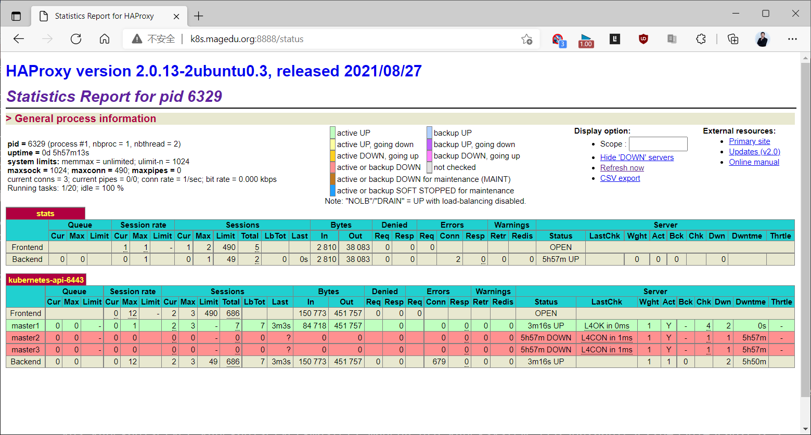

示例: 查看master上面的默认镜像
```bash
[root@master1 ~]#docker images
REPOSITORY                                                                    TAG
IMAGE ID       CREATED         SIZE
rancher/mirrored-flannelcni-flannel
v0.16.3   8cb5de74f107   7 weeks ago     59.7MB
rancher/mirrored-flannelcni-flannel-cni-plugin
v1.0.1    ac40ce625740   2 months ago    8.1MB
registry.cn-hangzhou.aliyuncs.com/google_containers/kube-apiserver
v1.22.1   f30469a2491a   7 months ago    128MB
registry.cn-hangzhou.aliyuncs.com/google_containers/kube-controller-manager
v1.22.1   6e002eb89a88   7 months ago    122MB
registry.cn-hangzhou.aliyuncs.com/google_containers/kube-proxy
v1.22.1   36c4ebbc9d97   7 months ago    104MB
registry.cn-hangzhou.aliyuncs.com/google_containers/kube-scheduler
v1.22.1   aca5ededae9c   7 months ago    52.7MB
registry.cn-hangzhou.aliyuncs.com/google_containers/etcd
3.5.0-0   004811815584   9 months ago    295MB
registry.cn-hangzhou.aliyuncs.com/google_containers/coredns
v1.8.4    8d147537fb7d   9 months ago    47.6MB
registry.cn-hangzhou.aliyuncs.com/google_containers/pause
3.5       ed210e3e4a5b   12 months ago   683kB

[root@master1 ~]#docker images|awk '{print $1}'
REPOSITORY
rancher/mirrored-flannelcni-flannel
rancher/mirrored-flannelcni-flannel-cni-plugin
registry.cn-hangzhou.aliyuncs.com/google_containers/kube-apiserver
registry.cn-hangzhou.aliyuncs.com/google_containers/kube-proxy
registry.cn-hangzhou.aliyuncs.com/google_containers/kube-controller-manager
registry.cn-hangzhou.aliyuncs.com/google_containers/kube-scheduler

registry.cn-hangzhou.aliyuncs.com/google_containers/etcd
registry.cn-hangzhou.aliyuncs.com/google_containers/coredns
registry.cn-hangzhou.aliyuncs.com/google_containers/pause
```

##### 3.4.7.2.2 基于文件初始化kubernetes集群

生产环境推荐本方式，利用文件可以了解以前创建的配置。

示例 : 清理旧的Kubernetes环境
```bash
#如果在前面已有集群环境中实现可以先清理环境,按先清理node节点，再清理master节点
#node节点
kubeadm  reset -f
rm -rf  /etc/cni/net.d/
reboot
apt install -y kubelet=1.21.4-00 kubeadm=1.21.4-00 kubectl=1.21.4-00 --allow-
downgrades

#master
kubeadm  reset --force
rm -rf  /etc/cni/net.d/  $HOME/.kube/config /var/lib/etcd/
reboot
apt install -y kubelet=1.21.4-00 kubeadm=1.21.4-00 kubectl=1.21.4-00 --allow-
downgrades
```

示例: 基于文件初始化kubernetes集群
```yaml
#输出默认初始化配置
[root@master1 ~]#kubeadm config print init-defaults

#将默认配置输出至文件
[root@master1 ~]#kubeadm config print init-defaults > kubeadm-init.yaml

#修改后的初始化文件内容，修改下面共7项设置
#k8s-v1.34.1
[root@master1 ~]#vim kubeadm-init.yaml
apiVersion: kubeadm.k8s.io/v1beta4
bootstrapTokens:
- groups:
- system:bootstrappers:kubeadm:default-node-token
token: BOOTSTRAP_TOKEN
ttl: 24h0m0s    #指定token有效期,默认24小时,0s为永不失效
usages:
- signing
- authentication
kind: InitConfiguration
localAPIEndpoint:
advertiseAddress: 10.0.0.201 #1）指定当前主机IP
bindPort: 6443
nodeRegistration:
criSocket: unix:///var/run/containerd/containerd.sock
imagePullPolicy: IfNotPresent
imagePullSerial: true
name: master1.bowen.org     #2）指定主机名
taints: null
timeouts:
controlPlaneComponentHealthCheck: 4m0s

discovery: 5m0s
etcdAPICall: 2m0s
kubeletHealthCheck: 4m0s
kubernetesAPICall: 1m0s
tlsBootstrap: 5m0s
upgradeManifests: 5m0s
---
apiServer: {}
apiVersion: kubeadm.k8s.io/v1beta4
caCertificateValidityPeriod: 87600h0m0s
certificateValidityPeriod: 8760h0m0s
certificatesDir: /etc/kubernetes/pki
clusterName: kubernetes
controlPlaneEndpoint: kubeapi.bowen.org:6443 #3）添加此行,配置基于 VIP 的 Endpoint，必
须项
controllerManager: {}
dns: {}
encryptionAlgorithm: RSA-2048
etcd:
local:
dataDir: /var/lib/etcd
imageRepository: registry.aliyuncs.com/google_containers #4）修改为国内的镜像地址
kind: ClusterConfiguration
kubernetesVersion: 1.34.1                         #5）指定版本，必须项
networking:
dnsDomain: cluster.local
podSubnet: 10.244.0.0/16              #6）添加此行,指定Pod的网段，必须项
serviceSubnet: 10.96.0.0/12           #7）指定网段，必须项，默认值10.96.0.0/12
proxy: {}
scheduler: {}
#旧版
[root@master1 ~]#vim kubeadm-init.yaml
apiVersion: kubeadm.k8s.io/v1beta2
bootstrapTokens:
- groups:
- system:bootstrappers:kubeadm:default-node-token
token: BOOTSTRAP_TOKEN
ttl: 48h0m0s                        #指定token有效期,默认24小时,0s为永不失效
usages:
- signing
- authentication
kind: InitConfiguration
localAPIEndpoint:
advertiseAddress: 10.0.0.101        #指定当前主机IP
bindPort: 6443
nodeRegistration:
criSocket: /var/run/dockershim.sock
name: master1.bowen.org      #指定主机名
taints:
- effect: NoSchedule
key: node-role.kubernetes.io/master
---
apiServer:
timeoutForControlPlane: 4m0s
apiVersion: kubeadm.k8s.io/v1beta2
certificatesDir: /etc/kubernetes/pki
clusterName: kubernetes

controlPlaneEndpoint: kubeapi.bowen.org:6443     #添加此行,配置基于 VIP 的 Endpoint，
必须项
controllerManager: {}
dns:
type: CoreDNS
etcd:
local:
dataDir: /var/lib/etcd
imageRepository: registry.aliyuncs.com/google_containers  #修改为国内的镜像地址
kind: ClusterConfiguration
kubernetesVersion: v1.22.1              #指定版本，必须项
networking:
dnsDomain: bowen.org                 #指定域名，非必须项，默认值cluster.local
podSubnet: 10.244.0.0/16                #添加此行,指定Pod的网段，必须项
serviceSubnet: 10.96.0.0/12         #指定网段，必须项，默认值10.96.0.0/12
scheduler: {}

# 基于文件执行master初始化,注意：需要加选项--upload-certs，否则生成加入Master节点的命令缺
失--certificate-key 88c53d620c6导致无法加master进集群
[root@master1 ~]#kubeadm init --config kubeadm-init.yaml --upload-certs
......
[addons] Applied essential addon: kube-proxy

Your Kubernetes control-plane has initialized successfully!

To start using your cluster, you need to run the following as a regular user:

mkdir -p $HOME/.kube
sudo cp -i /etc/kubernetes/admin.conf $HOME/.kube/config
sudo chown $(id -u):$(id -g) $HOME/.kube/config

Alternatively, if you are the root user, you can run:

export KUBECONFIG=/etc/kubernetes/admin.conf
```


You should now deploy a pod network to the cluster. Run "kubectl apply -f [podnetwork].yaml" with one of the options listed at:

<https://kubernetes.io/docs/concepts/cluster-administration/addons/>

```bash
You can now join any number of control-plane nodes by copying certificate
authorities
and service account keys on each node and then running the following as root:

kubeadm join kubeapi.bowen.org:6443 --token BOOTSTRAP_TOKEN \
--discovery-token-ca-cert-hash
sha256:CA_CERT_HASH \
--control-plane --certificate-key
CERTIFICATE_KEY
```


Please note that the certificate-key gives access to cluster sensitive data, keep it secret! As a safeguard, uploaded-certs will be deleted in two hours; If necessary, you can use"kubeadm init phase upload-certs --upload-certs" to reload certs afterward.

```bash
Then you can join any number of worker nodes by running the following on each as
root:

kubeadm join kubeapi.bowen.org:6443 --token BOOTSTRAP_TOKEN \
--discovery-token-ca-cert-hash
sha256:CA_CERT_HASH

[root@master1 ~]#
```

### 3.4.8  生成 kubectl命令的 kube-config 授权文件

kubectl是kube-apiserver的命令行客户端程序，实现了除系统部署之外的几乎全部的管理操作，是kubernetes管理员使用最多的命令之一。kubectl需经由API server认证及授权后方能执行相应的管理操作，kubeadm部署的集群为其生成了一个具有管理员权限的认证配置文件/etc/kubernetes/admin.conf，它可由kubectl通过默认的“$HOME/.kube/config”的路径进行加载。当然，用户也可在kubectl命令上使用--kubeconfig选项指定一个别的位置。

根据第一台主机初始化成功的提示信息进行下面操作
```yaml
#复制认证为Kubernetes系统管理员的配置文件至目标用户（例如当前用户root）的家目录下,生成配置
kube-config 文件
[root@master1 ~]#mkdir -p $HOME/.kube
[root@master1 ~]#sudo cp -i /etc/kubernetes/admin.conf $HOME/.kube/config
[root@master1 ~]#sudo chown $(id -u):$(id -g) $HOME/.kube/config
[root@master1 ~]#cat /etc/kubernetes/admin.conf
apiVersion: v1
clusters:
- cluster:
certificate-authority-data:
LS0tLS1CRUdJTiBDRVJUSUZJQ0FURS0tLS0tCk1JSUN5RENDQWJDZ0F3SUJBZ0lCQURBTkJna3Foa2lH
OXcwQkFRc0ZBREFWTVJNd0VRWURWUVFERXdwcmRXSmwKY201bGRHVnpNQjRYRFRJd01EUXlOVEEwTURj
eU1Wb1hEVE13TURReU16QTBNRGN5TVZvd0ZURVRNQkVHQTFVRQpBeE1LYTNWaVpYSnVaWFJsY3pDQ0FT
SXdEUVlKS29aSWh2Y05BUUVCQlFBRGdnRVBBRENDQVFvQ2dnRUJBT2I2CjFCcWdUS29GWmtobVZJY1pZ
ZjdRN1hNWGZ0QmhTd3E1eWE0M3VYWm1xTTRMYmdadlNmNXdnNzRGZ1VpdkhhSGcKSy9UNHEzUlBMWm5a
T3AwV3dVMWlYTzYrOFNTWVJwcmpEZllNcnZYS2ZQQ0kvYmRaZHlMbmg4Y2ZGQlRYNmRvdApydHE0cHla
eHJXT0w3ejJpTDJwSHUyQVcxQUd5UHNkZCtGdlBJbXQvN1NOUTBhUDFrRnZ1Z3hSOWtuNGhha2IyClh2
M1dMVnZUdis5Z0oxejYvZExlMUt3ODE1N0hyeHdxMFBRb3d0UWQ0SEEzRDFhNnR0S2xMeGVYcjBZKy9L
ckYKRm5sL2RDcE0vYnE0U0R0ejdJWFk5WSs2VDlNV0U4c3VudUZ1Uk1XZGlZQVU5YUhwUXJZVTBRTm1l
QmM0VVpWSAprVHhFTFRGVlBFbVNqQ081SWFVQ0F3RUFBYU1qTUNFd0RnWURWUjBQQVFIL0JBUURBZ0tr
TUE4R0ExVWRFd0VCCi93UUZNQU1CQWY4d0RRWUpLb1pJaHZjTkFRRUxCUUFEZ2dFQkFBR0FBK2lNOWdq
cXdCeHNObXYrZ0F1c3dtSDEKN0J2cyszUmdyNERkbkJ6eGxuTjhTVDZkc2Z4ZmFyUnFCUVlLZGk0UkVW
WlNWV0NLbzZNYmRnNS9PYnZiZUlqQgpmK1o0WUd5cS9LYmhJd1Noc1k3dEtJbHhXeVVpMUVkSitFaVVI
YTVTMW15eUFUNU9QTHV3V1FYVFZtbFpLaU9LCjg2N2xpK0oxcEEyV0RVNTdISlV4d0VLZ3pkY0hva09N
V09YNDI5OThSTjJjVjdWSXJzZjVXYTFmcHdqV2p1cU0KaTI5R2RZcCtIU05iVUpzcUxlYnM2bjd6Z2k4
RzlJbkY0eUxYcVVseldLUmFvUmJJKzgrME1EMGcwNTExQnBsYwpBcllMR2FxS0N1c3RHa1pwb0JMaW5R
amFlNnpKOS9CdlJhYnNxcTVLd1V4RUw0ZnRLOGY3QnRiOG9qaz0KLS0tLS1FTkQgQ0VSVElGSUNBVEUt
LS0tLQo=
server: https://10.0.0.100:6443
name: kubernetes
contexts:
- context:
cluster: kubernetes
user: kubernetes-admin
name: kubernetes-admin@kubernetes
current-context: kubernetes-admin@kubernetes
kind: Config
preferences: {}
users:
- name: kubernetes-admin
user:

client-certificate-data:
LS0tLS1CRUdJTiBDRVJUSUZJQ0FURS0tLS0tCk1JSUM4akNDQWRxZ0F3SUJBZ0lJVnhVcy9kOFo1Qk13
RFFZSktvWklodmNOQVFFTEJRQXdGVEVUTUJFR0ExVUUKQXhNS2EzVmlaWEp1WlhSbGN6QWVGdzB5TURB
ME1qVXdOREEzTWpGYUZ3MHlNVEEwTWpVd05EQTNNalJhTURReApGekFWQmdOVkJBb1REbk41YzNSbGJU
cHRZWE4wWlhKek1Sa3dGd1lEVlFRREV4QnJkV0psY201bGRHVnpMV0ZrCmJXbHVNSUlCSWpBTkJna3Fo
a2lHOXcwQkFRRUZBQU9DQVE4QU1JSUJDZ0tDQVFFQXdxYklqcUtHc1F3YjI5eXQKUXpMMzBXbmd5SjVK
Zy9kcE1UM0R2YzdqTjZEdm1USFhwa1NicW9iOUJhc1dxQ3JSUmVUYXFIZU82YVUvSEZ6SgpIb25lQmRW
YjZaeEF3bDBGengxNXNXazRxd3RRbWp6WkhDeWFSU01Vd2dRM3phbGRCSlppRU1MT0MvcXNWa0RKClJH
ZmQ5SWRFbTRJNHJBd2tPV09PRDk5OWV1ZDE5dG05eFVUZUR3ckZ0NXVzeW9NK2Nndmk4UXV3Y0ZiajA0
ekUKejVuYWFOUlR4b2FHSjJhdnV2cHBOTm02dHNTOGJ0K1AzR2QzaTJaWW1WTGo2djNwelRsQllhK1BL
OXAvNzdWbApZdExvVlNPTWZKU2RNU0JDL2I1b04yWWRzNjcvYmxYbEhiT1VSUVlYNzdiNjRHU2JJN3JK
aUJjbEVTcEl6V0xhCkRqNEZhd0lEQVFBQm95Y3dKVEFPQmdOVkhROEJBZjhFQkFNQ0JhQXdFd1lEVlIw
bEJBd3dDZ1lJS3dZQkJRVUgKQXdJd0RRWUpLb1pJaHZjTkFRRUxCUUFEZ2dFQkFNSDJDaFhET0Npb0o4
eUE0QThXUHdaNTF6bERBcUNnK1c3Twp3QzBlUFFlcXUxa1IxejVWUWpSdnRjRm5GVnpwR1cvWDdYb3pN
QWR0ajZKd3BvaVIybTc5alo4UUNzZWVVZGZxCjJJeFNjUVVHb1kzaGdRbmJCOUlkak1JUXFYaDFTcVRy
RTdpR3NCYlY1NWtFcW9BSVZOeTRhdWNKVEMwM2FPcFgKNlRSaUVUU3Vjc0VhdU9nMUt0T0NKYmV0U0U3
WGJWRllDR05ocFQ5S1ZoYjhnN2tmSmhvNGZLOWY3SmVGTSszeAo1dnNSSDc0WUE4WEhlZXh4b05Zcm50
RVB5c0JRcEhDQmVxT1JxR2x3R0JtN3M0UXJjM0lsT1o4OFhOWGkzSDVmCk5pS00yZnVFS1dFZE1Cek9J
YzBDV0N2VUdjWnNoRnZMVTNlZnFwL1Y4N1R6eXRQYnBlND0KLS0tLS1FTkQgQ0VSVElGSUNBVEUtLS0t
LQo=
client-key-data:
LS0tLS1CRUdJTiBSU0EgUFJJVkFURSBLRVktLS0tLQpNSUlFcFFJQkFBS0NBUUVBd3FiSWpxS0dzUXdi
Mjl5dFF6TDMwV25neUo1SmcvZHBNVDNEdmM3ak42RHZtVEhYCnBrU2Jxb2I5QmFzV3FDclJSZVRhcUhl
TzZhVS9IRnpKSG9uZUJkVmI2WnhBd2wwRnp4MTVzV2s0cXd0UW1qeloKSEN5YVJTTVV3Z1EzemFsZEJK
WmlFTUxPQy9xc1ZrREpSR2ZkOUlkRW00STRyQXdrT1dPT0Q5OTlldWQxOXRtOQp4VVRlRHdyRnQ1dXN5
b00rY2d2aThRdXdjRmJqMDR6RXo1bmFhTlJUeG9hR0oyYXZ1dnBwTk5tNnRzUzhidCtQCjNHZDNpMlpZ
bVZMajZ2M3B6VGxCWWErUEs5cC83N1ZsWXRMb1ZTT01mSlNkTVNCQy9iNW9OMllkczY3L2JsWGwKSGJP
VVJRWVg3N2I2NEdTYkk3ckppQmNsRVNwSXpXTGFEajRGYXdJREFRQUJBb0lCQVFDbWlodytMVUFnYXNQ
TApNTnZ0Q3NhTkhaRjlGRERDQUFTNFpLZjgxZTRCd21nOUlpL255ZnVGdzBqb2VLRkI4S0JzdEltQWFn
cVVUUlhhCkptak5BQmc5MVhaMlFZSUd5YUFXdkpsSitVVEswenQ3TzJSbWZxTGZWRXlHVXlXTGlNUlZF
SFdHOGFWcENtZzQKdytWdjZZNDFrU1phQnVpR0N6MVMvS0tuWWdmeUJta1pJTnJDa3R4ZnN3YmdTVFVN
QXdiQkhSWDF3N0Y3T09BUApvTjdBTXVZSkw3M0dPNUQwL055eEJpVjZZRjBFTkgyeVRHY2RXMCtaa3Jq
ZEFlQTNLeHFsMXVxUDhMQ0RWNW5SCkJrWjQrdWpPaDlDLzJoOElwMzg3KzlBUitNK1BDRStxK1JkZnJP
NG1sUkdROWIvaUpaS0tabmlJM3oxMlVkdHMKNVVtTFBnOUJBb0dCQU9LRWRadkVTOVhoMWVLMHNFMkdu
M0sxYU96M2EwUVMxaS9md3NNbEdKdldnRURWbDJIbgpLTnp1alhUSjBpVTBDTHZxQnpTUUlrRU1UcVdY
UEc3OHFKZkFxSDFMWDArbUQ0NHlxcEdyYzg3RnFvaVlaa0toCmExOGt2N1hRZHVOSytTQkNLRVZEc29X
RG1Fb2duY2ZpR1VzRDFCdTlZOUd6QWMweE00ZEw1Sng5QW9HQkFOdjgKamVZcE84MndjUlhwVUwxZGE0
dHZWVkJsaklWYVdkTnZJTUp2OHRmMHFaVWZwSS8xaGJ1QmJZdkY2WkJOcUU2QgpFdE5yTzJiVklqVUpW
L1V6UFdPQTQ0ZFF6NUlEVTZzWTVxSXhTS3BvNzhKdzVaREptc2FLQTkxbXlNd2tjbUZuCllZUFZkSmd1
WGVEcmx6UnJFMTlrVitRdUF2VGo0SmhBUCtCQXB4WUhBb0dCQU5OOVF1VjFhQ3pBMTFiOHh5TUwKRDNJ
bEtGc2ZRdHBqRC9IUTVHSVpENW5vc3dSVnFDcXpqZmFCRURlN2UyWmE1OUN6VjVqZS9leG4xa0pMS3hT
Zwo5N1FBSUJBandGQjRSa3ZJeUhLTGR1dldxRHN5dHo5OHdPZ3JRb2M1cE5iZ21DdGpPWUE2RGNNVXM2
cDZPM1oxCmhwSUFlQmlTUWxGMjViYTBPbDBYSWRKdEFvR0FieVpQS0FDamQ4enpobWVwWk5TRDF5Szhq
MitQclgwMkw0OVIKbFF4dFBkSWZzUG9ZOHFmU0Z5aFJDak5JVEtJQUxSSW9TZXcvU2pqY0hNSUkwQnBB
cFRybE8yU0lURFVrSENucgp0ZjJDd3A5Y3JQalA5UFQ0SCtKeUMzYTRjL1RpV2ZhYkhicEhPL0VKZS9C
dEtJNEZic2hMWkQ0ZlBrNjVGeFEzCmNmNFlyaGNDZ1lFQTFUbFU2Tzc3MGVjM2poVzdXTHE1dWV5Zi9D
Tmk1QXZPSjFkR2RSeThpK3laN3ZvWWh5bEYKKzd1dmVIRW83QTJxcmxqdzVtRWY3UzlnUU1UT2E2UmxI
d2JlekRtOEp3Nys4MmljVnpTWklhR2p5S1VEU3d4UwpmVkRGTDFOcW16ZW8zNnlzZ3hNUDBRVDB5Z3Fi
amdaQkJvVDJlRnFSRHFrSzk5L3dSa3NBZWpvPQotLS0tLUVORCBSU0EgUFJJVkFURSBLRVktLS0tLQo=

#查看配置信息
[root@master1 ~]#kubectl config view
apiVersion: v1
clusters:
- cluster:
certificate-authority-data: DATA+OMITTED
server: https://kubeapi.bowen.org:6443
name: kubernetes

contexts:
- context:
cluster: kubernetes
user: kubernetes-admin
name: kubernetes-admin@kubernetes
current-context: kubernetes-admin@kubernetes
kind: Config
preferences: {}
users:
- name: kubernetes-admin
user:
client-certificate-data: REDACTED
client-key-data: REDACTED
```

范例：问题解决(可选)
```bash
#新版中scheduler组件显示Unhealthy状态这是因为默认的配置文件中对于端口的定制做了操作，将默认的
配置文件修改一下即可。注意：如果 controller-manager 也是Unhealthy，也用下面方法来进行处理
[root@master1 ~]#kubectl get cs
Warning: v1 ComponentStatus is deprecated in v1.19+
NAME                 STATUS      MESSAGE
ERROR
scheduler            Unhealthy   Get "http://127.0.0.1:10251/healthz": dial tcp
127.0.0.1:10251: connect: connection refused
controller-manager   Healthy     ok

etcd-0               Healthy     {"health":"true","reason":""}

[root@master1 ~]#grep port= /etc/kubernetes/manifests/kube-scheduler.yaml
- --port=0
#将port=0此行注释即可
[root@master1 ~]#sed -i.bak '/port=/s@^@#@' /etc/kubernetes/manifests/kube-
scheduler.yaml
[root@master1 ~]#grep port= /etc/kubernetes/manifests/kube-scheduler.yaml
#    - --port=0

#稍等即可，也可以重启服务
[root@master1 ~]#systemctl restart kubelet.service
```

### 3.4.9 添加其它的master 节点到集群(可选)

#### 3.4.9.1  在第1个 master 生成用于添加新的master控制节点的 key (可选)

如果集群初始化时, kubeadm init ---upload-certs 使用此选项,在初始化时会自动生成  --certificate-key信息,下面可不用执行,
```bash
#生成后续的master节点加入集群的key
[root@master1 ~]#kubeadm init phase upload-certs --upload-certs
I0222 17:35:04.342485   42379 version.go:255] remote version is much newer:
v1.23.4; falling back to: stable-1.22
[upload-certs] Storing the certificates in Secret "kubeadm-certs" in the "kube-
system" Namespace
[upload-certs] Using certificate key:
#生成key信息
e514d96ca1a827c2c910d29bba5faa1c4e60f6ab124530556267c1670f68711f  #复制此行的key信
息

#查看是否生成NAME为kubeadm-certs的证书
[root@master1 ~]#kubectl  get secrets -n kube-system
```

#### 3.4.9.2  添加后续所有其它 master 节点

依据3.4.7.2.1小节，集群初始化时最后面信息，添加master节点。
```bash
To start using your cluster, you need to run the following as a regular user:

mkdir -p $HOME/.kube
sudo cp -i /etc/kubernetes/admin.conf $HOME/.kube/config
sudo chown $(id -u):$(id -g) $HOME/.kube/config

Alternatively, if you are the root user, you can run:

export KUBECONFIG=/etc/kubernetes/admin.conf
```


You should now deploy a pod network to the cluster. Run "kubectl apply -f [podnetwork].yaml" with one of the options listed at:

<https://kubernetes.io/docs/concepts/cluster-administration/addons/>

```bash
You can now join any number of control-plane nodes by copying certificate
authorities
and service account keys on each node and then running the following as root:
# 复制以下命令
kubeadm join kubeapi.bowen.org:6443 --token BOOTSTRAP_TOKEN \
--discovery-token-ca-cert-hash
sha256:CA_CERT_HASH \
--control-plane

Then you can join any number of worker nodes by running the following on each as
root:

kubeadm join kubeapi.bowen.org:6443 --token BOOTSTRAP_TOKEN \
--discovery-token-ca-cert-hash
sha256:CA_CERT_HASH
[root@master1 ~]#
```

在所有其他 master节点执行下面所需命令
```bash
#基于kubeadm init命令执行的输出结果,添加 --certificate-key 参数,执行下面命令
[root@master2 ~]#kubeadm join kubeapi.bowen.org:6443 --token
BOOTSTRAP_TOKEN \
--discovery-token-ca-cert-hash
sha256:CA_CERT_HASH \

--control-plane  --certificate-key
CERTIFICATE_KEY \
--cri-socket=unix:///run/cri-dockerd.sock #注意：v1.24版本需要添加此项才能支持
docker
......
```


[preflight] Running pre-flight checks[preflight] Reading configuration from the cluster...[preflight] FYI: You can look at this config file with 'kubectl -n kube-system get cm kubeadm-config -o yaml'[preflight] Running pre-flight checks before initializing the new control plane instance[preflight] Pulling images required for setting up a Kubernetes cluster[preflight] This might take a minute or two, depending on the speed of your internet connection[preflight] You can also perform this action in beforehand using 'kubeadm config images pull'[download-certs] Downloading the certificates in Secret "kubeadm-certs" in the"kube-system" Namespace[certs] Using certificateDir folder "/etc/kubernetes/pki"[certs] Generating "apiserver" certificate and key[certs] apiserver serving cert is signed for DNS names [kubeapi.bowen.org kubernetes kubernetes.default kubernetes.default.svc kubernetes.default.svc.cluster.local master2.bowen.org] and IPs [192.168.0.1 10.0.0.102][certs] Generating "apiserver-kubelet-client" certificate and key[certs] Generating "front-proxy-client" certificate and key[certs] Generating "etcd/peer" certificate and key[certs] etcd/peer serving cert is signed for DNS names [localhost master2.bowen.org] and IPs [10.0.0.102 127.0.0.1 ::1][certs] Generating "etcd/server" certificate and key[certs] etcd/server serving cert is signed for DNS names [localhost master2.bowen.org] and IPs [10.0.0.102 127.0.0.1 ::1][certs] Generating "etcd/healthcheck-client" certificate and key[certs] Generating "apiserver-etcd-client" certificate and key[certs] Valid certificates and keys now exist in "/etc/kubernetes/pki"[certs] Using the existing "sa" key[kubeconfig] Generating kubeconfig files[kubeconfig] Using kubeconfig folder "/etc/kubernetes"[kubeconfig] Writing "admin.conf" kubeconfig file[kubeconfig] Writing "controller-manager.conf" kubeconfig file[kubeconfig] Writing "scheduler.conf" kubeconfig file[control-plane] Using manifest folder "/etc/kubernetes/manifests"[control-plane] Creating static Pod manifest for "kube-apiserver"[control-plane] Creating static Pod manifest for "kube-controller-manager"[control-plane] Creating static Pod manifest for "kube-scheduler"[check-etcd] Checking that the etcd cluster is healthy[kubelet-start] Writing kubelet configuration to file"/var/lib/kubelet/config.yaml"[kubelet-start] Writing kubelet environment file with flags to file"/var/lib/kubelet/kubeadm-flags.env"[kubelet-start] Starting the kubelet[kubelet-start] Waiting for the kubelet to perform the TLS Bootstrap...[etcd] Announced new etcd member joining to the existing etcd cluster[etcd] Creating static Pod manifest for "etcd"[etcd] Waiting for the new etcd member to join the cluster. This can take up to 40s


The 'update-status' phase is deprecated and will be removed in a future release. Currently it performs no operation[mark-control-plane] Marking the node master2.bowen.org as control-plane by adding the labels: [node-role.kubernetes.io/master(deprecated) node-role.kubernetes.io/control-plane node.kubernetes.io/exclude-from-external-load-balancers][mark-control-plane] Marking the node master2.bowen.org as control-plane by adding the taints [node-role.kubernetes.io/master:NoSchedule]

```text
This node has joined the cluster and a new control plane instance was created:
```


* Certificate signing request was sent to apiserver and approval was received.* The Kubelet was informed of the new secure connection details.* Control plane (master) label and taint were applied to the new node.* The Kubernetes control plane instances scaled up.* A new etcd member was added to the local/stacked etcd cluster.

```bash
To start administering your cluster from this node, you need to run the
following as a regular user:

mkdir -p $HOME/.kube
sudo cp -i /etc/kubernetes/admin.conf $HOME/.kube/config
sudo chown $(id -u):$(id -g) $HOME/.kube/config

Run 'kubectl get nodes' to see this node join the cluster.

#按上面提示生成kubectl命令的授权配置文件
[root@master2 ~]#mkdir -p $HOME/.kube
[root@master2 ~]#sudo cp -i /etc/kubernetes/admin.conf $HOME/.kube/config
[root@master2 ~]#sudo chown $(id -u):$(id -g) $HOME/.kube/config
[root@master2 ~]#kubectl get nodes
NAME                      STATUS   ROLES    AGE     VERSION
master1.bowen.org   Ready    master   4h33m   v1.17.2
master2.bowen.org   Ready    master   155m    v1.17.2
master3.bowen.org   Ready    master   150m    v1.17.2

#修改haproxy的配置
[root@ha1 ~]#vi /etc/haproxy/haproxy.cfg
listen stats
mode http
bind 0.0.0.0:8888
stats enable
log global
stats uri /status
stats auth admin:123456

listen  kubernetes-api-6443
bind 10.0.0.100:6443
mode tcp
server master1 10.0.0.101:6443 check inter 3s fall 3 rise 3
server master2 10.0.0.102:6443 check inter 3s fall 3 rise 3 #启用两行
server master3 10.0.0.103:6443 check inter 3s fall 3 rise 3

[root@ha1 ~]#systemctl reload haproxy
```

观察haproxy的状态页，可以看到所有 master上线。

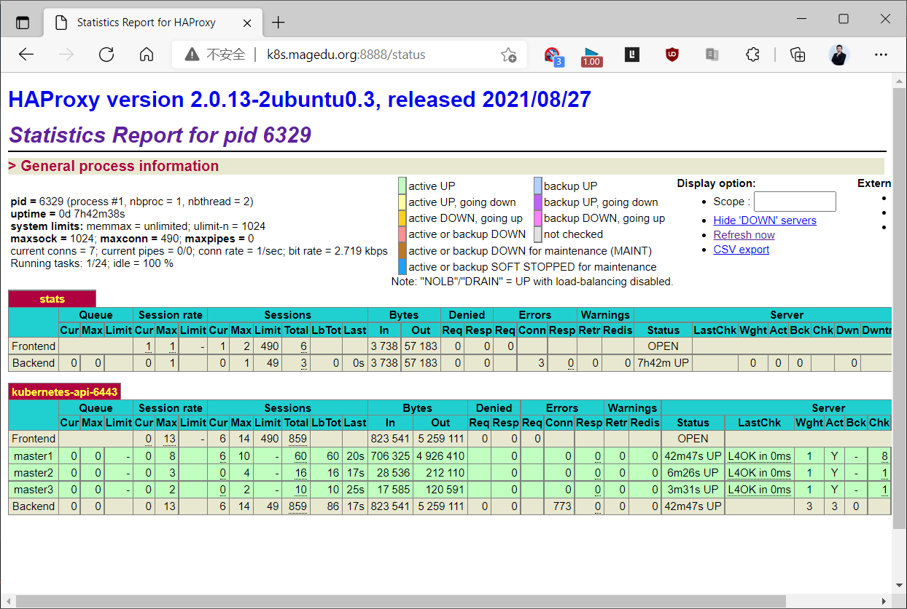

#### 3.4.9.3 验证master 状态

**验证master 状态**
```bash
[root@master1 ~]#kubectl get nodes
NAME               STATUS   ROLES    AGE     VERSION
master1.bowen.org   NotReady   master   88m   v1.17.2
master2.bowen.org   NotReady   master   88m   v1.17.2
master3.bowen.org   NotReady   master   88m   v1.17.2
```

**验证 k8s 集群状态**
```bash
[root@master1 ~]# kubectl get cs
NAME                 STATUS    MESSAGE             ERROR
scheduler            Healthy   ok
controller-manager   Healthy   ok
etcd-0               Healthy   {"health":"true"}
```

**验证证书信息**
```bash
[root@master1 ~]#kubectl  get csr
NAME        AGE    REQUESTOR                 CONDITION
csr-4xqfr   156m   system:bootstrap:abcdef   Approved,Issued
csr-95g2v   163m   system:bootstrap:abcdef   Approved,Issued
csr-pd4f8   161m   system:bootstrap:abcdef   Approved,Issued
csr-w9kzg   162m   system:bootstrap:abcdef   Approved,Issued
csr-x24b9   156m   system:bootstrap:abcdef   Approved,Issued
```

### 3.4.10  在每个worker节点分别执行命令将所有 Worker 主机加入集群

#### 3.4.10.1  在每个worker节点分别执行命令将所有 Worker 节点加入kubernetes集群

依据3.4.7.2.1小节，初始化时最后面信息，添加node节点。
```text
Then you can join any number of worker nodes by running the following on each as
root:

kubeadm join kubeapi.bowen.org:6443 --token BOOTSTRAP_TOKEN \
--discovery-token-ca-cert-hash
sha256:CA_CERT_HASH
```

**生成加入集群token命令**
```bash
[root@master1 ~]#kubeadm token create --print-join-command
kubeadm join kubeapi.bowen.org:6443 --token BOOTSTRAP_TOKEN --discovery-
token-ca-cert-hash
sha256:CA_CERT_HASH
```

在所有node节点执行上面的命令即可加入集群
```bash
[root@node1 ~]#kubeadm join kubeapi.bowen.org:6443 --token
BOOTSTRAP_TOKEN \
> --discovery-token-ca-cert-hash
sha256:CA_CERT_HASH
--cri-socket=unix:///run/cri-dockerd.sock #注意：v1.24版本需要添加此项才能支持docker
```


[preflight] Running pre-flight checks[preflight] Reading configuration from the cluster...[preflight] FYI: You can look at this config file with 'kubectl -n kube-system get cm kubeadm-config -o yaml'[kubelet-start] Writing kubelet configuration to file"/var/lib/kubelet/config.yaml"[kubelet-start] Writing kubelet environment file with flags to file"/var/lib/kubelet/kubeadm-flags.env"[kubelet-start] Starting the kubelet[kubelet-start] Waiting for the kubelet to perform the TLS Bootstrap...


This node has joined the cluster:* Certificate signing request was sent to apiserver and a response was received.* The Kubelet was informed of the new secure connection details.

```text
Run 'kubectl get nodes' on the control-plane to see this node join the cluster.
```

#### 3.4.10.2 在master上验证 Worker 节点是否加入集群
```bash
[root@master1 ~]#kubectl get cs
Warning: v1 ComponentStatus is deprecated in v1.19+
NAME                 STATUS    MESSAGE   ERROR
scheduler            Healthy   ok
controller-manager   Healthy   ok

etcd-0               Healthy   ok

#稍等几分钟后可以查看下面Ready状态
[root@master1 ~]#kubectl get nodes
NAME               STATUS   ROLES    AGE     VERSION
master1.bowen.org   NotReady   master   88m   v1.17.2
master2.bowen.org   NotReady   master   88m   v1.17.2
master3.bowen.org   NotReady   master   88m   v1.17.2
node1.bowen.org     NotReady   <none>    88m   v1.17.2
node2.bowen.org     NotReady   <none>    88m   v1.17.2
node3.bowen.org     NotReady   <none>    88m   v1.17.2
```

#### 3.4.10.3 配置所有 Worker 节点指向harbor(可选)
```bash
[root@node1 ~]#sed -Ei '/^ExecStart/s#$# --insecure-registry harbor.bowen.org#'
/lib/systemd/system/docker.service
[root@node1 ~]#systemctl daemon-reload
[root@node1 ~]#systemctl restart docker.service
```

#### 3.4.10.4  查看所有 Worker 节点的镜像
```bash
[root@node1 ~]#docker images
REPOSITORY                                                       TAG       IMAGE
ID       CREATED         SIZE
rancher/mirrored-flannelcni-flannel                              v0.16.3
8cb5de74f107   7 weeks ago     59.7MB
rancher/mirrored-flannelcni-flannel-cni-plugin                   v1.0.1
ac40ce625740   2 months ago    8.1MB
registry.cn-hangzhou.aliyuncs.com/google_containers/kube-proxy   v1.22.1
36c4ebbc9d97   7 months ago    104MB
registry.cn-hangzhou.aliyuncs.com/google_containers/pause        3.5
ed210e3e4a5b   12 months ago   683kB

[root@node1 ~]#docker images|awk '{print $1}'
REPOSITORY
rancher/mirrored-flannelcni-flannel
rancher/mirrored-flannelcni-flannel-cni-plugin
registry.cn-hangzhou.aliyuncs.com/google_containers/kube-proxy
registry.cn-hangzhou.aliyuncs.com/google_containers/pause
```

### 3.4.11 在第一个master节点配置网络组件

Kubernetes系统上Pod网络的实现依赖于第三方插件进行，这类插件有近数十种之多，较为著名的有flannel、calico、canal和kube-router等，简单易用的实现是为CoreOS提供的flannel项目。下面的命令用于在线部署flannel至Kubernetes系统之上。
```bash
#查看节点信息为NotReady状态,原因为没有网络插件
[root@master1 ~]#kubectl get node
NAME               STATUS     ROLES    AGE   VERSION
master1.bowen.org   NotReady   master   88m   v1.17.2
master2.bowen.org   NotReady   master   88m   v1.17.2
master3.bowen.org   NotReady   master   88m   v1.17.2
node1.bowen.org     NotReady   <none>    88m   v1.17.2
node2.bowen.org     NotReady   <none>    88m   v1.17.2
node3.bowen.org     NotReady   <none>    88m   v1.17.2

#官方下载链接地址：https://github.com/flannel-io/flannel/，下载和部署网络组件 flannel,
可能需要科学上网才能下载
#新版
[root@master1 ~]#wget https://github.com/flannel-io/flannel/releases/latest/download/kube-flannel.yml
#如果下载失败，可以使用代理https://mirror.ghproxy.com下载
[root@master1 ~]#wget https://mirror.ghproxy.com/https://github.com/flannel-io/flannel/releases/latest/download/kube-flannel.yml

#旧版
[root@master1 ~]#wget
https://raw.githubusercontent.com/coreos/flannel/master/Documentation/kube-flannel.yml

#参考前面初始化的命令中 --pod-network-cidr 10.244.0.0/16 选项指定的网段地址修改文件，可使
用默认文件不做修改（可选）
[root@master1 ~]#vim kube-flannel.yml
......
net-conf.json: |
{
"Network": "10.244.0.0/16",  #参考初始化集群时--pod-network-cidr 选项修改为指定
的网段,默认值为10.244.0.0/16
"Backend": {
"Type": "vxlan"
}
}
.......

#只需要在第一个master上应用修改后的配置文件,创建相关的容器
[root@master1 ~]#kubectl apply -f kube-flannel.yml
Warning: policy/v1beta1 PodSecurityPolicy is deprecated in v1.21+, unavailable
in v1.25+
podsecuritypolicy.policy/psp.flannel.unprivileged created
clusterrole.rbac.authorization.k8s.io/flannel created
clusterrolebinding.rbac.authorization.k8s.io/flannel created
serviceaccount/flannel created
configmap/kube-flannel-cfg created
daemonset.apps/kube-flannel-ds created

#使用如下命令确认其输出结果中Pod的状态为“Running”
[root@master1 ~]#kubectl get pods -n kube-system -l app=flannel
NAME                    READY   STATUS    RESTARTS   AGE
kube-flannel-ds-zj4ss   1/1     Running   0          106s

#如果有问题,可以用下面命令删除上面创建的网络（可选）
[root@master1 ~]#kubectl delete -f kube-flannel.yml

#如果镜像下载失败，手动导入镜像（可选）
[root@master1 ~]#docker images |grep flannel
[root@master1 ~]#docker load -i flannel.v0.12.0-amd64.tar.gz

#稍候再次验证 master 节点状态：
[root@master1 ~]#kubectl get nodes
NAME               STATUS   ROLES    AGE     VERSION
master1.bowen.org   Ready    master   5h8m    v1.17.2

master2.bowen.org   Ready    master   3h10m   v1.17.2
master3.bowen.org   Ready    master   3h5m    v1.17.2
node1.bowen.org     Ready    <none>   19m     v1.17.2
node2.bowen.org     Ready    <none>   2m49s   v1.17.2
node3.bowen.org     Ready    <none>   51s     v1.17.2
```

### 3.4.12 创建容器并测试访问

创建测试容器，测试网络连接是否可以通信。

范例: 测试创建pod和网络访问
```bash
#查看集群信息
[root@master1 ~]#kubectl cluster-info
Kubernetes control plane is running at https://kubeapi.bowen.org:6443
CoreDNS is running at https://kubeapi.bowen.org:6443/api/v1/namespaces/kube-
system/services/kube-dns:dns/proxy

To further debug and diagnose cluster problems, use 'kubectl cluster-info dump'.

#创建两个pod
[root@master1 ~]#kubectl create  deployment pod-test --image=registry.cn-
beijing.aliyuncs.com/bowen/pod-test:v0.1  --replicas=2

#动态扩容
[root@master1 ~]#kubectl scale deployment/pod-test --replicas=3

[root@master1 ~]#kubectl create service nodeport pod-test --tcp=80:80

#查看外部能访问的端口
[root@master1 ~]#kubectl get svc -l app=pod-test
NAME      TYPE       CLUSTER-IP       EXTERNAL-IP   PORT(S)        AGE
pod-test     NodePort    10.110.17.180   <none>        80:31496/TCP   2m33s

#可以看到pod分布在三个worker节点上
[root@master1 ~]#kubectl get pod   -o wide
NAME                        READY   STATUS    RESTARTS   AGE     IP
NODE             NOMINATED NODE   READINESS GATES
pod-test-5b8795b9bc-4782x   1/1     Running   0          5m15s   10.244.1.4
node1.bowen.org   <none>           <none>
pod-test-5b8795b9bc-c48zh   1/1     Running   0          5m15s   10.244.2.4
node2.bowen.org   <none>           <none>
pod-test-5b8795b9bc-jnsmh   1/1     Running   0          5m15s   10.244.3.5
node3.bowen.org   <none>           <none>

#pod-test是一个web应用，因此，用户可以于集群外部通过“http://NodeIP:PORT”这个URL访问pod-
test上的应用，例如于集群外通过浏览器访问“http://node1.bowen.org:31496”
[root@master1 ~]#curl node1.bowen.org:31496
kubernetes pod-test v0.1!! ClientIP: 10.244.1.1, ServerName: pod-test-
5b8795b9bc-4782x, ServerIP: 10.244.1.4!
[root@master1 ~]#curl node1.bowen.org:31496
kubernetes pod-test v0.1!! ClientIP: 10.244.1.0, ServerName: pod-test-
5b8795b9bc-jnsmh, ServerIP: 10.244.3.5!
[root@master1 ~]#curl node1.bowen.org:31496

kubernetes pod-test v0.1!! ClientIP: 10.244.1.0, ServerName: pod-test-
5b8795b9bc-c48zh, ServerIP: 10.244.2.4!

#注意:不论访问哪个node主机都有自动均衡负载至不同worker上的pod

[root@master1 ~]#curl http://node2.bowen.org:31496/
[root@master1 ~]#curl http://node3.bowen.org:31496/

#或者通service地址访问也可以
[root@master1 ~]#curl 10.110.17.180
kubernetes pod-test v0.1!! ClientIP: 10.244.0.0, ServerName: pod-test-
5b8795b9bc-jnsmh, ServerIP: 10.244.3.5!
[root@master1 ~]#curl 10.110.17.180
kubernetes pod-test v0.1!! ClientIP: 10.244.0.0, ServerName: pod-test-
5b8795b9bc-c48zh, ServerIP: 10.244.2.4!
[root@master1 ~]#curl 10.110.17.180
kubernetes pod-test v0.1!! ClientIP: 10.244.0.0, ServerName: pod-test-
5b8795b9bc-4782x, ServerIP: 10.244.1.4!
```

范例：测试创建pod并且相互通信
```bash
[root@master1 ~]#kubectl run test1  --image=busybox  sleep 100000
[root@master1 ~]#kubectl run test2  --image=busybox  sleep 100000

[root@master1 ~]#kubectl get pod
NAME    READY   STATUS    RESTARTS   AGE
test1   1/1     Running   0          3m1s
test2   1/1     Running   0          2m56s

[root@master1 ~]#kubectl get pod  -o wide
NAME    READY   STATUS    RESTARTS   AGE     IP           NODE
NOMINATED NODE   READINESS GATES
test1   1/1     Running   0          3m18s   172.16.4.2   node2.bowen.org
<none>           <none>
test2   1/1     Running   0          3m13s   172.16.5.2   node3.bowen.org
<none>           <none>

[root@master1 ~]#kubectl exec -it test1 sh
kubectl exec [POD] [COMMAND] is DEPRECATED and will be removed in a future
version. Use kubectl exec [POD] -- [COMMAND] instead.
/ # hostname -i
172.16.4.2
/ # ping 172.16.5.2 -c1 #测试容器之间的通信成功
PING 172.16.5.2 (172.16.5.2): 56 data bytes
64 bytes from 172.16.5.2: seq=0 ttl=62 time=0.880 ms

--- 172.16.5.2 ping statistics ---
1 packets transmitted, 1 packets received, 0% packet loss
round-trip min/avg/max = 0.880/0.880/0.880 ms

/ # ping www.baidu.com -c1 #访问外网成功
PING www.baidu.com (39.156.66.14): 56 data bytes
64 bytes from 39.156.66.14: seq=0 ttl=127 time=4.697 ms

--- www.baidu.com ping statistics ---
1 packets transmitted, 1 packets received, 0% packet loss

round-trip min/avg/max = 4.697/4.697/4.697 ms
```

范例：测试
```bash
#注意：--replicas选项在新版中不再支持
[root@master1 ~]# kubectl run test1  --image=alpine --replicas=2 sleep 100000
kubectl run --generator=deployment/apps.v1 is DEPRECATED and will be removed in
a future version. Use kubectl run --generator=run-pod/v1 or kubectl create
instead.
deployment.apps/test1 created
[root@master1 ~]#kubectl get pod
NAME                         READY   STATUS    RESTARTS   AGE
test1-5fcc69db59-5lkv9   1/1     Running   0          112s
test1-5fcc69db59-rhq2d   1/1     Running   0          112s
[root@master1 ~]#kubectl get pod -o wide
NAME                         READY   STATUS    RESTARTS   AGE     IP
NODE               NOMINATED NODE   READINESS GATES
test1-5fcc69db59-5lkv9   1/1     Running   0          2m30s   172.16.5.2
node2.bowen.org   <none>           <none>
test1-5fcc69db59-rhq2d   1/1     Running   0          2m30s   172.16.3.2
node1.bowen.org   <none>           <none>

#测试容器之间的通信
[root@master1 ~]#kubectl exec -it test1-5fcc69db59-5lkv9 sh
/ # ip a
1: lo: <LOOPBACK,UP,LOWER_UP> mtu 65536 qdisc noqueue state UNKNOWN qlen 1000
link/loopback 00:00:00:00:00:00 brd 00:00:00:00:00:00
inet 127.0.0.1/8 scope host lo
valid_lft forever preferred_lft forever
3: eth0@if6: <BROADCAST,MULTICAST,UP,LOWER_UP,M-DOWN> mtu 1450 qdisc noqueue
state UP
link/ether 56:b5:4f:60:37:d9 brd ff:ff:ff:ff:ff:ff
inet 172.16.5.2/24 scope global eth0
valid_lft forever preferred_lft forever
/ # traceroute 172.16.3.2
traceroute to 172.16.3.2 (172.16.3.2), 30 hops max, 46 byte packets
1  172.16.5.1 (172.16.5.1)  0.007 ms  0.020 ms  0.014 ms
2  172.16.3.0 (172.16.3.0)  1.193 ms  0.385 ms  0.424 ms
3  172.16.3.2 (172.16.3.2)  0.374 ms  0.644 ms  0.924 ms

/ # ping www.baidu.com
PING www.baidu.com (61.135.169.125): 56 data bytes
64 bytes from 61.135.169.125: seq=0 ttl=127 time=7.718 ms
64 bytes from 61.135.169.125: seq=1 ttl=127 time=5.172 ms
^C
--- www.baidu.com ping statistics ---
2 packets transmitted, 2 packets received, 0% packet loss
round-trip min/avg/max = 5.172/6.445/7.718 ms

/ # route -n
Kernel IP routing table
Destination     Gateway         Genmask         Flags Metric Ref    Use Iface
0.0.0.0         172.16.5.1      0.0.0.0         UG    0      0        0 eth0
172.16.0.0      172.16.5.1      255.255.0.0     UG    0      0        0 eth0
172.16.5.0      0.0.0.0         255.255.255.0   U     0      0        0 eth0
```

**查看所有pod**
```bash
[root@master1 ~]#kubectl  get pod -A
NAMESPACE     NAME                                              READY   STATUS
RESTARTS   AGE
default       test1-5fcc69db59-5lkv9                        1/1     Running   0
37m
default       test1-5fcc69db59-rhq2d                        1/1     Running   0
37m
kube-system   coredns-7f9c544f75-cfhj2                          1/1     Running
1          3h55m
kube-system   coredns-7f9c544f75-cslwk                          1/1     Running
1          3h55m
kube-system   etcd-master1.bowen.org                      1/1     Running   30
3h55m
kube-system   etcd-master2.bowen.org                      1/1     Running   11
3h28m
kube-system   etcd-master3.bowen.org                      1/1     Running   10
3h28m
kube-system   kube-apiserver-master1.bowen.org            1/1     Running   28
3h55m
kube-system   kube-apiserver-master2.bowen.org            1/1     Running   10
3h28m
kube-system   kube-apiserver-master3.bowen.org            1/1     Running   10
3h27m
kube-system   kube-controller-manager-master1.bowen.org   1/1     Running   3
3h55m
kube-system   kube-controller-manager-master2.bowen.org   1/1     Running   4
3h27m
kube-system   kube-controller-manager-master3.bowen.org   1/1     Running   3
3h27m
kube-system   kube-flannel-ds-amd64-54mrf                       1/1     Running
0          3h27m
kube-system   kube-flannel-ds-amd64-8262m                       1/1     Running
0          3h22m
kube-system   kube-flannel-ds-amd64-mr875                       1/1     Running
4          3h28m
kube-system   kube-flannel-ds-amd64-t7ttl                       1/1     Running
1          3h32m
kube-system   kube-flannel-ds-amd64-w9xks                       1/1     Running
3          3h28m
kube-system   kube-flannel-ds-amd64-xqsrq                       1/1     Running
0          3h22m
kube-system   kube-proxy-4fntr                                  1/1     Running
2          3h28m
kube-system   kube-proxy-4qfvz                                  1/1     Running
0          3h27m
kube-system   kube-proxy-bjgwz                                  1/1     Running
1          3h55m
kube-system   kube-proxy-xlbch                                  1/1     Running
2          3h28m
kube-system   kube-proxy-zq8k2                                  1/1     Running
0          3h22m
kube-system   kube-proxy-zxklh                                  1/1     Running
0          3h22m
kube-system   kube-scheduler-master1.bowen.org            1/1     Running   4
3h55m

kube-system   kube-scheduler-master2.bowen.org            1/1     Running   4
3h27m
kube-system   kube-scheduler-master3.bowen.org            1/1     Running   2
3h27m
```

浏览器访问验证,用户名密码: admin:123456。


- <http://kubeapi.bowen.org:8888/status>


### 3.4.13 查看集群状态信息
```yaml
[root@master1 ~]#kubectl cluster-info
Kubernetes control plane is running at https://kubeapi.bowen.org:6443
CoreDNS is running at https://kubeapi.bowen.org:6443/api/v1/namespaces/kube-
system/services/kube-dns:dns/proxy

To further debug and diagnose cluster problems, use 'kubectl cluster-info dump'.

[root@master1 ~]#kubectl get componentstatuses | cs
Warning: v1 ComponentStatus is deprecated in v1.19+
NAME                 STATUS    MESSAGE                         ERROR
scheduler            Healthy   ok
controller-manager   Healthy   ok
etcd-0               Healthy   {"health":"true","reason":""}

#查看集群配置信息
[root@master1 ~]#kubectl get cm kubeadm-config  -n kube-system -o yaml
apiVersion: v1
data:
ClusterConfiguration: |
apiServer:
extraArgs:
authorization-mode: Node,RBAC
timeoutForControlPlane: 4m0s
apiVersion: kubeadm.k8s.io/v1beta3
certificatesDir: /etc/kubernetes/pki
clusterName: kubernetes
controlPlaneEndpoint: kubeapi.bowen.org:6443
controllerManager: {}
dns: {}
etcd:
local:
dataDir: /var/lib/etcd
imageRepository: registry.aliyuncs.com/google_containers
kind: ClusterConfiguration
kubernetesVersion: v1.26.2
networking:
dnsDomain: cluster.local
podSubnet: 10.244.0.0/16
serviceSubnet: 10.96.0.0/12
scheduler: {}
kind: ConfigMap
metadata:
creationTimestamp: "2023-03-07T04:30:22Z"
name: kubeadm-config
namespace: kube-system
resourceVersion: "197"
uid: 39c0a68b-069a-4e59-a67a-b45e77bf03e3

#查看每个节点信息
[root@master1 ~]#kubectl describe  node master1.bowen.org
Name:               master1.bowen.org
Roles:              control-plane
Labels:             beta.kubernetes.io/arch=amd64
beta.kubernetes.io/os=linux
kubernetes.io/arch=amd64
kubernetes.io/hostname=master1.bowen.org
kubernetes.io/os=linux
node-role.kubernetes.io/control-plane=
node.kubernetes.io/exclude-from-external-load-balancers=
Annotations:        flannel.alpha.coreos.com/backend-data:
{"VNI":1,"VtepMAC":"52:2c:3e:81:cd:86"}
flannel.alpha.coreos.com/backend-type: vxlan
flannel.alpha.coreos.com/kube-subnet-manager: true
flannel.alpha.coreos.com/public-ip: 10.0.0.200
kubeadm.alpha.kubernetes.io/cri-socket: unix:///run/cri-
dockerd.sock
node.alpha.kubernetes.io/ttl: 0
volumes.kubernetes.io/controller-managed-attach-detach: true
CreationTimestamp:  Sat, 04 Mar 2023 23:36:33 +0800
Taints:             node-role.kubernetes.io/control-plane:NoSchedule
Unschedulable:      false
```


Lease: HolderIdentity:  master1.bowen.org AcquireTime:     <unset>RenewTime:       Mon, 05 Jun 2022 22:54:16 +0800 Conditions: Type                 Status  LastHeartbeatTime LastTransitionTime                Reason                       Message----                 ------  -----------------                 ------------------                ------                       -------NetworkUnavailable   False   Mon, 05 Jun 2022 20:20:11 +0800   Mon, 05 Jun 2022 20:20:11 +0800   FlannelIsUp                  Flannel is running on this node MemoryPressure       False   Mon, 05 Jun 2022 22:53:12 +0800   Sat, 13 May 2022 22:15:17 +0800   KubeletHasSufficientMemory   kubelet has sufficient memory available DiskPressure         False   Mon, 05 Jun 2022 22:53:12 +0800   Sat, 13 May 2022 22:15:17 +0800   KubeletHasNoDiskPressure     kubelet has no disk pressure PIDPressure          False   Mon, 05 Jun 2022 22:53:12 +0800   Sat, 13 May 2022 22:15:17 +0800   KubeletHasSufficientPID      kubelet has sufficient PID available Ready                True    Mon, 05 Jun 2022 22:53:12 +0800   Sat, 13 May 2022 22:15:17 +0800   KubeletReady                 kubelet is posting ready status. AppArmor enabled Addresses: InternalIP:  10.0.0.200 Hostname:    master1.bowen.org Capacity: cpu:                2 ephemeral-storage:  101590008Ki hugepages-1Gi:      0 hugepages-2Mi:      0 memory:             1988232Ki pods:               110 Allocatable: cpu:                2 ephemeral-storage:  93625351218 hugepages-1Gi:      0 hugepages-2Mi:      0 memory:             1885832Ki pods:               110 System Info: Machine ID:                 1aeffdcd4a80453eaa5130ba5956bb77 System UUID:                7f994d56-1e20-5504-58f9-cd45b9365ea3 Boot ID:                    24ce224a-5348-4ceb-823f-dcb2c4057f80 Kernel Version:             5.15.0-72-generic OS Image:                   Ubuntu 22.04.2 LTS Operating System:           linux Architecture:               amd64 Container Runtime Version:  docker://20.10.21 Kubelet Version:            v1.26.2 Kube-Proxy Version:         v1.26.2 PodCIDR:                      10.244.0.0/24 PodCIDRs:                     10.244.0.0/24 Non-terminated Pods:          (6 in total) Namespace                   Name                                        CPU Requests  CPU Limits  Memory Requests  Memory Limits  Age---------                   ----                                        ------------  ----------  ---------------  -------------  ---

```bash
kube-flannel                kube-flannel-ds-rlz76                       100m
(5%)     0 (0%)      50Mi (2%)        0 (0%)         23d
kube-system                 etcd-master1.bowen.org                       100m
(5%)     0 (0%)      100Mi (5%)       0 (0%)         92d
kube-system                 kube-apiserver-master1.bowen.org             250m
(12%)    0 (0%)      0 (0%)           0 (0%)         53d
kube-system                 kube-controller-manager-master1.bowen.org    200m
(10%)    0 (0%)      0 (0%)           0 (0%)         92d
kube-system                 kube-proxy-nglzg                            0 (0%)
0 (0%)      0 (0%)           0 (0%)         57d
kube-system                 kube-scheduler-master1.bowen.org             100m
(5%)     0 (0%)      0 (0%)           0 (0%)         92d
Allocated resources:
(Total limits may be over 100 percent, i.e., overcommitted.)
Resource           Requests    Limits
--------           --------    ------
cpu                750m (37%)  0 (0%)
memory             150Mi (8%)  0 (0%)
ephemeral-storage  0 (0%)      0 (0%)
hugepages-1Gi      0 (0%)      0 (0%)
hugepages-2Mi      0 (0%)      0 (0%)
Events:              <none>

[root@master1 ~]#kubectl describe  node node1.bowen.org
Name:               node1.bowen.org
Roles:              <none>
Labels:             beta.kubernetes.io/arch=amd64
beta.kubernetes.io/os=linux
kubernetes.io/arch=amd64
kubernetes.io/hostname=node1.bowen.org
kubernetes.io/os=linux
Annotations:        flannel.alpha.coreos.com/backend-data:
{"VNI":1,"VtepMAC":"d2:e6:d2:3b:03:a8"}
flannel.alpha.coreos.com/backend-type: vxlan
flannel.alpha.coreos.com/kube-subnet-manager: true
flannel.alpha.coreos.com/public-ip: 10.0.0.201
kubeadm.alpha.kubernetes.io/cri-socket: unix:///run/cri-
dockerd.sock
node.alpha.kubernetes.io/ttl: 0
volumes.kubernetes.io/controller-managed-attach-detach: true
CreationTimestamp:  Sun, 05 Mar 2023 00:04:06 +0800
Taints:             <none>
Unschedulable:      false
Lease:
HolderIdentity:  node1.bowen.org
AcquireTime:     <unset>
RenewTime:       Mon, 05 Jun 2022 22:53:59 +0800
Conditions:
Type                 Status  LastHeartbeatTime
LastTransitionTime                Reason                       Message
----                 ------  -----------------                 ---------------
---                ------                       -------
NetworkUnavailable   False   Mon, 05 Jun 2022 20:20:50 +0800   Mon, 05 Jun
2022 20:20:50 +0800   FlannelIsUp                  Flannel is running on this
node
```


MemoryPressure       False   Mon, 05 Jun 2022 22:53:06 +0800   Sat, 20 May 2022 21:44:40 +0800   KubeletHasSufficientMemory   kubelet has sufficient memory available DiskPressure         False   Mon, 05 Jun 2022 22:53:06 +0800   Sat, 20 May 2022 21:44:40 +0800   KubeletHasNoDiskPressure     kubelet has no disk pressure PIDPressure          False   Mon, 05 Jun 2022 22:53:06 +0800   Sat, 20 May 2022 21:44:40 +0800   KubeletHasSufficientPID      kubelet has sufficient PID available Ready                True    Mon, 05 Jun 2022 22:53:06 +0800   Sat, 20 May 2022 21:44:40 +0800   KubeletReady                 kubelet is posting ready status. AppArmor enabled Addresses: InternalIP:  10.0.0.201 Hostname:    node1.bowen.org Capacity: cpu:                2 ephemeral-storage:  101590008Ki hugepages-1Gi:      0 hugepages-2Mi:      0 memory:             1988232Ki pods:               110 Allocatable: cpu:                2 ephemeral-storage:  93625351218 hugepages-1Gi:      0 hugepages-2Mi:      0 memory:             1885832Ki pods:               110 System Info: Machine ID:                 1aeffdcd4a80453eaa5130ba5956bb77 System UUID:                760f4d56-2448-f6dd-6454-759ea7a2c6a1 Boot ID:                    ba86c5d1-95a1-46a0-b14d-a962ffc563ed Kernel Version:             5.15.0-73-generic OS Image:                   Ubuntu 22.04.2 LTS Operating System:           linux Architecture:               amd64 Container Runtime Version:  docker://20.10.21 Kubelet Version:            v1.26.2 Kube-Proxy Version:         v1.26.2 PodCIDR:                      10.244.1.0/24 PodCIDRs:                     10.244.1.0/24 Non-terminated Pods:          (8 in total) Namespace                   Name                                         CPU Requests  CPU Limits  Memory Requests  Memory Limits  Age---------                   ----                                         ------------  ----------  ---------------  -------------  ---default                     deployment-test-76655685fd-r2gd2             0(0%)        0 (0%)      0 (0%)           0 (0%)         9d default                     nfs-client-provisioner-64f4c66f4f-lnh4r      0(0%)        0 (0%)      0 (0%)           0 (0%)         7d2h ingress-nginx               ingress-nginx-controller-6fc8fc9c5b-7tkzz    100m(5%)     0 (0%)      90Mi (4%)        0 (0%)         9d kube-flannel                kube-flannel-ds-t7txb                        100m(5%)     0 (0%)      50Mi (2%)        0 (0%)         23d kube-system                 coredns-5bbd96d687-l6kdg                     100m(5%)     0 (0%)      70Mi (3%)        170Mi (9%)     9d kube-system                 kube-proxy-hpl88                             0(0%)        0 (0%)      0 (0%)           0 (0%)         57d

```text
openelb-system              openelb-keepalive-vip-4gjtc                  0
(0%)        0 (0%)      0 (0%)           0 (0%)         11d
openelb-system              openelb-manager-d6df4dfc4-4t8dn              100m
(5%)     100m (5%)   100Mi (5%)       300Mi (16%)    11d
Allocated resources:
(Total limits may be over 100 percent, i.e., overcommitted.)
Resource           Requests     Limits
--------           --------     ------
cpu                400m (20%)   100m (5%)
memory             310Mi (16%)  470Mi (25%)
ephemeral-storage  0 (0%)       0 (0%)
hugepages-1Gi      0 (0%)       0 (0%)
hugepages-2Mi      0 (0%)       0 (0%)
Events:              <none>
```



<nav class="article-end" aria-label="章节导航">
  <a href="{{ '/subjects/Kubernetes/02-deployment-overview.html' | relative_url }}">← 上一章：部署模型与 Minikube</a>
  <a href="{{ '/subjects/Kubernetes/' | relative_url }}">返回 Kubernetes 目录</a>
  <a href="{{ '/subjects/Kubernetes/04-kubeadm-containerd-ha.html' | relative_url }}">下一章：Kubeadm 与 Containerd 高可用部署 →</a>
</nav>
